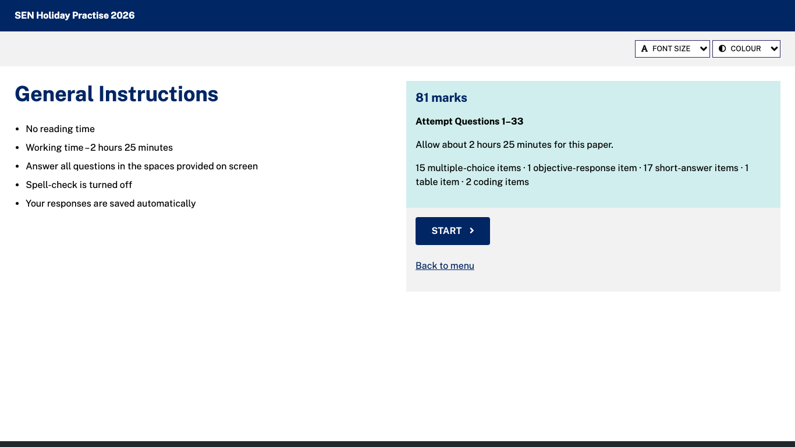
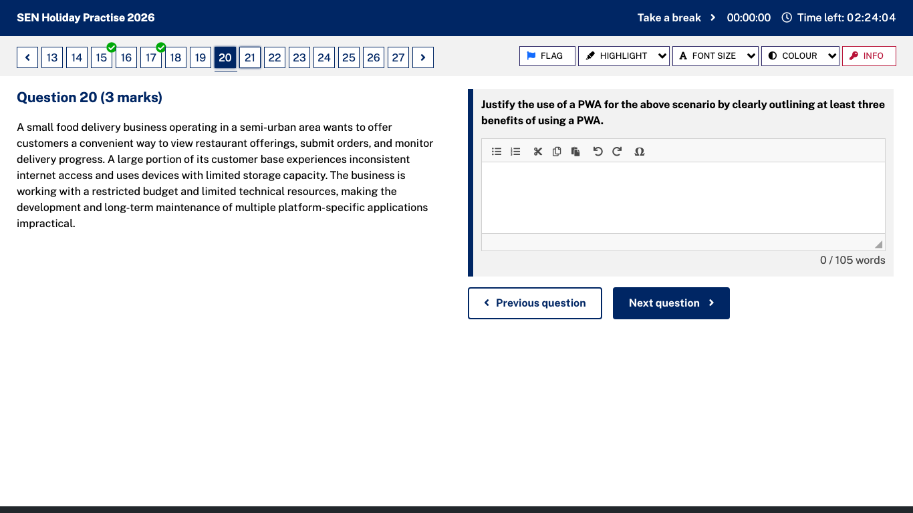
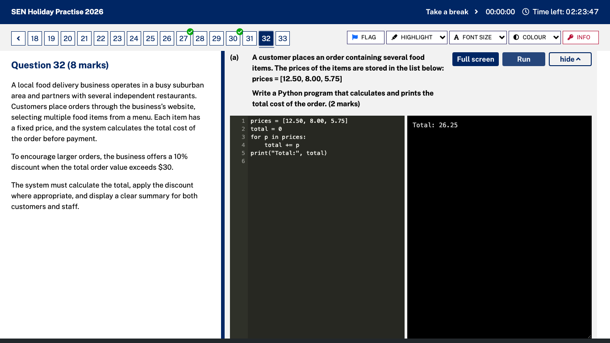
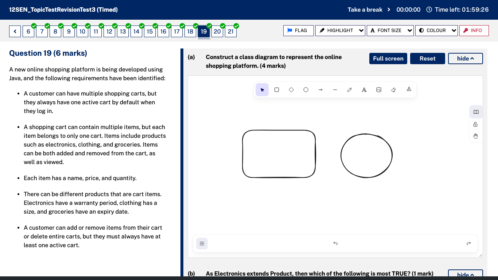
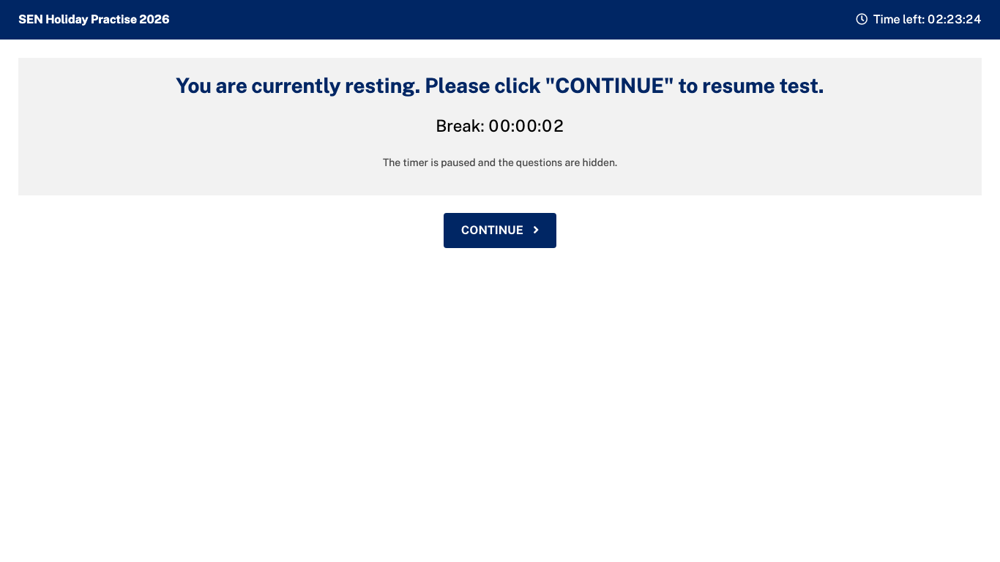
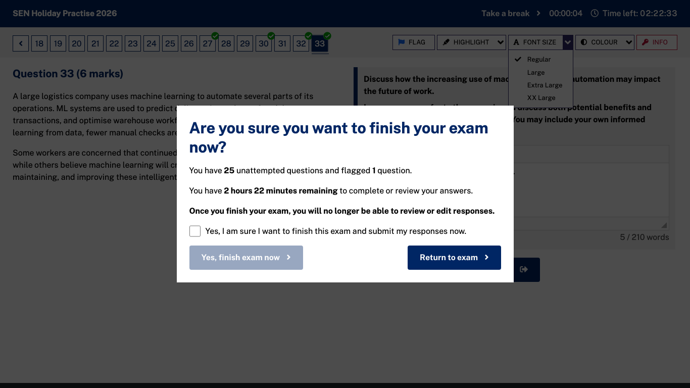
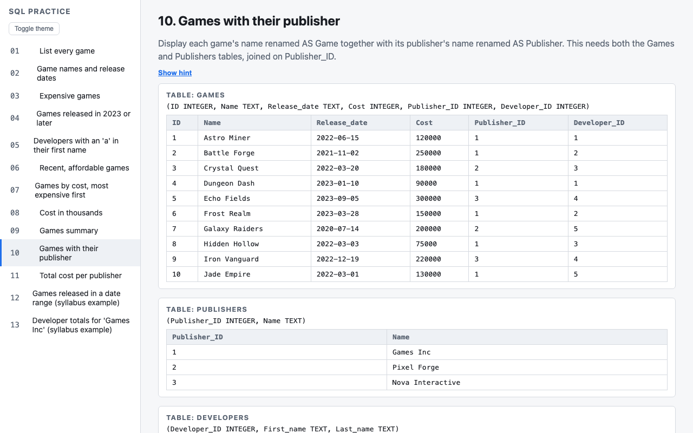
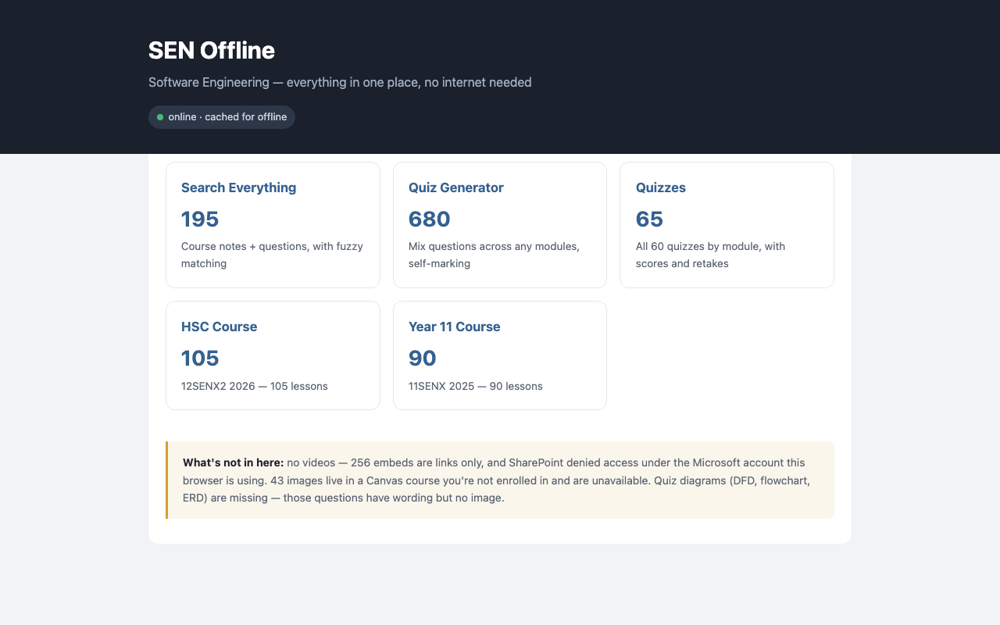
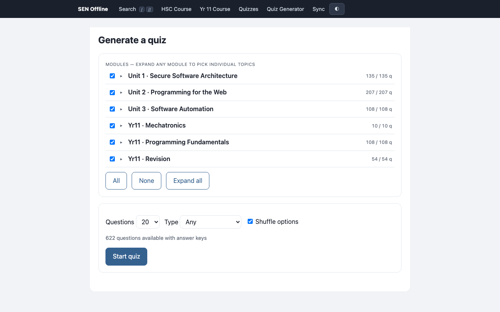

# HSC Software Engineering — study kit

Everything I used to prepare for the 2026 HSC Software Engineering exam, shared with my class.
It's all here: past papers, every Gradeo paper with marking criteria and sample answers, my own
answers and feedback, an offline exam app that works like NESA's, a SQL trainer, a pseudocode
checker, and a marking skill for Claude that's been tested against our teacher's real marks.

This will come down after the HSC.

## Quick start

You need **Node.js** (nodejs.org, the LTS version) and **Python 3** (python.org, only for the SQL trainer).
Then copy and paste:

```sh
git clone https://github.com/fredgaffey/hsc-se-study.git
cd hsc-se-study
npm install
npm start
```

That starts all three apps (the first run also sets up the SQL trainer, about a minute). Open:

| App | Link |
|---|---|
| Exam app | http://localhost:7788 |
| SQL trainer | http://localhost:5050 |
| Course site + quiz generator | http://localhost:8765 |

Press **Ctrl-C** in the terminal to stop them. Next time just `cd hsc-se-study` and `npm start`.

No git? Click the green **Code** button on GitHub → **Download ZIP**, unzip it, open a terminal in the
folder and run `npm install` then `npm start`.

## The apps

### Exam app: sit papers like the real online HSC

Styled and laid out like NESA's online HSC exam app: question number bar with ticks and flags,
FLAG / HIGHLIGHT / FONT SIZE / COLOUR / INFO toolbar, stimulus on the left and answer on the right,
reading time, **Take a break** (pauses the timer), word counts, and NESA's finish window.
Every Gradeo paper in this repo is in the menu, plus any PDF you drop into `papers/`.
Python questions run in the browser, SQL questions run against the question's own data, and drawing
questions use Excalidraw (the same tool NESA uses). Spell-check is off, as in the real exam.

**Questions from Claude:** Claude can write a one-off set of questions for you with
`node exam-app/drill.mjs spec.json` (format at the top of that file). It appears under **From Claude** in
the menu. Answer it in the exam layout, and Claude reads your answers from `papers/attempts/`.

When you finish, your answers are saved to `papers/attempts/<name>.md`, ready to mark yourself
against `gradeo_out/exams/<paper>/exam.md` or to give to Claude with `skills/hsc-marking`.

| | |
|---|---|
|  |  |
|  |  |
|  |  |

**The real 2025 HSC paper:** NESA's own familiarisation app at https://fam.hsconline.nesa.nsw.edu.au/
lets you sit the actual 2025 HSC Software Engineering paper in the real exam interface. Mark it with
`papers/marking/2025 HSC - Marking Guidelines (official).pdf` (don't open the full-mark samples
until you've sat it).

### SQL trainer: 13 tasks on the course specification's database

Write a query, press Run, and it checks your result against the answer. NESA's word operators
(`GREATER THAN`, `CONTAINS`…) work as well as symbols.



### Course site: every Canvas lesson, plus a quiz generator

195 lessons from the Year 11 and HSC courses, search across everything, and a quiz generator over 680
questions (pick modules, number of questions and question types; it marks itself).





## HSC Podcast (audio revision)

[`hsc-podcast/`](https://github.com/fredgaffey/hsc-podcast) is a **git submodule**: the HSC Podcast app, which turns study notes into podcast-style audio. Its Software Engineering transcripts (166 episodes: syllabus points + case studies, ~505k words), notes, quizzes and glossary are in `hsc-podcast/content/software/`.

```bash
git clone --recurse-submodules https://github.com/fredgaffey/hsc-se-study.git   # includes the podcast and textbook
# already cloned?
git submodule update --init
```

To build the app with audio, follow the README inside `hsc-podcast/`.

## Software Engineering textbook

[`textbook/`](https://github.com/fredgaffey/Software-Engineering-HSC-Textbook) is a **git submodule**: a Software Engineering HSC textbook covering the whole syllabus, built with MkDocs.

**Credit:** this textbook was written by **[Eatham532](https://github.com/Eatham532)**. The original is **[Eatham532/Software-Engineering-HSC-Textbook](https://github.com/Eatham532/Software-Engineering-HSC-Textbook)** (MIT License, © 2025 Eatham532), and the submodule is my fork of it. Read the original online at **https://eatham532.github.io/Software-Engineering-HSC-Textbook/**. If it helps you, star their repo.

To build it locally, follow the README inside `textbook/` (a standard MkDocs project: install the requirements, then `mkdocs serve`).

## My major works (worked examples)

- [`major-project/`](major-project): Software Engineering major project (**full marks**): final documentation, complete logbook, diagrams, Gantt chart and a 15-minute walkthrough video.
- [`dt-major-work/`](dt-major-work): Design & Technology major work folio for the same project (**SHAPE nomination**).

## Example major project: L Flip

[`lflip/`](https://github.com/fredgaffey/Lflip) is a **git submodule**: my Year 12 Software Engineering / D&T major project. A learner-driver logbook app with smart L-plate hardware: a PWA plus native (Capacitor) app, a Flask + SQLite + SQLAlchemy back end with JWT auth, and ESP32 boards that log GPS trips and flip the plates over Bluetooth. Use it as a worked example of a full-stack project: requirements, data storage, auth, APIs and hardware integration.

## What's where

| Folder | What it is |
|---|---|
| `exam-app/` | Offline exam app styled like NESA's online HSC exam. Sit any Gradeo paper or a PDF paper with a timer, reading time, rest breaks (pauses the timer), flagging, spell-check off. Answers autosave to `papers/attempts/`. |
| `gradeo_out/exams/` | Every Gradeo paper: questions, images, videos, marking criteria, rubrics, sample answers. `exam.md` is the readable version, `exam.json` the data. Start at `gradeo_out/INDEX.md`. Includes my answers, marks and Sir's feedback. |
| `private_papers/` | **12 trial papers** (CSSA 2025, Normanhurst, Merewether, Girraween, North Sydney Boys, Independent, NSW SE, DoE, NESA sample and familiarisation, CSSA familiarisation, a prelim paper) with answer keys and criteria where available. Sit them in the exam app under **Trial papers**. |
| `notes/` | Shared notes: Programming for the Web, Software Automation (Word + PDF), and a syllabus checklist spreadsheet. Sources in `notes/SOURCES.txt`. |
| `papers/` | NESA Sample HSC Exam (PDF/DOCX). `papers/marking/` has the official marking guidelines for it and for the 2025 HSC, plus the 2025 full-mark sample answers. |
| `practice/QUEUE.md` | 115 written questions from every paper, ordered for practice (extended responses and legal/ethical first). Answers are in `practice/key.json` — don't peek. |
| `worksheets/` | SQL, schema, data dictionary, DFD, decision tree, UI/UX and network diagram questions with answers, plus course notes. |
| `canvas/` | The Year 11 and 12 Canvas course: 195 lessons, 680 quiz questions with answers, quiz generator. Open `canvas/index.html` via the server above. |
| `sql-app/` | SQL trainer on the course specification's Games/Publishers/Developers database, 13 tasks, accepts NESA words (`GREATER THAN` etc.). |
| `skills/hsc-pseudocode/` | Claude skill + linter for NESA pseudocode syntax (`python3 skills/hsc-pseudocode/scripts/hsc_pseudocode_linter.py file.txt`). |
| `skills/hsc-marking/` | Claude skill for marking answers like our teacher. See `calibration.md` for how well it matches his marks. |
| `course-docs/` | NESA syllabus and course specifications (pseudocode, flowcharts, DFDs, structure charts, class diagrams and more). |
| `REVISION.md` | My revision plan, weak areas and progress log. |

## Using the Claude skills

Copy a skill folder into `~/.claude/skills/` (Claude Code), or upload the folder to a Claude.ai project.
Then ask e.g. *"mark my attempt papers/attempts/<file>.md using the hsc-marking skill"*.

How well the marking matches our teacher (blind test on 48 of his marked answers): every short answer
within 1 mark with a marking guideline, 47/48 without one. Paper totals land within a few marks.

## Exporting your own Gradeo papers

Each of us can pull our own Gradeo results (your answers, marks and feedback):

1. In Chrome, open `chrome://inspect/#remote-debugging` and turn on remote debugging.
2. Log in to platform.gradeo.com.au in that Chrome.
3. `node fetch.mjs` (click **Allow** in Chrome once), then `node build.mjs`.

Output goes to `gradeo_out/`. Papers you've submitted but whose results haven't been released return
"locked" until the teacher releases them.

## Tips that actually moved marks

**Print [`sentence-starters.pdf`](sentence-starters.pdf)**: one page with the sentence starters, question words, how much to write and a checklist.

- About **35 words per mark** and **2 minutes per mark**. Never leave a question blank.
- "Explain" = point → *this is because* → *for example* → *as a result*, linked to the scenario.
- Full sentences, not dot points, even for "identify".
- On "select all that apply", only add a second option if you're sure.
