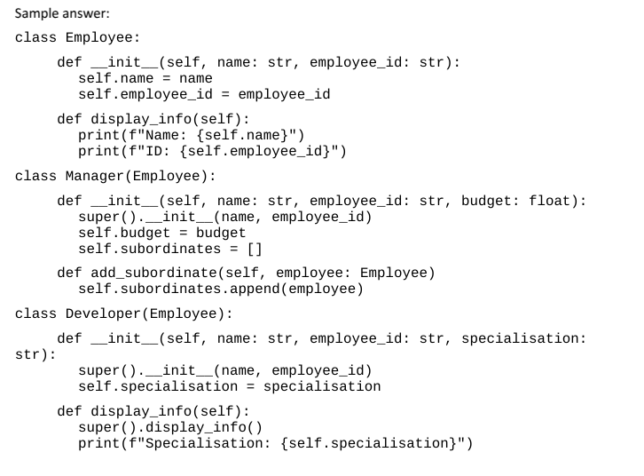

# Generated quiz 2025-08-28 12:04:28

- Syllabus: Software Engineering · Publisher: Gradeo AI
- Status: COMPLETED · submitted 2025-09-01
- **Score: – / 10** · answered 0/2 parts · marked 0/2
- Review page: https://platform.gradeo.com.au/reviewExam/c2b61b7b-102a-482f-a6a7-8cbdb6cac28d

---

## 1. Provide Python implementations (Question 25, ITE 2024 Y11)

**Stimulus:**

Consider the following class diagram which models an employee management system:

You can assume:

-   The display\_info() method prints the properties of the object created from that class.
    
-   The Manager has a property called subordinates which stores an array of Employee objects representing the employees who report to that manager.
    
-   The add\_subordinate() method adds a given Employee object to the subordinates property of that Manager object.
    
-   You do not need to enforce the relationship cardinalities (1..1, 1..\*) between Employee and Manager objects.

#### Question 25 — –/5 marks  `CODING`

Provide Python implementations for each of the Employee, Manager and Developer classes.

**Your answer:**

_(not answered)_

**Marking criteria:**
- [5] Provides correct definitions for ALL of the three classes in Python, providing at least the following for each class:

Employee

__init__ method to initialise and populate the object's properties

display_info method to print the object's properties

Manager

__init__ method calls super then initialises and populates the object's properties

add_subordinate method to append an Employee object to the subordinate array

Developer

__init__ method calls super then initialises and populates the object's properties

display_info method calls super and also prints the specialisation value
- [4] Provides substantially correct definitions for ALL of the three classes in Python, which may contain some minor errors or omissions.
- [3] Provides substantially correct definitions for AT LEAST TWO of the three classes in Python, which may contain some minor errors or omissions.
- [2] An attempt at providing definitions for AT LEAST TWO of the three classes in Python.
- [1] An attempt at providing a definition for AT LEAST ONE of the three classes in Python.

**Marking rubric:**

---

## 2. Pseudocode Algorithm (Question 20, ITE 2024 Y11)

**Stimulus:**

A ‘magic square’ is a grid with a width and height of n, containing the numbers from 1 to n2. Each row, column, and diagonal adds up to the same sum. For example, in the grid below n is 3; the grid contains the numbers 1-9, and every row, column, and diagonal adds up to 15.

#### Question 20 — –/5 marks  `CODING`

Write an algorithm in pseudocode for a function which, when passed a 2D array of integers called “square”, will return True if the square is “magic” and False otherwise.

**Your answer:**

_(not answered)_

**Marking criteria:**
- [5] Creates a substantially correct algorithm, using NESA&rsquo;s format for pseudocode, which attempts all of the following:

Checks the size of the 2D array

Iterates through the 2D array

Calculates the sum for each row and column

Calculates the sum for each diagonal

Returns true if all sums are equal

Returns false otherwise
- [4] Creates an algorithm in pseudocode which attempts at least four of the above criteria.
- [3] Creates an algorithm, or language-specific code, which attempts at least three of the above criteria.
- [2] Creates an algorithm or code which includes some of the required logic for two or more of the above criteria.
- [1] Creates an algorithm or code which addresses some part of the question.

**Marking rubric:**

