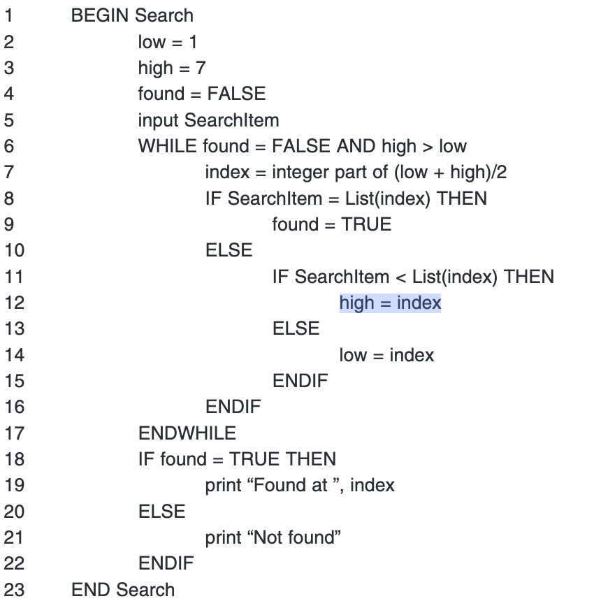
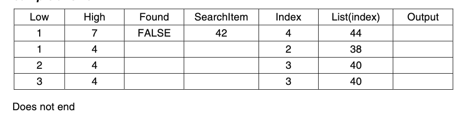

# 12SEN_TopicTestRevisionTest1 (Timed)

- Syllabus: Software Engineering · Publisher: –
- Status: COMPLETED · results released · submitted 2026-04-29
- **Score: 10 / 60** (17%) · answered 26/27 parts · marked 12/27
- Review page: https://platform.gradeo.com.au/reviewExam/ae25c455-7274-4eea-be5c-387d459a61a4

---

## 1. Fundamental Development Steps (MS, TKS 2025)

*Source: TKS 2025*

**Stimulus:**

A development team is preparing for the integration phase of a secure health records system. The system handles sensitive patient data and will interact with external hospital databases.

#### Part A — –/1 marks  `MULTI_CHOICE`

Which THREE of the following practices are most appropriate to ensure secure integration of system components?

- **A.** Refactoring code to improve readability and modularity
- **B.** Testing components in isolation before combining them  ✅ *correct*  ⬅️ **your choice**
- **C.** Writing pseudocode to document component interactions
- **D.** Conducting integration tests focused on access control and data flow  ✅ *correct*  ⬅️ **your choice**
- **E.** Verifying that data is encrypted during inter-component communication  ✅ *correct*  ⬅️ **your choice**

**Your answer:** B, D, E · **Correct:** B, D, E ✔

---

## 2. Security Features (MC, TKS 2025)

*Source: TKS 2025*

#### Part A — 1/1 marks  `MULTI_CHOICE`

A company performs regular security audits on their software. What is the primary reason for these audits?

- **A.** To optimise the software package.
- **B.** To find and fix vulnerabilities before they are exploited  ✅ *correct*  ⬅️ **your choice**
- **C.** To redesign the user interface with a new colour scheme for better appeal
- **D.** To negotiate with hosting providers to reduce monthly server costs over time

**Your answer:** B · **Correct:** B ✔

---

## 3. Social Issues (Q5, 2022 HSC Exam SDD)

*Source: HSC 2022*

#### Part A — 1/1 marks  `MULTI_CHOICE`

Which of the following requires inclusivity to be considered when designing interfaces for a proposed system?

- **A.** Incomplete testing
- **B.** A culturally diverse user base  ✅ *correct*  ⬅️ **your choice**
- **C.** The use of images created by others
- **D.** The storage of sensitive customer data

**Your answer:** B · **Correct:** B ✔

---

## 4. Agile Approach (MC, TKS2025)

*Source: TKS 2025*

#### Part A — 0/1 marks  `MULTI_CHOICE`

How does method tailoring benefit an Agile team?

- **A.** It forces teams to follow a strict process.
- **B.** It allows teams to adjust Agile practices to suit their project.  ✅ *correct*
- **C.** It ensures all documentation is completed before coding begins.  ⬅️ **your choice**
- **D.** It removes the need for communication between team members.

**Your answer:** C · **Correct:** B ✘

---

## 5. Backend Engineering (MC, TKS 2025)

*Source: TKS 2025*

#### Part A — 1/1 marks  `MULTI_CHOICE`

Which of the following best prevents unauthorised access to sensitive user data in a back-end system?

- **A.** Using JWTs to verify user identity  ✅ *correct*  ⬅️ **your choice**
- **B.** Writing front-end code in HTML and CSS
- **C.** Hosting the website on a secure cloud server like AWS
- **D.** Allowing users to access the database directly via URL

**Your answer:** A · **Correct:** A ✔

---

## 6. Difficulties (MC, TKS 2025)

*Source: TKS 2025*

**Stimulus:**

A development team is working on a new web application but encounters a persistent authentication bug that is delaying the release. One of the junior developers suggests searching online for solutions.

#### Part 1 — 1/1 marks  `MULTI_CHOICE`

Which of the following best describes a risk associated with relying on this strategy?

- **A.** Looking online discourages collaboration, which is a core Agile principle
- **B.** Searching online wastes time and is discouraged in professional environments
- **C.** Solutions found online may not always apply directly to the team&rsquo;s specific context  ✅ *correct*  ⬅️ **your choice**
- **D.** Online forums like Stack Overflow are usually monitored by software companies for bugs

**Your answer:** C · **Correct:** C ✔

---

## 7. Big Data (MC, TKS2025)

*Source: TKS2025*

#### Part A — –/1 marks  `MULTI_CHOICE`

What is data mining in big data?

- **A.** Encrypting data for privacy.
- **B.** Storing large amounts of data securely.  ⬅️ **your choice**
- **C.** Scraping the web to create large datasets.  ⬅️ **your choice**
- **D.** Finding useful patterns and insights in big datasets.  ✅ *correct*

**Your answer:** B, C · **Correct:** D ✘

---

## 8. Web Browsers (MC, TKS2025)

*Source: TKS2025*

#### Part A — 1/1 marks  `MULTI_CHOICE`

How can developer tools in web browsers help optimize website performance?

- **A.** Profile scripts and monitor requests.  ✅ *correct*  ⬅️ **your choice**
- **B.** Create backups of server files and databases regularly.
- **C.** Automatically compress and resize images for faster loading.
- **D.** Disable JavaScript to test website functionality without scripts.

**Your answer:** A · **Correct:** A ✔

---

## 9. Open-Source Software (MC, TKS2025)

*Source: TKS 2025*

#### Part A — 1/1 marks  `MULTI_CHOICE`

How does community collaboration improve open-source web tools?

- **A.** It guarantees all contributions are high quality.
- **B.** It ensures the software stays small and simple.
- **C.** It allows more users to test, report bugs, and suggest improvements.  ✅ *correct*  ⬅️ **your choice**
- **D.** It reduces the need for testing by spreading development across many people.

**Your answer:** C · **Correct:** C ✔

---

## 10. Web Shell Scripting (MS, TKS2025)

*Source: TKS2025, North Parramatta*

#### Part A — 1/1 marks  `MULTI_CHOICE`

Which of the following best describes a shell script?

- **A.** A file that contains only images and sound clips
- **B.** A programming language used to develop modern mobile apps
- **C.** A set of CSS rules to style a web page
- **D.** A series of instructions to run on the command line  ✅ *correct*  ⬅️ **your choice**

**Your answer:** D · **Correct:** D ✔

---

## 11. SQL Query Results (Yr12, CT, TKS2025)

*Source: TKS 2025*

**Stimulus:**

The following table represents a database at a book store:

| **BookID** | **Title** | **Author** | **Year** |
|---|---|---|---|
| 201 | The Hobbit | J.R.R. Tolkien | 1937 |
| 202 | 1984 | George Orwell | 1949 |
| 203 | Brave New World | Aldous Huxley | 1932 |
| 204 | Dune | Frank Herbert | 1965 |
| 205 | Animal Farm | Geroge Orwell | 1945 |

#### Part A — 0/2 marks  `RICH_TABLE`

The following SQL query is run to test the database.

**SELECT Title, Year**  
**FROM Books**   
**WHERE Author <> 'Geroge Orwell'**  
**ORDER BY Year ASC**

Fill in the table below with the result of running the SQL query. You may not need to use all the rows or columns.

|  |  |  |  |
|---|---|---|---|
|  |  |  |  |
|  |  |  |  |
|  |  |  |  |

**Sample answer:**

| **Title** | **Year** |
|---|---|
| Brave New World | 1932 |
| The Hobbit | 1937 |
| Dune | 1965 |

---

## 12. Additional Solutions (SA + MC, TKS 2025)

*Source: TKS 2025
*

**Stimulus:**

A development team is creating a mobile app to help users track their daily water intake. While the app prototype functions correctly, user feedback reveals that the interface is cluttered and confusing. Users struggle to locate key features like the daily goal tracker and hydration reminders.

#### Part A — –/3 marks  `SHORT`

Describe how the principle of consistency could be applied to improve the user interface of the app.

*Word limit: 125*

**Your answer:**

> The princiole of concistance could be aplied so that the app is concistnt with outher simlar app this means that the app would be more intuitve. for example using a simler layout 
> 
> THIS IS A GUESS NEED TO LEARN

*(39 words)*

**Marking criteria:**
- [3] Clearly describes how the principle of consistency could be applied to improve the user interface of the app.
- [2] Outlines how the principle of consistency could be applied to improve the user interface of the app.
- [1] Provides some relevant information.

**Sample answer:**

Consistency in UI design means using uniform visual elements (such as colours, fonts, and icons) and predictable interaction patterns across the app. By applying consistency, the team could ensure that similar features look and behave the same way throughout the app. For example, placing all tracking tools in a similar layout or using the same icon style for reminders would help users recognise and navigate features more easily, reducing confusion.

#### Part B — 1/1 marks  `MULTI_CHOICE`

Which of the following best demonstrates the principle of consistency in UI design?

- **A.** Changing the interface design regularly to keep users engaged with new visuals
- **B.** Placing navigation menus in different locations depending on the feature being used
- **C.** Applying the same font, colour scheme, and layout structure across all screens in the app  ✅ *correct*  ⬅️ **your choice**
- **D.** Using different button styles and colours for each screen to make the app visually dynamic

**Your answer:** C · **Correct:** C ✔

---

## 13. Testing and Evaluating (OR, TKS 2025)

*Source: TKS 2025*

#### Part A — 1/2 marks  `OBJECTIVE_RESPONSE`

Match the appropriate testing methodology to its definition.

| Statement | Correct | Yours | |
|---|---|---|---|
| Confirming that the software meets the business requirements and is ready for deployment. | Acceptance Testing | Acceptance Testing | ✔ |
| Testing individual components or functions of the code in isolation. | Unit Testing | Unit Testing | ✔ |
| Verifying that the entire application functions as expected in its environment. | System Testing | Integration Testing | ✘ |
| Ensuring that different modules work together correctly. | Integration Testing | System Testing | ✘ |

---

## 14. Feedback (SA, TKS 2025)

*Source: TKS 2025*

#### Part A — –/3 marks  `SHORT`

Describe two steps involved in analysing feedback during software development.

*Word limit: 120*

**Your answer:**

> 1.  catorgrisination you need goupe in to cahprgray like UI impovments, bugs, authication isues 
> 2.  adressing the isute based on sevrity 
> 
> IRK

*(20 words)*

**Marking criteria:**
- [3] Clearly describes two steps involved in analysing feedback during software development.
- [2] Outlines AT LEAST ONE step involved in analysing feedback during software development.
- [1] Provides some relevant information

**Sample answer:**

One step in analysing feedback is categorisation, where feedback is sorted based on its source such as user, stakeholder, peer, or automated. This helps developers prioritise feedback appropriately, ensuring that critical issues like user-reported bugs are addressed before less urgent suggestions. Another step is impact analysis, which involves evaluating how implementing the feedback will affect the software’s architecture, performance, or user experience. This helps developers avoid introducing new problems and ensures that changes lead to meaningful improvements.

---

## 15. Language Dependent Optimsation (MC + SA, TKS 2025)

*Source: TKS 2025*

**Stimulus:**

A developer is improving the performance of a program by replacing a slow sorting algorithm with a more efficient one. Later, they also rewrite parts of the code using Python specific features like list comprehensions and built-in functions.

#### Part A — 1/1 marks  `MULTI_CHOICE`

Which statement best describes the types of optimisation being used?

- **A.** Both techniques are language independent because they improve performance.
- **B.** Both techniques are language dependent because they involve changes to the code.
- **C.** The sorting algorithm change is language independent, while the use of Python pecific features is language dependent.  ✅ *correct*  ⬅️ **your choice**
- **D.** The use of Python specific features is language independent, while the sorting algorithm changes are language dependent.

**Your answer:** C · **Correct:** C ✔

#### Part B — –/3 marks  `SHORT`

Explain the difference between language independent and language dependent optimisation techniques.

*Word limit: 140*

**Your answer:**

> A langage spicific optimisaion is where you take advantage of a feure of a the langage like list comprhensin in python this will use the copiled c utils that file that will run this is where you use the langae better. 
> 
> A langage indepedint optimsatin is where the programmer uses better programitcal tools to make there program pform better like for examl useing a linked list vs a itrating over a array of {key:value,...} is faster then \[\[key,value\],...\] as it is got a lower time complexity. or ueing a faster alrthom.

*(91 words)*

**Marking criteria:**
- [3] Explain the difference between language independent and language dependent optimisation techniques.
- [2] Outlines a difference between language independent and language dependent optimisation techniques.
- [1] Provides some relevant information.

**Sample answer:**

Language-independent optimisation refers to techniques that can be applied across most programming languages. These include improving algorithm efficiency, reducing redundant code, and using better data structures. For example, replacing a slow sorting algorithm with a faster one improves performance regardless of the language used. Language-dependent optimisation involves using features specific to a particular language to enhance performance. In Python, this could include using list comprehensions, built-in functions like map() or sum(), or leveraging libraries like NumPy for faster numerical operations. By combining both approaches, a developer can write code that is both efficient in general and tailored to the strengths of the language being used.

---

## 16. Generating Solutions (SA, TKS 2025)

*Source: TKS 2025*

#### Part 1 — –/4 marks  `SHORT`

Which type of testing focuses on verifying that individual components or functions of a program work as expected?

*Word limit: 150*

**Your answer:**

> If a algrytim is effint to run it will use less cpu and or memory this means that it cost less to run. 
> 
> if the agrythem i scaleabel this means that the it can me scaled horozontaly this is cheaper and also can run on mulabel screens 
> 
> the binfets of this is a sofwhere engenring progect is that the profitmargins will be bigger and also that the user can grow and not incorr the large cost for the users

*(79 words)*

**Marking criteria:**
- [4] Clearly explains how the concepts of algorithm efficiency and scalability impact the success of a software engineering project.
- [3] Describes how the concepts of algorithm efficiency and scalability impact the success of a software engineering project.
- [2] Outlines how algorithm efficiency and scalability can affect the outcome of a software engineering project.
- [1] Provides some relevant information.

**Sample answer:**

Algorithm efficiency and scalability are critical factors that greatly impact the success of a software engineering project. Efficiency ensures that the program runs quickly and responds in a timely manner, which is crucial for user satisfaction and system performance. Scalability ensures that the program can handle growth, whether it is an increase in data size, user load, or complexity, without degradation in performance. Ignoring efficiency can lead to software that is slow or resource-intensive, making it frustrating for users and potentially leading to system crashes. For example, an inefficient algorithm in a real-time application, such as stock trading software, could result in delayed transaction processing, causing financial losses. Similarly, neglecting scalability can result in software that cannot cope with increasing demand, such as an e-commerce platform that crashes during peak shopping times. This not only results in lost sales but also damages the company's reputation. By prioritising these concepts during the design phase, software engineers can create robust, reliable, and user-friendly software solutions.

---

## 17. Programming - ASCII Encode (Sequence, 2025 TKS)

*Source: TKS 2025*

#### Part A — –/3 marks  `CODING`

Write a Python program that takes a string entered by the user and then encodes it by shifting it one letter forward. Your answer must be **all letters.** 

You only need to consider **lowercase** characters. 

Note that the ASCII number for 'a' is 97.

**Your answer:**

```python
sr = input("> ")
out = ""
for i in sr: 
  out += chr(ord(i)+1)
print(out)
  
```

**Marking criteria:**
- [3] Provides a substantially correct algorithms that includes the following features:

Uses input to obtain a lowercase string from the user
Uses ord() to convert characters to ASCII values
Increments the ASCII value of each character by 1 (accounting for 'z' to 'a')
Uses chr() to convert back to characters and constructs the new encoded string.
Correctly outputs the encoded string
- [2] Provides an algorithm that includes most key features, but has minor logic or syntax errors that do not significantly impact the outcome
- [1] Provides an algorithm that addresses some key aspects of the task (e.g. correctly converts or encodes some characters, loop may be flawed)

**Sample answer:**

text = input("Enter a lowercase word: ")  
encoded = ""  
  
for char in text:  
    ascii\_val = ord(char)  
    if ascii\_val == (97 + 25):  # Check if it's 'z'  
        new\_char = chr(97)     # Wrap around to 'a'  
    else:  
        new\_char = chr(ascii\_val + 1)  
    encoded += new\_char  
  
print("Original string:", text)  
print("Encoded string:", encoded)

---

## 18. Web elements (SA, TKS 2025)

*Source: TKS 2025*

#### Part 1 — –/3 marks  `SHORT`

Explain the role of server-side technologies in web application development.

*Word limit: 130*

**Your answer:**

> the role is to help the with the running hard calulatins on the server as this is faster for the user vs client side

*(24 words)*

**Marking criteria:**
- [3] Clearly explains the role of server-side technologies in web application development.
- [2] Somewhat explains the role of server-side technologies in web application development.
- [1] Provides a limited explination of some concepts relating to server-side technologies.

**Sample answer:**

Server-side technologies play a critical role in web application development by handling the back-end operations such as data processing, server communication, and database interactions that support the client-side components of an application. One such technology is Django, a high-level Python framework that encourages rapid development and a clean, pragmatic design. It specialises in providing robust request handling capabilities with its middleware and view dispatcher system. Django also excels in authentication through its built-in User model and comprehensive authentication system that handles user registration, login, logout, password management and permissions efficiently.

---

## 19. Development (SA, TKS 2025)

*Source: TKS 2025*

#### Part A — –/3 marks  `SHORT`

A small software company is developing a web app on a limited budget.

Explain two ways the team can optimise their resource allocation to meet deadlines without overspending.

*Word limit: 90*

**Your answer:**

> they can use ajile developemt is better sutied to a small team also is more time efffint thus saving money 
> 
> the use of git this allow for less emaling back and forthe zip files
> 
> they can use ai acellrated devlopem insed of each member of staff wriing each line of code they give ai a artecture paln and then revew its work

*(62 words)*

**Marking criteria:**
- [3] Clearly explains two valid ways to optimise resource allocation with relevant examples.
- [2] Explains one optimisation method with detail or two methods with limited detail.
- [1] Mentions optimisation generally but lacks specific examples or clarity.

**Sample answer:**

The team can prioritise critical tasks by focusing resources on essential features first, delaying less important ones until later. This ensures key functions are delivered on time. They can also outsource specialised tasks, like UI design, to freelancers rather than hiring full-time staff, reducing salary costs. Additionally, overlapping activities such as testers preparing test cases during development saves time. Monitoring progress regularly allows adjustments to resource use, preventing bottlenecks or wasted effort. These strategies help balance limited financial and human resources while maintaining project deadlines.

---

## 20. Algorithms / Testing (Q28, 2021 HSC Exam SDD)

*Source: HSC 2021*

**Stimulus:**

A student, attempting to perform a binary search on an array called List with 7 elements, wrote the following algorithm.

The algorithm contains errors.



#### Part A — –/3 marks  `SHORT`

The contents of List are shown


Perform a desk check of the algorithm using the value 42 for SearchItem

**Your answer:**

> loop for ever

*(3 words)*

**Marking criteria:**
- [3] Provides a substantially correct desk check, indicating a never-ending loop
- [2] Provides a desk check, indicating a never-ending loop
- [1] Shows some understanding of desk checking

**Sample answer:**



#### Part B — –/2 marks  `SHORT`

The logic is not correct in lines 12 and 14 of the algorithm. 

Modify these lines so that the logic is correct

**Your answer:**

> low = index
> 
> ELSE
> 
>    high = index

*(7 words)*

**Marking criteria:**
- [2] Proivdes the correct logic
- [1] Demonstrates some understanding of the problem

**Sample answer:**

Line 12 high = index –1  
Line 14 low = index +1

---

## 21. Frontend Code Libraries (SA, TKS2025)

*Source: TKS 2025*

#### Part A — –/2 marks  `SHORT`

Explain how front-end frameworks improve development speed in building web applications.

*Word limit: 40*

**Your answer:**

> it reduse the amout to boiler plate code that the develper has to write. this redueses the LOC that they have to wrie. in aditon it will also provid nice fetues ionic for example has v-for this is a loop in the 'HTML' this makes it much faster

*(48 words)*

**Marking criteria:**
- [2] Correctly explains a way in which front-end frameworks improve development speed in building web applications.
- [1] Provides some relevant information.

**Sample answer:**

Front-end frameworks improve development speed by offering ready-made components and structures that developers can reuse. This reduces the amount of manual coding needed and helps quickly assemble user interfaces, speeding up the overall build process.

---

## 22. PWAs (SA, TKS 2025)

*Source: TKS 2025*

#### Part A — –/3 marks  `SHORT`

Explain how this automated car park barrier system demonstrates the integration of hardware and software components in mechatronics.

In your response, analyse how the different types of sensors work together to provide system inputs, describe how the actuators respond to create the desired physical outputs, and discuss the role of the programmable controller in coordinating all system components.

*Word limit: 90*

**Your answer:**

> the ui principle of consitancy this is where you keep your ui colur and font the same (or simlalr) over time 
> 
> the ui priciple of BRB (big red button) you make the thing that you want the user to do clear big bright coulers in th middle of the screen 
> 
> using these priciple it dictats that how the couler shoud be chosen

*(62 words)*

**Marking criteria:**
- [3] Clearly explains two relevant UI/UX principles with accurate details.
- [2] Explains one principle well and another partially.
- [1] Provides limited or vague information about UI/UX principles.

**Sample answer:**

When designing the font for a PWA, readability is essential. Fonts should be clear and legible across different devices and screen sizes, avoiding overly decorative styles that may reduce clarity. Using web-safe fonts or Google Fonts ensures consistent display and performance. For colour, maintaining sufficient contrast between text and background improves visibility, especially for users with visual impairments. This also supports accessibility standards like WCAG. Colour schemes should align with branding and evoke the right emotions, while also avoiding reliance on colour alone to convey important information, ensuring inclusivity for colour-blind users.

---

## 23. Security Strategy & Tools (SA, TKS 2025)

*Source: TKS 2025*

#### Part A — –/4 marks  `SHORT`

Explain the purpose of a vulnerability assessment in system security.

*Word limit: 150*

**Your answer:**

> the pourpos of a vunriblity assment is to clealy idintifi, quantifi, and prioritise. to lead to the reolution of fixing of vuriblitys.
> 
> this allows the developmet team to address the most impoant vuribileiy first so that there time is spent in the best possable way.

*(45 words)*

**Marking criteria:**
- [4] Clearly explains the purpose of a vulnerability assessment in system security.
- [3] Describes why vulnerability assessments are used in system security.
- [2] Outlines a reason why vulnerability assessments are used in system security.
- [1] Provides some relevant information.

**Sample answer:**

A vulnerability assessment is a critical process in system security that aims to identify, evaluate, and prioritise weaknesses within a system. Its main purpose is to ensure that potential security flaws are detected early, allowing developers and security teams to take proactive measures before these vulnerabilities can be exploited. The process typically begins with identifying possible vulnerabilities through scans or manual checks. These findings are then analysed to understand the risks they pose, including the likelihood of exploitation and the potential impact on system operations. A risk assessment follows, helping prioritise which vulnerabilities require immediate attention. Finally, remediation strategies are implemented, such as patching software, changing configurations, or introducing preventive controls. By systematically addressing vulnerabilities, organisations can strengthen their security posture, reduce the risk of data breaches, and maintain the integrity and reliability of their systems.

---

## 24. Social, Ethical & Legal (ER, TKS 2025)

*Source: TKS 2025*

**Stimulus:**

A video on data privacy shows how companies collect and use personal information from users online. This raises social, ethical, and legal concerns about consent, security, and misuse of data.

[▶ VIDEO (open this file)](assets/e1aed016-9cf8-4b65-a25f-a79c6142bad6.mp4)

Video Credit: Netwrix.com

#### Part A — –/8 marks  `SHORT`

Evaluate the impact of data privacy concerns on individuals and organisations, making reference to the social, ethical, and legal issues involved.

*Word limit: 500*

**Your answer:**

**Marking criteria:**
- [7-8] Demonstrates a comprehensive understanding of data privacy

Effectively links social, ethical, and legal issues to impacts on individuals and organisations

Integrates detailed and relevant examples, including legislation or case studies

Provides sustained evaluation and well-structured analysis
- [5-6] Demonstrates a sound understanding of data privacy

Explains social, ethical, and legal issues in detail

Provides relevant examples and considers impacts on individuals and organisations

Some evaluation of issues is evident
- [3-4] Demonstrates a basic understanding of data privacy

Describes some social, ethical, or legal issues, but unevenly

Uses simple or partially relevant examples
- [1-2] Provides limited information about data privacy

May identify a social, ethical, or legal issue with little detail

Examples, if present, are minimal or irrelevant

**Sample answer:**

Data privacy is one of the most significant challenges in the digital age, affecting both individuals and organisations. The collection of personal information by companies creates major social, ethical, and legal issues that influence how technology is developed and used.

From a social perspective, privacy breaches can erode trust between users and organisations. If personal information such as location data or browsing habits is shared without consent, individuals may feel vulnerable and exploited. This can discourage people from engaging with online platforms and create anxiety about constant surveillance. At the same time, responsible data use can provide social benefits, such as personalised recommendations and improved services, highlighting the need for balance.

Ethical issues also emerge around consent and fairness. Many companies collect data through lengthy terms and conditions that most users do not read or fully understand. Ethically, this raises questions about whether consent is truly informed. Additionally, there is debate over the fairness of companies profiting from user data without providing clear benefits to the individuals whose information is being sold. Ethical responsibility requires organisations to be transparent and accountable in their handling of personal information.

Legal issues are central to regulating data privacy. In Australia, the Privacy Act 1988 and the Notifiable Data Breaches scheme require organisations to handle personal data responsibly and report breaches. Internationally, regulations such as the European Union’s General Data Protection Regulation (GDPR) enforce stricter standards for consent and data storage. However, enforcement can be inconsistent, especially across global digital platforms.

Overall, data privacy impacts society at multiple levels. Individuals risk harm when data is misused, while organisations face reputational and legal consequences if they fail to protect it. Evaluating these social, ethical, and legal issues highlights the importance of stronger regulation and ethical responsibility in safeguarding personal information.
