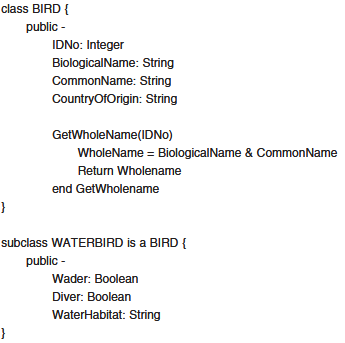
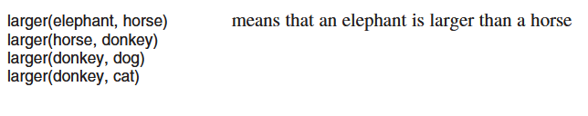
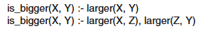
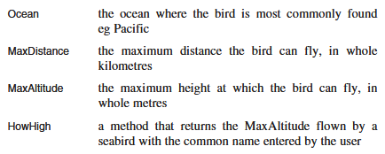
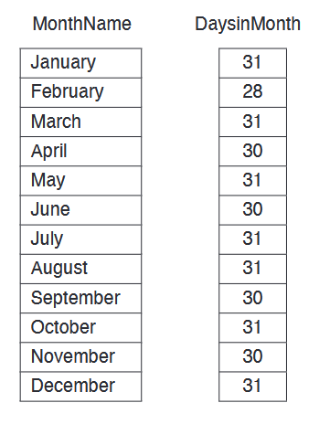
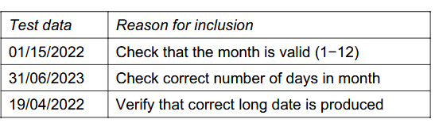
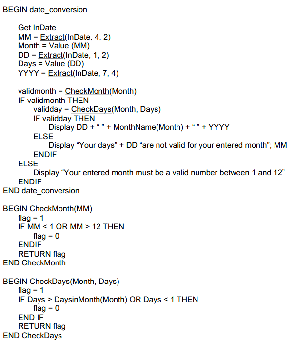
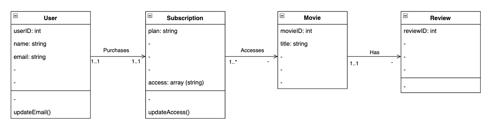
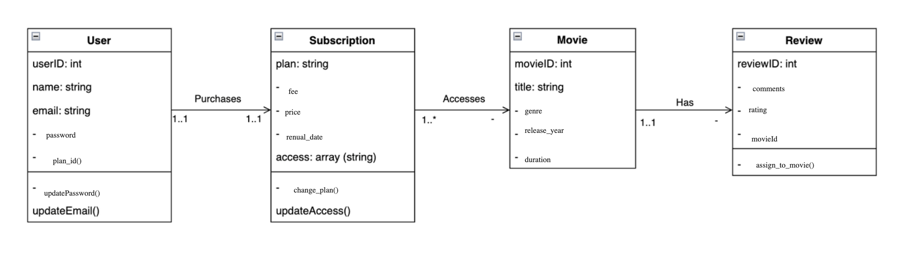

# 12SEN_TopicTestRevisionTest2 (Timed)

- Syllabus: Software Engineering · Publisher: –
- Status: COMPLETED · results released · submitted 2026-05-03
- **Score: 40 / 60** (67%) · answered 24/24 parts · marked 24/24
- Review page: https://platform.gradeo.com.au/reviewExam/1a625df8-374d-41cc-8646-d8297fd73555

---

## 1. Enterprise Benefits (MS, TKS 2025)

*Source: TKS 2025*

**Stimulus:**

A software enterprise is reviewing its long-term strategy. It wants to gain the most benefit from implementing secure development practices across all future projects.

#### Part A — 1/1 marks  `MULTI_CHOICE`

Select TWO benefits the company is most likely to achieve

- **A.** Developers will no longer need to perform manual testing.
- **B.** The company can eliminate the need for any external penetration testing.
- **C.** Security becomes embedded in company culture, improving future development.  ✅ *correct*  ⬅️ **your choice**
- **D.** Secure components can be reused across projects, increasing development speed.  ✅ *correct*  ⬅️ **your choice**

**Your answer:** C, D · **Correct:** C, D ✔

---

## 2. Yr12 Data Structures - Arrays (MC5, 2024 HSC SDD Exam)

#### Part A — 1/1 marks  `MULTI_CHOICE`

Which of the following describes data that would best be stored in an array of floating point/real numbers?

- **A.** Dice rolls that are randomly generated for a game
- **B.** The average daily temperature for each day in 2024  ✅ *correct*  ⬅️ **your choice**
- **C.** Product codes that need to be sorted alphabetically for display
- **D.** Attendance data for a school indicating whether each student was absent or present

**Your answer:** B · **Correct:** B ✔

---

## 3. Cascading Style Sheets (MC, TKS2025)

*Source: TKS2025*

#### Part A — 0/1 marks  `MULTI_CHOICE`

How does CSS help maintain consistent appearance in a web application?

- **A.** It adds server-side validation for user inputs
- **B.** It creates responsive animations  ⬅️ **your choice**
- **C.** It automatically adjusts content structure for different browsers  ⬅️ **your choice**
- **D.** It allows styles to be defined once and applied across multiple pages  ✅ *correct*  ⬅️ **your choice**

**Your answer:** B, C, D · **Correct:** D ✘

**Feedback (TKS CST, 0 marks):** CSS is strictly a frontend styling language so B can't be correct.

While CSS is capable of creating responsive animations and transitions, this is a specific feature rather than the fundamental mechanism that maintains an application's overall consistent appearance. As such C can't be correct either.

---

## 4. Algorithms (Q18, 2023 HSC Exam SDD)

*Source: HSC 2023*

**Stimulus:**

A sort is applied to the array {C,D,A,S,F}

The result of the first pass of the sort is {D,C,A,S,F}

#### Part A — 0/1 marks  `MULTI_CHOICE`

Which of the following will be the result of the next pass?

- **A.**   ⬅️ **your choice**
- **B.**   ✅ *correct*
- **C.** 
- **D.** 

**Your answer:** A · **Correct:** B ✘

**Feedback (TKS CST, 0 marks):** This problem uses the Insertion Sort algorithm to sort the letters in reverse alphabetical order. (You have to infer the type of sort and order based on the info in question)

Pass 1: The algorithm looks at the second letter, D, and moves it in front of C because it comes later in the alphabet. The array becomes {D, C, A, S, F}. The sorted portion of the list is now {D, C}.

Pass 2: The algorithm looks at the next letter, A. It compares A to the sorted portion ({D, C}). Since A comes before both C and D in the alphabet, it is already in the correct spot at the end of that sorted group.

Because A doesn't need to shift forward, the array doesn't visually change during this pass. That is why the correct answer is B {D, C, A, S, F}.

---

## 5. Quality Assurance (MC, TKS 2025)

*Source: TKS 2025*

#### Part 1 — 1/1 marks  `MULTI_CHOICE`

Accessibility standards, like the WCAG, are designed to:

- **A.** Reduce development time.
- **B.** Boost software performance.
- **C.** Limit access to only authorised users.
- **D.** Ensure software is accessible to users with disabilities.  ✅ *correct*  ⬅️ **your choice**

**Your answer:** D · **Correct:** D ✔

---

## 6. PWAs (MC, TKS 2025)

*Source: TKS 2025*

**Stimulus:**

A PWA developer chooses colours with high contrast between text and background and adds alt text for images

#### Part A — 0/1 marks  `MULTI_CHOICE`

Which design principle is being described in the stimulus?

- **A.** Offline caching  ⬅️ **your choice**
- **B.** Flexible layouts
- **C.** Performance optimisation  ⬅️ **your choice**
- **D.** Accessibility and inclusivity  ✅ *correct*

**Your answer:** A, C · **Correct:** D ✘

**Feedback (TKS CST, 0 marks):** The stimulus focuses on two specific actions: using high contrast colours and adding alt text for images. High contrast helps users with low vision or colour blindness read the text, while alt text allows screen reading software to describe images to users who are blind. Both of these practices are all about making the app usable for people with disabilities, which is the definition of Accessibility and inclusivity.

---

## 7. Frontend Code Libraries (MC, TKS2025)

*Source: TKS 2025*

#### Part A — 0/1 marks  `MULTI_CHOICE`

How do frameworks improve the maintainability of large web applications?

- **A.** By encrypting data transfers.
- **B.** By generating UI automatically.  ⬅️ **your choice**
- **C.** By supporting the reuse of components.  ✅ *correct*  ⬅️ **your choice**
- **D.** By storing all project files in a single HTML file

**Your answer:** B, C · **Correct:** C ✘

**Feedback (TKS CST, 0 marks):** Frameworks don't generate the UI for you. Developers still must write the code to define the layout, logic, and styling. Frameworks just provide the structure and tools to render it efficiently.

---

## 8. Developing Secure Code (MC, TKS2025)

*Source: TKS2025*

#### Part A — 1/1 marks  `MULTI_CHOICE`

Which of these would be effective at preventing Cross Site Scripting?

- **A.** Using prepared SQL statements
- **B.** Trust the user to only enter valid input
- **C.** Disable Javascript in the user's browser
- **D.** Sanitising user input to remove special characters  ✅ *correct*  ⬅️ **your choice**

**Your answer:** D · **Correct:** D ✔

---

## 9. Object-Relational Mapping (MC, TKS2025)

*Source: TKS 2025*

#### Part A — 1/1 marks  `MULTI_CHOICE`

Which of the following best describes how an ORM interact with a database?

- **A.** It bypasses the database engine.
- **B.** It sends commands through a web API.
- **C.** It writes data to plain text files for storage.
- **D.** It generates SQL queries based on code objects.  ✅ *correct*  ⬅️ **your choice**

**Your answer:** D · **Correct:** D ✔

---

## 10. Communication Issues (MC, TKS2025)

*Source: TKS 2025*

#### Part A — 1/1 marks  `MULTI_CHOICE`

Which of the following best describes the purpose of regular feedback in software development?

- **A.** To speed up coding and reduce testing.
- **B.** To identify issues early during development.  ✅ *correct*  ⬅️ **your choice**
- **C.** To finalise design decisions before client input.
- **D.** To delay release until feedback is fully analysed.

**Your answer:** B · **Correct:** B ✔

---

## 11. Backend Engineering (OR, TKS 2025)

*Source: TKS 2025*

#### Part A — 2/2 marks  `OBJECTIVE_RESPONSE`

Select the cell that best describes the primary back-end responsibility for each situation. 

Only ONE correct option per row.

| Statement | Correct | Yours | |
|---|---|---|---|
| Logging failed login attempts for later review | Error Handling | Error Handling | ✔ |
| Encrypting sensitive user data before storing it in the database | Security Engineering | Security Engineering | ✔ |
| Using a framework to manage database access and routing | Technology Used | Technology Used | ✔ |
| Sending formatted data from the server to the user interface | Front-End | Front-End | ✔ |

**Marking criteria:**
- [2] Correctly selects all options
- [1] Partially correct selection

---

## 12. Impact of Secure Software (ER, TKS 2025)

*Source: TKS 2025*

#### Part A — 7/10 marks  `SHORT`

Secure software development has become essential for modern enterprises.

Evaluate how collaboration, enterprise-level practices, and awareness of social, ethical, and legal issues contribute to developing safe and secure software.

In your response, refer to specific examples and consider both technical and non-technical impacts on people and organisations.

**Your answer:**

> secure sofwhere development is complex and has many facits recruies comuicant collabratin and a understenign of leagal social and the deffrence between tecnical and nontecnical people.
> 
> when colabratin happens sofwhere becomes more secure. take large proects like luinx or curl. these have a large amout of peoplo working on using git. this resulted in lunx being the moset secure oprating system in the world and curl being the mose secres way to make webrequests. this collabratn where you can use outher peoples well testerd secure code insted of having to reinvent the wheell evry tiime make sofwhere more secre. in adtion when there are lotes of people colabratin like on ssh someonf foud that ssh was a few ns slower slower and this led to them finding a backdoor that somone put in to ssh.
> 
> A cultre of secruty by design this is from regula pshing training in all the eimplyeys in the busuns not just the devs but also admin and the c team. this enterprise levely sercrity by desien mean that secury is not just somting that you do at the end as a after thought but is intergrated through out the whole prosess. this is crucial for the devlopemn of safe softhwere.
> 
> The useeser of softhwer are usealy non tecnical so that needs to be taken in to account so secrity pracits like maule has verifactin is not a good idere (like when you downlod a iso image). This will imvolve them useing the teriminsl the non tecnical midet of the terminl use is that i will get hacted instanly if i use it this is not true but it will seem suspios even if it is a ligitment secrtiy feture. but things like 2FA are becoming more of a social tredn in sosity so this sought  so you s shoiuld allwasys take in to account the tecnical abliy of your useres. 
> 
> there is also a leagl resolnibliy to secure data there are lawas like HIPI and GDPR that make rulse about how data must be stored and kept safe. If you dont follow this you are liabe for fines and the libiley.
> 
> tecnical people in the rognisat get the pourps of things like 2FA but notecnical peopele just think it is a wast of time. so make in seure softhere needs to take in to account tecnical and not tecnial people it is ulimity evryons respomibley. so a atmofher of collabratin a williness to admit your mistakes and culter that is fully on bord with make evryones secure.

*(422 words)*

**Feedback (TKS CST, 7 marks):** Your response shows a solid understanding of the core concepts, particularly with your excellent use of real world examples like open source collaboration catching backdoors, GDPR compliance, and the user experience of security features like 2FA. Additionally, try to expand more on the ethical implications of software development, such as the moral responsibilities businesses have when handling sensitive user data, rather than just focusing on the legal compliance and user frustration aspects.

**Marking criteria:**
- [9-10] Provides a comprehensive evaluation of collaboration, enterprise practices, and social/ethical/legal issues in secure software development. Uses relevant, well-integrated examples. Demonstrates deep understanding of technical and non-technical impacts. Response is well-structured and clearly communicated.
- [7-8] Provides a detailed explanation of most aspects of the question, with relevant examples. Demonstrates good understanding of secure software development and its impacts. May be slightly less thorough or balanced in discussion.
- [5-6] Identifies and explains some relevant elements from at least two of the three key areas (collaboration, enterprise practices, legal/social issues). Examples may be general or underdeveloped. Understanding is sound but lacks depth.
- [3-4] Makes general statements about security practices or related concepts. Shows limited understanding of the specific impacts or lacks coverage of key areas. Few or no examples given.
- [1-2] Attempts to answer the question with minimal relevant content. Misunderstands key ideas or refers only vaguely to secure software.

**Sample answer:**

Secure software development is not just a technical process—it is a multidimensional approach that involves collaboration, enterprise-wide planning, and a deep understanding of social, ethical, and legal considerations. By integrating these elements, organisations can create software that is not only secure, but also resilient, ethical, and aligned with stakeholder expectations.

Collaboration is essential in developing secure software because it draws upon a wide range of perspectives and skills. Security is a complex issue that no single developer or department can address alone. In a collaborative environment, tasks can be delegated based on expertise, which ensures that encryption, authentication, data protection, and testing are handled by individuals with the most relevant skills. For example, in a team developing a banking app, one specialist might focus on secure data transmission while another ensures that multi-factor authentication is implemented effectively. This division of labour not only increases efficiency but also enhances the quality of the final product. In addition, collaboration supports practices like peer review and collective testing, which are crucial for catching vulnerabilities that might be missed by individuals. By integrating diverse viewpoints, teams are more likely to anticipate potential threats and address them proactively.

From an enterprise perspective, implementing safe and secure development practices delivers both immediate and long-term benefits. These include improved product reliability, reduced costs from post-release fixes, enhanced customer trust, and streamlined future development. When security is integrated from the start of the Software Development Life Cycle (SDLC), software is less likely to contain critical vulnerabilities. This reduces the need for emergency patches, minimises downtime, and builds user confidence. For example, a SaaS company that integrates security scanning into its development pipeline can identify and remediate vulnerabilities before deployment. This saves time and money in the long term and reduces the reputational damage that comes from data breaches.

In addition, secure practices influence future development. By standardising secure components, such as authentication libraries and encryption modules, organisations create a reusable security foundation. This not only improves consistency but accelerates development in future projects. Over time, secure development becomes embedded in the organisation's culture, leading to a proactive rather than reactive approach to security.

Equally important are the social, ethical, and legal issues that surround the development and implementation of secure software. Enterprises must consider how their practices affect both individuals and the broader community. For instance, secure software has major implications for employment. While it creates new roles in cybersecurity, it may also lead to the automation of lower-level IT jobs. Ethically, this creates a responsibility for businesses to retrain displaced workers.

Data security and privacy are also key ethical and legal concerns. Users have a right to control their personal information, and software must be designed to uphold this right. Regulations like the GDPR require organisations to obtain consent for data collection, implement access controls, and respond to data requests from individuals. A company that fails to comply not only risks fines but also violates public trust. For example, an online platform that allows users to adjust privacy settings and opt out of tracking demonstrates both legal compliance and ethical respect for user autonomy.

Copyright and intellectual property concerns also shape the secure development process. Developers have legal rights to protect their code, but in some cases, they may choose to license it under open-source terms to support broader innovation. Balancing protection with access is particularly important when secure software has public safety implications.

Finally, secure software contributes to digital disruption. It enables new technologies, such as blockchain or secure cloud services, that transform industries and change how businesses operate. While this can provide a competitive edge, it also challenges traditional models and requires enterprises to adapt quickly.

In conclusion, secure software development is a shared responsibility that relies on effective collaboration, enterprise commitment to best practices, and thoughtful engagement with legal and ethical standards. When these areas are addressed holistically, organisations can deliver software that is not only functional and efficient but also secure, sustainable, and socially responsible.

---

## 13. Programming Paradigms (Q32, 2022 HSC Exam SDD)

*Source: HSC 2022*

**Stimulus:**

For Part B:

Consider the following fragment of code which has been written using the object oriented programming (OOP) paradigm

For Part C:

The following facts have been defined using the logic paradigm.

For Part C (ii): 

The following rules are defined.

#### Part A — 1/2 marks  `SHORT`

Describe abstraction in the context of object oriented programming

**Your answer:**

> abstraction is where you remove deitals and this allows the proramer to remove the unecery detilas. this leads to faster development. like how all road viecals drive but some have diffrent numers of wheels. so you make a parant class that has go stop but the you add the dietas in later.

*(52 words)*

**Feedback (TKS CST, 1 marks):** Your answer shows a basic understanding of hiding unnecessary details, but to improve, you should use precise object-oriented terminology like objects, attributes and methods. Focus your explanation on how abstraction allows a programmer to use an object without needing to understand its complex internal workings, rather than just stating it leads to faster development.

**Marking criteria:**
- [2] Describes abstraction in the context of object oriented programming
- [1] Shows some understanding of abstraction

**Sample answer:**

In OOP, abstraction enables a programmer to make use of an existing object without having to know the detail of all of the attributes or methods of that object

#### Part B (i) — 3/3 marks  `SHORT`

With reference to the fragment of code above, explain the importance of inheritance in the OOP paradigm

**Your answer:**

> Inheratecns i oop is where you can instancate a class from a base calss thiss reduses code duplican. for exampl GetWholeName is difind in the arant calss and then the child class doent have to rewrite that. this lease the faster devlopemnt time and code is easer to dobug.

*(49 words)*

**Feedback (TKS CST, 3 marks):** Looks good.

**Marking criteria:**
- [3] Explains the importance of inheritance in the OOP paradigm

References the code
- [2] Describes the importance of inheritance in the OOP paradigm
- [1] Provides some relevant information

**Sample answer:**

Inheritance enables attributes of a superclass to be automatically assumed by its subclasses, thus saving the programmer from having to redefine them. In this case, the WATERBIRD class will automatically include all of the attributes of the BIRD class.

#### Part B (ii) — 2/3 marks  `SHORT`

Write the code to define a subclass of WATERBIRD called SEABIRD which has the following attributes and method

**Your answer:**

> subclass SEABIRD is a WATERBIRD {
> 
>    public - 
> 
>       Ocean: String
> 
>       MaxDistance: String
> 
>       MaxAltitued: String
> 
> HowHigh(CommonName)
> 
> retrun MaxAltitude
> 
> end HowHigh
> 
> }

*(20 words)*

**Feedback (TKS CST, 2 marks):** Since the specifications indicate that the distance and altitude are represented in whole numbers, MaxDistance and MaxAltitude must be defined as Integers instead of Strings.

**Marking criteria:**
- [3] Writes the code that defines a subclass of WATERBIRD called SEABIRD which has the following attributes and method
- [2] Provides half of the solution
- [1] Shows some understanding of the problem

**Sample answer:**

SUBCLASS SEABIRD IS A WATERBIRD {  
    PUBLIC -  
        Ocean: String  
        MaxDistance: Integer  
        MaxAltitude: Integer

        HowHigh(CommonName)  
            RETURN MaxAltitude  
        END HowHigh  
}

#### Part C (i) — 1/1 marks  `SHORT`

Explain the result of the following query.

  
?- larger(elephant, cat)

**Your answer:**

> it is a elafant 
> 
> a e is larger than a h wihich is larger that a donky and donky is larger then a cat therfor cat

*(26 words)*

**Marking criteria:**
- [2] Explains the result of the following query.
- [1] Shows some understanding of the query

**Sample answer:**

No. Because there is no fact or rule that matches the query.

#### Part C (ii) — 2/3 marks  `SHORT`

Write a query to find animals that are both smaller than a donkey and bigger than a cat

**Your answer:**

> is\_bigger(donky,cat)

*(1 words)*

**Feedback (TKS CST, 2 marks):** Need to consider X too.

Must check two things, Donkey is bigger than X and X is bigger than Cat.

**Marking criteria:**
- [3] Writes a substantially correct query to find animals that are both smaller than a donkey and bigger than a cat
- [2] Writes a query to find animals that are both smaller than a donkey and bigger than a cat
- [1] Demonstrates some understanding of rules or queries in the logic paradigm

**Sample answer:**

? is\_bigger(donkey, X), is\_bigger(X, cat)

---

## 14. Algorithms/Testing (Q32, 2023 HSC Exam SDD)

*Source: HSC 2023*

**Stimulus:**

An algorithm is required to convert a date in DD/MM/YYYY format into its equivalent long date such as 29 October 2023.

The entered date will always be 10 characters and in the format DD/MM/YYYY.

The date is validated as follows:

-   the month must be a valid month (from 1 to 12)
-   the day value must be valid for that month 
-   (for example, no more than 28 for February – ignore leap years).

For Part B:

You may use the following two library routines in your pseudocode:

-   Extract(string, start, N) eg Extract(“Names”, 3, 2) returns “me”
-   Value(string) converts a string to its numerical value eg Value(“42”) returns 42.

You may use the following two arrays (indexed from 1) in your pseudocode

#### Part A — 2/3 marks  `RICH_TABLE`

Refer to the stimulus.

Complete the table with THREE items of test data that test different aspects of the logic of the algorithm.

| Test Data | Reason for inclusion |
|---|---|
| **you:** day = 20 | **you:** test if overlow is allowed |
| **you:** month = 20 | **you:** test if overlow is allowed |
| **you:** day = -10 month = -12 | **you:** test negives |

**Feedback (TKS CST, 2 marks):** Inputs do not match the required format, should be, DD/MM/YYYY

**Marking criteria:**
- [3] Provides THREE items of test data for different aspects of the algorithm, with corresponding reasons for inclusion
- [2] Provides TWO items of test data for different aspects of the algorithm, with some justification
- [1] Demonstrates some understanding of test data relevant to this algorithm

**Sample answer:**

#### Part B — 3/5 marks  `SHORT`

Refer to the stimulus. 

Design an algorithm to validate a date in the form DD/MM/YYYY and output the equivalent long date, eg 29 October 2023.  
 

Include all meaningful error messages to assist the user to understand why their entered date is not valid.

**Your answer:**

> raw = INPUT("enter you date in the follwoing format DD/MM/YYYY")
> 
> day = Value(Extract(raw,1,2))
> 
> month = Value(Extract(raw,3,4))
> 
> year = Value(Extract(raw,6,10))
> 
> day\_ = Extract(raw,1,2)
> 
> month\_ = Extract(raw,3,4)
> 
> year\_ = Extract(raw,6,10)
> 
> #like this will do not neg like bool = -1 
> 
> IF not (day and month and year)
> 
>    DISPLAY "there is a neg"
> 
>    exit
> 
> ENDIF
> 
> IF not year > 0
> 
>    DISPLAY "the year is not valid"
> 
>    exit
> 
> ENDIF
> 
> IF not DaysinMonth(moth) <= day
> 
>    DISPLAY "the days are invlid"
> 
>    exit
> 
> ENDIF
> 
> IF month > 12 
> 
>    DISPLAY "month is not valid"
> 
>    exit 
> 
> ENDIF
> 
> DISPLAY day\_ +" " + MonthName(month) + " " + year\_

*(99 words)*

**Feedback (TKS CST, 3 marks):** Your algorithm demonstrates a good structural attempt at solving the problem, but you need to carefully review the parameters for the Extract routine, as it requires the starting position and the number of characters (N) rather than the start and end index positions. Additionally, your logic for validating the days in a month is reversed and will falsely reject valid dates, and your month validation must also ensure the value is not less than 1.

**Marking criteria:**
- [5] Provides a substantially correct algorithm that addresses the following
features:
&ndash; Validates the inputted date
&ndash; Uses appropriate data structures and library routines
&ndash; Outputs the correct long date
&ndash; Provides meaningful error messages
- [4] Provides a substantially correct algorithm that addresses most of the features
- [3] Provides an algorithm that addresses some of the features
- [2] Provides an algorithm that attempts to address one of the features
- [1] Demonstrates some understanding of the problem

**Sample answer:**

---

## 15. Applications of Web Programming (SA, TKS 2025)

*Source: TKS 2025*

**Stimulus:**

A local bookstore wants to create an interactive website where customers can search for books, submit reviews, and receive personalised recommendations.

#### Part A — 1/3 marks  `SHORT`

Explain two ways an interactive website can improve user experience for this bookstore.

**Your answer:**

> -   the useres dont have to deal with refreshing the page on click of anything 
> -   it is faster and easery to navigate 
> 
> both these make the useres life eaiar

*(28 words)*

**Feedback (TKS CST, 1 marks):** Your response touches on the benefit of faster loading times, but you need to specifically identify two distinct interactive features, such as a book search bar or a customer review section. To improve your answer, clearly state these two features and explicitly explain how each one directly enhances the customer's experience when browsing or buying books on the website, rather than just stating it makes their life easier.

**Marking criteria:**
- [3] Thorough explanation of two distinct interactive features with clear relevance to user experience.
- [2] Some explanation of interactive features, with partial relevance.
- [1] Mentions interactive features but lacks clear explanation or relevance.

**Sample answer:**

An interactive website can improve user experience by allowing customers to search for books easily, providing quick and relevant results based on their input. Additionally, enabling users to submit reviews creates engagement and builds community trust. Personalised recommendations based on past searches or reviews make the experience tailored to individual preferences, encouraging more visits and purchases.

---

## 16. Class Diagrams (Draw/MCQ, TKS 2025)

*Source: TKS 2025*

**Stimulus:**

A company wishes to develop a movie streaming platform uisng Java, an OOP language that manages users, subscriptions, movies, and reviews. It will have the following requirements. 

-   A user must create an account with a unique userID, name, email, and password. They will also have the ability to update their email and password. 
    
-   Each user can have one subscription plan (e.g., Basic, Premium) that determines their streaming quality,  subscription fee and what the user can access. 
    
-   A subscription also has details like plan name, price, and renewal date. 
-   The platform offers a range of movies, each with a title, genre, release year, and duration.
    
-   Users can maintain a watch history, recording what movies or shows they’ve watched and when. They can also add movies to their favourites list. 
    
-   Users can also rate movies on a numerical scale, comments within each review they create and endorse other reviews. Each review can only be assigned to one movie.

#### Part A — 3/4 marks  `DRAWING_V2`

Complete the following task diagram by appending an attribute or method where a (-) exists.

Drawing background provided:

**Your answer:**

Drawing contents (extracted): labels: "password", "updatePassword()", "fee", "price ", "renual_date", "genre\n\nrelease_year\n\n\nduration", "comments", "rating", "movieId", "assign_to_movie()", "change_plan()", "plan_id()"

**Feedback (TKS CST, 3 marks):** Need to specify types of attributes.

**Marking criteria:**
- [4] Accurately constructs a class diagram with minimal errors. This includes showing all attributes, inheritance, relationships and multiplicity.
- [3] Constructs a class diagram with a maximum of two major omissions.
- [2] Constructs a class diagram with a maximum of four major omissions.
- [1] Attempts to construct a class diagram relevant to the scenario.

**Marking rubric:**

Note that there can be variances in the student's relationship descriptions. For instance, using "uses" or "attains" instead of "has".

**Sample answer:**

#### Part B — 1/1 marks  `MULTI_CHOICE`

Which of the following best describes the relationship between Subscription and Movie?

- **A.** One to One
- **B.** One to Many  ✅ *correct*  ⬅️ **your choice**
- **C.** Many to One
- **D.** Many to Many

**Your answer:** B · **Correct:** B ✔

---

## 17. Prototyping (Q21, 2023 HSC Exam SDD)

#### Part A — 2/2 marks  `SHORT`

Outline how a prototype can be used in the development of a software application.

**Your answer:**

> A prototype allow the engenrest to make get ealy feadback so giued the directon of the progect. It can also be used to asses teclnical fisibleiy.

*(26 words)*

**Marking criteria:**
- [2] Demonstrates a sound understanding of the use of prototyping
- [1] Demonstrates some understanding of prototyping

**Sample answer:**

A prototype can be used to show screen design and navigation, to clarify understanding of the system and get client feedback.

---

## 18. UI & UX (ER, TKS 2025)

*Source: TKS 2025*

**Stimulus:**

Below is a video going through the OECD Government at a Glance 2025 dashboard which compares the performance of OECD Countries. 

[▶ VIDEO (open this file)](assets/73db782d-dae0-40f4-8a71-792b46f52d13.mov)

You browser not support video

You browser not support video

Source: The OECD

#### Part A — 4/8 marks  `SHORT`

Evaluate the effectiveness of the above dashboard in communicating its information in terms of its UI and UX.

*Word limit: 400*

**Your answer:**

> -   consitancy 
> -   interactivy 
> 
> This is a exceptnaly well design UI provindeg the usere with a exepltery UX. It is consistant and responcive (it scales to diffent dispays) and it is intuitve. this make the imfomatin on it easey to read and prosess as the user doesnt have to think about how to find out what they need. This siite is also asesable.
> 
> The UI is concistan as it has one coulor scheme all the way throught that is a nice green and blue this makes it feel like a word doument a format that the users is filliar with also this scheem doent hart there eyes.
> 
> Unlike outer websites this website is intuive to use there is now mulit lay tab selection and nothing confusing like that but is is scroling with buttons that allow you to jump to key feturea this means that it is easy for the uer to navigat fast and effintly even if it is ther fist time. the only donwside is the intuve ness scrifecs a small amoutn to profmance (no complx key bord shortcuts) but the timesaving are not work the comliexity. 
> 
> this website is acceable in the stimula you can see clear selectable titles this means the blid peplos screen readeers can help the see. this means that it is accable this will greatly enhance the ux of someone that is blind.
> 
> Ultimely the OECD gov website is easy to use and has followed best pracitss with UI and UX. theis reusltin in a great user expernce.

*(253 words)*

**Feedback (TKS CST, 4 marks):** Your response correctly identifies basic UI and UX concepts like accessibility, colour consistency, and navigation, but to improve, you need to deeply analyse the specific features of this particular data dashboard. Focus on evaluating how well interactive elements like charts, filters, and data comparisons actually communicate the complex information, rather than just discussing generic website elements like scrolling. Additionally, it requires providing a balanced judgement that looks at both strengths and potential weaknesses, such as whether the dashboard might overwhelm users with visual density or lack guidance for non expert visitors.

**Marking criteria:**
- [8] Clearly evaluates the effectiveness of the OECD Government at a Glance 2025 Dashboard in achieving its goal with reference to UI and UX.
- [6-7] Describes how effective the OECD Government at a Glance 2025 Dashboard is in achieving its goal with reference to UI and UX.
- [4-5] Outlines major features of the dashboard particularly in reference to UI and UX.
- [2-3] Outlines some features of the dashboard and if its UI and UX are effective.
- [1] Provides some relevant information.

**Sample answer:**

The OECD Government at a Glance 2025 interactive dashboard is designed to present comparative data on public governance across OECD member countries. While the dashboard succeeds in delivering a wealth of information, its overall effectiveness is shaped significantly by its user experience (UX) and user interface (UI) design.

From a UX perspective, the dashboard offers a structured and informative experience for users familiar with data analysis. It allows exploration of governance indicators such as trust in government, digital service delivery, and public sector performance. The ability to compare countries and track changes over time enhances its analytical value. However, the dashboard lacks onboarding features or guided navigation, which can make it difficult for first-time or non-expert users to engage meaningfully. The absence of contextual explanations for indicators may also hinder understanding, especially for students or general audiences. Furthermore, the dashboard is not fully optimised for mobile devices, limiting accessibility for users on the go.

In terms of UI, the dashboard presents a clean and professional layout consistent with OECD branding. Interactive elements such as dropdown filters and dynamic charts allow users to customise their view, which supports deeper engagement. The use of colour coding and visual hierarchy helps distinguish between data categories, making the interface visually coherent. However, the design could benefit from more intuitive controls and clearer labelling. For example, some filters are nested or hidden, which may confuse users unfamiliar with the structure. Additionally, the lack of downloadable summaries or simplified visualisations reduces the dashboard’s utility for educators or policymakers who need quick insights.

Overall, the dashboard’s UX and UI are functional but not fully inclusive. While it serves its core audience—policy analysts and researchers—well, it could be improved to better support broader public engagement. Enhancements such as mobile responsiveness, clearer navigation, and contextual help would significantly improve the user experience. Similarly, UI improvements like simplified layouts and exportable visuals would make the dashboard more versatile and accessible.

In conclusion, the OECD Government at a Glance 2025 dashboard is a powerful tool for comparative governance analysis. Its UX and UI are generally effective but require refinement to maximise accessibility, usability, and impact across a wider audience.

**The student may also talk about:**

-   User Journey Flow: The dashboard lacks a clear progression or guided path for users to follow, which can lead to confusion about where to start or how to interpret data.
-   Audience Appropriateness: The dashboard seems tailored more for policymakers and analysts than for general public or students, which limits its broader educational utility.
-   Feedback Mechanism: There is no visible way for users to provide feedback or report issues, which reduces opportunities for iterative improvement.
-   Visual Density: Some pages are crowded with charts and filters, which can overwhelm users and reduce clarity.
-   Tooltip Use: Limited use of tooltips or hover-over explanations for technical terms or indicators.
-   Consistency Across Pages: While the design is professional, some sections use different layouts or chart styles, which can reduce cohesion.
