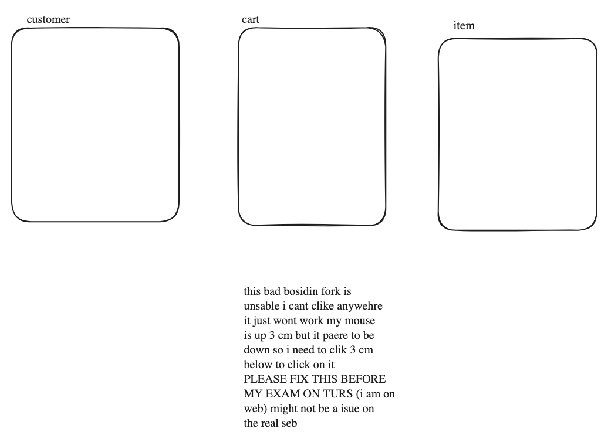
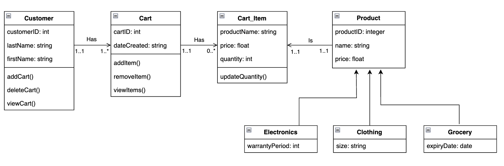

# 12SEN_TopicTestRevisionTest3 (Timed)

- Syllabus: Software Engineering · Publisher: –
- Status: COMPLETED · results released · submitted 2026-05-04
- **Score: 36 / 61** (59%) · answered 22/23 parts · marked 23/23
- Review page: https://platform.gradeo.com.au/reviewExam/c0fdf13f-55b7-4537-8534-de67721701c5

---

## 1. Security Strategies & Tools (MC, TKS 2025) 

*Source: TKS 2025*

#### Part 1 — 1/1 marks  `MULTI_CHOICE`

In what stage of development can SAST tools be applied?

- **A.** Only during integration testing.
- **B.** Only during initial design phases.
- **C.** Only after the code is completed.
- **D.** At any stage after Requirements definition.  ✅ *correct*  ⬅️ **your choice**

**Your answer:** D · **Correct:** D ✔

---

## 2. Social/Ethical/Legal Issues (OR, TKS 2025)

*Source: TKS 2025*

#### Part A — 2/2 marks  `OBJECTIVE_RESPONSE`

Match each scenario to the primary issue or ramification it demonstrates in the context of secure software development.

Select only one correct response per row.

| Statement | Correct | Yours | |
|---|---|---|---|
| A company uses automated tools, reducing demand for manual testing roles. | Employment Impact | Employment Impact | ✔ |
| A start-up patents its secure authentication method to prevent competitors copying it. | Copyright / IP | Copyright / IP | ✔ |
| A healthcare app uses encryption and access controls for patient records. | Data Security / Privacy | Data Security / Privacy | ✔ |
| A logistics firm moves to a cloud platform that replaces older systems with secure APIs. | Digital Disruption | Digital Disruption | ✔ |

**Marking criteria:**
- [2] Correctly selects all options
- [1] Partially correct selection

---

## 3. Enterprise Benefits (MS, TKS 2025)

*Source: TKS 2025*

**Stimulus:**

A software enterprise is reviewing its long-term strategy. It wants to gain the most benefit from implementing secure development practices across all future projects.

#### Part A — 1/1 marks  `MULTI_CHOICE`

Select TWO benefits the company is most likely to achieve

- **A.** Developers will no longer need to perform manual testing.
- **B.** The company can eliminate the need for any external penetration testing.
- **C.** Security becomes embedded in company culture, improving future development.  ✅ *correct*  ⬅️ **your choice**
- **D.** Secure components can be reused across projects, increasing development speed.  ✅ *correct*  ⬅️ **your choice**

**Your answer:** C, D · **Correct:** C, D ✔

---

## 4. Collaborative Work  Practises (MC, TKS2025)

*Source: TKS 2025*

#### Part A — 1/1 marks  `MULTI_CHOICE`

Which practice improves integration between frontend and backend teams?

- **A.** Ignoring frontend needs.
- **B.** Using different programming languages.
- **C.** Working separately and merging at the end.
- **D.** Defining API endpoints and data formats early.  ✅ *correct*  ⬅️ **your choice**

**Your answer:** D · **Correct:** D ✔

---

## 5. Web Requests (MC, TKS2025)

*Source: TKS 2025*

#### Part A — 1/1 marks  `MULTI_CHOICE`

When a user sends a request to a dynamic web page, which of the following shows the correct order of processes in the back end?

- **A.** Database &rarr; Web server &rarr; URL Router &rarr; Response
- **B.** URL Router &rarr; Database &rarr; Web server &rarr; Response
- **C.** URL Router &rarr; Web server &rarr; Database &rarr; Response
- **D.** Web server → URL Router → Database → Response  ✅ *correct*

**Your answer:** (none) · **Correct:** D ✘

**Feedback (TKS CST, 1 marks):** URL Router goes in between so that the web server can communicate to the database.

---

## 6. Web Elements (MC, TKS2025)

*Source: TKS2025*

#### Part A — 1/1 marks  `MULTI_CHOICE`

Which of the following tasks is most commonly handled by a back-end system?

- **A.** Styling the web page layout.
- **B.** Handling mouse and keyboard events.
- **C.** Managing authentication and access control  ✅ *correct*  ⬅️ **your choice**
- **D.** Displaying images and video content in the browser.

**Your answer:** C · **Correct:** C ✔

---

## 7. Difficulties (OR, TKS 2025)

*Source: TKS 2025*

#### Part A — 2/2 marks  `OBJECTIVE_RESPONSE`

For each situation in the left-hand column, select the strategy most likely to introduce the described challenge.

| Statement | Correct | Yours | |
|---|---|---|---|
| Difficulty verifying whether a solution is trustworthy | Looking Online | Looking Online | ✔ |
| Misunderstandings caused by time zone differences | Outsourcing | Outsourcing | ✔ |
| Reduced hands-on problem-solving by the internal development team | Outsourcing | Outsourcing | ✔ |
| Disagreements over the best approach to solving a problem | Collaborating with Peers | Collaborating with Peers | ✔ |

**Marking criteria:**
- [2] Correctly selects all options
- [1] Partially correct selection

---

## 8. WAgile Approach (MC, TKS2025)

*Source: TKS 2025*

#### Part A — 1/1 marks  `MULTI_CHOICE`

Why might WAgile be unsuitable for very small projects?

- **A.** It requires no documentation at all.
- **B.** It doesn&rsquo;t support team collaboration.
- **C.** Its iterative cycles are too short for small teams.
- **D.** The structured setup may cause extra overhead.  ✅ *correct*  ⬅️ **your choice**

**Your answer:** D · **Correct:** D ✔

---

## 9. Design (Q7, 2015 HSC Exam SDD)

*Source: HSC 2015*

#### Part A — 1/1 marks  `MULTI_CHOICE`

How can the inclusivity of a computer program be enhanced?

- **A.** By replacing password characters with asterisks
- **B.** By providing a range of methods for inputting data  ✅ *correct*  ⬅️ **your choice**
- **C.** By providing all the necessary library routines in a single DLL
- **D.** By ensuring that all sources have been included in the acknowledgements

**Your answer:** B · **Correct:** B ✔

---

## 10. Security and Resilience of Software (SA, TKS 2025)

*Source: TKS 2025*

#### Part A — 3/3 marks  `SHORT`

Explain why regular patching is important for maintaining software security.

*Word limit: 90*

**Your answer:**

> if patches are not aplied regualy attacers can find vuribliys and exploit them before they are secured this can lead to data being exfiltrted and catosrific damage to you compoys infsture.
> 
> For example openclaw has hundreds of CVE's and this has lead to 13,000 + open claw instence exposed on VPS. this is why open claw has a reputaion of being insecure unless you harden it you self.

*(68 words)*

**Feedback (TKS CST, 3 marks):** Looks good.

**Marking criteria:**
- [3] Explains why regular patching is important to maintain software security.
- [2] Describes why regular patching
- [1] Clearly describes 1 ways OR outlines 2 ways in which system hardening can improve software security.

**Sample answer:**

Regular patching is important because it fixes known vulnerabilities and security flaws in software, preventing attackers from exploiting them. It also helps maintain compliance with security standards and keeps systems protected against emerging threats.

---

## 11. Security of Programming Code (SA, TKS 2025)

*Source: TKS 2025*

#### Part A — 2/3 marks  `SHORT`

Describe the role of code review in identifying programming errors and improving security.

*Word limit: 90*

**Your answer:**

> When devs write code they often constract a carll mentel model of that is happeing and this can be wrong somtines containg wrong asumtins or logical errores. 
> 
> a example in python 
> 
> if n >= 0: # check not is neg
> 
> this is a example of a error that can be made the ">" should be "<" this is why a code reviw is imptant it is like getting someone else to check you work.

*(74 words)*

**Feedback (TKS CST, 2 marks):** You must also discuss the role of code reviews in enhancing security, specifically how a second reviewer can identify potential vulnerabilities or weaknesses that could be exploited by attackers before the software is finalised.

**Marking criteria:**
- [3] Clearly describes the role of code reviews in finding errors AND improving security.
- [2] Clearly describes the role of code reviews in finding errors OR improving security.

OR

Outlines the role of code reviews in finding errors AND improving security.
- [1] Provides some relevant information.

**Sample answer:**

Code review helps identify programming errors by allowing another developer to examine the code for mistakes, poor practices, or overlooked logic. It improves security by spotting vulnerabilities that the original author may have missed, ensuring safer and more reliable code before it is deployed.

---

## 12. Defensive Data (SA, TKS 2025)

*Source: TKS 2025*

#### Part A — 3/3 marks  `SHORT`

Explain why input validation is important in software development and give two examples of input validation techniques.

**Your answer:**

> Input validatin is essental to makeing good softhere as if you dont do this it will lead to hard to dignose errore cause by use error or miloious attack. for example lenght checking is where you will check the lengh of a provided imput for exaple a password needs to be 10 caricters long. this ensure that you dont have buffer oveflows or insecure passords. NOTE: memory mangment isue were a substantl cause for many bugs found in 2024. range checking is anouther form of input validation it is where you see if the number is with in a valid range. for example a month field might be range checkt to see if it is in <= 1 and <= 12.

*(121 words)*

**Feedback (TKS CST, 3 marks):** Well done.

**Marking criteria:**
- [3] Thorough explanation of input validation importance and two clear examples with correct terminology.
- [2] Sound explanation with at least one example detailed correctly.
- [null] Basic explanation with examples lacking depth or clarity.

**Sample answer:**

Input validation is important because it ensures that data entered by users meets expected formats, helping prevent errors and security risks like injection attacks. It acts as the first line of defence by rejecting invalid or malicious input before it can be processed. Examples include type checking, which verifies that input is of the correct data type (e.g., number or string), and length checking, which restricts inputs to a specified number of characters to avoid overflow or abuse.

---

## 13. SQL (ER, TKS 2025)

*Source: TKS 2025*

**Stimulus:**

As part of a class project, a student has created a video explaining how SQL is used in enterprise environments to manage large-scale databases.

[▶ VIDEO (open this file)](assets/0d7ecf5f-cfef-42c2-986e-f4d3a7038b66.mp4)

#### Part A — 0/8 marks  `SHORT`

Evaluate the effectiveness of SQL in supporting enterprise-level data management and security, using examples and insights from the video to support your response.

*Word limit: 400*

**Your answer:**

**Marking criteria:**
- [8] Clearly evaluates SQL’s effectiveness in enterprise data management and security whilst referencing both strengths and limitations. Integrates relevant and specific examples from the video to support the response.
- [6-7] Makes a judgement about SQL&rsquo;s effectiveness in enterprise data management and security that has some flaws. Integrates relevant and specific examples from the video to support the response.
- [4-5] Describes SQL&rsquo;s effectiveness in enterprise data management and security whilst referencing both strengths and limitations.
- [2-3] Outlines SQL&rsquo;s effectiveness in enterprise data management and security.
- [1] Provides some relevant information

**Marking guidance:**

Note that answers could include numerous points:

-   Explanation of SQL as a language used to manage relational databases in enterprise environments.
-   Description of how SQL supports data management through commands such as `SELECT`, `UPDATE`, `DELETE`, and `JOIN`.
-   Reference to SQL’s ability to handle large volumes of structured data efficiently.
-   Discussion of data integrity features in SQL, including the use of constraints like `PRIMARY KEY`, `FOREIGN KEY`, and `CHECK`.
-   Explanation of transaction control (`BEGIN`, `COMMIT`, `ROLLBACK`) and its importance in maintaining reliable operations.
-   Description of SQL’s role in enterprise security through access control mechanisms (`GRANT`, `REVOKE`) and role-based permissions.
-   Reference to examples from the video, such as restricting access to financial records or updating customer data securely.
-   Mention of SQL’s widespread use and compatibility across enterprise platforms.
-   Evaluation of SQL’s limitations, such as vulnerability to SQL injection if input is not properly validated.
-   Discussion of the need for secure coding practices and skilled developers to implement SQL effectively.
-   Consideration of SQL’s complexity and potential performance issues in large-scale systems.
-   A balanced judgement on SQL’s overall effectiveness, acknowledging both its strengths and areas that require careful implementation.

**Sample answer:**

SQL (Structured Query Language) is a widely used tool in enterprise computing for managing and securing data. Its effectiveness lies in its ability to handle large volumes of structured data efficiently, while also offering features that support data integrity and security. However, its success depends on how well it is implemented and maintained.

In terms of data management, SQL allows enterprises to perform complex operations such as querying, updating, and reporting. These capabilities are essential for businesses that rely on real-time access to accurate information. For example, the video demonstrates how SQL commands like `SELECT`, `UPDATE`, and `JOIN` are used to retrieve and manipulate data across multiple tables. This shows how SQL enables businesses to generate insights and make informed decisions quickly.

SQL also supports data integrity through the use of constraints such as `PRIMARY KEY`, `FOREIGN KEY`, and `CHECK`. These ensure that data entered into the database follows specific rules, reducing the risk of errors and inconsistencies. Transactions, managed through commands like `BEGIN`, `COMMIT`, and `ROLLBACK`, allow multiple operations to be treated as a single unit. This is particularly useful in enterprise systems where data accuracy is critical, such as in financial or healthcare databases.

From a security perspective, SQL provides access control features that help protect sensitive data. The video highlights how commands like `GRANT` and `REVOKE` are used to assign or remove user permissions. This allows organisations to implement role-based access control, ensuring that only authorised users can view or modify certain data.

Despite these strengths, SQL does have limitations. One of the main concerns is its vulnerability to SQL injection attacks, which occur when malicious input is used to manipulate queries. The video explains that without proper input validation and secure coding practices, attackers can gain unauthorised access to data. Additionally, SQL can become complex to manage in large systems and often requires skilled developers to maintain performance and security.

In conclusion, SQL is a highly effective tool for enterprise data management and security. Its strengths in scalability, precision, and control make it a valuable asset. However, its effectiveness depends on secure implementation, regular maintenance, and the expertise of those managing the system.

**Note that answers could include numerous points:**

-   Explanation of SQL as a language used to manage relational databases in enterprise environments.
-   Description of how SQL supports data management through commands such as `SELECT`, `UPDATE`, `DELETE`, and `JOIN`.
-   Reference to SQL’s ability to handle large volumes of structured data efficiently.
-   Discussion of data integrity features in SQL, including the use of constraints like `PRIMARY KEY`, `FOREIGN KEY`, and `CHECK`.
-   Explanation of transaction control (`BEGIN`, `COMMIT`, `ROLLBACK`) and its importance in maintaining reliable operations.
-   Description of SQL’s role in enterprise security through access control mechanisms (`GRANT`, `REVOKE`) and role-based permissions.
-   Reference to examples from the video, such as restricting access to financial records or updating customer data securely.
-   Mention of SQL’s widespread use and compatibility across enterprise platforms.
-   Evaluation of SQL’s limitations, such as vulnerability to SQL injection if input is not properly validated.
-   Discussion of the need for secure coding practices and skilled developers to implement SQL effectively.
-   Consideration of SQL’s complexity and potential performance issues in large-scale systems.
-   A balanced judgement on SQL’s overall effectiveness, acknowledging both its strengths and areas that require careful implementation.

---

## 14. Object-Relational Mapping (SA, TKS2025)

*Source: TKS 2025*

#### Part A — 3/3 marks  `SHORT`

Explain a performance trade-off when using an ORM instead of just SQL.

*Word limit: 60*

**Your answer:**

> If you use a ORM you will genraly get worse pofanse as you will need to creat the obgect evry time but making obgects make it easer to work will but it is slower. On the outher hand you have SQL that is much better pofance but you need to handle the passing of the data your self which is more complex. 
> 
> For example I chose to use a ORM in my sofwhere engenrin prgect as it was faster to devlop and i was willing to take the mincule progamnce drop. But if i was a large compony storing 10 000 000 user entrys and documnst i would use SQL as it is much cheaper but it will be more complex.

*(121 words)*

**Feedback (TKS CST, 3 marks):** Discuss how ORMs sometimes generate inefficient queries for complex data relationships, which increases database load compared to hand-optimised SQL.

**Marking criteria:**
- [3] Correctly explains a performance trade-off when using ORM instead of SQL.
- [2] Describes a performance trade-off when using ORM instead of SQL.
- [1] Desmonstrates some understanding.

**Sample answer:**

ORM adds a layer between your code and the database, which reduces control over how queries are written and executed. This can result in less efficient SQL being generated, especially for complex operations or large data sets, leading to increased load on the database compared to custom written SQL and slower response times.

---

## 15. Content Management System (SA, TKS2025)

*Source: TKS 2025*

#### Part A — 3/3 marks  `SHORT`

Explain why a CMS might be preferred for a small business website.

*Word limit: 60*

**Your answer:**

> This conteent managemt seirvise can be priferd there is less of time/ learnign curve that they may not want to invest.
> 
> for example if i wanted a simple ecomse store it would be realy esey to do the auth and login. but if the user dident do that they would have to do all pament and also auth, think about crsf cors and many outher thing that i had no ider about but and i have done a SDD. this small team that my have just a maketing guy needing the throw togeter a website. 
> 
> this is why espicaly for a small bisnues this is not a good idrer to make there own website but instad use CMS.

*(118 words)*

**Feedback (TKS CST, 3 marks):** Improve your response by using more formal terminology and explicitly linking these advantages to the business's need for cost-effectiveness.

**Marking criteria:**
- [3] Clearly explains 2 reasons why a CMS may be preferred for a small business website.
- [2] Explains one reason why a CMS may be preferred for a small business website.

OR 

Describes two relevant features of CMS's.
- [1] Provides some relevant information.

**Sample answer:**

A CMS might be preferred for a small business website because it allows non-technical users to easily create, edit, and manage content without needing coding skills. It also offers ready made templates and plugins that speed up development and reduce costs, making it ideal for small budgets and quick setup.

---

## 16. Programming - ASCII Encode (Sequence, 2025 TKS)

*Source: TKS 2025*

#### Part A — 2/3 marks  `CODING`

Write a Python program that takes a string entered by the user and then encodes it by shifting it one letter forward. Your answer must be **all letters.** 

You only need to consider **lowercase** characters. 

Note that the ASCII number for 'a' is 97.

**Your answer:**

```python
# Write a Python program that takes a string entered by the user and then encodes it by shifting it one letter forward. Your answer must be all letters. 

# You only need to consider lowercase characters. 

# Note that the ASCII number for 'a' is 97. 
in_string = input("enter you string: ")
out_string = ""
for i in in_string:
  out_string += chr(ord(i)+1)
print(out_string)
  
```

**Feedback (TKS CST, 2 marks):** The current code does not account for the wrap-around from z back to a, which results in an incorrect character when z is entered. To improve the program, you should include a conditional check to identify when a character is z and manually set it back to a to ensure the output remains within the lowercase alphabet.

**Marking criteria:**
- [3] Provides a substantially correct algorithms that includes the following features:

Uses input to obtain a lowercase string from the user
Uses ord() to convert characters to ASCII values
Increments the ASCII value of each character by 1 (accounting for 'z' to 'a')
Uses chr() to convert back to characters and constructs the new encoded string.
Correctly outputs the encoded string
- [2] Provides an algorithm that includes most key features, but has minor logic or syntax errors that do not significantly impact the outcome
- [1] Provides an algorithm that addresses some key aspects of the task (e.g. correctly converts or encodes some characters, loop may be flawed)

**Sample answer:**

text = input("Enter a lowercase word: ")  
encoded = ""  
  
for char in text:  
    ascii\_val = ord(char)  
    if ascii\_val == (97 + 25):  # Check if it's 'z'  
        new\_char = chr(97)     # Wrap around to 'a'  
    else:  
        new\_char = chr(ascii\_val + 1)  
    encoded += new\_char  
  
print("Original string:", text)  
print("Encoded string:", encoded)

---

## 17. Language Dependent Optimisation (SA, TKS 2025)

*Source: TKS 2025
*

#### Part A — 1/2 marks  `SHORT`

Outline why code optimisation in Python is tricky as opposed to others.

*Word limit: 80*

**Your answer:**

> Python is a langae that is very abstract so therfor it is dificlt to do meory mangment unlike C. in C you can difine pointers and do things like maloc() but in python you can not uless you comple parts like useing cthon but this is complex and 'tricky"

*(49 words)*

**Feedback (TKS CST, 1 marks):** While you correctly identified that limited memory management and a lack of pointers make Python challenging to optimise, the response would be stronger if it addressed Python’s nature as an interpreted and dynamically typed language. Explaining how runtime type checking and line by line execution add overhead compared to compiled languages would provide a more comprehensive outline of why performance tuning is particularly tricky.

**Marking criteria:**
- [2] Clearly outlines why code optimisation in Python is tricky.
- [1] Provides some relevant information.

**Sample answer:**

Python is an interpreted and dynamically typed language. This means that code is executed line-by-line and types are checked at runtime, which can slow down performance. In contrast, compiled languages like C++ or Java perform type checking and optimisation during compilation, making them faster and easier to optimise.

---

## 18. Software Project (Q22, 2019 HSC Exam SDD)

*Source: HSC 2019*

#### Part A — 2/3 marks  `SHORT`

Identify TWO advantages and TWO disadvantages to users if a particular software development company is dominant in the software marketplace

**Your answer:**

> There are many advangaes and disavantages to the to the user. some advantages include better compadiblit insed of switch between compedoters the user can have evryting in one place this is simlar to google drive ingrates semlessly with docs and sites
> 
> _IS IT OK TO JUST ANSWER IN BULETE POINTS_
> 
> TWO disadvantages
> 
> -   eorbidant pricing (adoby)
> -   single point to failer
> 
> TWO advantages
> 
> -   compadiblity 
> -   training

*(63 words)*

**Feedback (TKS CST, 2 marks):** You should present your answer in full sentences to clearly explain how a company's dominance in the marketplace directly causes these specific advantages and disadvantages for the user. Just dot points doesn't link back to question well enough for 3/3.

**Marking criteria:**
- [3] Identifies TWO advantages and TWO disadvantages to users if a particular software development company is dominant in the software marketplace
- [2] Identify ONE advantage and ONE disadvantage to users if a particular software development company is dominant in the software marketplace
- [1] Identifies a relevant issue

**Sample answer:**

A large customer base (with a dominant developer) results in potentially more support being available through user groups. Because more clients use the product, most errors have been addressed. 

However, less competition leads to less incentive for innovative creative ideas or maintenance of the product. Also, there is less incentive to respond to user requests for support.

---

## 19. Class Diagrams (Draw/MCQ, TKS 2025)

*Source: TKS 2025
*

**Stimulus:**

A new online shopping platform is being developed using Java, and the following requirements have been identified:

-   A customer can have multiple shopping carts, but they always have one active cart by default when they log in.
    
-   A shopping cart can contain multiple items, but each item belongs to only one cart. Items include products such as electronics, clothing, and groceries. Items can be both added and removed from the cart, as well as viewed.
    
-   Each item has a name, price, and quantity.
    
-   There can be different products that are cart items. Electronics have a warranty period, clothing has a size, and groceries have an expiry date.
    
-   A customer can add or remove items from their cart or delete entire carts, but they must always have at least one active cart.

#### Part A — 1/4 marks  `DRAWING_V2`

Construct a class diagram to represent the online shopping platform.

**Your answer:**



Drawing contents (extracted): labels: "customer", "cart", "item", "this bad bosidin fork is\nunsable i cant clike anywehre\nit just wont work my mouse\nis up 3 cm but it paere to be\ndown so i need to clik 3 cm\nbelow to click on it \nPLEASE FIX THIS BEFORE\nMY EXAM ON TURS (i am on\nweb) might not be a isue on\nthe real seb"

**Marking criteria:**
- [4] Accurately constructs a class diagram with minimal errors. This includes showing all attributes, inheritance, relationships and multiplicity.
- [3] Constructs a class diagram with a maximum of two major omissions.
- [2] Constructs a class diagram with a maximum of four major omissions.
- [1] Attempts to construct a class diagram relevant to the scenario.

**Marking rubric:**

Note that there can be variances in the student's relationship descriptions. For instance, using "uses" or "attains" instead of "has".

**Sample answer:**



#### Part B — 1/1 marks  `MULTI_CHOICE`

As Electronics extends Product, then which of the following is most TRUE?

- **A.** Electronics will not inherit anything from Product.
- **B.** Electronics will inhert only the methods from Product.
- **C.** Electronics will inherit only the attributes from Product.
- **D.** Electronics will inherit both the attributes and methods from Product.  ✅ *correct*  ⬅️ **your choice**

**Your answer:** D · **Correct:** D ✔

#### Part C — 0/1 marks  `MULTI_CHOICE`

Which of the following best describes the relationship between Customer and Cart?

- **A.** One to One  ⬅️ **your choice**
- **B.** One to Many  ✅ *correct*
- **C.** Many to One
- **D.** Many to Many

**Your answer:** A · **Correct:** B ✘

**Feedback (TKS CST, 0 marks):** Question states customer can have multiple shopping carts.

---

## 20. Programming - Positive Integers (Iteration, 2025 TKS)

*Source: TKS 2025*

#### Part A — 4/5 marks  `CODING`

Write a Python program that:

-   Creates an empty list
-   Uses a loop to ask the user to enter 5 integers
-   Only adds the number to the list if it is positive
-   After the loop prints the list of positive numbers entered.

**Your answer:**

```python
# Write a Python program that:

# Creates an empty list
elist = []
# Uses a loop to ask the user to enter 5 integers
for i in range(1,6):
  n = int(input(f"enter int {i}"))
# Only adds the number to the list if it is positive
  if n >= 0: elist.append(n)
for i in elist: print(i)
# After the loop prints the list of positive numbers entered.
```

**Feedback (TKS CST, 4 marks):** Change >= 0 to > 0, and replace the final for-loop with a single print(elist) to match the expected output format.

**Marking criteria:**
- [3] Fully working code: loop collects 5 inputs, conditionally adds positives to list, and final output correct.
- [2] Minor issue in loop or input validation, but logic mostly accurate and result produced.
- [1] Inputs and loop correct, but list logic partially implemented (e.g. all values added without condition).

**Sample answer:**

positive\_numbers = \[\]  
  
for i in range(5):  
    num = int(input("Enter a number: "))  
    if num > 0:  
        positive\_numbers.append(num)  
  
print("Positive numbers:", positive\_numbers)

---

## 21. Intellectual Property (ER, TKS 2025)

*Source: TKS 2025*

**Stimulus:**

Below is a video excerpt that explains intellectual property. 

[▶ VIDEO (open this file)](assets/3e71dd80-dc9c-4ddd-ade5-73667f8549d4.mp4)

Source: Federal Laboratory Consortium for Technology Transfer (FLC)

#### Part A — 0/8 marks  `SHORT`

Evaluate the social, ethical and legal issues associated with secure software development. In your response, refer to the provided infographic and include relevant examples.

*Word limit: 400*

**Your answer:**

_(not answered)_

**Marking criteria:**
- [8] Clearly evaluates the social, ethical and legal issues associated with secure software development and refers to the provided infographic for example(s) and/or definition(s). Response is also well structured and coherent.
- [6-7] Describes the social, ethical and legal issues associated with secure software development and refers to the provided infographic for example(s) and/or definition(s).
- [4-5] Outlines the social, ethical and legal issues associated with secure software development.
- [2-3] Attempts to outline what social, ethical and legal issues are OR attempts to outline what secure software development is.
- [1] Provides some relevant information.

**Sample answer:**

Secure software development raises a range of social, ethical, and legal issues that developers must navigate to ensure their work is both effective and responsible. These issues are particularly complex due to the evolving nature of security threats and the collaborative environment in which software is often developed.

From a legal perspective, intellectual property (IP) laws such as copyright and patents are essential for protecting software innovations. Under the Copyright Act 1968, developers have the right to protect their source code from unauthorised use. As shown in the infographic, a developer can apply for a copyright of their code for commercial use, allowing others to use the software while retaining legal control. However, legal disputes can arise when multiple contributors are involved, especially in collaborative or open-source projects, making ownership unclear. 

Ethically, developers must consider the balance between protecting their work and allowing access to tools that benefit society. For example, secure software used in healthcare or public infrastructure may be critical for public safety. Strict enforcement of copyright or patents could limit access to these tools, raising ethical concerns about equity and social responsibility. 

Social issues include the impact of secure software on users and communities. Developers have a responsibility to ensure their software protects user data and privacy. If security features are poorly implemented or withheld due to IP restrictions, users may be exposed to risks. 

In evaluating these issues, it’s clear that legal protections like copyright and patents are effective in supporting innovation and rewarding developers. However, they must be applied flexibly and ethically, especially when public welfare is at stake. Open-source models offer a middle ground, allowing for innovation, collaboration, and access.

In conclusion, secure software development involves navigating complex social, ethical, and legal considerations. Developers must balance protection with accessibility, and legal rights with ethical responsibilities, to ensure their software serves both enterprise goals and societal needs. 

**Answers could also include:**

-   Definition of intellectual property (IP) as legal protection for creations such as software. 
-   Reference to patents protecting unique algorithms or security methods.
-   Use of open-source licensing to allow collaboration while retaining copyright control. 
-   Example(s) of a developer releasing code for non-commercial use.
-   Example(s) of a cybersecurity start-up patenting an encryption algorithm.
-   Discussion of challenges in applying IP laws to rapidly evolving secure software. 
-   Mention of legal disputes over ownership in collaborative development.
-   Ethical considerations around access to secure software for public welfare.
-   Evaluation of how well IP laws balance innovation, protection, and accessibility.
