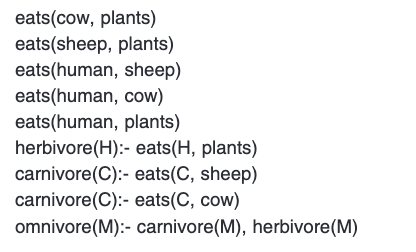
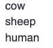
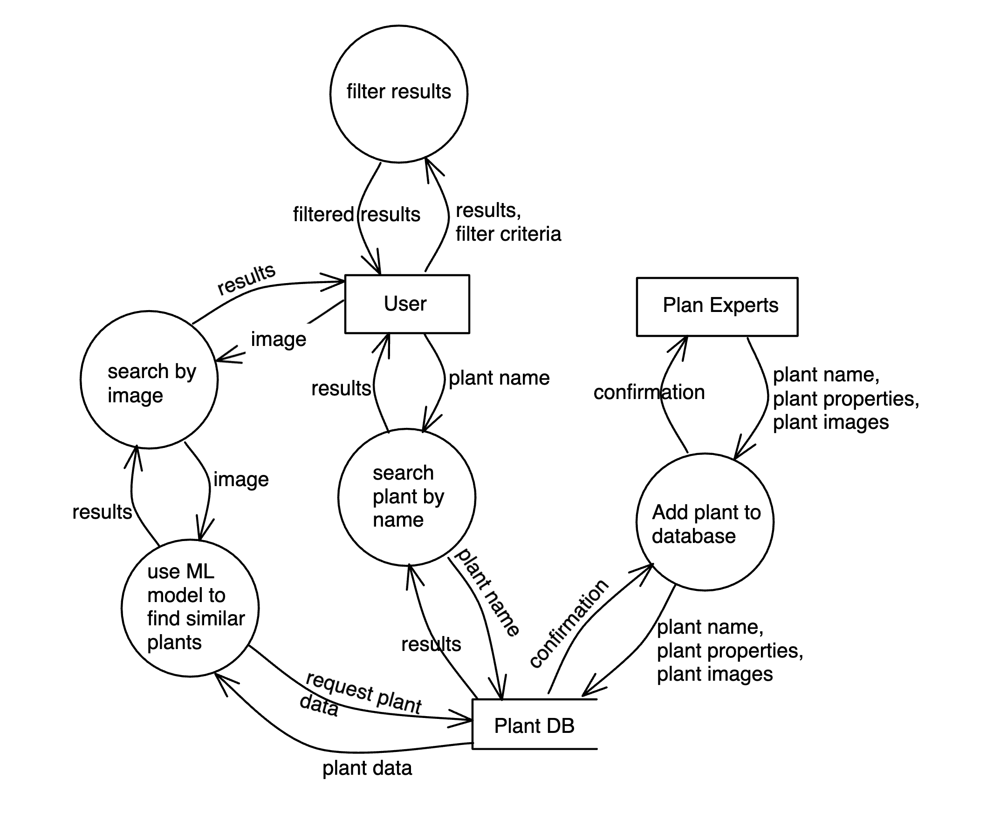
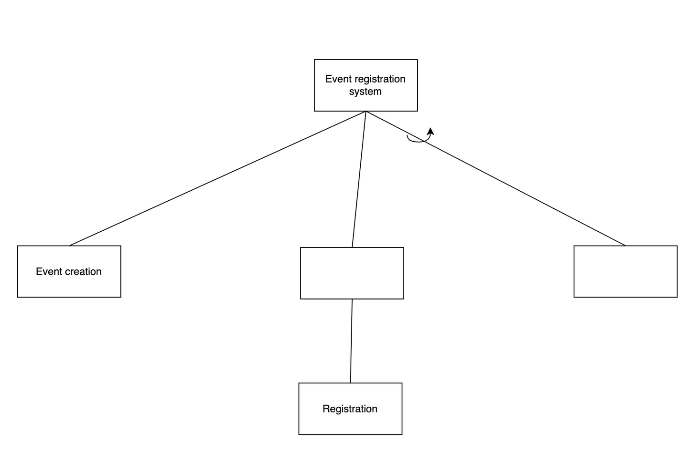
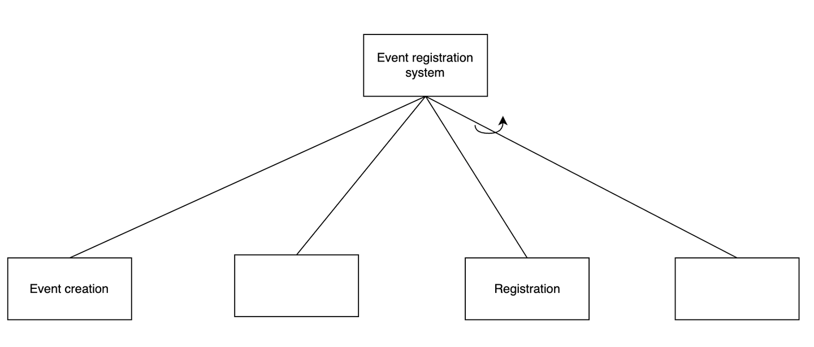
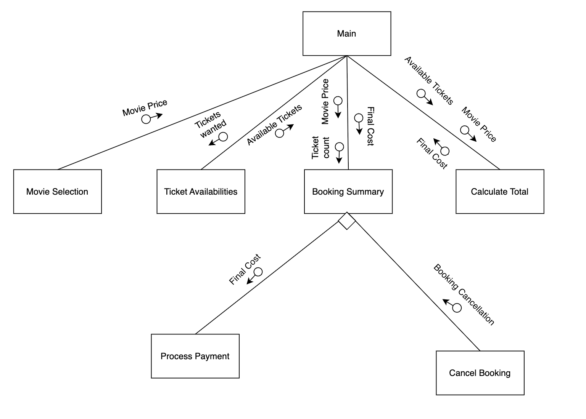

# 12SEN_TopicTestRevisionTest4 (Timed)

- Syllabus: Software Engineering · Publisher: –
- Status: COMPLETED · results released · submitted 2026-05-05
- **Score: – / 60** · answered 0/26 parts · marked 0/26
- Review page: https://platform.gradeo.com.au/reviewExam/1706ed25-445c-4dc5-a830-198e71dba603

---

## 1. Software Dev Steps (Q11, 2018 HSC Exam SDD)

*Source: HSC 2018*

#### Part A — –/1 marks  `MULTI_CHOICE`

During which stages of the software development cycle is benchmarking relevant?

- **A.** Implementing, testing and evaluating
- **B.** Planning and designing, testing and evaluating  ✅ *correct*
- **C.** Defining and understanding the problem, implementing
- **D.** Defining and understanding the problem, planning and designing

**Your answer:** (none) · **Correct:** B

---

## 2. Testing & Debugging (Q7, 2017 HSC Exam SDD)

*Source: HSC 2017*

**Stimulus:**

During the execution of a program, an incorrect value is displayed on screen. That value is much higher than expected.

#### Part A — –/1 marks  `MULTI_CHOICE`

What type of error caused this?

- **A.** Logic  ✅ *correct*
- **B.** Overflow
- **C.** Runtime
- **D.** Syntax

**Your answer:** (none) · **Correct:** A

---

## 3. Designing Secure Software (OR, TKS 2025)

*Source: TKS 2025*

#### Part A — –/2 marks  `OBJECTIVE_RESPONSE`

Select the technique that best matches each data security objective.

| Statement | Correct | Yours | |
|---|---|---|---|
| Ensures data has not been altered | Hashing | – |  |
| Prevents unauthorised users from accessing data | Encryption | – |  |
| Protects data confidentiality during transmission | Encryption | – |  |
| Grants different access levels to users | Role-Based Access Controls | – |  |

---

## 4. Designing Web Apps (Q15, 2023 HSC Exam SDD)

*Source: HSC 2023*

**Stimulus:**

A software developer decides to include a call to a library routine.

#### Part A — –/1 marks  `MULTI_CHOICE`

Which of the following must the developer consider?

- **A.** The logic of the library routine
- **B.** The space required to store the library routine
- **C.** The language used to produce the library routine
- **D.** The order of parameters to be passed to the library routine  ✅ *correct*

**Your answer:** (none) · **Correct:** D

---

## 5. Applications of Web Programming (MC, TKS 2025)

*Source: TKS 2025*

**Stimulus:**

A small clothing business wants to build a platform where customers can browse products, add items to a cart, make payments securely, and track orders online.

#### Part A — –/1 marks  `MULTI_CHOICE`

Which type of web application is most suitable for this purpose?

- **A.** Static website
- **B.** Interactive website
- **C.** E-commerce website  ✅ *correct*
- **D.** Progressive Web App (PWA)

**Your answer:** (none) · **Correct:** C

---

## 6. Web Data Transfer (MC, TKS2025)

*Source: TKS 2025*

#### Part A — –/1 marks  `MULTI_CHOICE`

Which of the below statements best describes a data packet?

- **A.** A device that routes internet traffic
- **B.** A virus that infects network systems
- **C.** A small unit of data sent across a network  ✅ *correct*
- **D.** A set of protocols used for email communication

**Your answer:** (none) · **Correct:** C

---

## 7. Effectiveness (MS, TKS 2025)

*Source: TKS 2025*

#### Part A — –/1 marks  `MULTI_CHOICE`

A test engineer is designing an evaluation strategy for a large-scale enterprise system. They want to ensure the software can handle real-world conditions under peak usage.

Select two testing techniques that would be most appropriate in this scenario.

- **A.** Load testing  ✅ *correct*
- **B.** Stress testing  ✅ *correct*
- **C.** Usability testing
- **D.** Boundary testing
- **E.** Compatibility testing

**Your answer:** (none) · **Correct:** A, B

---

## 8. Requirements (MC, TKS 2025)

*Source: TKS 2025*

**Stimulus:**

The development team agrees the app will handle user login, profile management, and order placement but will not include social media features.

#### Part A — –/1 marks  `MULTI_CHOICE`

Which section of the requirements definition does the stimulus describe?

- **A.** Defining data types
- **B.** Defining boundaries  ✅ *correct*
- **C.** Generating requirements
- **D.** Assessing scheduling feasibility

**Your answer:** (none) · **Correct:** B

---

## 9. Backup (MC, TKS 2025)

*Source: TKS 2025*

#### Part A — –/1 marks  `MULTI_CHOICE`

Which of the following best explains the primary advantage of programmed data backup for businesses?

- **A.** It eliminates all risks associated with cybersecurity threats
- **B.** It reduces the need for skilled IT staff to manage data security manually
- **C.** It allows businesses to avoid purchasing expensive hardware for data storage
- **D.** It ensures that critical data is regularly saved and can be quickly restored after data loss  ✅ *correct*

**Your answer:** (none) · **Correct:** D

---

## 10. Generating Solutions (MC, TKS 2025)

*Source: TKS 2025*

#### Part 1 — –/1 marks  `MULTI_CHOICE`

Which of the following best describes the purpose of brainstorming in the context of software engineering project development?

- **A.** To strictly critique each idea presented
- **B.** To generate as many unique ideas as possible  ✅ *correct*
- **C.** To create detailed plans and final solutions immediately
- **D.** To organise and visualise ideas in a structured format

**Your answer:** (none) · **Correct:** B

---

## 11. File Security (SA, TKS 2025)

*Source: TKS 2025*

#### Part A — –/3 marks  `SHORT`

Outline two mitigation strategies a developer can implement to protect against insecure file uploads in a web application

**Your answer:**

_(not answered)_

**Marking criteria:**
- [3] Clearly outlines two effective and relevant mitigation strategies with brief explanations
- [2] Outlines two strategies with limited explanation, or one strategy with clear explanation
- [1] Identifies one strategy with limited detail or vague description.

**Sample answer:**

To protect against insecure file uploads, developers should restrict uploaded file types to safe formats using whitelisting (e.g., only allowing .jpg or .pdf). This prevents execution of malicious scripts like .php or .exe files. Additionally, files should be stored in a non-executable directory, separate from the application logic, to avoid accidental execution. These measures reduce the risk of attackers uploading and executing harmful files on the server.

---

## 12. Minimise Vulnerabilities (SA, TKS 2025)

*Source: TKS 2025*

#### Part A — –/3 marks  `SHORT`

Explain how race conditions can create security vulnerabilities in a software system and outline one technique a developer could use to mitigate this issue.

**Your answer:**

_(not answered)_

**Marking criteria:**
- [3] Demonstrates a thorough understanding of race conditions and mitigation; provides a clear and accurate technique with explanation.
- [2] Demonstrates a sound understanding with some detail; may lack clarity or specificity in mitigation
- [1] Identifies the concept of a race condition but gives limited or unclear explanation.

**Sample answer:**

A race condition occurs when two or more operations execute concurrently and access shared resources in an unsynchronised way. This can lead to unpredictable behaviour, such as duplicated transactions or data corruption. For example, if two users attempt to withdraw money from the same bank account at the same time, both could pass the balance check before either transaction completes, resulting in an overdraft. To mitigate this, developers can use locking mechanisms like mutexes to ensure only one process accesses a critical section at a time. This ensures that once a process starts modifying a shared resource, others must wait their turn, thus maintaining data integrity.

---

## 13. Software Dev Steps - Security Requirements (SA, TKS 2025)

*Source: TKS 2025, North Parramatta*

#### Part A — –/3 marks  `null`

Explain how the “requirements definition” stage contributes to secure software development.

**Your answer:**

_(not answered)_

**Marking criteria:**
- [3] Explains how the requirements definition stage contributes to secure software development.
- [2] Demonstrates some understanding of the requirements definition stage and its contribution to secure software development.
- [1] Identifies the requirements definition stage

**Sample answer:**

The _requirements definition_ stage helps secure software development by clearly identifying what the software aims to achieve. During this step, it outlines security features (data protection, user access control and compliance requirements) to be implemented.   
  
Defining these features early enables developers to plan security features according to the _"Security by Design"_ principle, thereby preventing vulnerabilities from being introduced later in the development stage.

---

## 14. End User Influence (SA, TKS 2025)

*Source: TKS 2025*

#### Part 1 — –/4 marks  `SHORT`

Explain the challenges of balancing usability with security in software design, and suggest ways developers can address these challenges.

**Your answer:**

_(not answered)_

**Marking criteria:**
- [4] Explains key challenges in balancing usability and security in software design

Suggests relevant and practical ways developers can address these challenges
- [3] Outlines challenges with some explanation

Suggests one or more ways developers can respond, with some relevance
- [2] Identifies basic challenges or general conflict between usability and security

Suggests a vague solution
- [1] Shows some understanding of usability or security in the context of software design

**Sample answer:**

Balancing usability with security is a challenge as enhancing one often compromises the other. An overly secure software might be cumbersome and difficult to use, which could deter users from adopting it. Conversely, enhancing usability might lead to vulnerabilities in security. Solutions include minimising user friction by streamlining authentication processes, implementing adaptive security measures that adjust based on user behaviour, and ensuring the security features are transparent but not overly intrusive. For example, developers can use straightforward notifications for security alerts to keep users informed without disrupting their experience. Additionally, providing secure defaults and ensuring that critical security settings are enabled by default can maintain a baseline of security.

---

## 15. Logic Paradigm / SQL (Q34b, 2021 HSC Exam SDD)

*Source: HSC 2021*

**Stimulus:**

The following fragment of code is written using the logic paradigm

The query ?eats(A, plants) produces the result

#### Part A — –/2 marks  `SHORT`

Write a query that will produce the result

sheep  
cow  
plants

**Your answer:**

_(not answered)_

**Marking criteria:**
- [2] Provides a correct query
- [1] Shows some understanding of a relevant query

**Sample answer:**

?eats(human, A)

#### Part B — –/2 marks  `SHORT`

A self\_eater is any animal that eats other animals of its own kind

Provide a new rule that defines self\_eater

**Your answer:**

_(not answered)_

**Marking criteria:**
- [2] Provides a correct rule
- [1] Provides a partially correct rule

**Sample answer:**

self\_eater(A) :- eats(A, A)

#### Part C — –/3 marks  `SHORT`

Contrast the use of forward chaining and backward chaining when evaluating the query ?omnivore(human).

**Your answer:**

_(not answered)_

**Marking criteria:**
- [3] Demonstrates an understanding of the difference between forward and backward chaining for this query
- [2] Demonstrates an understanding of forward and backward chaining for this query
- [1] Demonstrates a basic understanding of how a query is evaluated

**Sample answer:**

Forward chaining starts from the first fact and locates all the facts that include human, identifying the last three facts. From there it will evaluate if the facts make the rules herbivore and carnivore true. Which are both true for a human. 

Backward chaining assumes the query is true. Then it uses the omnivore rule to check if herbivore and carnivore are both true. They are both true for humans so the assumption was correct.

---

## 16. Managing Load Times (SA, TKS2025)

*Source: TKS 2025*

#### Part A — –/2 marks  `SHORT`

Explain how compression methods improve web performance.

**Your answer:**

_(not answered)_

**Marking criteria:**
- [2] Clearly explains how compression methods improve web performance.
- [1] Identifies that compression reduces file sizes OR that compression speeds up loading.

**Sample answer:**

Compression methods improve web performance by reducing the size of files sent from the server to the browser. Smaller files mean mean less data to transfer and hence quicker page loading.

---

## 17. Applications of Web Programming (SA, TKS 2025)

*Source: TKS 2025*

**Stimulus:**

A startup wants to develop an interactive website that adapts to user preferences and provides real-time updates.

#### Part A — –/3 marks  `SHORT`

Explain two benefits of using interactive websites for businesses aiming to improve customer engagement.

**Your answer:**

_(not answered)_

**Marking criteria:**
- [3] Explains two benefits of interactive websites and links them to customer engagement.
- [2] Describes two benefits with limited detail or partial connection to customer engagement.
- [1] Mentions one benefit or provides vague/incomplete explanations.

**Sample answer:**

Interactive websites improve customer engagement by offering personalised content based on user preferences, which makes users feel valued and increases their time on the site. They also provide real-time updates, such as live chats or dynamic product recommendations, which keep users informed and encourage immediate action. Together, these features create a more engaging and responsive experience that can boost customer satisfaction and loyalty.

---

## 18. Version Control (MC, TKS 2025)

*Source: TKS 2025*

**Stimulus:**

A team of developers is collaborating on a web application using Git and GitHub. During a sprint, a developer accidentally pushes a commit to the main branch that breaks the layout of the homepage. The team wants to fix the issue while preserving the project history and avoiding disruption to other contributors who are working on feature branches.

#### Part A — –/1 marks  `MULTI_CHOICE`

Which of the following would be the most appropriate way to resolve the issue using Git?

- **A.** Delete the main branch and recreate it from a stable feature branch, then notify all contributors to rebase their work.
- **B.** Force push an older version of the project to the main branch using "git push -- force" removing the faulty commit from history.
- **C.** Use "git revert" to create a new commit that undoes the changes from the faulty commit, then push the revert to the main branch.  ✅ *correct*
- **D.** Pause all development, clone the repository locally, manually fix the layout, and upload the corrected files without using Git commands.

**Your answer:** (none) · **Correct:** C

---

## 19. DFD Level 1 - (Draw, TKS 2025)

*Source: TKS 2025*

**Stimulus:**

A new online catalogue system for plants is being developed.

-   It consists of a website that is connected to a database of plants.
-   Experts will enter the different types of plants into the database, along with a range of corresponding images.
-    Users will be able to search and filter plants by name or their properties such as average height, and temperature ranges.
-   Users can also search by an image, where a machine learning model will find the closest-looking plants.

#### Part A — –/4 marks  `DRAWING_V2`

Draw a level 1 data flow diagram (DFD) to represent this system.

**Your answer:**

_(not answered)_

**Marking rubric:**

| **Criteria** | **Marks** |
|---|---|
| Constructs a substantially correct data flow diagram that includes at least the processes of adding plants, searching plants and sorting plants; relevant data flows, storage, and external entities | 4 |
| Constructs a data flow diagram that is relevant to the plant catalogue app and includes two external entities, most of the processes, and data flows | 3 |
| Constructs a data flow diagram with some elements relevant to the parking app | 2 |
| Shows a basic understanding of data flow diagrams | 1 |

**Sample answer:**

---

## 20. Interactive Web Apps (SA, TKS 2025)

*Source: TKS North Parramatta, 2025*

#### Part 1 — –/3 marks  `SHORT`

Explain the role of HTML, CSS, and JavaScript in creating interactive web pages.

**Your answer:**

_(not answered)_

**Sample answer:**

HTML, CSS, and JavaScript each play a distinct role in the development of interactive web pages. HTML is the foundational markup language used to structure content on the World Wide Web. It enables developers to define elements such as headings, paragraphs, lists, links, and images. CSS is used to style the HTML content, providing the ability to control layout, colours, fonts, and overall visual appearance of the web pages, thus separating content from design. JavaScript (JS), the primary web scripting language, enables dynamic content updates for iterative user interfaces through API requests (including single-page applications). Together, HTML, CSS, and JavaScript form the core building blocks of modern web applications.

---

## 21. Structure Charts (Draw, TKS 2025)

**Stimulus:**

A program is needed to allow users to book movie tickets. The system displays available movies, allows users to select a movie, choose the number of tickets, and proceed with payment. The developer has drafted the following algorithm to outline the program's behavior: 

BEGIN Main  
    MovieTotal = 0  
    TicketCount = 0  
    DisplayMovieList  
    SelectMovie (MovieTotal)  
  
    GetTicketCount (TicketCount)  
    CalculateTotal (MovieTotal, TicketCount, FinalCost)  
  
    ShowBookingSummary (MovieTotal, TicketCount, FinalCost)  
END Main  
  
BEGIN SelectMovie (MovieTotal)  
    Display “Select a movie”  
    MovieTotal = 15  
END  
  
BEGIN GetTicketCount (TicketCount)  
    Input number of tickets  
    TicketCount = user input  
END  
  
BEGIN CalculateTotal (MovieTotal, TicketCount, FinalCost)  
    FinalCost = MovieTotal \* TicketCount  
END  
  
BEGIN ShowBookingSummary (MovieTotal, TicketCount, FinalCost)  
    Display MovieTotal, TicketCount, FinalCost  
    GetConfirmation  
  
    IF Confirmation = True THEN  
        ProcessPayment (FinalCost)  
    ELSE  
        CancelBooking  
    ENDIF  
END  
  
BEGIN ProcessPayment (FinalCost)  
    Display “Payment received”  
    Display FinalCost  
END  
  
BEGIN CancelBooking  
    Display “Booking cancelled”  
END

#### Part A — –/4 marks  `DRAWING_V2`

Using the provided pseudocode, create a structure chart.

Drawing background provided:

**Your answer:**

_(not answered)_

**Marking criteria:**
- [4] Constructs a substantially correct structure chart that includes all essential elements.
- [3] Constructs a structure chart that is mostly correct with at most 2 major errors.
- [2] Constructs a structure chart that has 4 or more major errors.
- [1] Attempts to create a structure chart relevant to the stimulus.

**Marking rubric:**

Note that there may be variations in the students' solution. The sample answer is only a guide, and the validity of the students' solution is up to the marker's discretion.

**Sample answer:**

---

## 22. Additional Solutions (SA + MC, TKS 2025)

*Source: TKS 2025*

**Stimulus:**

A team is developing a prototype for a mobile app that helps users track their daily water intake. While the prototype successfully records and stores data, user feedback indicates that the interface is confusing and visually cluttered. Users struggle to find key features like the daily goal tracker and hydration reminders.

#### Part A — –/3 marks  `SHORT`

Based on UI design principles, suggest two improvements the team could make to enhance the user experience.

*Word limit: 140*

**Your answer:**

_(not answered)_

**Marking criteria:**
- [3] Clearly suggests two improvements.
- [2] Suggests one improvement.
- [1] Provides some relevant information.

**Sample answer:**

One improvement the team could make is to apply the clarity principle by simplifying the layout and using clear labels for key features like the daily goal tracker and hydration reminders. This would help users quickly identify and understand the purpose of each element, reducing confusion. Another improvement is to enhance efficiency by reorganising the interface so that frequently used features are easily accessible, possibly through a dashboard or quick-access menu. This would streamline user interactions and make the app more intuitive, improving the overall experience.

#### Part B — –/1 marks  `MULTI_CHOICE`

Which of the following UI design principles would be most effective in addressing the users’ concerns?

- **A.** Clarity: Simplify the layout and use clear labels to make key features easier to locate and understand.  ✅ *correct*
- **B.** Complexity: Remove all visual elements to make the app faster, even if it becomes harder to navigate.
- **C.** Consistency: Add more features to the interface to give users more control over their hydration tracking.
- **D.** Efficiency: Use identical colours and fonts throughout the app, even if they don&rsquo;t match the function of each screen.

**Your answer:** (none) · **Correct:** A

---

## 23. SQL (ER, TKS 2025)

*Source: TKS 2025*

**Stimulus:**

As part of a class project, a student has created a video explaining how SQL is used in enterprise environments to manage large-scale databases.

[▶ VIDEO (open this file)](assets/0d7ecf5f-cfef-42c2-986e-f4d3a7038b66.mp4)

#### Part A — –/8 marks  `SHORT`

Evaluate the effectiveness of SQL in supporting enterprise-level data management and security, using examples and insights from the video to support your response.

*Word limit: 400*

**Your answer:**

_(not answered)_

**Marking criteria:**
- [8] Clearly evaluates SQL’s effectiveness in enterprise data management and security whilst referencing both strengths and limitations. Integrates relevant and specific examples from the video to support the response.
- [6-7] Makes a judgement about SQL&rsquo;s effectiveness in enterprise data management and security that has some flaws. Integrates relevant and specific examples from the video to support the response.
- [4-5] Describes SQL&rsquo;s effectiveness in enterprise data management and security whilst referencing both strengths and limitations.
- [2-3] Outlines SQL&rsquo;s effectiveness in enterprise data management and security.
- [1] Provides some relevant information

**Marking guidance:**

Note that answers could include numerous points:

-   Explanation of SQL as a language used to manage relational databases in enterprise environments.
-   Description of how SQL supports data management through commands such as `SELECT`, `UPDATE`, `DELETE`, and `JOIN`.
-   Reference to SQL’s ability to handle large volumes of structured data efficiently.
-   Discussion of data integrity features in SQL, including the use of constraints like `PRIMARY KEY`, `FOREIGN KEY`, and `CHECK`.
-   Explanation of transaction control (`BEGIN`, `COMMIT`, `ROLLBACK`) and its importance in maintaining reliable operations.
-   Description of SQL’s role in enterprise security through access control mechanisms (`GRANT`, `REVOKE`) and role-based permissions.
-   Reference to examples from the video, such as restricting access to financial records or updating customer data securely.
-   Mention of SQL’s widespread use and compatibility across enterprise platforms.
-   Evaluation of SQL’s limitations, such as vulnerability to SQL injection if input is not properly validated.
-   Discussion of the need for secure coding practices and skilled developers to implement SQL effectively.
-   Consideration of SQL’s complexity and potential performance issues in large-scale systems.
-   A balanced judgement on SQL’s overall effectiveness, acknowledging both its strengths and areas that require careful implementation.

**Sample answer:**

SQL (Structured Query Language) is a widely used tool in enterprise computing for managing and securing data. Its effectiveness lies in its ability to handle large volumes of structured data efficiently, while also offering features that support data integrity and security. However, its success depends on how well it is implemented and maintained.

In terms of data management, SQL allows enterprises to perform complex operations such as querying, updating, and reporting. These capabilities are essential for businesses that rely on real-time access to accurate information. For example, the video demonstrates how SQL commands like `SELECT`, `UPDATE`, and `JOIN` are used to retrieve and manipulate data across multiple tables. This shows how SQL enables businesses to generate insights and make informed decisions quickly.

SQL also supports data integrity through the use of constraints such as `PRIMARY KEY`, `FOREIGN KEY`, and `CHECK`. These ensure that data entered into the database follows specific rules, reducing the risk of errors and inconsistencies. Transactions, managed through commands like `BEGIN`, `COMMIT`, and `ROLLBACK`, allow multiple operations to be treated as a single unit. This is particularly useful in enterprise systems where data accuracy is critical, such as in financial or healthcare databases.

From a security perspective, SQL provides access control features that help protect sensitive data. The video highlights how commands like `GRANT` and `REVOKE` are used to assign or remove user permissions. This allows organisations to implement role-based access control, ensuring that only authorised users can view or modify certain data.

Despite these strengths, SQL does have limitations. One of the main concerns is its vulnerability to SQL injection attacks, which occur when malicious input is used to manipulate queries. The video explains that without proper input validation and secure coding practices, attackers can gain unauthorised access to data. Additionally, SQL can become complex to manage in large systems and often requires skilled developers to maintain performance and security.

In conclusion, SQL is a highly effective tool for enterprise data management and security. Its strengths in scalability, precision, and control make it a valuable asset. However, its effectiveness depends on secure implementation, regular maintenance, and the expertise of those managing the system.

**Note that answers could include numerous points:**

-   Explanation of SQL as a language used to manage relational databases in enterprise environments.
-   Description of how SQL supports data management through commands such as `SELECT`, `UPDATE`, `DELETE`, and `JOIN`.
-   Reference to SQL’s ability to handle large volumes of structured data efficiently.
-   Discussion of data integrity features in SQL, including the use of constraints like `PRIMARY KEY`, `FOREIGN KEY`, and `CHECK`.
-   Explanation of transaction control (`BEGIN`, `COMMIT`, `ROLLBACK`) and its importance in maintaining reliable operations.
-   Description of SQL’s role in enterprise security through access control mechanisms (`GRANT`, `REVOKE`) and role-based permissions.
-   Reference to examples from the video, such as restricting access to financial records or updating customer data securely.
-   Mention of SQL’s widespread use and compatibility across enterprise platforms.
-   Evaluation of SQL’s limitations, such as vulnerability to SQL injection if input is not properly validated.
-   Discussion of the need for secure coding practices and skilled developers to implement SQL effectively.
-   Consideration of SQL’s complexity and potential performance issues in large-scale systems.
-   A balanced judgement on SQL’s overall effectiveness, acknowledging both its strengths and areas that require careful implementation.
