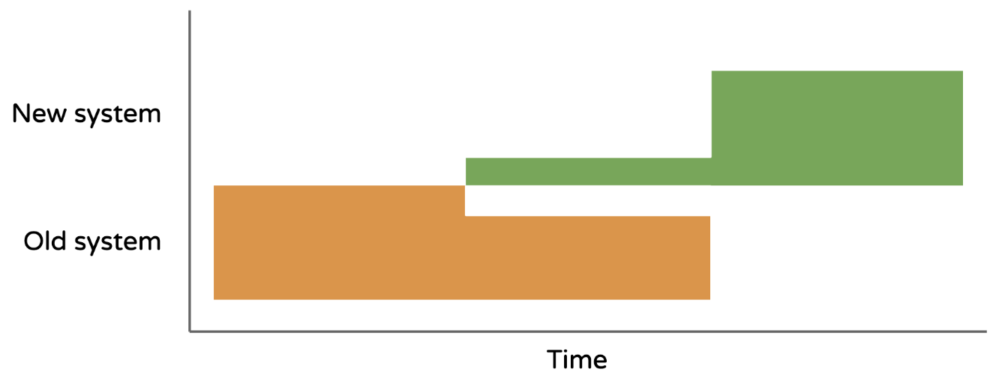
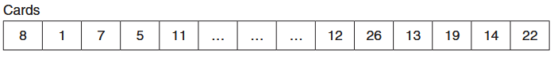
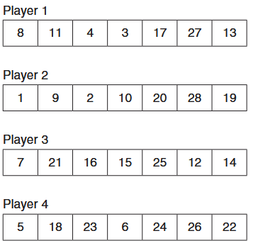
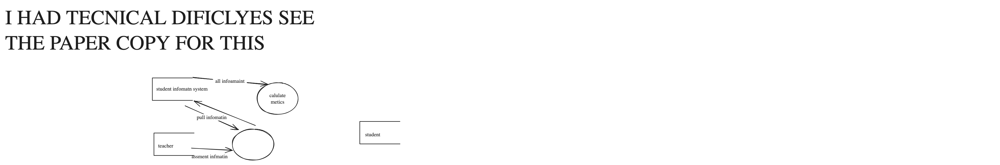
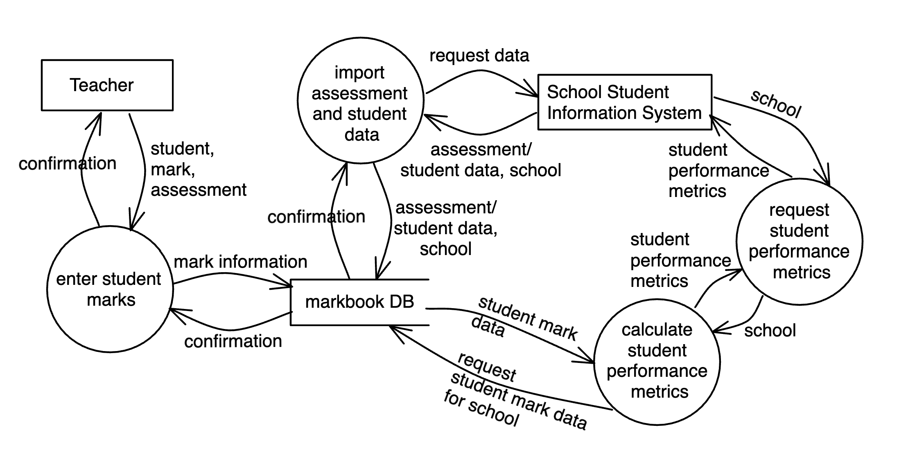

# 2026 Software Engineering AT2 Topic Test (Thursday May 7 Canberra)

- Syllabus: Software Engineering · Publisher: –
- Status: COMPLETED · results released · submitted 2026-05-07
- **Score: 39.5 / 64** (62%) · answered 24/24 parts · marked 24/24
- Review page: https://platform.gradeo.com.au/reviewExam/f03141b2-2bab-4efb-a1de-679d689f11fd

---

## 1. Installation Method (Q1,MC,2026 Topic Test)

**Stimulus:**



#### Part A — 0/1 marks  `MULTI_CHOICE`

What installation method is described in the image?

- **A.** Direct
- **B.** Parallel
- **C.** Phased  ⬅️ **your choice**
- **D.** Pilot  ✅ *correct*

**Your answer:** C · **Correct:** D ✘

---

## 2. Waterfall Approach (Q2,MC, 2026 Topic Test)

#### Part A — 0/1 marks  `MULTI_CHOICE`

What is the correct sequence of stages in the Waterfall model?

- **A.** Specifications → Requirements → Design → Development → Integration → Testing → Installation → Maintenance
- **B.** Requirements → Specifications → Design → Development → Integration → Testing → Installation → Maintenance  ✅ *correct*
- **C.** Requirements → Specifications → Design → Development → Testing → Integration → Installation → Maintenance  ⬅️ **your choice**
- **D.** Requirements → Specifications → Development → Design → Integration → Testing → Maintenance → Installation

**Your answer:** C · **Correct:** B ✘

---

## 3. CSS (Q3, MC, 2026 Topic Test)

#### Part A — 0/1 marks  `MULTI_CHOICE`

What is one main benefit of using predesigned CSS classes in web development?

- **A.** They help keep designs consistent.  ✅ *correct*
- **B.** They remove the need for custom styles.  ⬅️ **your choice**
- **C.** They let you write CSS inside HTML tags.
- **D.** They turn CSS into JavaScript automatically.

**Your answer:** B · **Correct:** A ✘

---

## 4. APIs (Q4, OR, 2026 Topic Test)

#### Part A — 2/2 marks  `OBJECTIVE_RESPONSE`

For each situation below, select the most appropriate API security practice being used.  
Only one correct cell per row.

| Statement | Correct | Yours | |
|---|---|---|---|
| The API checks that a submitted value is an integer between 1 and 10 | Input Validation | Input Validation | ✔ |
| A user can only make 60 API calls per minute | Rate Limiting | Rate Limiting | ✔ |
| A client sends a request with an API key to access user data | Authentication | Authentication | ✔ |
| The API returns “Request failed” instead of revealing backend file paths | Error Handling | Error Handling | ✔ |

**Marking criteria:**
- [2] Correctly selects all options
- [1] Partially correct selection

---

## 5. Web Elements (Q5, OR, 2026 Topic Test)

#### Part A — 1/1 marks  `OBJECTIVE_RESPONSE`

Match the following technologies to their roles within the context of front end web development.

| Statement | Correct | Yours | |
|---|---|---|---|
| Defines styles and layout | CSS | CSS | ✔ |
| Defines structure and content | HTML | HTML | ✔ |
| Adds interactivity and dynamic content | JavaScript | JavaScript | ✔ |

---

## 6. File Security (Q6, MS, 2026 Topic Test)

#### Part A — 1/1 marks  `MULTI_CHOICE`

Which of the following are effective techniques to mitigate file-based security vulnerabilities?  
Select exactly 2 options.

- **A.** Validate and normalise file paths  ✅ *correct*  ⬅️ **your choice**
- **B.** Disable all file logging for performance
- **C.** Store all files in the system root directory
- **D.** Restrict file uploads to specific directories  ✅ *correct*  ⬅️ **your choice**

**Your answer:** A, D · **Correct:** A, D ✔

---

## 7. Object-Relational Mapping (Q7, MC, 2026 Topic Test)

#### Part A — 1/1 marks  `MULTI_CHOICE`

Which of the following best describes the level of abstraction in ORM compared to SQL?

- **A.** SQL and ORM use the same abstraction model.
- **B.** SQL uses object-oriented structures to access data.
- **C.** ORM has lower abstraction and requires raw queries.
- **D.** ORM provides a higher level of abstraction than SQL.  ✅ *correct*  ⬅️ **your choice**

**Your answer:** D · **Correct:** D ✔

---

## 8. Open-Source Software (Q8, MC, 2026 Topic Test)

#### Part A — 1/1 marks  `MULTI_CHOICE`

How does community collaboration improve open-source web tools?

- **A.** It guarantees all contributions are high quality.
- **B.** It ensures the software stays small and simple.
- **C.** It allows more users to test, report bugs, and suggest improvements.  ✅ *correct*  ⬅️ **your choice**
- **D.** It reduces the need for testing by spreading development across many people.

**Your answer:** C · **Correct:** C ✔

---

## 9. Big Data (Q9, SA, Topic Test)

#### Part A — 2/3 marks  `SHORT`

Explain why metadata is essential for efficient web architectures that handle big data.

*Word limit: 60*

**Your answer:**

> Meta data is data about data. for example in a tcp pacat there is meta data in the headder that will give the pacet lenght this improve effincey. Eapiclay when handleing big data you need to store where who what it is as it is hard or somtise impoible to work out where it is. for espampel if i want to find all images take at a spot and i have 100 0000 of images looknig in the headder is far far cheaper then doing gelocaton on them. this is wahy meta data is importat.

*(95 words)*

**Feedback (TKS CST, 2 marks):** Would benefit from being clearer and more directly linked to web architectures that handle big data. You could strengthen your response by explaining how metadata enables faster searching, indexing, storage optimisation, and data management across distributed systems. Making these connections more explicit would give a clearer and more complete explanation of why metadata is essential in big‑data web environments.

**Marking criteria:**
- [3] Explains the importance of metadata for the efficiency of web architectures handling big data.
- [2] Describes the importance of metadata for the efficiency of web architectures handling big data.
- [1] Provides some relevant information.

**Sample answer:**

Metadata is essential for efficient web architecture because it describes the content, structure, and context of data. This reduces the search space for any given query by grouping similar data together, improving response times and system performance. It helps web services store and access large volumes of data in a structured and scalable way.

---

## 10. Content Management System (Q11,MC, 2026 Topic Test)

#### Part A — 1/1 marks  `MULTI_CHOICE`

Which scenario best describes when a custom-built website might be preferred over a CMS?

- **A.** When the site only has static pages.
- **B.** When using pre-designed templates is important.
- **C.** When a lightweight solution with minimal overhead is needed.  ✅ *correct*  ⬅️ **your choice**
- **D.** When quick content updates by non-technical users are needed.

**Your answer:** C · **Correct:** C ✔

---

## 11. Testing and Evaluating (Q10, MC, 2026 Topic Test)

#### Part 1 — 0/1 marks  `MULTI_CHOICE`

What is the primary purpose of load testing in software performance evaluation?

- **A.** To assess the software's security vulnerabilities
- **B.** To identify the software's breaking point under extreme conditions  ⬅️ **your choice**
- **C.** To determine how the software behaves under expected user loads  ✅ *correct*
- **D.** To ensure the software meets functional and operational requirements

**Your answer:** B · **Correct:** C ✘

---

## 12. Algorithms - Pseudocode (Q11, Code, 2026 Topic Test)

**Stimulus:**

A computer game based on cards numbered from 1 to 28 is to be developed. The 28 cards are stored randomly in an array called Cards. An example is shown.



There are four players and each player is dealt seven cards. An array is assigned to each player for storing their cards. The players are given cards from the array Cards one card at a time starting with Player 1, then Player 2, Player 3, Player 4, and then back to Player 1, Player 2, Player 3, Player 4 and so on.

Examples of the players’ arrays are shown.



#### Part A — 1/4 marks  `CODING`

Write a Pseudocode function called DealCards to distribute the cards from the array Cards to each of the four players. In your algorithm, include appropriate control and data structures.

Starter code (PYTHON):
```
### USE THIS ARRAY TO TEST ###
LET cards = (8, 1, 7, 5, 11, 4, 3, 6, 17, 9, 10, 2, 13, 20, 28, 18, 7, 21, 16, 15, 25, 12, 14, 5, 18, 23, 6, 24)
```

**Your answer:**

```python
### USE THIS ARRAY TO TEST ###
LET cards = (8, 1, 7, 5, 11, 4, 3, 6, 17, 9, 10, 2, 13, 20, 28, 18, 7, 21, 16, 15, 25, 12, 14, 5, 18, 23, 6, 24)

lET P1 = ()
lET P2 = ()
lET P3 = ()
lET P4 = ()

BEGIN DealCards:
  FOR col = 1 TO 7
    p1 += col*4
    p2 += col*4 +1
    p3 += col*+ 2
    p4 += col*4 +3
  NEXT col
END DealCards
  
```

**Feedback (Jack Jurd, 1 marks):** understanding of loop, but player arrays not used as arrays.

**Feedback (TKS CST, 1 marks):** understanding of loop, but player arrays not used as arrays.

**Marking criteria:**
- [4] Provides a substantially correct algorithm that uses appropriate control and data structures
- [3] Provides an algorithm that addresses some aspects of the problem using appropriate control and data structures
- [2] Provides an algorithm that shows some understanding of data structures AND/OR control structures
- [1] Shows some understanding of the problem

**Sample answer:**

BEGIN deal\_cards(cards)  
    GET player1()  
    GET player2()  
    GET player3()  
    GET player4()  
  
    FOR i TO 7 STEP 1  
        player1.append(cards(i \* 4 + 0))  
        player2.append(cards(i \* 4 + 1))  
        player3.append(cards(i \* 4 + 2))  
        player4.append(cards(i \* 4 + 3))  
    NEXT i  
  
    RETURN player1, player2, player3, player4  
END deal\_cards

---

## 13. Defensive Data (Q12,SA, 2026 Topic Test)

#### Part A — 2.5/3 marks  `SHORT`

Describe one difference between client-side and server-side input validation, and explain why both are important in a secure application

*Word limit: 80*

**Your answer:**

> Client side validatin is where you chek the users imput thith somting like JS to chek if it is in range for exaple password lenght validatin. It is more secure then doing server side validation of the passwor as you dont have to send it over the intnet. 
> 
> A atacer can get around things like that by using tools like posman
> 
> where as sever side validatin is importa is to protect you infomatin on the server like validatin the session token before giving them infomatin. this cant be bypaset by tools like postman.

*(93 words)*

**Feedback (TKS CST, 2 marks):** Some parts of your explanation are unclear or incorrect. Client-side validation is useful for improving user experience by catching simple errors early, but it is not necessarily more secure than server-side validation, and sensitive checks such as passwords still need to be validated on the server. Your point about attackers bypassing client-side validation with tools like Postman is correct, but server-side validation can also be bypassed if not implemented properly, so both layers are essential.

To strengthen your response, you could more clearly explain why both types of validation are needed: client-side for usability and early error detection, and server-side for enforcing security and protecting data regardless of what the client sends.

**Marking criteria:**
- [3] Clearly describes the difference and explains the importance of using both client- and server-side validation in a secure context
- [2] Outlines the difference and gives a sound explanation of one reason why both are used.
- [1] Identifies a basic difference but explanation is unclear or incomplete.

**Sample answer:**

Client-side validation is performed in the user’s browser before the data is sent to the server, while server-side validation happens after the data reaches the server. Client-side checks improve the user experience by providing quick feedback, but they can be bypassed by attackers. Server-side validation is more secure because it ensures all data is properly checked before it is processed or stored. Using both together ensures better usability and strong protection against invalid or malicious input

---

## 14. PWAs (Q13, SA, 2026 Topic Test)

#### Part A — 2/4 marks  `SHORT`

Explain the role of the web manifest in a Progressive Web App (PWA) and how it contributes to user experience.

*Word limit: 120*

**Your answer:**

> The web manifest allows the PWA to be "downloaded" installed natively. this is of great benifet to the use eperince as the app is not neceryliy fonund but by the usual SEO but then the app can have offline cashing for faster loading time usage witout a internet connection. in the web manifest there will be a sirvice workker this is will act as a intmedary and handle all webrequest in and out. this allows for it to query intenal databses. thes webmanfest also ontains images of the icon. 
> 
> Ulimey a PWA will grealy enacne the useres experse. Ubua fonund a 20 % increce in sales this is likey due to the better UX that a pwa offers thrught faster and more resplncive. much better for scrooling and dyaminc content as the URL bar doese not anoyigny apper and get in the way.

*(143 words)*

**Feedback (Jack Jurd, 2 marks):** Good understanding of PWA and its functionality what you have described is more in line with a Service Worker with some references to the web manifest

**Feedback (TKS CST, 2 marks):** Your answer would be stronger if you clearly separated the manifest’s role from the service worker’s role, and if you used more precise cause‑and‑effect examples (for example, how specifying display mode removes the URL bar, or how icons improve recognisability). Clarifying these points would make your explanation more accurate and easier to follow.

**Marking criteria:**
- [4] Explains the web manifest’s role and its impact on user experience, providing cause and effect language utilising examples.
- [3] Describes the web manifest’s role and its impact on user experience utilising examples.
- [2] Outlines with some inaccuracies or missing key points.
- [1] Limited or vague understanding of the web manifest.

**Sample answer:**

The web manifest is a JSON file that provides metadata about a PWA, such as the app’s name, icons, theme colours, and how it should appear when launched. It defines whether the app opens in full-screen or standalone mode and specifies the start URL. By configuring these properties, the manifest enables the PWA to behave like a native app when installed on a user’s device, launching without the browser’s interface. This improves the user experience by creating a more immersive and consistent feel, making the app easier to find and use. The manifest also controls aspects like orientation and screen display, contributing to seamless interaction across devices.

---

## 15. Difficulties (Q14, SA, 2026 Topic Test)

**Stimulus:**

Many developers rely on online platforms such as Stack Overflow, GitHub Issues, or tutorials when encountering problems during software development.

#### Part A — 2/3 marks  `SHORT`

Describe one advantage and one potential drawback of looking for solutions online when facing a software development challenge.

*Word limit: 90*

**Your answer:**

> One benifit is that you can find a solution from the comunity that is allready done for example like usein a libery or a pacage. On the outher hand it can be unsave. for example in Luinx redits peope oftne segest running sudo rm -rf / # this is often incoded. this will wipe you mechen this is why is is unfave to trust on line solutins.
> 
> The solutions may also not take in to account you piticulat confuraton so somtmes it can take longer than working it out ourself or reading the maule. The wide deceminaton of manusle and wikis is the bigest advantage of lookin online.

*(108 words)*

**Feedback (Jack Jurd, 2 marks):** outline of advantage

**Feedback (TKS CST, 2 marks):** Some sentences are difficult to follow due to spelling and grammar issues, which makes your ideas less clear than they could be. Streamlining your examples and ensuring they directly support your points would also strengthen your answer. For instance, focusing on general safety concerns rather than extreme examples would make the explanation more balanced.

**Marking criteria:**
- [3] Demonstrates clear understanding by describing a relevant advantage and a well-explained drawback
- [2] Identifies an advantages and/or a drawback with limited explanation or clarity
- [1] Identifies one relevant advantage or drawback with minimal explanation

**Sample answer:**

Outsourcing could allow the startup to quickly access mobile development expertise that their in-house team lacks, helping them stay on schedule and meet the client’s requirements. By hiring an external contractor or agency, they can offload the mobile component of the project and focus on areas where they are more competent. However, one challenge is maintaining quality control — the outsourced work must align with the company’s coding standards and integrate smoothly into the existing codebase. Another challenge is communication; if the outsourced team is located overseas, time zone differences and language barriers could delay progress or cause misunderstandings. Careful documentation, clear expectations, and regular updates would be essential to manage these risks effectively.

---

## 16. Backend Engineering (Q15, SA, 2026 Topic Test)

#### Part A — 2/3 marks  `SHORT`

Explain how back-end frameworks contribute to efficient software development. Include an example of a commonly used framework.

*Word limit: 90*

**Your answer:**

> The use of frame works like flask and sql achmey can make softhwer develpment faster and easer insted of having to use the request lib in python which is far to complex and low lsevle you can you flask this provids you wiht a decoratoe @get.route("/") this allows you to degine the api endpoints inadtion to providng you with the some nece obgects. in addiont to the api lib there is also a framwork for ORM this lets you abstract the lowerlevle SQL commands there you can soimpley make obgevs this suies the OOP devlopment aproch well.

*(97 words)*

**Feedback (TKS CST, 2 marks):** strengthen your response by explaining more explicitly how these features improve efficiency, such as reducing boilerplate code and supporting cleaner application structure.

**Marking criteria:**
- [3] Demonstrates a clear understanding of how back-end frameworks support development, with a relevant example
- [2] Shows some understanding of back-end frameworks with a general or partially accurate example.
- [1] Identifies a back-end framework or gives a vague idea of its purpose.

**Sample answer:**

Back-end frameworks help developers build software efficiently by providing pre-built components and tools to handle common tasks such as routing, database management, and user authentication. These frameworks reduce the need to write repetitive code and promote best practices, improving code quality and security. For example, Django, a popular Python framework, includes an object-relational mapper (ORM) and a secure admin interface, allowing developers to build scalable and secure applications quickly while focusing on core features rather than low-level details.

---

## 17. Security By Design (Q16 SA, 2026 Topic Test)

#### Part 1 — 2/3 marks  `SHORT`

A software company is testing a new chat application.

Explain how sandboxing can help during the testing phase to improve security.

*Word limit: 90*

**Your answer:**

> given that the chat needs to handle abitry text there is dangers of misious code execution thes can leade to a RCE (remote code execution) this is dangroud and can lead to all you data being breached. but sandboxing can let you safly try and breach the security and expoit you app in a non distrutive way. If thay can run malioch code like drop tabels (this will deleat the would DB) in the sandbox it wont delete the databse for all the active useser. this means that testing is much safer.

*(92 words)*

**Feedback (TKS CST, 2 marks):** explain more clearly how sandboxing works as an isolated environment and why this isolation improves security during testing. At the moment, your explanation is somewhat unclear and focuses heavily on examples rather than the underlying concept of containment.

**Marking criteria:**
- [3] Clearly explains how sandboxing helps improve security during testing, such as isolating code and preventing system-wide damage.
- [2] Describes how sandboxing helps improve security during testing, such as isolating code and preventing system-wide damage.
- [1] Shows some understanding of sandboxing in testing, but explanation is vague or incomplete.

**Sample answer:**

Sandboxing helps by running the chat application’s new features in an isolated environment where any bugs or vulnerabilities can be detected without risking the main system. This containment prevents harmful code from affecting other parts of the software or the operating system. It allows developers to safely test untrusted or experimental code, reducing the risk of security breaches during development.

---

## 18. Web Protocols (Q17, SA, TKS 2025)

#### Part 1 — 3/4 marks  `SHORT`

Compare HTTP and HTTPS in terms of security features and data transmission reliability, providing examples of scenarios where HTTPS is preferred.

*Word limit: 90*

**Your answer:**

> HTTP is the older unsecure transport protocal vs the more model one HTTPS the "s" stands for secure. These protocall use somting calles a SSL this is a sescut socet layer theis uses public and privet key encrytion to protect the socet. The use of HTTPS is preferd in almost all cases save on a sescure network as then it is slower. But it is espcaly necerery when tranfering auth tokens or anyting crypgrapic, passords, crieditcats but also when receving infmatin that shold not be modified like import email adress this can lead to you tusting people that you shoulden thus spearpshing atacks can be conducted.

*(106 words)*

**Feedback (Jack Jurd, 3 marks):** Differneces shown, but HTTP not explained in how it transfers data from server to client

**Feedback (TKS CST, 3 marks):** the explanation needs much clearer wording, as the spelling and grammar issues make parts of your answer difficult to follow. You refer to SSL but don’t explain that modern HTTPS typically uses TLS, and your comparison doesn’t fully address data transmission reliability, which is part of the question. I’d encourage you to clearly describe how HTTPS prevents tampering and ensures data integrity, and to provide well‑structured examples of where it’s preferred, such as online banking, e‑commerce, or login forms.

**Marking criteria:**
- [4] Thorough comparison of HTTP and HTTPS security features and data transmission reliability, supported by relevant scenarios where HTTPS is preferred.
- [3] Sound comparison of HTTP and HTTPS, addressing security and transmission reliability with at least one relevant scenario.
- [2] Basic comparison identifying some differences between HTTP and HTTPS, with a limited example.
- [1] Limited or superficial information about HTTP and/or HTTPS.

**Sample answer:**

HTTP (Hypertext Transfer Protocol) does not provide a secure channel for data transmission as it transmits data in plain text, making it vulnerable to interception by attackers. HTTPS (Hypertext Transfer Protocol Secure), on the other hand, uses TLS (Transport Layer Security) or SSL (Secure Sockets Layer) to encrypt the data transmitted between a client and a server, ensuring confidentiality and integrity. The encryption also helps to verify the authenticity of the communicating parties. HTTPS is crucial for scenarios that require sensitive data transmission, such as online banking, e-commerce transactions, and login pages, as it mitigates risks like man-in-the-middle attacks and data breaches.

---

## 19.  Programming - Python (Q18, Decision, 2026 Topic Test)

**Stimulus:**

An e-commerce site issues discount codes via email. The system checks that codes follow a strict format before accepting them at checkout.

An online store uses discount codes that must:

-   Start with "DISC".
    
-   Be exactly 8 characters long.
    
-   Not contain any lowercase letters.

#### Part A — 3/3 marks  `CODING`

Write a function that returns `True` if the code is valid.

**Your answer:**

```python
# Start with "DISC".
# Be exactly 8 characters long.
# Not contain any lowercase letters

test = ["DISCTTTT","DISAAAAA","DISCKKKKK","DISCaaaa"]

def is_valid_code(ipt):
  if len(ipt) != 8:
    return False
  if not ipt[0:4] == "DISC":
    return False
  if ipt.upper() == ipt:
    return True
  return False
  
for i in test:
  print(is_valid_code(i))
```

**Marking criteria:**
- [3] Provides a correct function that checks whether a discount code is valid.
- [2] Provides a partially correct function in Python that attempts to check whether a discount code is valid.
- [1] Shows some understanding of the problem and Python programming.

**Sample answer:**

def is\_valid\_code(code):  
 if not code.startswith("DISC"):  
  return False  
 if len(code) != 8:  
  return False  
 if not code.isupper():  
  return False  
 return True

---

## 20. Programming - Python (Q19, Code, 2026 Topic Test)

**Stimulus:**

A program for a puzzle is to be developed. The puzzle uses a 4-by-4 grid. A two- dimensional array, cell(row, column), is used to store the number in each square of the grid. For example, cell(2,4) = 3 in the grid provided.


For the puzzle to be completed correctly, the numbers in each row must add up to 10. 

The following code calculates the total of the numbers in the first row.

rowtotal = 0  
FOR column = 1 TO 4  
    rowtotal = rowtotal + cell(1, column)  
NEXT column

#### Part A — 3/6 marks  `CODING`

Write a Python algorithm that checks whether a puzzle has been completed correctly and then displays an appropriate message

Starter code (PYTHON):
```
# This is a sample 4x4 puzzle grid use for testing
cell = [
    [1, 2, 4, 2],
    [4, 2, 1, 3],
    [2, 4, 4, 1],
    [1, 2, 2, 4]
]

## YOUR CODE BELOW
```

**Your answer:**

```python
# This is a sample 4x4 puzzle grid use for testing

cell = [
    [1, 2, 4, 2],
    [4, 2, 1, 3],
    [2, 4, 4, 1],
    [1, 2, 2, 4]
]
def win(cell):
  for row in cell:
    if sum(row) == 10:
      print("you have won")
      return True
  return False
win(cell)
## YOUR CODE BELOW
```

**Feedback (Jack Jurd, 3 marks):** Only checks first row if first row is true

**Feedback (TKS CST, 3 marks):** Your solution shows some understanding of the problem, but it does not meet the task requirements. The function 'win' currently checks whether any single row adds to 10, but the task requires checking that *all* rows add to 10 before declaring the puzzle complete. Because you return immediately when the first row sums to 10, the rest of the puzzle is never validated. Additionally, the algorithm should output a success message only when every row is correct, and a different message if the puzzle is incomplete or incorrect. You may also want to avoid hard‑coding messages inside the loop, and ensure the function only prints a result after all checks are complete.

**Marking criteria:**
- [4] Provides a substantially correct algorithm that incorporates the following features:
– Correctly referencing elements of the array
– Checking whether each individual row adds to 10 4
– Checking whether all rows add to 10
– Outputting an appropriate message
- [3] Provides an algorithm that attempts to address the main features of the problem
- [2] Provides an algorithm that attempts to solve some features of the problem
- [1] Shows some understanding of the problem

**Sample answer:**

def check\_puzzle(grid):  
    completed\_correctly = True

    for row in grid:  
        row\_total = sum(row)  
        if row\_total != 10:  
            completed\_correctly = False

    if completed\_correctly:  
        print("Puzzle completed correctly")  
    else:  
        print("Puzzle not completed correctly")

\# Run the function with the sample puzzle  
check\_puzzle(cell)

---

## 21. SQL Query (Q20, SQL, 2026 Topic Test NEW)

**Stimulus:**

A bookstore database contains the following table:

**Books:**

| **BookID** | **Title** | **Author** | **Price** | **StockQuantity   ** | **PublishedYear   ** |
|---|---|---|---|---|---|
| B001 | The Ocean World | Smith | 35.00 | 12 | 2018 |
| B002 | Coding Made Essay | Smith | 42.50 | 5 | 2017 |
| B003 | Journey to the Stars | Smith | 29.99 | 20 | 2019 |
| B004 | Database Essentials | Clark | 50.00 | 3 | 2022 |
| B005 | Machine Learning Basics | Lee | 48.00 | 8 | 2023 |
| B006 | Advanced Algorithms | Clark | 65.00 | 0 | 2022 |
| B007 | Web Development Guide | Lee | 39.95 | 15 | 2020 |

After running a SQL query, the following results were obtained:

| **Author** | **Total\_Stock** | **Average\_Price** |
|---|---|---|
| Lee | 23 | 43.975 |
| Clark | 3 | 57.50 |

#### Part A — 2/3 marks  `SQL`

Write the correct SQL algorithm to replicate the result shown.

Dataset:
```sql
-- Drop existing table if it exists (optional, for clean setup)
DROP TABLE IF EXISTS Books;

-- Create the Books table with additional columns
CREATE TABLE Books (
    BookID VARCHAR(10) PRIMARY KEY,
    Title VARCHAR(100) NOT NULL,
    Author VARCHAR(50) NOT NULL,
    Price DECIMAL(10, 2) NOT NULL,
    StockQuantity INT NOT NULL,
    PublishedYear INT NOT NULL
);

-- Insert the data
INSERT INTO Books (BookID, Title, Author, Price, StockQuantity, PublishedYear) VALUES
('B001', 'The Ocean World',          'Smith', 35.00, 12, 2018),
('B002', 'Coding Made Easy',         'Smith', 42.50,  5, 2017),
('B003', 'Journey to the Stars',     'Smith', 29.99, 20, 2019),
('B004', 'Database Essentials',      'Clark', 50.00,  3, 2022),
('B005', 'Machine Learning Basics',  'Lee',   48.00,  8, 2023),
('B006', 'Advanced Algorithms',      'Clark', 65.00,  0, 2022),
('B007', 'Web Development Guide',    'Lee',   39.95, 15, 2020);
```

**Your answer:**

```sql
 

SELECT
  Author = 'Lee' as 'Author',
  sum(StockQuantity) as Total_Stock,
  sum(Price)/count(Price) as Average_Price
FROM Books 
  
```

**Feedback (Jack Jurd, 2 marks):** Needed to output both results

**Feedback (TKS CST, 2 marks):** Your query diverges significantly from the required logic shown in the reference solution. Instead of selecting the actual Author field, your query hard‑codes Author = 'Lee', which prevents grouping by real authors and breaks the intent of aggregating data per author. You have also omitted essential components such as the WHERE clause filtering PublishedYear >= 2020, the GROUP BY Author clause, and the ORDER BY on the calculated Average_Price. Additionally, calculating the average price using sum(Price)/count(Price) is unnecessarily manual when AVG(Price) is clearer and more maintainable. Overall, the query will run, but it will not replicate the expected result and does not follow best practices for readability or correctness.

**Sample answer:**

**SELECT Author, SUM(StockQuantity) AS Total\_Stock, AVG(Price) AS Average\_Price**  
**FROM Books**  
**WHERE PublishedYear >= 2020**  
**GROUP BY Author**  
**ORDER BY Average\_Price ASC**

---

## 22. DFD Level 1 - (Q21, Draw, Topic Test 2026)

**Stimulus:**

A new mark book is being developed for use across schools. The markbook is specifically designed to minimise the amount of data entry required, so it automatically pulls data from the school's student information system (a separate system) to populate the markbook with current assessments and students undertaking each assessment. The markbook then allows teachers to enter student marks. The markbook calculates metrics on student performance, such as assessment rank and performance bands, which it can then provide back to the student information system for other uses.

#### Part A — 3/4 marks  `DRAWING_V2`

Draw a level 1 data flow diagram (DFD) for the markbook system.

**Your answer:**



Drawing contents (extracted): labels: "student infomatn system", "teacher", "student", "pull infomatin", "assment infmatin ", "calulate\nmetics", "all infoamaint", "I HAD TECNICAL DIFICLYES SEE \nTHE PAPER COPY FOR THIS "

Connectors: line "student infomatn system (nearest)" → "student infomatn system (nearest)"; line "teacher (nearest)" → "assment infmatin  (nearest)"; line "student (nearest)" → "student (nearest)"; arrow "student infomatn system (nearest)" → "[ellipse]" [pull infomatin]; arrow "assment infmatin  (nearest)" → "[ellipse]"; arrow "student infomatn system (nearest)" → "calulate\nmetics" [all infoamaint]; arrow "[ellipse]" → "student infomatn system (nearest)"

**Feedback (TKS CST, 3 marks):** hand drawing used

**Marking rubric:**

| **Criteria** | **Marks** |
|---|---|
| Constructs a substantially correct data flow diagram that includes at least the processes of importing assessments/users, generating metrics, returning data, and mark input; relevant data flows, storage, and two external entities | 4 |
| Constructs a data flow diagram that is relevant to the mark book system and includes external entities, most of the processes, and data flows | 3 |
| Constructs a data flow diagram with some elements relevant to the parking app | 2 |
| Shows a basic understanding of data flow diagrams | 1 |

**Marking guidance:**

There are many different possible interpretations of this question and many correct diagrams.

Dataflow/Processes: The dataflows may be labelled differently, but as long as they indicate that each of the relevant processes is happening and all relevant inputs/outputs are provided for each process, the processes can be considered correct. If you missed a few of the processes or some of the dataflows were not correct or missing, you may loose a mark or two depending on how many you left out.

External Entities: The stimulus made it very clear that _teacher_ would be an external entity, however, slightly more subtly is that the "School Student Information System" is also considered an external entity since it is a separate system that the mark book interfaces with. This scenario is far less common, but important to be aware of and practice for. To get full marks, you need both external entities. If you only had one, you can get a maximum of 3 marks.

Datastore: We only need one datastore for this diagram and it makes sense to name it "markbook DB" since it's the datastore for the markbook app.

**Sample answer:**



---

## 23. Social and Ethical (Q22, SA, Topic Test 2026)

**Stimulus:**

A development team is creating a budgeting app for a not-for-profit organisation. Midway through the project, a major stakeholder demands that the app include targeted ads to generate extra income. The team is concerned that including ads may distract users, especially since the app is intended to help vulnerable users manage limited finances.

#### Part A — 2/4 marks  `SHORT`

Discuss the social and ethical considerations for developers when deciding whether to adopt stakeholder feedback suggested in the scenario above.

*Word limit: 150*

**Your answer:**

> Often the stakeholder intrests are for fincal gain but this is not allways the most ethical or socialy aproprit thing. In the simule a typical situarin is aoring the stakhoders want to explot the users for mony but this is not the right thing as the usese can be vunrable. such as minors using social miea and getting fed adds that degrade body image to sell buty products. of in the case funicaly vunrable peple geting fed adds will increas spending therefe making them of poor. 
> 
> This is the challange that develpwer need to face when taking on stakhoders advice becase there goal is to make mony not help pople but given that they work for a NFP this make is easer for devloper to push back. But wheb pushing back they cna risk jow securey as thay can get fired of made redudent.

*(144 words)*

**Feedback (Jack Jurd, 2 marks):** Described financial issues of stakeholders and issues with uncontrolled targeted ads

**Feedback (TKS CST, 2 marks):** At times the explanation is brief or unclear, and several points need further development. For instance, you could expand on how different stakeholder groups may be impacted, how developers weigh competing responsibilities, and why ethical decision‑making is crucial in a broader social context. S

**Marking criteria:**
- [4] Discusses social AND ethical considerations thoroughly. Clearly addresses the tensions and impacts between various stakeholders.
- [3] Explains social AND ethical considerations. Addresses some relevant issues and implications
- [2] Describes social AND ethical considerations but with minimal detail or depth.
OR
Discusses only ONE social OR ONE ethical consideration thoroughly.
- [1] Outlines social or ethical considerations with limited explanation.

**Sample answer:**

Ethically, while ads can increase revenue and support further feature development, this conflicts with the purpose of the app. As a not-for-profit tool, it should focus on supporting users with limited financial literacy or stability. Relying on user engagement for income risks shifting the app’s purpose from social benefit to profit-making.

Socially, displaying targeted ads raises concerns about content appropriateness and user trust. The development team must consider how ads will be selected and moderated, especially if the users are financially at risk. Even if stakeholders support the decision, poorly regulated ads could damage the app’s credibility and alienate its user base, particularly if they promote harmful or manipulative content (e.g. political bias, hate speech).

Overall, developers must navigate complex social and ethical considerations whilst balancing the demands of different societal stakeholders. These demands can both benefit and potentially harm the app’s future development.

---

## 24. UI & UX (Q23, ER, Topic Test 2026)

**Stimulus:**

Below is a video going through the Transport for NSW (TfNSW) Customer Satisfaction Index Interactive Dashboard. Its primary goal is to provide transparent, accessible insights into customer satisfaction and inform service improvements.

[▶ VIDEO (open this file)](assets/0cf456aa-588c-4224-b140-78e0fe0f3599.mov)

Source: TfNSW

#### Part A — 3/6 marks  `SHORT`

Evaluate the efficacy of the above dashboard in achieving its goal. Consider the UX and UI in your response.

*Word limit: 400*

**Your answer:**

> this app is medocer at efectivley acheving its goal it displast all the infomatin that it needs to do but it is not very easy to navigat it is confusing and not consitante also it uses nested header and dupicate infomaton. 
> 
> this website does diplay the infoamtno that i needs to but it is not unified or accable transparant insights.
> 
> The app has the coustomer satifaction index report dupicated 3-4 times acrss the nested nav bars. the nested nav bar is hard to navigat with "tab" for peopel with moter imparments. also the dupicated infomation makes things confusing. 
> 
> There is no unfed coulor seheem see the graphs at 0:09 the are diffrent couler his makes it clutterd but is not that much of a magor iuse. 
> 
> dispite this there is clear filetering of data that is much more manageable for the usre to process this ehnances the UX. as it is faster to find what you are loking for. 
> 
> Ultimetly the this app convays the infoamton but it would be quite hard to havigate for but once those intal dificalys were over came it would provide the infoman neede. But the app is not accable as it has the imfomant neede to be found the user needs to navidate a unfiler and conplex double header bar this is bad UX design and this is the main thing limity the app.

*(230 words)*

**Feedback (Jack Jurd, 3 marks):** Very knowledgable about UI elements

**Feedback (TKS CST, 3 marks):** Strengthening your writing would help your ideas come across more clearly and professionally.

Your answer does comment on whether the dashboard achieves its goal, but the explanation could be more structured and specific. For example, you could more clearly relate each UI or UX issue to how it impacts the dashboard’s ability to provide customer satisfaction insights. You mention filtering as a positive aspect, which is useful, but expanding on how this supports the user’s goal would strengthen your evaluation.

**Marking criteria:**
- [6] Clearly evaluates the efficacy of the TfNSW Customer Satisfaction Index Dashboard in achieving its goal with reference to UI and UX.
- [4-5] Describes the efficacy of the TfNSW Customer Satisfaction Index Dashboard in achieving its goal with reference to UI and UX.
- [3] Outlines major features of the dashboard particularly in reference to UI and UX.
- [2] Outlines some features of the dashboard and how it achieves its goal.
- [1] Provides some relevant information.

**Sample answer:**

The Transport for NSW (TfNSW) Customer Satisfaction Index Interactive Dashboard is a digital tool designed to present public feedback across various transport modes in New South Wales. Its primary goal is to provide transparent, accessible insights into customer satisfaction and inform service improvements. The dashboard is largely effective in achieving this goal, though some limitations in user experience (UX) and user interface (UI) design affect its overall impact.

From a UX perspective, the dashboard demonstrates strong accessibility and responsiveness. It is publicly available and regularly updated, incorporating feedback from over 23,000 participants across transport modes such as public transport, road use, and point-to-point services. This inclusivity ensures that diverse user experiences are represented. The dashboard allows users to explore satisfaction trends across key dimensions like safety, timeliness, and accessibility, which supports TfNSW’s commitment to continuous improvement. However, users may experience browser incompatability issues as it is embedded, which can hinder access unless cookies are enabled. Additionally, the volume of data presented may overwhelm casual users, suggesting a need for more intuitive data summarisation.

In terms of UI, the dashboard employs interactive charts and filters that enhance visual clarity and allow users to navigate data efficiently. The integration within TfNSW’s Open Data Hub provides a structured environment that supports user engagement. Nevertheless, the interface could benefit from improvements in mobile optimisation and greater customisation options. For instance, users might find value in downloadable summaries tailored to specific transport modes or regions. In addition, the dashboard may benefit from a chance of font and improvement of navigation such as by replacing texts with icons. Users might also appreciate visual aesthetics to be implemented into the design such as introducing increasing whitespace and introducing a more visually appealing colour scheme. 

Overall, the TfNSW Customer Satisfaction Index Dashboard is an effective tool for promoting transparency and guiding transport service improvements. Its strengths lie in its comprehensive data coverage and interactive design, which align with its intended purpose. However, addressing technical limitations and enhancing personalisation would further improve its efficacy. By refining both UX and UI elements, TfNSW can ensure that the dashboard not only informs policy but also empowers users to engage meaningfully with transport data.

**Students can also talk about:**

-   Accessibility: Publicly available and easy to access via TfNSW’s Open Data Hub.
-   Inclusivity: Covers feedback from a wide range of transport users—public transport, road users, cyclists, pedestrians.
-   Responsiveness to Feedback: Data shows improvements in areas like safety and timeliness, indicating TfNSW is acting on feedback.
-   Data Comprehensiveness: Over 23,000 participants contribute to the index, offering a robust sample size.
-   Navigation Experience: Users can filter and explore data by transport mode, region, and satisfaction category.
-   Visual Design: Uses interactive charts and graphs that are visually engaging and easy to interpret.
