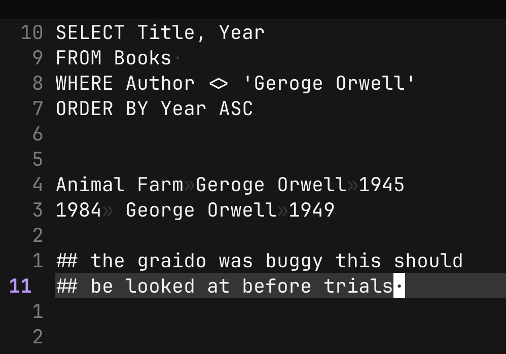
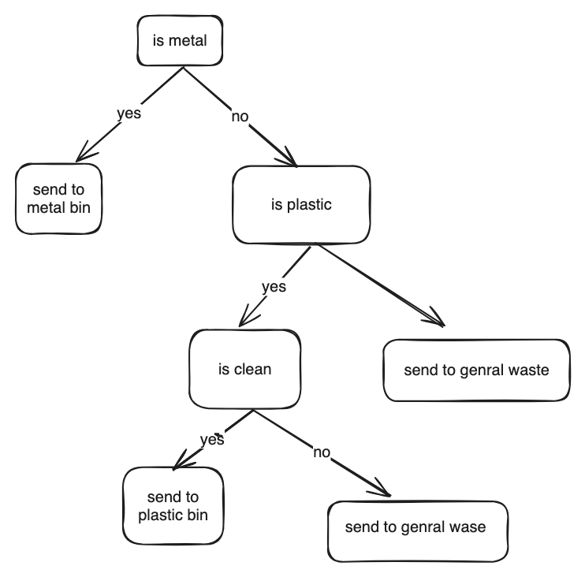
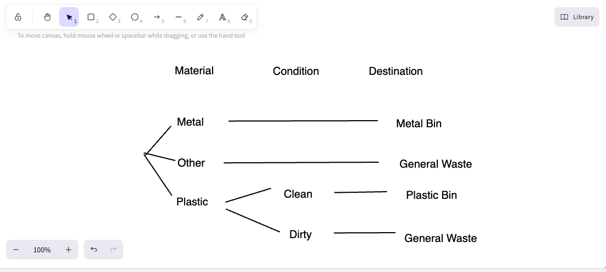

# 12SEN_TrialExamRevisionTest1 (timed)

- Syllabus: Software Engineering · Publisher: –
- Status: COMPLETED · results released · submitted 2026-07-15
- **Score: 48 / 78** (62%) · answered 31/31 parts · marked 31/31
- Review page: https://platform.gradeo.com.au/reviewExam/08fe862e-7fac-4bca-a6c7-8995e3e7a494

---

## 1. Version Control (MC, TKS 2025)

*Source: TKS 2025*

**Stimulus:**

A team of developers is collaborating on a web application using Git and GitHub. During a sprint, a developer accidentally pushes a commit to the main branch that breaks the layout of the homepage. The team wants to fix the issue while preserving the project history and avoiding disruption to other contributors who are working on feature branches.

#### Part A — 1/1 marks  `MULTI_CHOICE`

Which of the following would be the most appropriate way to resolve the issue using Git?

- **A.** Delete the main branch and recreate it from a stable feature branch, then notify all contributors to rebase their work.
- **B.** Force push an older version of the project to the main branch using "git push -- force" removing the faulty commit from history.
- **C.** Use "git revert" to create a new commit that undoes the changes from the faulty commit, then push the revert to the main branch.  ✅ *correct*  ⬅️ **your choice**
- **D.** Pause all development, clone the repository locally, manually fix the layout, and upload the corrected files without using Git commands.

**Your answer:** C · **Correct:** C ✔

---

## 2. Backup (MC, TKS 2025)

*Source: TKS 2025*

**Stimulus:**

A medium-sized business experiences a ransomware attack that encrypts all its customer data and financial records. The IT department had implemented programmed backups, but the last successful backup was completed two weeks prior to the attack.

#### Part A — 1/1 marks  `MULTI_CHOICE`

Which of the following actions would best minimise data loss and ensure business continuity in the future?

- **A.** Disable all internet access to prevent future attacks
- **B.** Increase the frequency of programmed backups and offsite storage  ✅ *correct*  ⬅️ **your choice**
- **C.** Performing full manual backups when major changes occur in the system
- **D.** Switch to a staggered method of data backup (ie: Grandfather, Father, Son)

**Your answer:** B · **Correct:** B ✔

---

## 3. Types of Machine Learning Algorithms (MC, TKS 2025)

*Source: TKS 2025*

#### Part 1 — 1/1 marks  `MULTI_CHOICE`

If we want to make predictions by comparing new data points to similar instances in a dataset, which algorithm fits this approach?

- **A.** Linear regression
- **B.** Logistic regression  ✅ *correct*  ⬅️ **your choice**
- **C.** Support Vector Machine
- **D.** K-nearest neighbour (KNN)

**Your answer:** B · **Correct:** B ✔

---

## 4. Generating Solutions (MC, TKS 2025)

*Source: TKS 2025*

#### Part 1 — 1/1 marks  `MULTI_CHOICE`

Which type of testing focuses on verifying that individual components or functions of a program work as expected?

- **A.** Unit testing  ✅ *correct*  ⬅️ **your choice**
- **B.** System testing
- **C.** Integration testing
- **D.** Acceptance testing

**Your answer:** A · **Correct:** A ✔

---

## 5. Security Strategies & Tools (MC, TKS 2025) 

*Source: TKS 2025*

#### Part 1 — 0/1 marks  `MULTI_CHOICE`

In what stage of development can SAST tools be applied?

- **A.** Only during integration testing.
- **B.** Only during initial design phases.
- **C.** Only after the code is completed.  ⬅️ **your choice**
- **D.** At any stage after Requirements definition.  ✅ *correct*

**Your answer:** C · **Correct:** D ✘

---

## 6. Presentation (MC, TKS 2025)

*Source: TKS 2025*

#### Part A — 1/1 marks  `MULTI_CHOICE`

Which of the following best describes how to maintain consistency in presentation design?

- **A.** Use the same fonts, colors, and spacing on all slides  ✅ *correct*  ⬅️ **your choice**
- **B.** Change slide backgrounds frequently to keep things interesting
- **C.** Add animations and transitions to every slide to impress the audience
- **D.** Vary font sizes and styles based on the importance of content on each slide

**Your answer:** A · **Correct:** A ✔

---

## 7. Development (MC, TKS 2025)

*Source: TKS 2025*

#### Part A — 1/1 marks  `MULTI_CHOICE`

In software engineering, why is it important to include a contingency fund when allocating financial resources?

- **A.** To cover the costs of team social events and morale-boosting activities
- **B.** To guarantee that hardware and software purchases can be made immediately
- **C.** To account for unforeseen challenges such as scope changes or technical issues  ✅ *correct*  ⬅️ **your choice**
- **D.** To ensure that all team members receive overtime pay regardless of project needs

**Your answer:** C · **Correct:** C ✔

---

## 8. Designing and Analysing ML (MC, TKS 2025)

*Source: TKS 2025*

#### Part 1 — 0/1 marks  `MULTI_CHOICE`

How does batch normalisation improve the training process of neural networks?

- **A.** By minimising the number of layers required
- **B.** By normalising input weights of selected neurons  ⬅️ **your choice**
- **C.** By decreasing computation time through layer fusing
- **D.** By ensuring inputs to each layer are on a similar scale  ✅ *correct*

**Your answer:** B · **Correct:** D ✘

---

## 9. Requirements (MC, TKS 2025)

*Source: TKS 2025*

**Stimulus:**

The development team agrees the app will handle user login, profile management, and order placement but will not include social media features.

#### Part A — 1/1 marks  `MULTI_CHOICE`

Which section of the requirements definition does the stimulus describe?

- **A.** Defining data types
- **B.** Defining boundaries  ✅ *correct*  ⬅️ **your choice**
- **C.** Generating requirements
- **D.** Assessing scheduling feasibility

**Your answer:** B · **Correct:** B ✔

---

## 10. Quality Assurance (OR, TKS 2025)

*Source: TKS 2025*

#### Part A — 2/2 marks  `OBJECTIVE_RESPONSE`

For each software project described below, select the most appropriate quality assurance focus area that should be prioritised.

| Statement | Correct | Yours | |
|---|---|---|---|
| A government website designed for public access | Usability | Usability | ✔ |
| A video game app requiring fast response times | Performance | Performance | ✔ |
| A medical records system needing accurate data entry | Functionality | Functionality | ✔ |
| An online banking platform that processes transactions | Security | Security | ✔ |

**Marking criteria:**
- [2] Correctly selects all options
- [1] Partially correct selection

---

## 11. Social/Ethical/Legal Issues (SA, TKS 2025)

*Source: TKS 2025*

#### Part A — 0/3 marks  `SHORT`

Describe the concept of digital disruption and how the development of secure software can both cause and respond to it.

**Your answer:**

> # learn what the digital diruption is \*\*\*\*\*

*(7 words)*

**Feedback (TKS CST, 0 marks):** - Clearly define digital disruption (for example, how new digital technologies change or replace existing business models, services, or ways of working).
- Explain how secure software can *cause* digital disruption (such as enabling new online services or platforms that people trust because they’re safe and protect data).
- Explain how secure software can *respond* to digital disruption (for example, helping existing organisations adapt by securing their systems, protecting customer information, and enabling secure digital transformation).
- Include at least one concrete example, like secure mobile banking apps disrupting traditional banking, or secure cloud services disrupting on‑premise IT.

**Marking criteria:**
- [3] Clearly describes digital disruption and how secure software relates to it, with examples.
- [2] Provides a general description of digital disruption with some link to secure software
- [1] Makes a vague or minimal connection between digital disruption and security.

**Sample answer:**

Digital disruption refers to how new technologies change or replace traditional business models. Secure software development can cause digital disruption by enabling innovative services, like blockchain-secured transactions, that make older methods obsolete. It also helps enterprises respond to disruption by protecting data and systems from cyber threats, allowing them to adopt new digital tools safely. For example, a financial company using secure blockchain tech disrupts traditional banking with faster, safer services. At the same time, secure software helps businesses protect themselves and adapt to these technological changes.

---

## 12. Collaboration Benefits (SA, TKS 2025)

*Source: TKS 2025*

#### Part A — 3/4 marks  `SHORT`

Describe how collaborative code reviews contribute to the security of a software system. In your answer, refer to specific benefits of having multiple team members involved in reviewing code.

**Your answer:**

> When you have code reviws and get other people to review your code it will make code more secure. "if you have enough eyes all bugs becom shallow" - linise tovolds. This is esentaly that there will he less bugs and better code when there is a mulable reviewrs. This is becase the writer of the code will write the code with cirtirn assumtioins in place for example the Hartbleed bug was not lengh checking a value becase he asumend that it was allready checkd elswhere but a second person could have soptted that if it was review preopelry.

*(99 words)*

**Feedback (TKS CST, 3 marks):** Strong start. To strengthen your answer, I would explain more specific security-related benefits of collaborative reviews, such as:
- Different reviewers bringing diverse expertise (e.g. cryptography, access control, secure coding practices) and spotting security flaws others might overlook.
- Reviewers checking that input validation, error handling, and authentication/authorisation are implemented correctly and consistently.
- Shared responsibility and accountability, which can reduce the chance of risky shortcuts or insecure patterns slipping through.
- Helping to spread security knowledge across the team, so more people learn to recognise secure and insecure coding patterns.

**Marking criteria:**
- [4] Demonstrates a thorough understanding of how collaborative code reviews improve security, with specific and relevant benefits clearly explained
- [3] Shows a sound understanding of code review benefits with some relevant explanation.
- [2] Identifies a general benefit of code reviews with limited or vague explanation.
- [1] Provides a basic or general statement about teamwork or checking code, without clear links to security.

**Sample answer:**

Collaboration is important in secure software development because no single developer can identify every possible vulnerability or threat. Security is a complex area that benefits from multiple perspectives and areas of expertise. While one developer may be skilled in coding secure authentication, another may be better at identifying potential network vulnerabilities. By working together, the team can address more risks and validate each other’s work, which increases the overall quality and resilience of the software. Relying on one person increases the chance of blind spots or overlooked errors, while collaboration spreads responsibility and strengthens the final product.

---

## 13. ML Regression Models with OOP (OR, TKS 2025)

*Source: TKS 2025*

#### Part A — 1/1 marks  `OBJECTIVE_RESPONSE`

The following are equations for different regression models.

Select the correct equation for each model.

| Statement | Correct | Yours | |
|---|---|---|---|
| null | Logistic Regression | Logistic Regression | ✔ |
| null | Polynomial Regression | Polynomial Regression | ✔ |
| null | Linear Regression | Linear Regression | ✔ |

---

## 14. Programming - Dictionaries (Structured Data Types, 2025 TKS)

*Source: TKS 2025*

#### Part A — 3/3 marks  `CODING`

Write a dictionary called student that stores the keys: "name", "age", and "grade". Assign values of your choice and print them.

**Your answer:**

```python
student = {}
for i in ["name","age","grade"]:
  val = input(f"enter {i} ")
  student[i]=val

for i in ["name","age","grade"]:
  print(f"{i} is set to {student[i]}")
  
# testing 
# enter name fred
# enter age 10
# enter grade A+
# name is set to fred
# age is set to 10
# grade is set to A+
```

**Feedback (TKS CST, 3 marks):** Your code correctly creates a dictionary called 'student' with the keys 'name', 'age', and 'grade', and then prints out each value, so it gets full marks.

Areas for possible adjustment:
- The question only asked you to "assign values of your choice" and print them, not to read them from user input. For this exercise, something like:
  `student = {"name": "Fred", "age": 10, "grade": "A+"}`
  followed by `print(student["name"])`, etc., would be totally fine. Yours is harmlessly over-engineered.
- Because you are using `input`, all values are stored as strings. If age is intended to be numeric, you could convert it, for example: `student["age"] = int(input("enter age "))`.
- Variable naming can be slightly clearer: instead of `i`, something like `key` makes it more obvious what the loop variable represents.

**Marking criteria:**
- [3] Dictionary is created with correct keys and values, and each value is accessed and printed correctly.
- [2] Dictionary created, but missing a key/value or incorrect access when printing.
- [1] Dictionary partially attempted or printed incorrectly.

**Sample answer:**

student = {"name": "Liam", "age": 16, "grade": "A"}  
print(student\["name"\])  
print(student\["age"\])  
print(student\["grade"\])

---

## 15. File Security (SA, TKS 2025)

*Source: TKS 2025*

#### Part A — 1/3 marks  `SHORT`

Outline two mitigation strategies a developer can implement to protect against insecure file uploads in a web application

**Your answer:**

> **Never** **ever** **execure** the file this would mean using the OS levle pemtions to protect your self  
> 
> chmod r-w-- and not execuet as this means that the thess files are nutrustwothry. 
> 
> also running them in a **sandbox** would prevet the user a effectin user b but is 
> 
> # this is a gap in my knolage!!!!

*(54 words)*

**Feedback (TKS CST, 1 marks):** As you've acknowledged, this response needs some work:
The chmod example you used is a bit confused: to prevent execution you would normally remove the execute permission (e.g. make sure the file has no `x` bits like rw-), but you also need to think about where files are stored (e.g. outside the web root) and how they’re accessed (serving them safely through a secured API rather than letting the OS or web server execute them). At the moment, your answer doesn’t explain how a developer would implement this in a typical web application.

Similarly, your mention of a sandbox is on the right track conceptually, but it’s very vague. It would help to explain what “running them in a sandbox” means in practice: for example, using a separate, locked‑down process or container with minimal privileges to handle any necessary processing of uploaded files so that, if something malicious is uploaded, it can’t affect the main application or other users.

To strengthen your answer, I would:
- Clearly name two specific mitigation strategies (for example: strict validation of file types and extensions, storing files outside the web root and instead in a secure storage location, disabling execution of uploaded files, virus scanning, size and content checks, and sandboxed processing).
- Explain each strategy briefly but specifically from a developer’s perspective: what to configure, what checks to perform, and why it protects against insecure uploads.

**Marking criteria:**
- [3] Clearly outlines two effective and relevant mitigation strategies with brief explanations
- [2] Outlines two strategies with limited explanation, or one strategy with clear explanation
- [1] Identifies one strategy with limited detail or vague description.

**Sample answer:**

To protect against insecure file uploads, developers should restrict uploaded file types to safe formats using whitelisting (e.g., only allowing .jpg or .pdf). This prevents execution of malicious scripts like .php or .exe files. Additionally, files should be stored in a non-executable directory, separate from the application logic, to avoid accidental execution. These measures reduce the risk of attackers uploading and executing harmful files on the server.

---

## 16. Minimise Vulnerabilities (SA, TKS 2025)

*Source: TKS 2025*

#### Part A — 2/4 marks  `SHORT`

Explain what Cross-Site Scripting (XSS) attacks are and describe two ways developers can protect their applications against them.

**Your answer:**

> A XSS atack is where user A will get you to enjest some java script then it will be uploded and given to user B that will run on there broser. then it will make a post request to a server thay own captrung cred of excuting command on the attacter bahalf. This can be prevented by tags telling browser not to execure it this mean the the pauylod is not executed. A better defence is sanitaaion this is where the test is sent to the baced this the baced will strip all escap all JS keyword so that i is nolonger vlaid executable javascript.

*(105 words)*

**Feedback (TKS CST, 2 marks):** You’ve captured the basic idea of what XSS is: malicious JavaScript is injected into a page so that it runs in another user’s browser, often allowing the attacker to steal data or perform actions on that user’s behalf. That shows a foundational understanding of the attack.

However, your explanation needs to be clearer and more precise. At the moment, the description is difficult to follow due to spelling and grammar issues, and some of the technical wording is a bit confusing (for example, “captrung cred of excuting command on the attacter bahalf”). I would focus on clearly stating that XSS occurs when an application displays user-supplied input without proper safety measures, allowing an attacker’s script to run in another user’s browser and access things like cookies or session tokens.

On the mitigation side, you mention preventing execution and sanitisation, which are relevant ideas, but they need to be described more accurately:
- When you talk about “tags telling browser not to execure it”, I think you’re referring to things like correctly escaping output in HTML (for example, converting `<` to `&lt;` so the browser treats it as text, not as a tag), or using Content Security Policy (CSP) to define what can be loaded and from where. As written, it’s not very clear what specific technique you mean. I would explicitly mention output encoding/escaping and explain that this stops the browser from interpreting user input as script.
- Your mention of sanitisation is on the right track, but the explanation that the backend will “strip all escap all JS keyword” is not accurate or practical. Good sanitisation usually means validating and cleaning input based on allowed content (e.g., only allowing certain characters or HTML tags) rather than trying to remove all JavaScript keywords. Also, you could mention input validation and using well-tested libraries or frameworks that handle this safely.

To strengthen your answer, I would:
1. Rewrite your explanation of what XSS is in clear, grammatical sentences, focusing on the core idea: attacker-controlled script running in another user’s browser because of unsafe handling of user input.
2. Name and explain two specific, standard mitigation techniques clearly, such as:
   - Output encoding/escaping for HTML, attributes, and JavaScript contexts.
   - Input validation and sanitisation using a whitelist approach.
   - Using HTTP-only cookies and Content Security Policy (CSP) as additional layers.

**Marking criteria:**
- [4] Thorough explanation of XSS and two clear, accurate mitigation methods with reasoning.
- [3] Thorough explanation of XSS and two clear, accurate mitigation methods with reasoning.
- [2] Basic understanding of XSS and at least one mitigation method explained.
- [1] Vague or limited explanation of XSS or mitigation methods.

**Sample answer:**

Cross-Site Scripting (XSS) is a security vulnerability where attackers inject malicious scripts into web pages viewed by other users. These scripts execute in the victim’s browser, allowing attackers to steal sensitive data or perform actions on behalf of the user. To protect against XSS, developers should validate and sanitize all user inputs to remove harmful code or characters. Additionally, encoding output before rendering it in web pages prevents injected scripts from executing by treating them as text rather than code. Implementing a Content Security Policy (CSP) is also effective in restricting the execution of untrusted scripts. Together, these measures reduce the risk of XSS attacks and improve application security.

---

## 17. Object-Relational Mapping (SA, TKS2025)

*Source: TKS 2025*

#### Part A — 3/3 marks  `SHORT`

Which of the following is an example of human bias influencing AI system design?

*Word limit: 50*

**Your answer:**

> A ORM is a tool that allow devlopers to abstractly intergrate with a database this allows for devlopers to not have to hand craft there SQL commands. This is helpfull as a devleoer needs to focose on the bacends sdesign and implmetain not database optimatins. Also a ORM will handle command escapment this is benifical as SQL injecton uset to be one of the most common atacts but now largly due to orm it is not.

*(76 words)*

**Feedback (TKS CST, 3 marks):** Your explanation of how ORMs boost productivity could be clearer and more complete. I would strengthen it by:
- Explaining more directly that ORMs let developers work with database records as objects in their programming language, which speeds up development and reduces boilerplate code.
- Mentioning that ORMs can simplify common operations (like creating, reading, updating, and deleting records) and make code easier to maintain, which is a key part of productivity.

**Marking criteria:**
- [3] Correctly explains why ORM improves developer productivity.
- [2] Describes one reason why ORM improves developer productivity.
- [1] Provides some relevant information.

**Sample answer:**

ORM improves developer productivity by handling multiple SQL queries behind the scenes to perform a single high level task. This means developers can use simple method calls instead of writing and managing several related SQL statements manually.

---

## 18. SQL Query Results (Yr12, CT, TKS2025)

*Source: TKS 2025*

**Stimulus:**

The following table represents a database at a book store:

| **BookID** | **Title** | **Author** | **Year** |
|---|---|---|---|
| 201 | The Hobbit | J.R.R. Tolkien | 1937 |
| 202 | 1984 | George Orwell | 1949 |
| 203 | Brave New World | Aldous Huxley | 1932 |
| 204 | Dune | Frank Herbert | 1965 |
| 205 | Animal Farm | Geroge Orwell | 1945 |

#### Part A — 2/2 marks  `RICH_TABLE`

The following SQL query is run to test the database.

**SELECT Title, Year**  
**FROM Books**   
**WHERE Author <> 'Geroge Orwell'**  
**ORDER BY Year ASC**

Fill in the table below with the result of running the SQL query. You may not need to use all the rows or columns.

|  |  |  |  |
|---|---|---|---|
|  |  |  |  |
|  |  |  |  |
|  |  |  |  |

Uploaded: 

**Feedback (TKS CST, 2 marks):** Gave this full marks since the question may be faulty, and we don't want it to impact your mark.

**Sample answer:**

| **Title** | **Year** |
|---|---|
| Brave New World | 1932 |
| The Hobbit | 1937 |
| Dune | 1965 |

---

## 19. PWA (OR, TKS 2025)

*Source: TKS 2025*

#### Part A — 2/2 marks  `OBJECTIVE_RESPONSE`

Identify the corresponding feature to its relevant appliation.

| Statement | Correct | Yours | |
|---|---|---|---|
| A platform that allows users to buy products online | E-commerce Website | E-commerce Website | ✔ |
| A site that updates content based on user input | Interactive Website | Interactive Website | ✔ |
| An app-like website that works offline and sends notifications | Progressive Web App (PWA) | Progressive Web App (PWA) | ✔ |

**Marking criteria:**
- [2] Correctly selects all options
- [1] Partially correct selection

---

## 20. Human Behaviour Influences on ML and AI (SA, TKS 2025)

*Source: TKS 2025*

#### Part 1 — 2/4 marks  `SHORT`

Explain the importance of cultural sensitivity in the design of AI systems.

*Word limit: 150*

**Your answer:**

> Diffrent culturs have expect diffrent things from there AI systmes. For esample some culter want more or less automomey, vlaue privecy more or less, and expect diffrent amounts of fomality. This is why when makeing a ai product the devolper needs to be awhere and cultrualy sencitvy. other wise there product will be seen a intruse to autonomus or not automosl enought a spy divice trying to seal all your info or somting that is not personal or taliyrd to the user.
> 
> This is why it is imprtant to have diffrent prodcuts. 
> 
> for examle you can see in antropics sonot 5 suystme prompt that it tell thoe LLM not to mention memopruy a nice use of coultrsecitvity.

*(117 words)*

**Feedback (TKS CST, 2 marks):** This is an explain question, so we need a quick topic sentence followed by a series of cause -> link -> effects for each point you make.

Your response needs to be clearer and more structured. At the moment, the ideas are there but not fully developed. You could strengthen your answer by:
- Explicitly linking cultural sensitivity to outcomes like user trust, adoption, fairness, and avoiding harm or offence.
- Giving at least one concrete, well-explained example from a real-world context (for instance, differences in how AI should communicate in more formal vs more informal cultures, or how attitudes to data sharing vary across countries).
- Explaining that cultural sensitivity is not just about different products, but also about how AI systems are trained, whose values are embedded in them, and how they respond to users from diverse backgrounds.

Your reference to Anthropic’s system prompt shows you’re thinking about practical examples, but the explanation is a bit unclear. You could clarify how not mentioning memory is culturally sensitive (for example, by relating it to concerns about privacy and surveillance).

**Marking criteria:**
- [4] Clearly explains the importance cultural sensitivity in the design of AI systems.
- [3] Describes the importance cultural sensitivity in the design of AI systems.
- [2] Outlines why cultural sensitivity may be important in designing AI systems.
- [1] Provides some relevant information.

**Sample answer:**

Cultural sensitivity in AI design involves tailoring AI systems to respect and incorporate the cultural norms and practices of the intended user base. This ensures that the AI systems are perceived as respectful, relevant, and responsive to the users' cultural contexts, promoting higher levels of engagement and acceptance. For example, localisation of AI voice assistants like Amazon Alexa or Google Assistant is a critical component of cultural sensitivity. When deployed in different countries, these assistants undergo significant adaptation processes that include recognising local dialects, respecting local customs, and following region-specific social norms. By doing so, users across different cultures feel understood and respected, improving their overall engagement with the AI system. For instance, in a country where formality is a key social norm, the AI might be designed to use titles and formal language in its interactions, reflecting the users' cultural expectations and enhancing their comfort and trust in the system.

---

## 21. Decision Tree (SA, TKS 2025)

*Source: TKS 2025*

**Stimulus:**

A smart recycling bin uses an intelligent system to decide how to sort waste. It follows these steps:

1.  If the **item is metal**, it is sent to the **metal bin**.
    
2.  If the item is **not metal**, it checks whether the item is **plastic**.
    
    -   If it **is plastic**, it checks whether the **item is clean**.
        
        -   If **clean**, it is sent to the **plastic bin**.
            
        -   If **not clean**, it is sent to **general waste**.
            
    -   If it **is not plastic**, the item is sent to **general waste**.

#### Part A — 3/3 marks  `DRAWING_V2`

Construct a decision tree to represent the logical process used by the intelligent recycling system.

**Your answer:**



Drawing contents (extracted): labels: "is metal", "yes", "no", "send to\nmetal bin", "is plastic", "yes", "is clean", "yes", "send to\nplastic bin", "no", "send to genral wase", "send to genral waste"

Connectors: arrow "is metal" → "send to\nmetal bin (nearest)" [yes]; arrow "is metal" → "is plastic (nearest)" [no]; arrow "is plastic" → "is clean (nearest)" [yes]; arrow "is clean" → "send to\nplastic bin (nearest)" [yes]; arrow "is clean (nearest)" → "is clean (nearest)"; arrow "is clean" → "[rectangle] (nearest)" [no]; arrow "is plastic" → "send to genral waste (nearest)"

**Feedback (TKS CST, 3 marks):** All correct paths present.

**Marking criteria:**
- [3] Draws a substantially correct decision tree showing all rules and actions
- [2] Draws a decision tree showing understanding of some rules and actions
- [1] Identifies a feature of a decision tree

**Sample answer:**



---

## 22. Testing and Evaluating (OR, TKS 2025)

*Source: TKS 2025*

#### Part A — 2/2 marks  `OBJECTIVE_RESPONSE`

Match the appropriate testing methodology to its definition.

| Statement | Correct | Yours | |
|---|---|---|---|
| Confirming that the software meets the business requirements and is ready for deployment. | Acceptance Testing | Acceptance Testing | ✔ |
| Testing individual components or functions of the code in isolation. | Unit Testing | Unit Testing | ✔ |
| Verifying that the entire application functions as expected in its environment. | System Testing | System Testing | ✔ |
| Ensuring that different modules work together correctly. | Integration Testing | Integration Testing | ✔ |

---

## 23. Feedback (SA, TKS 2025)

*Source: TKS 2025*

#### Part A — 3/3 marks  `SHORT`

Describe two steps involved in analysing feedback during software development.

*Word limit: 120*

**Your answer:**

> you need to catogrise feadback then you need to rank it by importance.
> 
> **catogrise** 
> 
> you need to put the usere feadback in catogriys like UI, UX, devops, security, ect. this means tha the right people will get the feadback to action on.
> 
> **Importance**
> 
> next you need to rank in terms of impotance for ecample a RCE that is trival to atack is a 10 vrs a div not bing centerd thsi is maby 1 or 2 this will mean that the teams will be able to take do the tings tha thave the most impact first.

*(96 words)*

**Feedback (TKS CST, 3 marks):** To improve your answer:
- You could make your explanations a bit more structured by using full sentences and clearer punctuation. See sample response.

Overall, your answer is relevant, and you clearly describe two steps in the feedback analysis process.

**Marking criteria:**
- [3] Clearly describes two steps involved in analysing feedback during software development.
- [2] Outlines AT LEAST ONE step involved in analysing feedback during software development.
- [1] Provides some relevant information

**Sample answer:**

One step in analysing feedback is categorisation, where feedback is sorted based on its source such as user, stakeholder, peer, or automated. This helps developers prioritise feedback appropriately, ensuring that critical issues like user-reported bugs are addressed before less urgent suggestions. Another step is impact analysis, which involves evaluating how implementing the feedback will affect the software’s architecture, performance, or user experience. This helps developers avoid introducing new problems and ensures that changes lead to meaningful improvements.

---

## 24. Additional Solutions (SA + MC, TKS 2025)

*Source: TKS 2025
*

**Stimulus:**

A development team is creating a mobile app to help users track their daily water intake. While the app prototype functions correctly, user feedback reveals that the interface is cluttered and confusing. Users struggle to locate key features like the daily goal tracker and hydration reminders.

#### Part A — 2/3 marks  `SHORT`

Describe how the principle of consistency could be applied to improve the user interface of the app.

*Word limit: 125*

**Your answer:**

> The priciple of concitency mens keeping the app simlar to the exiting pattersn that the user is use to seeing. For moblile exiting pattes include things like a 3 itme bottem bar, a setting icon shaped like a cog. also keeping the menu free from clutter allow the ueser to ealey find what thay need as it follow a cohrent intenal design langage but also is the same langage and patters that other apps have.

*(75 words)*

**Feedback (TKS CST, 2 marks):** Your description is quite brief and fragmented, so it doesn’t fully explain how applying consistency would actually improve the user interface. For a descriptive question, you need to provide clear characteristics and features, such as how consistent placement of buttons, colours, typography, and navigation across all screens helps users learn the app more quickly and reduces confusion. You could also link this to using standard platform conventions (Android/iOS) so users know what to expect.

To improve your answer, try to:
- Write in complete, clear sentences that explain your ideas step by step.
- Explicitly describe how consistency in layout, icons, wording, and interactions makes the app easier to learn and remember.
- Give one or two concrete examples, such as: keeping the “back” button in the same spot on every screen, using the same colour for all primary actions, and making sure similar tasks work in similar ways.

**Marking criteria:**
- [3] Clearly describes how the principle of consistency could be applied to improve the user interface of the app.
- [2] Outlines how the principle of consistency could be applied to improve the user interface of the app.
- [1] Provides some relevant information.

**Sample answer:**

Consistency in UI design means using uniform visual elements (such as colours, fonts, and icons) and predictable interaction patterns across the app. By applying consistency, the team could ensure that similar features look and behave the same way throughout the app. For example, placing all tracking tools in a similar layout or using the same icon style for reminders would help users recognise and navigate features more easily, reducing confusion.

#### Part B — 1/1 marks  `MULTI_CHOICE`

Which of the following best demonstrates the principle of consistency in UI design?

- **A.** Changing the interface design regularly to keep users engaged with new visuals
- **B.** Placing navigation menus in different locations depending on the feature being used
- **C.** Applying the same font, colour scheme, and layout structure across all screens in the app  ✅ *correct*  ⬅️ **your choice**
- **D.** Using different button styles and colours for each screen to make the app visually dynamic

**Your answer:** C · **Correct:** C ✔

---

## 25. Testing and Evaluating (SA, TKS 2025)

*Source: TKS 2025*

**Stimulus:**

A software engineer is developing a weather forecasting application. Before launching the app, they test how different modules such as the data retrieval module, the temperature conversion module, and the display module work together. They want to ensure that the modules interact correctly and that data flows smoothly between them.

#### Part A — 1/3 marks  `SHORT`

Based on the scenario, identify the type of software testing being used and describe how this testing helps ensure the reliability of the final product.

*Word limit: 110*

**Your answer:**

> unit testing is where you test individual components or functions of the code in isolation. Integration testing is ensuring that different modules work together correctly.
> 
> This allow you to enshure that the app will work when it is finaly deplyed as if each modue works on its own that is verry good then if each module works toghte this this means that you can find bugs in small managable peises and be like there is a bug in these 20 000 lines but insted there is a bug in this function of there is a bug in the interfase of the weater api and the disply moduel.
> 
> can i coppy from another multi choice questoni this is from q 22????? (do not mark this) but want a answer please

*(129 words)*

**Feedback (TKS CST, 1 marks):** The question is aiming for you to identify systems testing and explain how that type of testing helps ensure the reliability of the final product. In your answer, you focused on unit and integration testing instead, so you haven’t directly addressed the required type of testing. To improve, you would need to state that the scenario is about systems testing and then describe that systems testing checks the complete, integrated application in an environment similar to real use, making sure all parts work together and meet the requirements.

Your description of integration testing is on the right track, but you could strengthen it by explicitly stating its benefits, such as detecting issues in the interactions between modules and ensuring data flows correctly across the system. This would get you closer to 2 marks.

About your final question: we don't copy responses from one question to another. In the HSC, each question will be unique and require you to apply different knowledge or skills in varying ways. They are trying to assess your knowledge broadly, so they will never double up on the same thing. Always answer the question to the best of your ability and try to include new stuff. If you feel like a question is the same as another, try reading it again to make sure you are interpreting it correctly. To confirm, you will never need to copy from another question. Each question is supposed to be isolated and unique.

**Marking criteria:**
- [3] Correctly identifies systems testing and clearly describes how this testing helps ensure the reliability of the final product.
- [2] Describes the benefits of integration testing.
- [1] Provides some relevant information.

**Marking guidance:**

Note that the student may have variations in their solutions, and integration testing can be accepted as a partly correct solution if the student explains provides a valid enough justification such as how the function would interact with other components of the application.

**Sample answer:**

The type of testing being used is system testing. This method is important because it evaluates the entire application as a whole, ensuring that all components such as step counting, heart rate monitoring, and data syncing work together correctly in a real-world environment. System testing helps identify issues that may arise from the interaction between modules and confirms that the software meets its functional and performance requirements before release.

---

## 26. Development (SA, TKS 2025)

*Source: TKS 2025*

#### Part A — 0/4 marks  `SHORT`

A software team is using Agile methodology for a complex project that frequently changes priorities.

Explain how resource allocation strategies should adapt to ensure project success.

*Word limit: 120*

**Your answer:**

> ## learn agile some more

*(4 words)*

**Feedback (TKS CST, 0 marks):** Revise 4.5 Agile Approach.
Your response should:
- Clearly explain how resources (people, time, skills, tools) need to be allocated flexibly in an Agile project, especially when priorities change frequently.
- Describe concrete strategies, such as cross-functional teams, shifting team members between tasks or sprints based on changing priorities, limiting work in progress, and regularly reassessing capacity during sprint planning.
- Include examples, for instance: how a team might move a developer from a low-priority feature to a high-priority bug fix in the next sprint, or how a product owner re-allocates effort after a sprint review.
- Justify why these strategies help ensure project success in a complex, changing environment (e.g. faster response to change, reduced bottlenecks, better alignment with customer needs).

**Marking criteria:**
- [4] Provides a detailed explanation of flexible resource allocation in Agile with examples and clear justification.
- [3] Explains the need for flexibility and some strategies, but lacks full detail or examples.
- [2] Mentions flexibility or Agile but with limited understanding or incomplete explanation.
- [1] Vague or minimal response with little relevance to Agile or resource allocation.

**Sample answer:**

In an Agile project with shifting priorities, resource allocation must be flexible. The team should regularly reassess and adjust resources to focus on high-priority tasks, reallocating developers, testers, and designers as needed. Overlapping tasks, such as testers preparing test cases during coding, helps maintain efficiency. Agile ceremonies like sprint planning and daily stand-ups support ongoing communication, allowing quick identification of resource shortages or bottlenecks. Maintaining a contingency fund helps manage unexpected issues without delaying work. This adaptive approach ensures critical features are developed first, prevents resource bottlenecks, and supports timely delivery despite changes, aligning with Agile’s iterative nature and promoting high-quality outcomes.

---

## 27. Version Control (MC + SA, TKS 2025)

*Source: TKS 2025*

**Stimulus:**

A development team is working on a collaborative project using Git and GitHub. Each developer is assigned a feature and works on a separate branch. Before merging their work into the main branch, the team conducts code reviews and tests for compatibility. One developer notices that their branch has diverged significantly from main due to recent updates by others.

#### Part A — 2/3 marks  `SHORT`

Describe the steps the developer should take to ensure their branch is compatible with the latest version of main before merging.

*Word limit: 120*

**Your answer:**

> 1.  fork the repo 
> 2.  sync there repo to master/main
> 3.  git pull
> 4.  reseove the meage confics rebase when and if needed
> 5.  make a commit 
> 6.  push to there repo 
> 7.  make a PR

*(29 words)*

**Feedback (TKS CST, 2 marks):** However, the steps you’ve listed aren’t very clearly structured around the specific goal of ensuring the branch is compatible with the latest version of main. At the moment, it reads more like a high-level GitHub workflow (fork, push, PR) rather than a clear sequence for updating an existing branch against the latest `main`.

To improve clarity, I would:
- Make it explicit that the developer should first fetch and update the local `main` branch (e.g. `git checkout main` then `git pull origin main`).
- Then describe checking out their feature branch (e.g. `git checkout my-feature-branch`).
- Explain how to bring changes from `main` into that branch, either by merging (`git merge main`) or rebasing (`git rebase main`), and emphasise that this is the key compatibility step. By reconciling the feature branch with main locally, we can ensure there won't be merge conflicts when doing a pull request on the remote repository,
- Add a clear note that merge conflicts need to be resolved carefully at this stage, and then the developer should run tests or the build to make sure everything still works.

The parts about forking the repo and making a PR are only partially relevant to the specific question. Forking is not always part of the workflow (especially in an internal company repo), and the question focuses on ensuring compatibility *before* merging, rather than the full contribution process.

**Marking criteria:**
- [3] Clearly describes the steps the developer should take to ensure their branch is compatible with the latest version of main before merging.
- [2] Outlines how the developer can ensure their branch is compatible with main without causing unnecessary conflicts.
- [1] Provides some relevant information

**Sample answer:**

To ensure their branch is compatible with the latest version of main, the developer should first use "git fetch" to retrieve the most recent changes from the remote repository. Then, they can use "git rebase main" while on their feature branch to apply their changes on top of the updated "main" branch. This helps integrate the latest updates and resolve any conflicts before merging. Git supports this process by allowing developers to rebase or merge branches, which helps maintain a clean and linear project history. Rebasing is especially useful for keeping feature branches up to date without creating unnecessary merge commits.

#### Part B — 1/1 marks  `MULTI_CHOICE`

In addition, what is the most appropriate action the developer should take to maintain team workflow discipline and avoid integration issues?

- **A.** Skip code review and merge their branch immediately to avoid delaying the sprint timeline.
- **B.** Archive their branch and start a new one from main, assuming the original work will be too difficult to integrate.
- **C.** Push their branch to the remote repository and collaborate with other team members to resolve any conflicts during the merge.
- **D.** Communicate with the team, pull the latest changes from main, and rebase their branch to align with the current codebase before requesting a merge.  ✅ *correct*  ⬅️ **your choice**

**Your answer:** D · **Correct:** D ✔

---

## 28. Programming - Positive Integers (Iteration, 2025 TKS)

*Source: TKS 2025*

#### Part A — 5/5 marks  `CODING`

Write a Python program that:

-   Creates an empty list
-   Uses a loop to ask the user to enter 5 integers
-   Only adds the number to the list if it is positive
-   After the loop prints the list of positive numbers entered.

**Your answer:**

```python
list = []
# for this i am not consider 0 as a intager so all numbers 
# like 1,2,3,4,5,6,7,8,...
for i in range(5):
  num = input(f"Enter your {i+1} number: ")
  # this checks that it is a int
  if int(num) > 0 and int(num) == float(num):
    list.append(num)
for i in list:
  print(i)
```

**Feedback (TKS CST, 5 marks):** Your program generally follows the task: you create an empty list, loop exactly 5 times asking for input, and then print the collected values at the end. The core idea of using a loop and a conditional before appending is aligned with the requirements.

However, there are several issues with correctness and best practice:

1. Using `list` as a variable name:
   - `list = []` shadows Python’s built-in `list` type. This is not recommended because it makes your code harder to read and can cause confusion or bugs in larger programs.
   - A better name would be something like `positive_numbers = []`.

2. Handling input and type conversion:
   - You use `num = input(...)` which returns a string, but you only convert it to `int` inside the `if` condition with `int(num) > 0`. Then you append `num` (the original string) using `list.append(num)`. As a result, your list will contain strings, not integers.
     
     num = int(input(f"Enter your {i+1} number: "))
     would be better.

3. The condition `int(num) == float(num)`:
   - This check is unnecessary. `input` always gives you a string, so `float(num)` and `int(num)` work only if the user enters something that can be converted. If they enter a non-numeric string, the program will crash with a `ValueError` instead of handling it.
   - The exercise only asks you to add positive integers, not to do extra numeric type comparisons. A simple `if num > 0:` after converting to `int` is enough.

4. Printing the result:
   - You currently print each element one by one:
     ```python
     for i in list:
         print(i)
     ```
   - The task says “prints the list of positive numbers entered”. In many Python exercises that means printing the list object itself (e.g. `print(positive_numbers)`). Your current approach is acceptable, but printing the list directly is more conventional for this type of question.

5. Comment accuracy and clarity:
   - 0 is actually an integer, though you’re correct in choosing to exclude it as a positive number.

**Marking criteria:**
- [3] Fully working code: loop collects 5 inputs, conditionally adds positives to list, and final output correct.
- [2] Minor issue in loop or input validation, but logic mostly accurate and result produced.
- [1] Inputs and loop correct, but list logic partially implemented (e.g. all values added without condition).

**Sample answer:**

positive\_numbers = \[\]  
  
for i in range(5):  
    num = int(input("Enter a number: "))  
    if num > 0:  
        positive\_numbers.append(num)  
  
print("Positive numbers:", positive\_numbers)

---

## 29. Impact of Secure Software (ER, TKS 2025)

*Source: TKS 2025*

#### Part A — 0/10 marks  `SHORT`

Secure software development has become essential for modern enterprises.

Evaluate how collaboration, enterprise-level practices, and awareness of social, ethical, and legal issues contribute to developing safe and secure software.

In your response, refer to specific examples and consider both technical and non-technical impacts on people and organisations.

**Your answer:**

> The devlopment of secure softhere is esental for most modern entprise.
> 
> # can we have a meeting to talk about how to strutre this paragraph as strugle with this
> 
> collaboration
> 
> across teams
> 
> enterprise-level practices
> 
> awareness of social, ethical, and legal

*(39 words)*

**Feedback (TKS CST, 0 marks):** Yes, definitely ask a tutor about structuring extended response questions in your next session.

**Marking criteria:**
- [9-10] Provides a comprehensive evaluation of collaboration, enterprise practices, and social/ethical/legal issues in secure software development. Uses relevant, well-integrated examples. Demonstrates deep understanding of technical and non-technical impacts. Response is well-structured and clearly communicated.
- [7-8] Provides a detailed explanation of most aspects of the question, with relevant examples. Demonstrates good understanding of secure software development and its impacts. May be slightly less thorough or balanced in discussion.
- [5-6] Identifies and explains some relevant elements from at least two of the three key areas (collaboration, enterprise practices, legal/social issues). Examples may be general or underdeveloped. Understanding is sound but lacks depth.
- [3-4] Makes general statements about security practices or related concepts. Shows limited understanding of the specific impacts or lacks coverage of key areas. Few or no examples given.
- [1-2] Attempts to answer the question with minimal relevant content. Misunderstands key ideas or refers only vaguely to secure software.

**Sample answer:**

Secure software development is not just a technical process—it is a multidimensional approach that involves collaboration, enterprise-wide planning, and a deep understanding of social, ethical, and legal considerations. By integrating these elements, organisations can create software that is not only secure, but also resilient, ethical, and aligned with stakeholder expectations.

Collaboration is essential in developing secure software because it draws upon a wide range of perspectives and skills. Security is a complex issue that no single developer or department can address alone. In a collaborative environment, tasks can be delegated based on expertise, which ensures that encryption, authentication, data protection, and testing are handled by individuals with the most relevant skills. For example, in a team developing a banking app, one specialist might focus on secure data transmission while another ensures that multi-factor authentication is implemented effectively. This division of labour not only increases efficiency but also enhances the quality of the final product. In addition, collaboration supports practices like peer review and collective testing, which are crucial for catching vulnerabilities that might be missed by individuals. By integrating diverse viewpoints, teams are more likely to anticipate potential threats and address them proactively.

From an enterprise perspective, implementing safe and secure development practices delivers both immediate and long-term benefits. These include improved product reliability, reduced costs from post-release fixes, enhanced customer trust, and streamlined future development. When security is integrated from the start of the Software Development Life Cycle (SDLC), software is less likely to contain critical vulnerabilities. This reduces the need for emergency patches, minimises downtime, and builds user confidence. For example, a SaaS company that integrates security scanning into its development pipeline can identify and remediate vulnerabilities before deployment. This saves time and money in the long term and reduces the reputational damage that comes from data breaches.

In addition, secure practices influence future development. By standardising secure components, such as authentication libraries and encryption modules, organisations create a reusable security foundation. This not only improves consistency but accelerates development in future projects. Over time, secure development becomes embedded in the organisation's culture, leading to a proactive rather than reactive approach to security.

Equally important are the social, ethical, and legal issues that surround the development and implementation of secure software. Enterprises must consider how their practices affect both individuals and the broader community. For instance, secure software has major implications for employment. While it creates new roles in cybersecurity, it may also lead to the automation of lower-level IT jobs. Ethically, this creates a responsibility for businesses to retrain displaced workers.

Data security and privacy are also key ethical and legal concerns. Users have a right to control their personal information, and software must be designed to uphold this right. Regulations like the GDPR require organisations to obtain consent for data collection, implement access controls, and respond to data requests from individuals. A company that fails to comply not only risks fines but also violates public trust. For example, an online platform that allows users to adjust privacy settings and opt out of tracking demonstrates both legal compliance and ethical respect for user autonomy.

Copyright and intellectual property concerns also shape the secure development process. Developers have legal rights to protect their code, but in some cases, they may choose to license it under open-source terms to support broader innovation. Balancing protection with access is particularly important when secure software has public safety implications.

Finally, secure software contributes to digital disruption. It enables new technologies, such as blockchain or secure cloud services, that transform industries and change how businesses operate. While this can provide a competitive edge, it also challenges traditional models and requires enterprises to adapt quickly.

In conclusion, secure software development is a shared responsibility that relies on effective collaboration, enterprise commitment to best practices, and thoughtful engagement with legal and ethical standards. When these areas are addressed holistically, organisations can deliver software that is not only functional and efficient but also secure, sustainable, and socially responsible.
