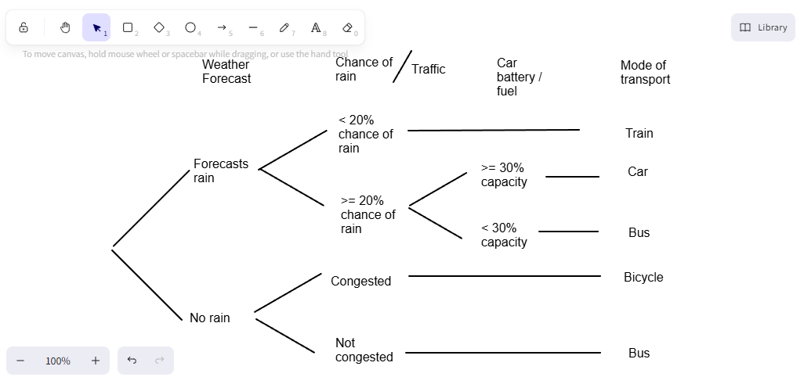
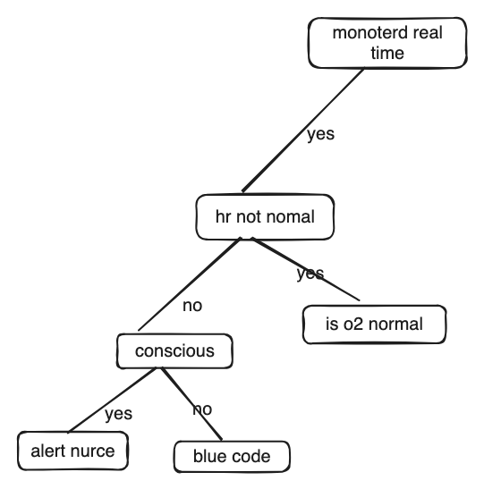
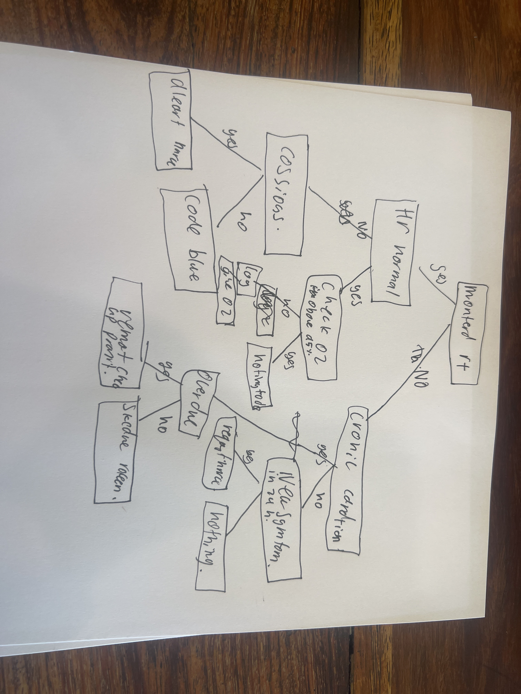
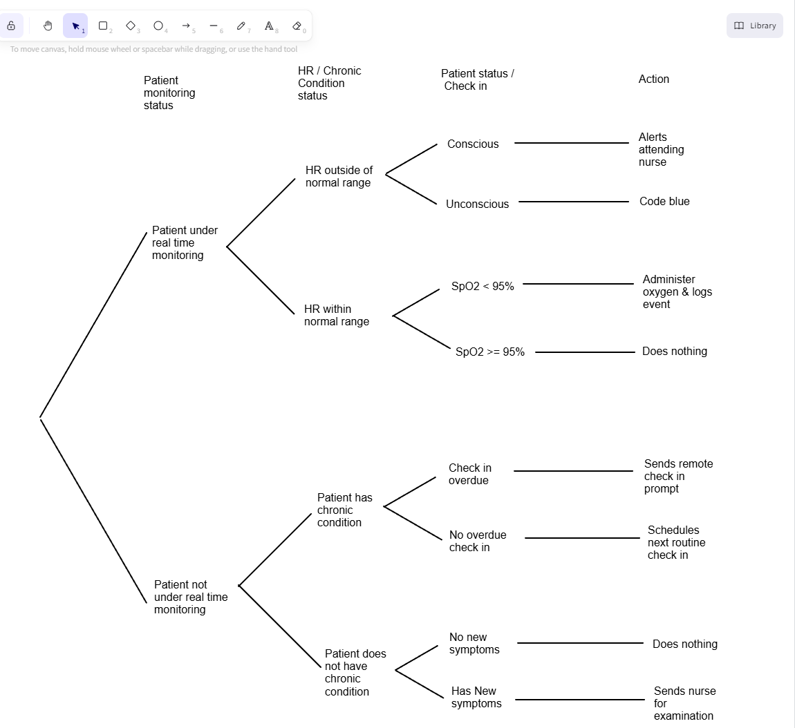

# 12SEN_TrialExamRevisionTest4 (non timed)

- Syllabus: Software Engineering · Publisher: –
- Status: IN_PROGRESS · results released
- **Score: – / 80** · answered 25/31 parts · marked 0/31
- Review page: https://platform.gradeo.com.au/reviewExam/cb0b0f3c-6112-40ab-ab06-82aac6b9837d

---

## 1. Managing Load Times (MC, TKS2025)

*Source: TKS 2025*

#### Part A — –/1 marks  `MULTI_CHOICE`

How does reducing the number of HTTP requests improve the load times of a web frontend?

- **A.** It compresses images and videos automatically.
- **B.** It reduces time fetching resources from the server.  ✅ *correct*  ⬅️ **your choice**
- **C.** It decreases the number of user interactions required.
- **D.** It allows the browser to use newer HTML tags more efficiently.

**Your answer:** B · **Correct:** B ✔

---

## 2. Cascading Style Sheets (MC, TKS2025)

*Source: TKS2025*

#### Part A — –/1 marks  `MULTI_CHOICE`

Which practice helps manage CSS in large web apps?

- **A.** Grouping unrelated styles together without separation.
- **B.** Writing all styles inline inside HTML elements for speed
- **C.** Using reusable styles and variables to keep code organized.  ✅ *correct*  ⬅️ **your choice**
- **D.** Adding repeated code for each page to avoid dependencies

**Your answer:** C · **Correct:** C ✔

---

## 3. Human and Dataset Bias in ML (MC, TKS 2025)

*Source: TKS 2025*

#### Part 1 — –/1 marks  `MULTI_CHOICE`

Which of the following best describes AI 'label bias'?

- **A.** Bias in how data is classified or labelled by humans.  ✅ *correct*  ⬅️ **your choice**
- **B.** Bias caused by selecting certain algorithmic structures.
- **C.** Bias introduced during the choice of features for a model.
- **D.** Bias due to over-representation of certain demographic groups.

**Your answer:** A · **Correct:** A ✔

---

## 4. Social/Ethical/Legal Issues (OR, TKS 2025)

*Source: TKS 2025*

#### Part A — –/2 marks  `OBJECTIVE_RESPONSE`

Match each scenario to the primary issue or ramification it demonstrates in the context of secure software development.

Select only one correct response per row.

| Statement | Correct | Yours | |
|---|---|---|---|
| A company uses automated tools, reducing demand for manual testing roles. | Employment Impact | Employment Impact | ✔ |
| A start-up patents its secure authentication method to prevent competitors copying it. | Copyright / IP | Copyright / IP | ✔ |
| A healthcare app uses encryption and access controls for patient records. | Data Security / Privacy | Data Security / Privacy | ✔ |
| A logistics firm moves to a cloud platform that replaces older systems with secure APIs. | Digital Disruption | Digital Disruption | ✔ |

**Marking criteria:**
- [2] Correctly selects all options
- [1] Partially correct selection

---

## 5. AI and ML (OR, TKS 2025)

*Source: TKS 2025*

#### Part A — –/1 marks  `OBJECTIVE_RESPONSE`

Artificial Intelligence (AI) and Machine Learning (ML) are two key concepts in the world of modern computing. 

Select the correct cells from below. Multiple selections can be made per column.

| Statement | Correct | Yours | |
|---|---|---|---|
| Process of utilising mathematical models to learn without direct intuition. | ML | AI | ✘ |
| Utilises insights and allows machines to extract knowledge from data to learn autonomously. | ML | ML, AI | ✘ |
| Refers to a general set of techonologies in a system to learn and sove a complex problem. | AI | ML | ✘ |

---

## 6. Efficient Execution (MC, TKS 2025)

*Source: TKS 2025*

#### Part A — –/1 marks  `MULTI_CHOICE`

Which is the best practice when handling exceptions in software development?

- **A.** Ignore exceptions to avoid interrupting the user
- **B.** Catch all exceptions broadly to prevent any errors
- **C.** Only catch specific exceptions you expect and log detailed error information  ✅ *correct*  ⬅️ **your choice**
- **D.** Display full error messages and log information including stack traces to users

**Your answer:** C · **Correct:** C ✔

---

## 7. Neural Models OOP (MC, TKS 2025)

*Source: TKS 2025*

#### Part 1 — –/1 marks  `MULTI_CHOICE`

How does backpropagation contribute to the training of a neural network?

- **A.** It directs data flows between neurons.
- **B.** It calculates the gradients of the loss function.  ✅ *correct*  ⬅️ **your choice**
- **C.** It introduces non-linearity to a regression model.
- **D.** It establishes neural connections between layers.

**Your answer:** B · **Correct:** B ✔

---

## 8. Programmed Data Backup (MC, TKS 2025)

*Source: TKS 2025*

#### Part 1 — –/1 marks  `MULTI_CHOICE`

Why is regular scheduling of data backups important?

- **A.** To reduce the cost of data storage.
- **B.** To enhance data security by encrypting files.
- **C.** To ensure business continuity and data integrity.  ✅ *correct*  ⬅️ **your choice**
- **D.** To improve network speeds during data transmission.

**Your answer:** C · **Correct:** C ✔

---

## 9. Open-Source Software (MC, TKS2025)

*Source: TKS 2025*

#### Part A — –/1 marks  `MULTI_CHOICE`

How does community collaboration improve open-source web tools?

- **A.** It guarantees all contributions are high quality.
- **B.** It ensures the software stays small and simple.
- **C.** It allows more users to test, report bugs, and suggest improvements.  ✅ *correct*  ⬅️ **your choice**
- **D.** It reduces the need for testing by spreading development across many people.

**Your answer:** C · **Correct:** C ✔

---

## 10. Generating Solutions (MC, TKS 2025)

*Source: TKS 2025*

#### Part 1 — –/1 marks  `MULTI_CHOICE`

Which of the following best describes debugging in the context of software development?

- **A.** The process of finding and fixing errors in the code  ✅ *correct*  ⬅️ **your choice**
- **B.** The task of writing code to enhance a program's features
- **C.** The process of running a program to check its performance
- **D.** The operation of integrating different modules into the system

**Your answer:** A · **Correct:** A ✔

---

## 11. Security and Resilience of Software (SA, TKS 2025)

*Source: TKS 2025*

#### Part A — –/4 marks  `SHORT`

Providing reasons, assess the effectiveness of automated patch management in securing large systems.

*Word limit: 120*

**Your answer:**

> A proplery working autmated patch managment system is esintal to securting a large system but if it dosent work is is a large liableity. Exuonox had a breach because it was running a old veriton of apachy and its autmated pattch managment system satd that is was all updated but it didnt work as there wass a ssl cert that had expired. But with a lage and compex aystme the systems admistarts have TO much to do and say on top of so thay need automated systmes to aply patchs or they will mis them by huyman error. This is why it is essenth to have a WORKING patch managment system!

*(111 words)*

**Marking criteria:**
- [4] Provides atleast 3 reasons AND Assesses the effectiveness of automated patch management in securing large systems.
- [3] Provides atleast 2 reasons AND Explains the effectiveness of automated patch management in securing large systems.
- [2] Provides atleast 1 reason AND Describes some features of automated patch management in securing large systems.
- [1] Provides some relevant information

**Sample answer:**

Automated patch management is highly effective in securing large systems because it ensures that security updates are applied consistently and promptly across all devices, reducing the window of vulnerability. It lowers the risk of human error and saves time compared to manual patching. However, it may be less effective if updates are not properly tested, potentially causing system disruptions or compatibility issues.

---

## 12. Security By Design (SA, TKS 2025)

*Source: TKS 2025*

#### Part 1 — –/4 marks  `SHORT`

A company is developing a cloud-based document sharing platform.

Describe how both cryptography and sandboxing can work together to enhance the platform’s security.

**Your answer:**

_(not answered)_

**Marking criteria:**
- [4] Explains clearly how both cryptography and sandboxing improve security, with relevant details and examples.
- [3] Outlines the contributions of both cryptography and sandboxing with some detail.
- [2] Describes one technique clearly and mentions the other.
- [1] Shows some understanding of either cryptography or sandboxing.

**Sample answer:**

Cryptography supports authentication by verifying the identities of users or devices through techniques like digital signatures and certificates. These methods use encrypted keys that prove a user is who they claim to be, preventing unauthorised access. By ensuring only authorised parties can access the software, cryptography strengthens security and helps protect sensitive information from attackers.

---

## 13. Security Features (SA, TKS 2025)

*Source: TKS 2025*

#### Part A — –/3 marks  `SHORT`

Explain why implementing a data retention policy is important for software development. In your answer include TWO key benefits such a policy provides.

*Word limit: 120*

**Your answer:**

> -   leagality you are not liabel for a fine $330 000 this is a extra cost
> -   also and primerly it will help you biule trust with useres as then they know what there data is bing usef for and why this will help ehnabe the diditly diruprtion
> 
> IS MY FIRST POINT RELVENT!!!???

*(51 words)*

**Marking criteria:**
- [3] Clearly explains the importance of a data retention policy in software development

Describes two relevant benefits the policy provides
- [2] Explains the importance with limited detail

Describes one relevant benefit
- [1] Shows some understanding of data retention policies or their benefits

**Sample answer:**

A data retention policy defines how long user data is stored and when it should be deleted. This is important to ensure compliance with legal regulations, such as GDPR, which require data to be kept only as long as necessary. One key benefit is reducing the risk of data breaches by limiting the amount of sensitive data stored. Another benefit is protecting user privacy by preventing unnecessary or outdated personal information from being kept, which builds trust and meets regulatory requirements.

---

## 14. Securing The Web (SA, TKS2025)

*Source: TKS 2025*

#### Part A — –/3 marks  `SHORT`

Explain the importance of SSL certificates for establishing trust between users and websites.

*Word limit: 50*

**Your answer:**

> A SSL cert or as it shold propely be called a TLS certifice as ssl is decrped. But this sert allows you to verifi that you are talking to the corect server as you can ask the cerficet authoriy and you can varifif the public key wit them.

*(48 words)*

**Marking criteria:**
- [3] Clearly explains the importance of SSL certificates for establishing trust between users and websites.
- [2] Describes the function of SSL certificates.
- [1] Provides some relevant information.

**Sample answer:**

SSL certificates verify a website’s identity, assuring users they are communicating with the legitimate site. This builds trust and encourages users to safely share sensitive information, knowing their data is encrypted and protected. Without SSL, users risk phishing attacks and data theft.

---

## 15. Level 0 DFD (Draw, TKS 2025)

*Source: TKS2025*

**Stimulus:**

A library uses an online system to manage book loans.

When a student borrows a book, they enter their student ID and book title into the system.

The system then sends the loan record to the library and a confirmation to the student.

#### Part A — –/2 marks  `DRAWING_V2`

Complete the following level 0 data flow diagram to represent this system.

**Your answer:**

_(not answered)_

**Marking criteria:**
- [2] Provides a substantially correct level 0 data flow diagram.
- [1] Provides some relevant information.

**Sample answer:**

### **Sample Answer**

| Entity | Data Flow | Process | Data Flow | Entity |
|---|---|---|---|---|
| **Student** → | `Student ID, Book title` → Confirmation returned to student | **Loan Management System** → | `Loan record` → | **Library Database** |

---

## 16. Fundamental Security Concepts (SA, TKS 2025)

*Source: TKS 2025*

**Stimulus:**

A medical appointment app ensures that only doctors and nurses can view patient health records. All records are encrypted during transmission, and if a user tries to access data they’re not permitted to see, the system logs the attempt.

#### Part A — –/3 marks  `SHORT`

Describe how this system uses three different security concepts to protect sensitive data. Explain how each concept works in this context.

**Your answer:**

> Role Based Acess is where olny cirtern people can acess the data. So for example a paitiont cant see other peopls midical infomatin. 
> 
> The pricipel of incyptin is used as it will protect the data over tansomtin the will ennsure that the usere data is protecte. most likey acumtisd with a TLS.
> 
> The system is auditaple this meand accountabley. So that if someone does a action there is a recod of that and it can be trased back. This is speicaly usfull for dasaster responce.

*(85 words)*

**Marking criteria:**
- [3] Describes three relevant security concepts

Clearly explains how each concept is applied to protect sensitive data in context
- [2] Describes two relevant security concepts

OR

Describes three concepts with limited or unclear explanation
- [1] Mentions at least one security concept with minimal explanation

**Sample answer:**

This system uses authorisation, confidentiality, and accountability. Authorisation limits access so that only doctors and nurses can view patient records, preventing unauthorised users from accessing private health information. Confidentiality is maintained by encrypting the data during transmission, ensuring it cannot be intercepted and read by others. Accountability is enforced by logging all unauthorised access attempts, so that any misuse can be traced back to a specific user. These combined measures protect sensitive medical data and ensure responsible system use.

---

## 17. Machine Learning and Automation (SA, TKS 2025)

*Source: TKS 2025*

#### Part 1 — –/4 marks  `SHORT`

Explain how machine learning enhances Business Process Automation systems' capability to process unstructured data.

*Word limit: 140*

**Your answer:**

> ML enables BPA on unstrucred data this is because if the data is unstruced is is very dificalt to pass without a soficticated passer. But with ML it can pass the data from a unstrued form in to strured of diriclty tool call to automate the syestem. THis allows data BPA to work with natral humans content like emails and document not just sttruecd things liek invoices. Thus ading tyhe capiplity for better BPA  
>   
> THIS FEELS TO SHORT WHAT DO I NEED TO ADD???

*(84 words)*

**Marking criteria:**
- [4] Clearly explains how machine learning enhances BPA systems' capability to process unstructured data.
- [3] Describes how machine learning enhances BPA systems' capability to process unstructured data.
- [2] Outlines how machine learning can improve the functionality of BPA systems.
- [1] Provides some relevant information.

**Sample answer:**

Machine learning enhances Business Process Automation (BPA) by enabling systems to process unstructured data such as emails, contracts, and customer feedback. This is achieved through technologies like Natural Language Processing (NLP) and computer vision. For instance, NLP allows BPA systems to automatically classify and extract information from unstructured text, integrating it into workflows. An example of this is in human resources, where ML-enhanced BPA can process unstructured resumes. Machine learning models scan resumes, extracting key details such as work history and qualifications, thereby reducing the manual effort of screening candidates. The integration of machine learning into BPA provides benefits such as enhanced efficiency, improved accuracy, scalability, and adaptability. ML automates decision-making and processes unstructured data faster, reduces errors through learning from past data, scales to handle larger data volumes, and adapts to changing business conditions, making BPA systems more flexible and responsive.

---

## 18. Decision Tree (SA/Draw, TKS 2025)

*Source: TKS 2025*

**Stimulus:**

A local government wishes to design a mode of transport suggestion intelligent system for its residents:

1.  if the weather is **forecast to rain**, check **the chance of rain**.
    -   If the chance of rain is **less than 20%**, take the **train**.
    -   Otherwise, check the **battery capacity/fuel** of the **car**.
        -   if the battery capacity is **at least 30%**, take the **car.**
        -   if the battery capacity is **below 30%**, take the **b****us**.
2.  If the weather is **not forecast to rain**, check the **traffic**.
    -   If the traffic is **congested**, take the **bicycle**.
    -   If the traffic is **not** **congested**, take the **bus**.

#### Part A — –/3 marks  `DRAWING_V2`

Construct a decision tree to represent the logical process used by the intelligent system.

**Your answer:**

_(empty drawing)_

**Marking criteria:**
- [3] Draws a substantially correct decision tree showing all rules and actions
- [2] Draws a decision tree showing of some rules and actions
- [1] Identifies a feature of a decision tree

**Sample answer:**



#### Part B — –/2 marks  `SHORT`

Suggests an extension of the rule set to account for cloudy weather when it is not forecast to rain.

*Word limit: 50*

**Your answer:**

_(not answered)_

**Marking criteria:**
- [2] Suggests any extension to the existing rule set that adds rules in relation to the inclusion of cloudy weather.
- [1] Provides some relevant information

**Marking rubric:**

Note that there can be variations in what the student decides to do.

**Sample answer:**

1.  if the weather is **forecast to rain**, check **the chance of rain**.
    -   If the chance of rain is **less than 20%**, take the **train**.
    -   Otherwise, check the **battery capacity/fuel** of the **car**.
        -   if the battery capacity is **at least 30%**, take the **car.**
        -   if the battery capacity is **below 30%**, take the **b****us**.
2.  If the weather is **not forecast to rain**, check the **for overcast**.
    -   If overcast, take the **bicycle.**
    -   Otherwise, check **congestion.**
        -   If the traffic is **congested**, take the **bicycle**.
        -   If the traffic is **not** **congested**, take the **bus**.

---

## 19. Web Protocols (SA, TKS2025)

*Source: TKS 2025*

#### Part A — –/3 marks  `SHORT`

Describe how SSL and TLS protect data being transferred between a client and a server.

*Word limit: 35*

**Your answer:**

> SSL is the older verion of TLS thay both have were designe to enaable hight speed tarsmtion of data while bing seure. theay first exchange keys public keys then the client will verifi with the CA to chekc the public key once that is done. Simetric key incrytion will coments to send all futher data.

*(55 words)*

**Marking criteria:**
- [3] Clearly describes SSL and TLS using encryption and certificates.
- [2] Describes SSL and TLS using encryption OR certificates.
- [1] Provides some relevant information.

**Sample answer:**

SSL and TLS encrypt data between client and server to keep it secure and verify that the data is sent to the correct server using certificates, preventing impersonation.

---

## 20. Programming - Vowel Count (Decision, 2025 TKS)

*Source: TKS 2025*

#### Part A — –/6 marks  `CODING`

Write a program that counts vowels in a string. Include both uppercase and lowercase, and treat “y” as a vowel.

**Your answer:**

```python
vowels = "aeiouy"
string = input("enter the word and we will count the vowels")
v_cnt = 0

for i in string.lower():
  if i in vowels:
    v_cnt += 1
print(f"there are {v_cnt} vowels")
```

**Marking criteria:**
- [3] Loops through every character, treats a e i o u y in both cases as vowels, tallies an accurate total, and prints exactly Vowel count: 8 for the given string
- [2] Correct loop and case-insensitive check; counts most vowels but off by 1 (e.g. overlooked a single &ldquo;y&rdquo;) or minor output-format slip.
- [1] Somewhat Counts standard vowels correctly but fails upper-case handling.

**Sample answer:**

text = "Dynamic Python Programming"  
  
vowels = "aeiouyAEIOUY"  
  
count = 0  
  
for char in text:  
    if char in vowels:  
        count += 1  
  
print("Vowel count:", count)  
  
  
Vowel Count: 8

---

## 21. Decision Tree (Draw/MC, TKS 2025)

*Source: TKS2025*

**Stimulus:**

A hospital uses a smart monitoring system to assess patients' vital signs and decide whether to alert medical staff or take automated action.

1\. If the patient is currently being monitored in **real time**:

-   The system checks the **heart rate** (HR).
    
    -   If the heart rate is **abnormally high or low**, it checks the **patient's alert status**.
        
        -   If the patient is **conscious**, it **sends an alert to the attending nurse**.
            
        -   If the patient is **unconscious**, it **triggers a code blue response**.
            
    -   If the heart rate is **within the normal range**, it checks the **oxygen level** (SpO2).
        
        -   If oxygen is **below 95%**, it **administers oxygen automatically** and **logs the event**.
            
        -   If oxygen is **normal**, it does **nothing**.
            

2\. If the patient is **not** currently under **real-time monitoring**:

-   The system checks whether the **patient has a chronic condition**.
    
    -   If **yes**, it checks whether **a check-in is overdue**.
        
        -   If **yes**, it **sends a remote check-in prompt**.
            
        -   If **no**, it **schedules the next routine check**.
            
    -   If **no chronic condition**, it checks whether the patient has had **any new symptoms reported** in the past 24 hours.
        
        -   If **yes**, it **requests a nurse** to examine patient.
            
        -   If **no**, it does **nothing**.

#### Part A — –/4 marks  `DRAWING_V2`

Construct a decision tree to represent the logical process used by the smart patient monitoring system.

**Your answer:**



Drawing contents (extracted): labels: "monoterd real\ntime", "yes", "hr not nomal", "no", "conscious", "yes", "alert nurce", "no", "blue code", "is o2 normal", "yes"

Connectors: line "monoterd real\ntime (nearest)" → "hr not nomal (nearest)"; line "hr not nomal (nearest)" → "conscious (nearest)"; line "conscious (nearest)" → "alert nurce (nearest)"; line "conscious (nearest)" → "blue code (nearest)"; line "hr not nomal (nearest)" → "is o2 normal (nearest)"

Uploaded: 

**Marking criteria:**
- [4] Draws a substantially correct decision tree showing all rules and actions
- [3] Draws a partially correct decision tree showing all rules and actions
- [2] Draws a decision tree showing understanding of some rules and actions
- [1] Identifies some features of a decision tree

**Sample answer:**



#### Part B — –/1 marks  `MULTI_CHOICE`

A patient is under real-time monitoring. Their heart rate is abnormal, and they are conscious. What will the system do?

- **A.** Administer oxygen
- **B.** Alert the attending nurse  ✅ *correct*  ⬅️ **your choice**
- **C.** Schedule a routine check
- **D.** Trigger a code blue response

**Your answer:** B · **Correct:** B ✔

#### Part C — –/1 marks  `MULTI_CHOICE`

The system detects a normal heart rate, but the patient’s oxygen level is at 89%. What action does the system take?

- **A.** Do nothing
- **B.** Alert the attending nurse
- **C.** Trigger a code blue response
- **D.** Administer oxygen and logs the event  ✅ *correct*

**Your answer:** (none) · **Correct:** D

#### Part D — –/1 marks  `MULTI_CHOICE`

A patient is being monitored. Their heart rate is abnormal, and they are unconscious. What happens?

- **A.** Do nothing
- **B.** Alert the attending nurse
- **C.** Trigger a code blue response  ✅ *correct*
- **D.** Administer oxygen and logs the event

**Your answer:** (none) · **Correct:** C

#### Part E — –/1 marks  `MULTI_CHOICE`

A patient is not being monitored and has no chronic condition, but reports new symptoms today. What will the system do?

- **A.** Alert the attending nurse
- **B.** Trigger a code blue response
- **C.** Sends a nurse to examine the patient  ✅ *correct*
- **D.** Administer oxygen and logs the event

**Your answer:** (none) · **Correct:** C

---

## 22. Programming - Current Maximum (Iteration, 2025 TKS)

*Source: TKS 2025*

#### Part A — –/4 marks  `CODING`

Write a Python program that prints the largest value seen so far as it loops through a list.

list = \[4, 2, 9, 5, 12, 3\]

**Your answer:**

```python
# change name to ls as not to shadow 
ls = [4, 2, 9, 5, 12, 3]

# is this ok 
max_value = float('inf')*-1
# of woule you prefer ???????
max_value = ls[0]


for i in ls:
  if i > max_value:
    max_value = i
print(max_value)
```

**Marking criteria:**
- [4] Initialises max_so_far to first element, updates inside loop, prints Current max: after every element, resulting sequence 4, 4, 9, 9, 12, 12.
- [3] Correct running max logic but printed label/spacing off or final element omitted.
- [2] Updates max correctly but prints only at end or misses first comparison edge-case.
- [1] Finds overall max once or prints intermediate values without updating rule.

**Sample answer:**

lst = \[4, 2, 9, 5, 12, 3\]  
  
max\_so\_far = lst\[0\]  
  
for val in lst:  
    if val > max\_so\_far:  
        max\_so\_far = val  
    print("Current max:", max\_so\_far)  
  
Output:  
Current max: 4  
Current max: 4  
Current max: 9  
Current max: 9  
Current max: 12  
Current max: 12

---

## 23. Neural Models OOP (SA, TKS 2025)

*Source: TKS 2025*

#### Part 1 — –/3 marks  `SHORT`

Explain how feedforward neural networks can address challenges with large datasets AND complex relationships.

*Word limit: 150*

**Your answer:**

> FNN poform better on compex data sets as the layer in eahc layer ofd tghe netowr are conected to the next aluer this allow for the netowk to better fit complex data and you cane have nonliner activation funcinnts this will allow it it fit better. Becase of the more pramaters and more compeld patters it can fit large and complx data sest verry well due to the multable layers

*(70 words)*

**Marking criteria:**
- [4] Clearly explains how feedforward neural networks can address challenges with large datasets AND complex relationships.
- [3] Describes how feedforward neural networks can address challenges with large datasets OR complex relationships.
- [2] Outlines how feedforward neural networks can address challenges with large datasets OR complex relationships.
- [1] Provides some relevant information.

**Sample answer:**

Feedforward neural networks can address challenges with large datasets and complex relationships by utilising multiple layers of neurons which capture more intricate patterns within the data. Unlike traditional regression models, which rely on linear relationships and are limited in their capacity to model non-linear interactions, feedforward neural networks incorporate activation functions that introduce non-linearity, enabling them to learn complex mappings from inputs to outputs. As data flows through these interconnected layers, each neuron aggregates information from the previous layer using weighted inputs, biases, and an activation function, allowing the network to progressively extract higher-level features. This layered approach allows neural networks to automatically learn feature representations directly from the data, which is particularly useful when dealing with high-dimensional data or when explicit feature engineering is impractical or impossible.

---

## 24. Applications of Web Programming (SA, TKS 2025)

*Source: TKS 2025*

**Stimulus:**

A startup wants to develop an interactive website that adapts to user preferences and provides real-time updates.

#### Part A — –/3 marks  `SHORT`

Explain two benefits of using interactive websites for businesses aiming to improve customer engagement.

**Your answer:**

> A pwa is faster and you can send notificatin. Besause it is faster it is easery to for the uers to use is as there is less overhed so that it is more repsocive this allow the users to be more ingaged. Also the app can send notificatn this will increase engagment as it will remind the uses to reengage with the site.

*(63 words)*

**Marking criteria:**
- [3] Explains two benefits of interactive websites and links them to customer engagement.
- [2] Describes two benefits with limited detail or partial connection to customer engagement.
- [1] Mentions one benefit or provides vague/incomplete explanations.

**Sample answer:**

Interactive websites improve customer engagement by offering personalised content based on user preferences, which makes users feel valued and increases their time on the site. They also provide real-time updates, such as live chats or dynamic product recommendations, which keep users informed and encourage immediate action. Together, these features create a more engaging and responsive experience that can boost customer satisfaction and loyalty.

---

## 25. Programming - Reverse Sentence (Sequence, 2025 TKS)

*Source: TKS 2025*

#### Part A — –/6 marks  `CODING`

Write a Python program that prints a sentence's words in reverse order.

Input: "Learning Python is fun"

**Your answer:**

```python
sentence = input("enter your sentence ")

words_in_order = [[]]
for i in sentence:
  if i == ' ':
    words_in_order.append([])
  else:
    words_in_order[-1].append(i)
    
reversed_words = ""
for i in words_in_order[::-1]:
  word = ""
  for j in i:
    word += j
  word += " "
  reversed_words += word

print(reversed_words)
    
```

**Marking criteria:**
- [3] Splits sentence into words, reverses order, joins with single spaces to output “fun is Python Learning” exactly
- [2] Correct reversal but extra/trailing space or different capitalisation.
- [1] Ateempted to reverse the string and output the new string correctly

**Sample answer:**

sentence \= "Learning Python is fun"  
words \= sentence.split()  
words.reverse()  
print(" ".join(words))  
  
Output:  
fun is Python Learning

---

## 26. Social, Ethical & Legal (ER, TKS 2025)

*Source: TKS 2025*

**Stimulus:**

A video on data privacy shows how companies collect and use personal information from users online. This raises social, ethical, and legal concerns about consent, security, and misuse of data.

[▶ VIDEO (open this file)](assets/e1aed016-9cf8-4b65-a25f-a79c6142bad6.mp4)

Video Credit: Netwrix.com

#### Part A — –/8 marks  `SHORT`

Evaluate the impact of data privacy concerns on individuals and organisations, making reference to the social, ethical, and legal issues involved.

*Word limit: 500*

**Your answer:**

**Marking criteria:**
- [7-8] Demonstrates a comprehensive understanding of data privacy

Effectively links social, ethical, and legal issues to impacts on individuals and organisations

Integrates detailed and relevant examples, including legislation or case studies

Provides sustained evaluation and well-structured analysis
- [5-6] Demonstrates a sound understanding of data privacy

Explains social, ethical, and legal issues in detail

Provides relevant examples and considers impacts on individuals and organisations

Some evaluation of issues is evident
- [3-4] Demonstrates a basic understanding of data privacy

Describes some social, ethical, or legal issues, but unevenly

Uses simple or partially relevant examples
- [1-2] Provides limited information about data privacy

May identify a social, ethical, or legal issue with little detail

Examples, if present, are minimal or irrelevant

**Sample answer:**

Data privacy is one of the most significant challenges in the digital age, affecting both individuals and organisations. The collection of personal information by companies creates major social, ethical, and legal issues that influence how technology is developed and used.

From a social perspective, privacy breaches can erode trust between users and organisations. If personal information such as location data or browsing habits is shared without consent, individuals may feel vulnerable and exploited. This can discourage people from engaging with online platforms and create anxiety about constant surveillance. At the same time, responsible data use can provide social benefits, such as personalised recommendations and improved services, highlighting the need for balance.

Ethical issues also emerge around consent and fairness. Many companies collect data through lengthy terms and conditions that most users do not read or fully understand. Ethically, this raises questions about whether consent is truly informed. Additionally, there is debate over the fairness of companies profiting from user data without providing clear benefits to the individuals whose information is being sold. Ethical responsibility requires organisations to be transparent and accountable in their handling of personal information.

Legal issues are central to regulating data privacy. In Australia, the Privacy Act 1988 and the Notifiable Data Breaches scheme require organisations to handle personal data responsibly and report breaches. Internationally, regulations such as the European Union’s General Data Protection Regulation (GDPR) enforce stricter standards for consent and data storage. However, enforcement can be inconsistent, especially across global digital platforms.

Overall, data privacy impacts society at multiple levels. Individuals risk harm when data is misused, while organisations face reputational and legal consequences if they fail to protect it. Evaluating these social, ethical, and legal issues highlights the importance of stronger regulation and ethical responsibility in safeguarding personal information.
