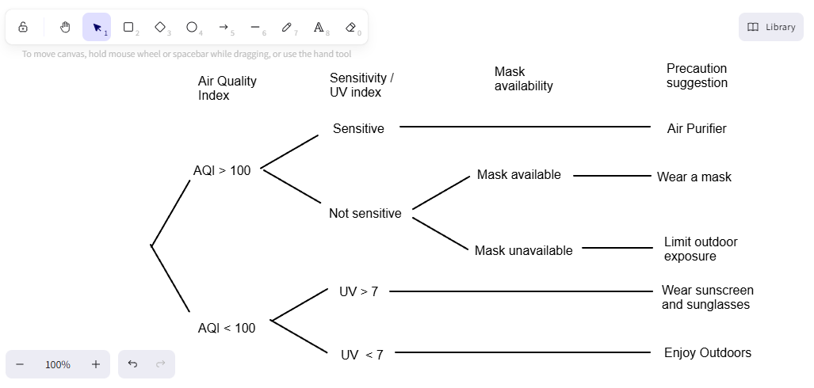

# 12SEN_Cycle11

- Syllabus: Software Engineering · Publisher: –
- Status: LIVE · results released
- **Score: – / 12** · answered 0/5 parts · marked 0/5
- Review page: https://platform.gradeo.com.au/reviewExam/b889defd-aaaf-4c15-acc9-e81e5d5b8ea9

---

## 1. Models of Training ML (SA, TKS 2025)

*Source: TKS 2025*

#### Part 1 — –/4 marks  `SHORT`

Evaluate the role of semi-supervised support vector machines (S3VM) within the framework of software automation.

*Word limit: 120*

**Your answer:**

_(not answered)_

**Marking criteria:**
- [4] Clearly evaluates the role of semi-supervised support vector machines (S3VM) within the framework of software automation.
- [3] Describes the role of semi-supervised support vector machines (S3VM) within the framework of software automation.
- [2] Outlines how S3VMs are used within software automation.
- [1] Provides some relevant information.

**Sample answer:**

Semi-supervised support vector machines (S3VM) play an influential role in software automation, particularly in the area of quality assurance. S3VMs utilise the structured framework of support vector machines, expanded to integrate both labelled and unlabelled data. They help in automating the process of detecting software defects by learning from a limited set of previously identified bugs and a larger set of unlabelled code. This method optimises the testing phase by predicting potential issues in unlabelled data, thus improving the efficiency and reliability of quality assurance processes. By automating defect prediction, S3VMs minimise manual testing efforts and accelerate the development cycle, ensuring higher software quality with less resource expenditure.

---

## 2. Decision Tree (Draw/MC, TKS 2025)

*Source: TKS 2025*

**Stimulus:**

A city health department wants to create an intelligent system that advises residents on daily health precautions based on air quality and personal health status.

1.  If the air quality index **(AQI)** is **above 100**, check the **sensitivity of the person** (e.g., asthma, elderly).
    
    -   If the person is **sensitive**, **stay indoors** and **use an air purifier**.
        
    -   If the person is **not sensitive**, check the **availability of a mask**.
        
        -   If a mask is **available**, **wear a mask.**
            
        -   If a mask is **not available**, **limit outdoor exposure**.
            
2.  If the **AQI** is **100 or below**, check the **UV index**.
    
    -   If the **UV index is high (above 7)**, **wear sunscreen and sunglasses**.
        
    -   If the **UV index is low**, **enjoy outdoor activities freely**.

#### Part A — –/3 marks  `DRAWING_V2`

Construct a decision tree to represent the logical process used by the health precaution suggestion intelligent system.

**Your answer:**

_(not answered)_

**Marking criteria:**
- [3] Draws a substantially correct decision tree showing all rules and actions
- [2] Draws a decision tree showing understanding of some rules and actions
- [1] Identifies a feature of a decision tree

**Sample answer:**

#### Part B — –/1 marks  `MULTI_CHOICE`

The AQI is 120. The person has asthma. What should they do?

- **A.** Go Jogging
- **B.** Wear a mask and go outside
- **C.** Wear sunscreen and sunglasses
- **D.** Stay indoors and use an air purifier  ✅ *correct*

**Your answer:** (none) · **Correct:** D

#### Part C — –/1 marks  `MULTI_CHOICE`

The AQI is 85, and the UV index is 9. What should be advised?

- **A.** Stay indoors
- **B.** Wear sunscreen  ✅ *correct*
- **C.** Limit outdoor exposure
- **D.** Enjoy outdoor activities freely

**Your answer:** (none) · **Correct:** B

---

## 3. Types of Machine Learning Algorithms (SA, TKS 2025)

*Source: TKS 2025*

#### Part 1 — –/3 marks  `SHORT`

Describe the role of logistic regression in enhancing the performance of spam detection systems.

*Word limit: 100*

**Your answer:**

_(not answered)_

**Marking criteria:**
- [3] Clearly describes the role of logistic regression in enhancing the performance of spam detection systems.
- [2] Outlines how logistic regression can enhance the performance of spam detection systems.
- [1] Provides some relevant information.

**Sample answer:**

In spam detection systems, logistic regression serves as a robust algorithm to classify emails based on textual content, metadata, and historical interaction data. Logistic regression takes features such as frequency of certain spam-indicative words, the presence of links, sender information, and other patterns to output a probability score indicating the likelihood of an email being spam. By training the model on a labelled dataset of emails, the logistic regression model learns the boundaries between 'spam' and 'not spam', helping filter incoming emails accurately. Over time, its adaptive nature ensures that the system stays resilient against evolving spam tactics, maintaining high detection performance and enhancing user experience by reducing false positives and negatives.
