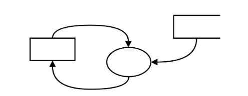
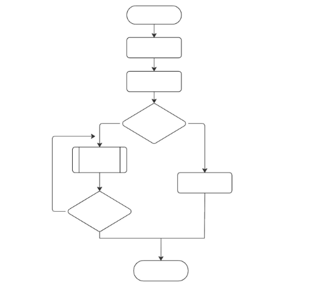
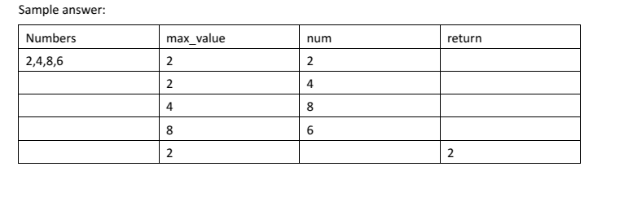
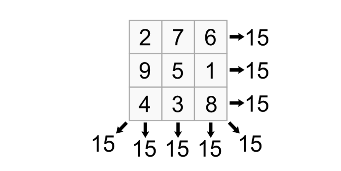
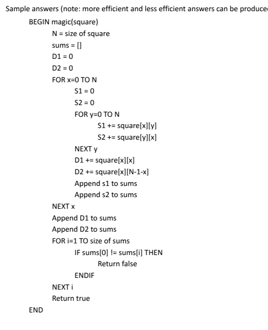
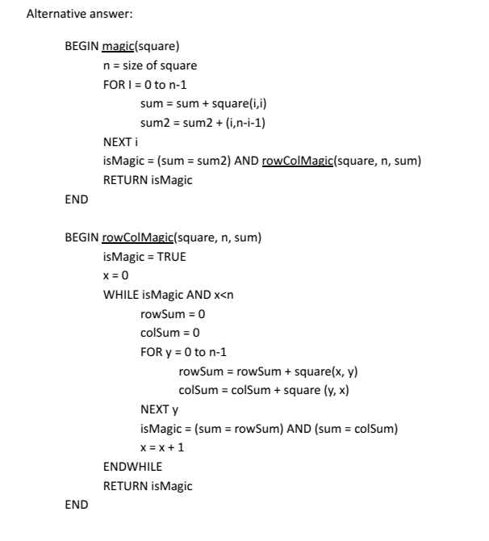
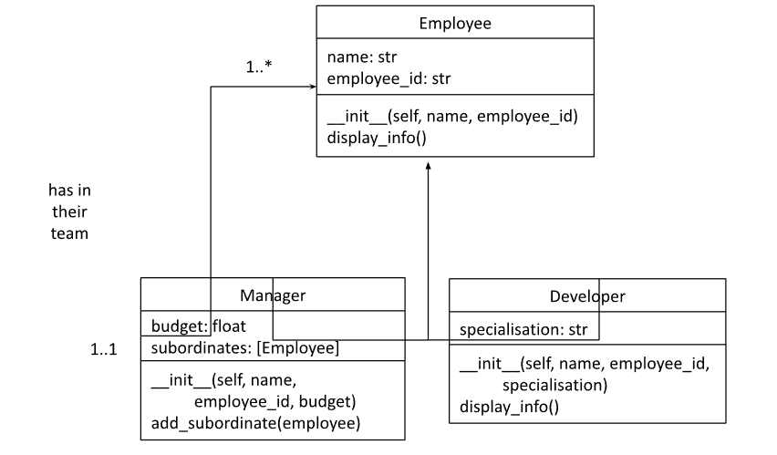

# ITE Software Engineering Y11 2024

- Syllabus: Software Engineering · Publisher: Independent Trials
- Status: LIVE
- **Score: – / 57** · answered 0/29 parts · marked 0/29
- Review page: https://platform.gradeo.com.au/reviewExam/975e2e17-4326-4bc0-b65a-e4ba5c503f40

---

## 1. Which of these is NOT a feature of the Agile development approach?  (Question 1, ITE 2024)

**Stimulus:**

For question 1-9 select the choice that best answers the question.

#### Question 1 — –/1 marks  `MULTI_CHOICE`

Which of these is NOT a feature of the Agile development approach?

- **A.** The client is involved with the development process.
- **B.** Working versions of the software are regularly released for use.
- **C.** The nature of the final product is clearly understood at the start.  ✅ *correct*
- **D.** Developers can incorporate changing requirements.

**Your answer:** (none) · **Correct:** C

---

## 2. What system modelling tool is represented by the symbols below? (Question 2, ITE 2024)

**Stimulus:**

#### Question 2 — –/1 marks  `MULTI_CHOICE`

What system modelling tool is represented by the symbols in the stimulus?

- **A.** Context diagram
- **B.** Data flow diagram  ✅ *correct*
- **C.** Structure chart
- **D.** Storyboard

**Your answer:** (none) · **Correct:** B

---

## 3. Which of the following only contains primitive data types? (Question 3, ITE 2024)

#### Question 3 — –/1 marks  `MULTI_CHOICE`

Which of the following only contains primitive data types?

- **A.** Boolean, integer, character  ✅ *correct*
- **B.** String, array, floating-point
- **C.** Floating-point, character, variable
- **D.** Binary, octal, decimal

**Your answer:** (none) · **Correct:** A

---

## 4. Python code (Question 4, ITE 2024 Y11)

**Stimulus:**

Consider the following Python code:

class Animal:

def \_\_init\_\_(self, name):

self.\_name = name

def make\_sound(self):

raise NotImplementedError("Subclass must implement method")

class Dog(Animal):

def make\_sound(self):

return "Woof"

class Cat(Animal):

def make\_sound(self):

return "Meow"

def describe\_animal(animal):

print(f"{animal.\_name} says {animal.make\_sound()}")

dog = Dog("Buddy")

cat = Cat("Whiskers")

describe\_animal(dog)

describe\_animal(cat)

#### Question 4 — –/1 marks  `MULTI_CHOICE`

Which of the following statements is correct?

- **A.** The make_sound method in the Animal class is an example of inheritance.
- **B.** The Animal class is an example of generalisation because it hides the details of the _name attribute.
- **C.** The describe_animal function demonstrates abstraction by working with the specific types Dog and Cat.
- **D.** The Dog and Cat classes demonstrate polymorphism by implementing the make_sound method differently.  ✅ *correct*

**Your answer:** (none) · **Correct:** D

---

## 5. Which of the following best describes the facade design pattern in object-oriented programming? (Question 5, ITE 2024 Y11)

#### Question 5 — –/1 marks  `MULTI_CHOICE`

Which of the following best describes the facade design pattern in object-oriented programming?

- **A.** It allows objects to communicate directly, bypassing the need for a mediator.
- **B.** It provides a simplified interface to a complex subsystem, making it easier to use.  ✅ *correct*
- **C.** It ensures that a class has only one instance and provides a global point of access to it.
- **D.** It defines a family of algorithms, encapsulates each one, and makes them interchangeable.

**Your answer:** (none) · **Correct:** B

---

## 6. Which of the following concepts in object-oriented programming refers to the bundling of data and methods within a single unit? (Question 6, ITE 2024 Y11)

#### Question 6 — –/1 marks  `MULTI_CHOICE`

Which of the following concepts in object-oriented programming refers to the bundling of data and methods within a single unit?

- **A.** Inheritance
- **B.** Abstraction
- **C.** Encapsulation  ✅ *correct*
- **D.** Polymorphism

**Your answer:** (none) · **Correct:** C

---

## 7. The crane has how many degrees of freedom? (Question 7, ITE 2024 Y11)

**Stimulus:**

#### Question 7 — –/1 marks  `MULTI_CHOICE`

The crane shown is used to move containers off ships and onto trucks. The crane has how many degrees of freedom?

- **A.** 2
- **B.** 3  ✅ *correct*
- **C.** 4
- **D.** 6

**Your answer:** (none) · **Correct:** B

---

## 8. What is the function of resistors in an electrical circuit? (Question 8, ITE 2024 Y11)

#### Question 8 — –/1 marks  `MULTI_CHOICE`

What is the function of resistors in an electrical circuit?

- **A.** To store and release electrical energy
- **B.** To increase power or current in a circuit
- **C.** To restrict current flow to a single direction
- **D.** To limit the flow of electrical current in a circuit  ✅ *correct*

**Your answer:** (none) · **Correct:** D

---

## 9. Which of the following statements represents an Assembly language statement? (Question 9, ITE 2024 YR11)

#### Question 9 — –/1 marks  `MULTI_CHOICE`

Which of the following statements represents an Assembly language statement?

- **A.** x = 2
- **B.** MOV EAX, 5  ✅ *correct*
- **C.** 001 1 0010
- **D.** #include <stdio.h>

**Your answer:** (none) · **Correct:** B

---

## 10. What control structures are present in the following flowchart algorithm? (Question 10, ITE 2024 Y11)

**Stimulus:**

For questions 10-12 tick each option that answers the question. (Multiple items may be selected).

#### Question 10 — –/1 marks  `MULTI_CHOICE`

What control structures are present in the following flowchart algorithm?

- **A.** Sequence  ✅ *correct*
- **B.** Binary selection  ✅ *correct*
- **C.** Multiway selection
- **D.** Pre-test repetition
- **E.** Post-test repetition  ✅ *correct*
- **F.** Counted loop
- **G.** Subroutine  ✅ *correct*

**Your answer:** (none) · **Correct:** A, B, E, G

---

## 11. Which of the following statements are correct regarding the effectiveness of this code implementation? (Question 11, ITE 2024 Y11)

**Stimulus:**

You are evaluating the following Python code. The code is intended to verify user credentials and handle login attempts.

def login(username, password):

\# Dummy user credentials

stored\_username = "admin"

stored\_password = "password123"

if username == stored\_username and password == stored\_password:

return "Login successful"

else:

return "Invalid credentials"

\# Example usage

print(login("admin", "password123")) # Expected output: Login successful

print(login("user", "pass")) # Expected output: Invalid credentials

#### Question 11 — –/1 marks  `MULTI_CHOICE`

Which of the following statements are correct regarding the effectiveness of this code implementation?

- **A.** The code effectively handles valid and invalid login attempts based on the hardcoded credentials.  ✅ *correct*
- **B.** The implementation includes mechanisms for password encryption and secure storage of user credentials.
- **C.** The code has been tested with a variety of input scenarios to ensure that it behaves correctly in all cases.
- **D.** The code is designed to handle various types of input, including special characters and different username formats.
- **E.** The code uses hardcoded credentials, which is a security risk and does not follow best practices for managing sensitive information.  ✅ *correct*
- **F.** The code is simple and easy to understand but lacks functionality for handling multiple users or password complexity requirements.  ✅ *correct*

**Your answer:** (none) · **Correct:** A, E, F

---

## 12. Which of the following are features of closed loop control systems? (Question 12, ITE 2024 Y11)

#### Question 12 — –/1 marks  `MULTI_CHOICE`

Which of the following are features of closed loop control systems?

- **A.** System stability as operation is adjusted continually to maintain a steady state.  ✅ *correct*
- **B.** Inputs are not altered by the system, hence outputs are predictable.
- **C.** Automatic adaptation to changes in the environment.  ✅ *correct*
- **D.** Simplicity as tasks are completed sequentially based on preset inputs.
- **E.** Feedback loop continually monitors the output and adjust the inputs accordingly.  ✅ *correct*
- **F.** Differences between the desired and actual output are not detected.

**Your answer:** (none) · **Correct:** A, C, E

---

## 13. Match each set of data to the most appropriate data structure (Q13, ITE Y11 2024)

#### Question 13 — –/1 marks  `RICH_TABLE`

Using the drop-down menus, match each set of data to the most appropriate data structure.

| Details for a single student (such as name and date of birth) | **you:** – (correct: Record) |
|---|---|
| Average daily temperatures across a month | **you:** – (correct: Array) |
| High score data for a game | **you:** – (correct: File) |
| File directory structure in a computer | **you:** – (correct: Tree) |
| Sequence of operations performed by a calculator | **you:** – (correct: Stack) |
| The squares on a chessboard | **you:** – (correct: 2D Array) |

**Marking guidance:**

-   Details for a single student (such as name and date of birth) = Record
-   Average daily temperatures across a month = Array
-   High score data for a game = File
-   File directory structure in a computer = Tree
-   Sequence of operations performed by a calculator = Stack
-   The squares on a chessboard = 2D Array

---

## 14. Match the description with the corresponding type of testing (Q14, ITE Y11 2024)

#### Question 14 — –/1 marks  `RICH_TABLE`

Using the drop-down menus, match the description with the corresponding type of testing.

| Testing the software with no knowledge of the internal workings or structure, focusing only on the outputs in response to selected inputs. | **you:** – (correct: Black box testing) |
|---|---|
| Testing the software with partial knowledge of the internal workings, often used to design test cases while having an understanding of the code or logic. | **you:** – (correct: Grey box testing) |
| Testing individual components or modules of a system in isolation to ensure they work correctly. | **you:** – (correct: Unit testing) |
| Testing the complete and integrated system to evaluate the system's compliance with its specified requirements. | **you:** – (correct: System testing) |
| Testing the software with full knowledge of the internal workings, focusing on the flow of inputs and outputs through the code, ensuring all paths are tested. | **you:** – (correct: White box testing) |
| Testing a combination of integrated modules or components to verify interactions between them. | **you:** – (correct: Subsystem testing) |

---

## 15. Is a structured approach more suited to the development of large, critical software systems? (Question 16, ITE 2024 Y11)

#### Question 16 — –/2 marks  `SHORT`

Is a structured approach more suited to the development of large, critical software systems? Justify your response.

**Your answer:**

_(not answered)_

**Marking criteria:**
- [2] Gives two valid reasons for the use of a structured approach.
- [1] Gives at least one valid reason for the use of a structured approach.

**Marking rubric:**

Answers may include:

-   The use of sequential stages provides clear milestones, making it easier to manage complex projects.
    
-   Each phase produces detailed documentation, which is essential to understand and manage a large project.
    
-   Well-defined requirements make it easier to effectively implement the varied aspects of a very large, complex project.
    
-   Thorough testing helps ensure accuracy, reliability and safety, which are necessary for critical systems.

---

## 16. Describe the purpose of the testing stage of software development. (Question 17, ITE 2024 Y11)

#### Question 17 — –/2 marks  `SHORT`

Describe the purpose of the testing stage of software development.

**Your answer:**

_(not answered)_

**Marking criteria:**
- [2] Accurately describes the purpose of the testing stage; better answers will draw connections to quality assurance.
- [1] Makes a correct statement about the testing stage, without describing the purpose.

**Marking rubric:**

Answers may include:

-   Ensure that the software meets the requirements
    
-   Ensure that no bugs or errors are present
    
-   Ensure that the software is compatible with all intended systems
    
-   Ensure that the software fulfils the quality assurance criteria

---

## 17. Distinguish between syntax and logic errors, providing an example of each (Question 18, ITE 2024 Y11)

#### Question 18 — –/3 marks  `SHORT`

Distinguish between syntax and logic errors, providing an example of each.

**Your answer:**

_(not answered)_

**Marking criteria:**
- [3] Clearly describes the distinguishing features of syntax and logic errors, with use of examples.
- [2] Describes some feature of syntax and logic errors.
- [1] Describes a feature of syntax or logic errors, OR identifies an example.

**Marking rubric:**

Sample answer:

Syntax errors occur when the code does not follow the rules of the programming language, such as “print hello world” in Python (missing parentheses), whereas logic errors occur when the program appears to function but does not produce the expected output, such as a loop that executes the wrong number of times.

---

## 18. Perform a desk check of the Python code below (Question 19, ITE 2024 Y11)

**Stimulus:**

def findMaximum(numbers):

max\_value = numbers\[0\]

for num in numbers:

if num > max\_value:

max\_value = num

else:

max\_value = numbers\[0\]

return max\_value

#### Question 19 — –/3 marks  `RICH_TABLE`

Refer to the stimulus. Perform a desk check of the Python code below, when numbers = \[2,4,8,6\].

| **you:** – | **you:** – | **you:** – | **you:** – |
|---|---|---|---|
| **you:** – | **you:** – | **you:** – | **you:** – |
| **you:** – | **you:** – | **you:** – | **you:** – |
| **you:** – | **you:** – | **you:** – | **you:** – |
| **you:** – | **you:** – | **you:** – | **you:** – |
| **you:** – | **you:** – | **you:** – | **you:** – |

**Marking criteria:**
- [3] Completes an accurate desk check, including the error and the duplication of the first check
- [2] Completes a desk check with minor errors or omissions.
- [1] Attempts to perform a desk check, but contains many errors.

**Marking rubric:**

---

## 19. Pseudocode Algorithm (Question 20, ITE 2024 Y11)

**Stimulus:**

A ‘magic square’ is a grid with a width and height of n, containing the numbers from 1 to n2. Each row, column, and diagonal adds up to the same sum. For example, in the grid below n is 3; the grid contains the numbers 1-9, and every row, column, and diagonal adds up to 15.

#### Question 20 — –/5 marks  `CODING`

Write an algorithm in pseudocode for a function which, when passed a 2D array of integers called “square”, will return True if the square is “magic” and False otherwise.

**Your answer:**

_(not answered)_

**Marking criteria:**
- [5] Creates a substantially correct algorithm, using NESA&rsquo;s format for pseudocode, which attempts all of the following:

Checks the size of the 2D array

Iterates through the 2D array

Calculates the sum for each row and column

Calculates the sum for each diagonal

Returns true if all sums are equal

Returns false otherwise
- [4] Creates an algorithm in pseudocode which attempts at least four of the above criteria.
- [3] Creates an algorithm, or language-specific code, which attempts at least three of the above criteria.
- [2] Creates an algorithm or code which includes some of the required logic for two or more of the above criteria.
- [1] Creates an algorithm or code which addresses some part of the question.

**Marking rubric:**

---

## 20. Describe ONE technique for optimising code performance. (Question 21, ITE 2024 Y11)

#### Question 21 — –/? marks  `SHORT`

Describe ONE technique for optimising code performance.

**Your answer:**

_(not answered)_

**Marking criteria:**
- [2] Describes ONE technique for optimising code performance.
- [1] Identifies ONE technique for optimising code performance.

**Marking rubric:**

Answers may include:

-   Algorithm optimisation: using more efficient algorithms to reduce execution time and memory requirements. For example, changing the sorting algorithm used in a program to improve the sorting performance on large datasets.
    
-   Code refactoring: Revising and restructuring code to make it more efficient, such as removing redundant operations. For example, refactoring a loop that performs multiple operations per iteration by pre-computing values outside the loop to reduce the number of calculations that need to be performed inside the loop.

---

## 21. Describe how version control systems support collaborative code development. (Question 22, ITE 2024 Y11)

#### Question 22 — –/2 marks  `SHORT`

Describe how version control systems support collaborative code development.

**Your answer:**

_(not answered)_

**Marking criteria:**
- [2] Describes ONE way that version control tools can assist with collaborative code development.
- [1] Identifies ONE way that version control tools can assist with collaborative code development OR identifies the purpose of version control tools.

**Marking rubric:**

Answers may include:

-   Allows multiple developers to work on the same project simultaneously without overwriting each other's work - along with providing conflict resolution tools should multiple developers change the same code at the same time.
    
-   Keeps a record of all changes made to the codebase, allowing developers to review the work of others and revert changes if necessary.
    
-   Supports multiple development paths through branches, which can be independently developed and later merged into the main codebase.

---

## 22. Contrast top-down design and bottom-up design in software development. (Question 23, ITE 2024 Y11)

#### Question 23 — –/3 marks  `SHORT`

Contrast top-down design and bottom-up design in software development.

**Your answer:**

_(not answered)_

**Marking criteria:**
- [3] Contrasts top-down design AND bottom-up design in software development.
- [2] Defines top-down design OR bottom-up design in software development.
- [1] Identifies features of top-down design OR bottom-up design in software development.

**Marking rubric:**

Top-down design is an approach where the system is designed from the highest level of abstraction down to the more detailed and specific components. The process starts with the broadest overview of the system and progressively breaks it down into smaller more manageable parts, through a process called decomposition.

In contrast, bottom-up design is where the system is developed from the ground up, starting with the detailed components and integrating them into higher-level functionalities. It focuses on building and testing individual components or modules before combining them to form the complete system.

---

## 23. Write a task definition for the book reservation feature (Question 24, ITE 2024 Y11)

#### Question 24 — –/3 marks  `SHORT`

You are part of a development team working on a project to create a new feature for a library management system. The feature involves implementing a user interface for managing book reservations. The system should include functionalities for reserving, cancelling, and viewing reservations.

Write a task definition for the book reservation feature. Include the objective, functional and non-functional requirements, constraints, and acceptance criteria.

**Your answer:**

_(not answered)_

**Marking criteria:**
- [3] Provides a comprehensive task definition which includes all of the following: functional requirements, non-functional requirements, constraints, and acceptance criteria.
- [2] Provides a task definition which includes at least TWO of the following: functional requirements, non-functional requirements, constraints, and acceptance criteria.
- [1] Provides an attempt at a relevant task definition.

**Marking rubric:**

Sample answer:

Objective: Develop a user interface for managing book reservations, allowing users to reserve, cancel, and view reservations.

Functional Requirements:

-   Users must be able to reserve a book from available options.
    
-   Users must be able to cancel a reservation and receive confirmation.
    
-   Users must be able to view their reservation history.
    

Non-Functional Requirements:

-   The interface should load within 2 seconds.
    
-   The system should handle up to 500 simultaneous users.
    

Constraints:

-   The feature must integrate with the existing library management system.
    
-   Must adhere to security and data privacy regulations.
    

Acceptance Criteria:

-   The feature successfully performs reservations, cancellations, and viewing of reservations.
    
-   The interface is responsive and performs well under expected load.

---

## 24. Provide Python implementations (Question 25, ITE 2024 Y11)

**Stimulus:**

Consider the following class diagram which models an employee management system:

You can assume:

-   The display\_info() method prints the properties of the object created from that class.
    
-   The Manager has a property called subordinates which stores an array of Employee objects representing the employees who report to that manager.
    
-   The add\_subordinate() method adds a given Employee object to the subordinates property of that Manager object.
    
-   You do not need to enforce the relationship cardinalities (1..1, 1..\*) between Employee and Manager objects.

#### Question 25 — –/5 marks  `CODING`

Provide Python implementations for each of the Employee, Manager and Developer classes.

**Your answer:**

_(not answered)_

**Marking criteria:**
- [5] Provides correct definitions for ALL of the three classes in Python, providing at least the following for each class:

Employee

__init__ method to initialise and populate the object's properties

display_info method to print the object's properties

Manager

__init__ method calls super then initialises and populates the object's properties

add_subordinate method to append an Employee object to the subordinate array

Developer

__init__ method calls super then initialises and populates the object's properties

display_info method calls super and also prints the specialisation value
- [4] Provides substantially correct definitions for ALL of the three classes in Python, which may contain some minor errors or omissions.
- [3] Provides substantially correct definitions for AT LEAST TWO of the three classes in Python, which may contain some minor errors or omissions.
- [2] An attempt at providing definitions for AT LEAST TWO of the three classes in Python.
- [1] An attempt at providing a definition for AT LEAST ONE of the three classes in Python.

**Marking rubric:**

---

## 25. Describe one of the fields that make up Mechatronics.  (Question 26, ITE 2024 Y11)

#### Question 26 — –/2 marks  `SHORT`

Describe one of the fields that make up Mechatronics.

**Your answer:**

_(not answered)_

**Marking criteria:**
- [2] Describes in detail a discipline that make up Mechatronics
- [1] Outlines a discipline that makes up Mechatronics

**Marking rubric:**

Answers could include any of the following:

Mechanical Engineering \- is a discipline where you design and maintain a variety of machinery, including transport, computing and biomedical systems. This field also includes environmental systems and renewable energy solutions.  

Mechanisation \- involves the conversion of working by hand to working by machinery. Much of today's farming has been mechanised with planting and harvesting machinery replacing more traditional farming methods. 

Electrical Technologies \- is the study of machines, equipment, technology and systems that conduct electrical charges and produce electricity. This field involves the study, design, development, application and practical implementation of principles related to electrical and electronics engineering. 

Information Technology and Software – is the study of the hardware and software necessary to run a computer-based system. 

Electromechanical systems – is the combination of electrical systems and mechanical systems and how the two systems interact with one another. An example is a garage door opener and washing machines. 

Electronics \- is the study of machines, equipment, technology and systems that conduct electrical charges and produce electricity.

---

## 26. Describe the process of converting analogue sound to digital. (Question 27, ITE 2024 Y11)

#### Question 27 — –/2 marks  `SHORT`

An analogue to digital converter converts analogue signals to digital signals. Describe the process of converting analogue sound to digital.

**Your answer:**

_(not answered)_

**Marking criteria:**
- [2] Describes in detail the process of converting analogue sound to digitised sound
- [1] Describes in summary the process of converting analogue sound to digitised sound

**Marking rubric:**

Sample answer:

The analogue signal, captured by a microphone, is measured at regular intervals (sampling rate) to create discrete data points. Each sampled data point's amplitude is approximated to the nearest value within a set range, determined by the bit depth, which defines the resolution and precision of the digital representation.

The values are then converted into binary code (0s and 1s), resulting in a digital signal that represents the original analogue sound. This digital signal can then be stored, processed, or transmitted in various digital formats, enabling high-quality sound reproduction and manipulation.

---

## 27. Distinguish between sensors and actuators. (Question 28, ITE 2024 Y11)

#### Question 28 — –/3 marks  `SHORT`

Distinguish between sensors and actuators. Give an example of a sensor and an actuator in your answer.

**Your answer:**

_(not answered)_

**Marking criteria:**
- [3] Describe the difference between the two with examples
- [2] Describe a sensor or an actuator with an example of 1 of them only
- [1] Identify a sensor or an actuator

**Marking rubric:**

Sample answer:

A sensor is a device used for the conversion of physical events or characteristics into the electrical signals. A sensor that converts input from the environment and converts it into an electrical signal for the system. A thermometer takes the temperature and converts it into an electrical signal for the system.

An actuator is a device that converts electrical signals into physical events or characteristics. It takes input from the system and gives output to the environment. For example, motors and heaters are some of the commonly used actuators.

---

## 28. Explain how Opcodes and Operands create a link between programmers and the CPU (Question 29, ITE 2024 Y11)

#### Question 29 — –/3 marks  `SHORT`

Explain how Opcodes and Operands create a link between programmers and the CPU. Give an example of an assembly language statement in your answer identifying the Opcode and Operand.

**Your answer:**

_(not answered)_

**Marking criteria:**
- [3] Demonstrates an excellent understanding of Assembly Language and Mnemonics giving an example of Opcodes and Operands
- [2] Demonstrates a good understanding of Assembly Language and Mnemonics
- [1] Demonstrates a basic understanding of Assembly Language

**Marking rubric:**

Sample answer:

Opcodes and Operands are a link between assembly programming language, a second-generation language, and machine code a first-generation programming language. Assembly languages sit between high level languages such as Python and C++ and Machine code. These languages are much easier for humans to understand. 

Assembly language uses Mnemonics Opcodes which are a shortened brief description of what is taking place – MOV for move or LDA for load accumulator, for example. Each mnemonic directly corresponds with a machine code instruction for the family of CPUs on which the code executes. As a result, assembly language is known as a one-to-one language. 

In x86 assembler the code MOV BL, 8 moves the value 8 into the BL register (the lower 8 bits of register BX). MOV is the Opcode. BL (register name) and 8 are the Operands.

The binary (machine code) equivalent of MOV BL,8 is 1011 0100 0000 1000. The first byte combines the opcode and the operand BL, the second byte is the operand 8 in binary.

---

## 29. How have mechatronic systems changed the manufacturing industry (Question 30, ITE 2024 Y11)

#### Question 30 — –/5 marks  `SHORT`

Discuss how Mechatronic systems have changed the manufacturing industry over the last 20 years using examples.

**Your answer:**

_(not answered)_

**Marking criteria:**
- [5] Discusses how manufacturing systems have changed over time with at least three examples
- [4] Discusses how manufacturing systems have changed over time with the introduction of Mechatronic systems with two examples.
- [3] Discusses how manufacturing systems have changed over time with the introduction of Mechatronic systems with one example.
- [2] Gives two different examples of Mechatronics systems in manufacturing
- [1] Gives one example of a Mechatronics system in manufacturing.

**Marking rubric:**

Suggested Solution:

Mechatronics systems have significantly transformed the manufacturing industry over the last 20 years, driving advancements in efficiency, precision, and flexibility. Here’s how:

Mechatronics has reshaped the manufacturing industry by integrating mechanical, electrical, and computer engineering to create highly efficient, flexible, and intelligent systems. This transformation has led to significant improvements in productivity, quality, and sustainability while also reducing costs and enhancing global competitiveness.

-   Increased Automation: Mechatronics has enabled the development of advanced robotic systems that automate complex tasks, reducing the need for human labour in repetitive and hazardous environments.
    

-   Enhanced Precision: Mechatronic systems have improved the precision of manufacturing processes through advanced sensors and control mechanisms. This has led to higher product quality and reduced waste.
    
-   Real-time Monitoring and Feedback: Integrated sensors and software allow for real-time monitoring of production processes. Any deviations from the set parameters can be instantly corrected, ensuring consistent quality.
    

-   Lower Operational Costs: Automation and precision reduce the need for manual labour and minimise errors, leading to lower operational costs.
    

-   Energy-Efficient Systems: Modern mechatronics systems are designed with energy efficiency in mind, reducing the overall energy consumption of manufacturing processes.
    
-   Increased Competitiveness: By adopting mechatronics, manufacturers can produce higher-quality products at lower costs, improving their competitive position in the global market.
    
-   Sustainable Manufacturing Practices: Mechatronics enables more sustainable manufacturing practices by minimizing waste, optimizing resource use, and supporting recycling processes.
