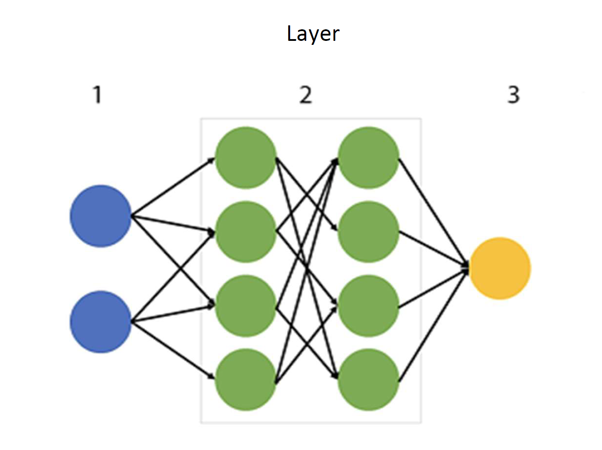
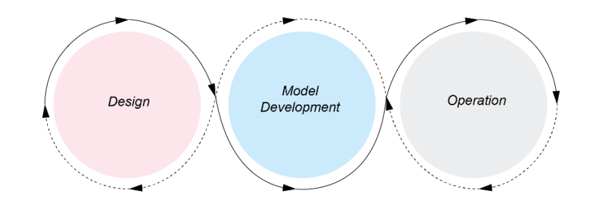
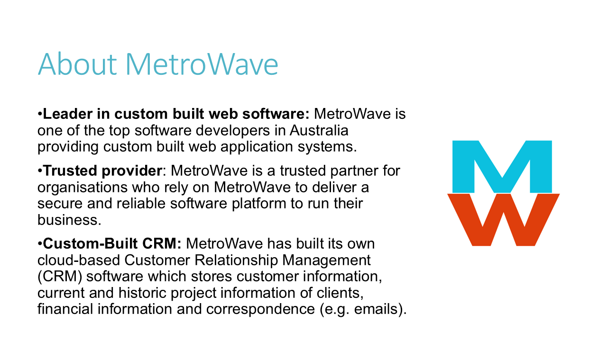
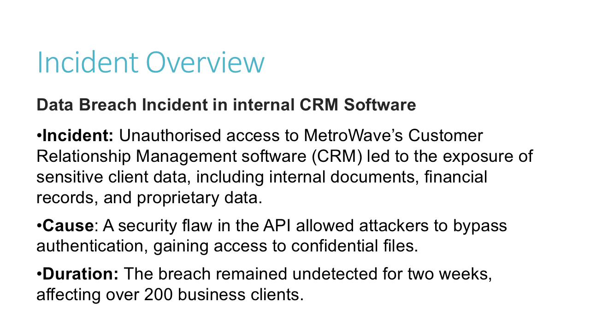
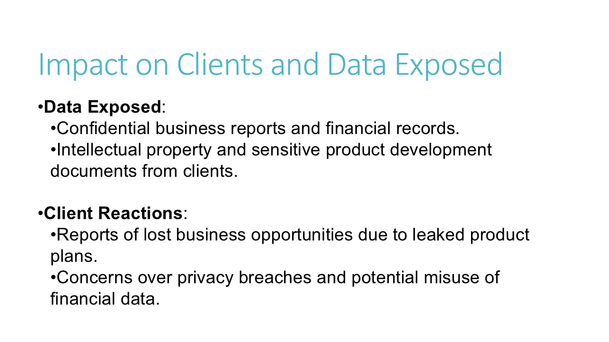
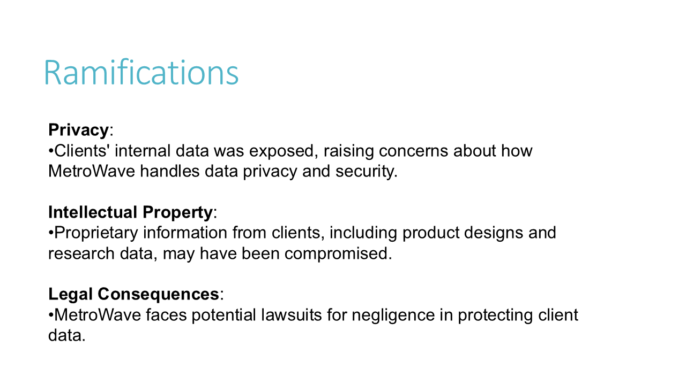
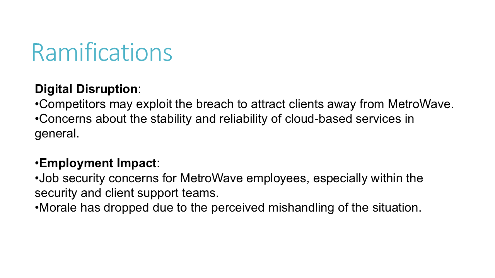
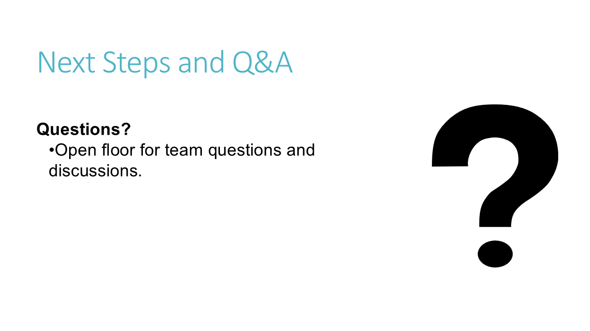

# CSSA 2025 Trial

- Syllabus: Software Engineering · Publisher: –
- Status: private
- **Score: – / 80** · answered 0/33 parts · marked 0/33
- Review page: -

---

## 1. 2025 CSSA, Q1, Progressive Web Apps

#### Question 1 — –/1 marks  `MULTI_CHOICE`

Which of the following best describes a Progressive Web App (PWA)?

- **A.** A type of website with no offline capabilities.
- **B.** A website that only supports desktop browsers.
- **C.** A mobile application that requires installation from an app store.
- **D.** A web app that uses modern web capabilities to deliver an app-like experience.  ✅ *correct*

**Your answer:** (none) · **Correct:** D

---

## 2. 2025 CSSA, Q2, Logistic Regression 

#### Question 2 — –/1 marks  `SHORT`

Fill in the missing word in the text box below.

\_\_\_\_\_\_\_\_\_\_\_\_\_\_\_\_ Regression : Used for classification problems (e.g., spam detection).

**Your answer:**

_(not answered)_

**Sample answer:**

Logistic

---

## 3. 2025 CSSA, Q3, Software Dev. Life Cycle 

#### Question 3 — –/1 marks  `MULTI_CHOICE`

What is the first step in the software development life cycle that impacts security?

- **A.** Design
- **B.** Maintenance
- **C.** Requirements definition  ✅ *correct*
- **D.** Testing

**Your answer:** (none) · **Correct:** C

---

## 4. 2025 CSSA, Q4, Social and Ethical use of Data 

#### Question 4 — –/1 marks  `MULTI_CHOICE`

An employee at an accounting firm accidentally sent a customer’s personal details to the wrong client. Although the data was not altered, it was exposed to someone who should not have access to it.  

Which security principle was primarily compromised in this situation?

- **A.** Authorisation
- **B.** Availability
- **C.** Confidentiality  ✅ *correct*
- **D.** Integrity

**Your answer:** (none) · **Correct:** C

---

## 5. 2025 CSSA, Q5, Cross-site Scripting 

#### Question 5 — –/1 marks  `MULTI_CHOICE`

An attacker creates the following URL and sends it to a victim: 

|  http://example.com/search?q=<script>alert('You have been hacked!');</script> |
|---|

When the victim clicks on the link, the server reflects the malicious script back into the search results page, and it executes in the victim’s browser, displaying a popup with the message "You have been hacked!" 

What type of vulnerability does this represent?

- **A.** Cross-Site Request Forgery (CSRF)
- **B.** Cross-Site Scripting (XSS)  ✅ *correct*
- **C.** Invalid forwarding and redirecting
- **D.** SQL Injection

**Your answer:** (none) · **Correct:** B

---

## 6. 2025 CSSA, Q6,  AI vs ML 

#### Question 6 — –/1 marks  `MULTI_CHOICE`

Which of the following best distinguishes artificial intelligence (AI) from machine learning (ML)?

- **A.** AI is a subset of ML.
- **B.** ML requires human input, while AI does not.
- **C.** ML focuses on hardware, while AI focuses on software.
- **D.** AI focuses on building systems that simulate human intelligence, while ML focuses on enabling machines to learn from data.  ✅ *correct*

**Your answer:** (none) · **Correct:** D

---

## 7. 2025 CSSA, Q7, Artificial Neural Networks 

**Stimulus:**



#### Question 7 — –/1 marks  `SORTING_TABLE`

The diagram in the Stimulus (left) represents an artificial neural network.   
  
Place the Layers in the correct order that matches the diagram.

**(Note: The top description will represent Layer #1.)**

**Your answer:**

_(not answered)_

**Sample answer:**

#1: Original data features for the network are processed.

#2: Transforms and processes data through weighted connections and activation functions.

#3: Predictions are based on the input data and hidden layer transformations.

---

## 8. 2025 CSSA, Q8, Client-side Programming 

#### Question 8 — –/1 marks  `MULTI_CHOICE`

Which statement below is true about _client-side programming_?

- **A.** It interacts with the user interface on the browser.  ✅ *correct*
- **B.** It handles data requests from a database such as records and fields.
- **C.** It manages server resources such as accounts, folders and files.
- **D.** It processes database searches and data queries on the back-end.

**Your answer:** (none) · **Correct:** A

---

## 9. 2025 CSSA, Q9, Legal and Ethical Issues

#### Question 9 — –/1 marks  `MULTI_CHOICE`

What is a legal and ethical consideration related to the development of secure software?

- **A.** Reducing the cost of development.
- **B.** Meeting data privacy regulations.  ✅ *correct*
- **C.** Increasing the functionality of the software.
- **D.** Developing software in multiple languages.

**Your answer:** (none) · **Correct:** B

---

## 10. 2025 CSSA, Q10, Algorithms used in Neural Networks

#### Question 10 — –/1 marks  `MULTI_CHOICE`

Which of the following is a key technique used in virtual personal assistants like Siri or Alexa?

- **A.** Decision trees
- **B.** Linear regression
- **C.** Logistic regression
- **D.** Neural networks  ✅ *correct*

**Your answer:** (none) · **Correct:** D

---

## 11. 2025 CSSA, Q11, Installation Methods 

#### Question 11 — –/1 marks  `MULTI_CHOICE`

New software has been developed to complete a task. Users of the new software have been asked to stop using the old software immediately and start to use the new software. 

What installation method is being used?

- **A.** Direct cut over  ✅ *correct*
- **B.** Parallel
- **C.** Phased
- **D.** Pilot

**Your answer:** (none) · **Correct:** A

---

## 12. 2025 CSSA, Q12, Secure Design Features

#### Question 12 — –/1 marks  `MULTI_CHOICE`

How do the capabilities and experience of end users influence the secure design features of software?

- **A.** Less experienced users may require security features that are automated and simple to use.  ✅ *correct*
- **B.** Experienced users require fewer security measures because they are less likely to make errors.
- **C.** The security features of software should be identical for all users, regardless of their experience.
- **D.** All users should be given full control over advanced security settings to prevent any vulnerabilities.

**Your answer:** (none) · **Correct:** A

---

## 13. 2025 CSSA, Q13, HTTPS/SSL Encryption

#### Question 13 — –/2 marks  `SORTING_TABLE`

Place in the correct order the steps to describe how HTTPS/SSL encryption works when a user connects to a secure website.

**(Note: The top description represents the first step of the HTTPS/SSL encryption process.)**

**Your answer:**

_(not answered)_

**Marking criteria:**
- [2] Correctly orders the HTTPS/SSL encryption process
- [1] Correctly orders at least 2 steps

---

## 14. 2025 CSSA, Q14, Design Approaches

#### Question 14 — –/3 marks  `SHORT`

Explain the difference between the ‘**security by design**’ approach and the ‘**privacy by design**’ approach.

*Word limit: 90*

**Your answer:**

_(not answered)_

**Marking criteria:**
- [3] Demonstrates a good understanding of both approaches and explains the differences
- [2] Demonstrates a good understanding of both approaches
- [1] Demonstrates some understanding of either approach

**Sample answer:**

The 'security by design' approach integrates security measures throughout the software development process to protect against external threats like unauthorised access and data breaches. In contrast, 'privacy by design' ensures that user privacy is embedded into the design, focusing on minimising data collection, ensuring user control, and complying with privacy laws. While both aim to protect data, security by design is about preventing attacks, whereas privacy by design focuses on respecting users' privacy rights.

---

## 15. 2025 CSSA, Q15, Security Concepts and Vulnerability Assessment

**Stimulus:**

A small café with five employees uses custom-built software to manage its point of sale (POS) system. The system has the following functions:  

-   Record transactions and issue receipts to customers.  
    

-   Delete transactions.  
    

-   View daily sales data.  
    

Currently, all employees have full access to all system functions. Recently, the manager has noticed that some transactions are being deleted throughout the day, with no way to track how or by whom these deletions occurred.

#### Question 15(a) — –/2 marks  `SHORT`

Outline TWO fundamental security concepts in software design that could help the manager address this issue.

*Word limit: 90*

**Your answer:**

_(not answered)_

**Marking criteria:**
- [2] Provides a clear and detailed explanation of how a vulnerability assessment could manage the security of the system with reference to the scenario covering identification, evaluation, and action steps
- [1] Outlines one relevant security concept or identifies two concepts with partial or unclear explanations

**Sample answer:**

**Authorisation:** Implementing role-based access control would allow the manager to restrict certain functions, such as deleting transactions, to specific employees. This would limit access and reduce the likelihood of unauthorized transaction deletions.

**Accountability:** Enabling audit logging within the system would allow the manager to track all actions taken by employees, including transaction deletions. This would provide a record of who performed specific actions and when, aiding in accountability.

#### Question 15(b) — –/3 marks  `SHORT`

Explain how conducting a vulnerability assessment could help improve the security of the POS system.

*Word limit: 90*

**Your answer:**

_(not answered)_

**Marking criteria:**
- [3] Provides a clear and detailed explanation of how a vulnerability assessment could manage the security of the system with reference to the scenario covering identification, evaluation, and action steps
- [2] Describes the role of a vulnerability assessment with some detail
- [1] Provides a basic description of a vulnerability assessment

**Sample answer:**

A vulnerability assessment would help the café identify security weaknesses in the POS system by analysing its software, network, and user access settings. The assessment would evaluate potential risks, such as the lack of access controls or insufficient logging mechanisms. Based on the findings, the café could then implement changes, such as restricting access to sensitive functions and improving system monitoring, to prevent unauthorised actions and protect against future security threats.

---

## 16. 2025 CSSA, Q16, Use of OOP 

#### Question 16 — –/3 marks  `SHORT`

Explain how an Object-Oriented Programming (OOP) approach can enhance the automation of machine learning models.

*Word limit: 90*

**Your answer:**

_(not answered)_

**Marking criteria:**
- [3] Explains OOP approach
- [2] Outlines OOP approach
- [1] Provides some relevant information

**Sample answer:**

OOP enhances automation by organising code into reusable classes and methods, which improves structure and maintainability. For example, each ML model (e.g., linear regression, neural network) can be represented as a class with specific methods for training, predicting, and updating. This modular approach allows developers to automate tasks like data processing, training, and deploying models without rewriting code, making it easier to manage, extend, and debug. OOP also allows different model classes to inherit properties, reducing redundancy and ensuring consistency across models.

---

## 17. 2025 CSSA, Q17, Web Protocols and Back-end Web Server description

**Stimulus:**

A Web Developer has been approached to develop a website for a clothing company that requires an online ordering system.  

The system would allow users to: 

-   create an account,  
    

-   browse for clothing items,  
    

-   add items to a cart for checkout   
    

-   make payment for their purchases.  
    

The order created would be sent to the warehouse for processing and update the clothing company’s inventory and stock.  

During the ordering process, the user is notified of updates to their order, including payment received, order processed, order dispatched and delivery.

#### Question 17 (a) — –/2 marks  `OBJECTIVE_RESPONSE`

Select the protocols required for the data being transferred.

| Statement | Correct | Yours | |
|---|---|---|---|
| Sending confirmation email for a created account | HTTP, TCP/IP | – |  |
| Sending private customer data between internal severs | TCP/IP, SFTP | – |  |
| Accessing the store&rsquo;s website | HTTP, TCP/IP | – |  |

**Marking criteria:**
- [2] Correctly selects all protocols
- [1] Correctly selects ONE row of protocols

**Marking guidance:**

Note: depending on interpretation, http may/may not be used to send/access email if the emails are access through a web browser

#### Question 17 (b) — –/2 marks  `SHORT`

Outline ONE collaborative practice back-end and front-end developers would need to engage to develop this website.

*Word limit: 60*

**Your answer:**

_(not answered)_

**Marking criteria:**
- [2] Outlines ONE collaborative practice back-end and front-end developers would need to engage to develop this website
- [1] Shows an understanding of collaboration OR front-end/back-end developers

**Sample answer:**

Front-end Developers could meet with back-end developers to make sure that the interface they design for a product matches the data stored in the back-end server.

#### Question 17 (c)  — –/3 marks  `SHORT`

Explain how CSS would be utilised by the ordering website for browsing the range of clothing that users can search.

*Word limit: 90*

**Your answer:**

_(not answered)_

**Marking criteria:**
- [3] Demonstrates a clear understanding of CSS and clearly explains effect of using CSS in this application
- [2] Demonstrates a clear understanding of CSS  OR describes effect of using CSS in this application
- [1] Shows an understanding of CSS

**Sample answer:**

CSS or Cascading Style Sheets, allow developers to store the style of html tags in a single file. To display multiple shopping items, over multiple pages, it is important that each item is displayed in a consistent manner no matter the search query results. Therefore, CSS would allow for the same style to be applied to all pages of the website, for example how a division aligns an image and text of a product so that the user can quickly identify the items they are trying to search for on each page.

---

## 18. 2025 CSSA, Q18,  Decision Tree with Test Data and Algorithm  

**Stimulus:**

Bruce’s Burgers offers half priced burgers if the customer has a loyalty card or is a university student. This discount doesn’t apply on public holidays. 

The following test data has been developed to be used:

The customer has a loyalty card, and is a university student, and the day is Boxing Day (Public Holiday)

#### Question 18 (a) — –/3 marks  `DRAWING_V2`

Draw a decision tree using the test data.

**Your answer:**

_(not answered)_

**Marking criteria:**
- [2] Constructs a substantially correct decision tree
- [1] Constructs a partially correct decision tree

**Sample answer:**


#### Question 18 (b) — –/4 marks  `PSEUDOCODE`

Referring to the stimulus create an algorithm to determine the price paid by a customer. The algorithm should take the required input, complete checks with necessary control structures and the result with meaningful output.

**Your answer:**

_(not answered)_

**Marking criteria:**
- [4] Provides a substantially correct algorithm including the following features:  

Appropriate inputs  

Use of control structures to complete checks  

Use of meaningful outputs
- [3] Provides a partially correct algorithm that address most features above
- [2] Provides a partially correct algorithm that address some features above
- [1] Attempts an algorithm relating to the scenario

**Sample answer:**

BEGIN  

GET loyalty\_card  

GET student  

GET day  

SET Discount = NO  

IF loyalty\_card = True OR student = True THEN  

IF day = Public Holiday THEN  

Discount = No 

ELSE  

Discount = Yes  

ENDIF  

 IF Discount = Yes THEN  

DISPLAY "Customer can have a half priced burger"  

ELSE  

DISPLAY "Customer must pay full price"  

ENDIF 

ENDIF  

END

---

## 19. 2025 CSSA, Q19, SQL and ORM 

**Stimulus:**

Consider the following table that represents a database named Customers for a customer rating system: 

| ID | Username | Premium Account | Rating |
|---|---|---|---|
| 1 | jkimble | False | 87.1 |
| 2 | fishstick | True | 94.2 |
| 3 | user123 | False | 78.5 |
| 4 | student456 | True | 82.3 |
| 5 | teacher789 | False | 90.0 |
| 6 | admin321 | True | 95.7 |
| 7 | learner234 | False | 81.2 |
| 8 | member567 | True | 88.9 |
| 9 | guest890 | False | 79.6 |
| 10 | tester001 | True | 91.4 |

#### Question 19 (a) — –/1 marks  `SQL`

Write an SQL statement that will display only the Username and Rating of customers who have a Rating of 90.0 or higher

Dataset:
```sql
CREATE TABLE "Customers" (
  "ID" INTEGER NOT NULL,
  "Username" TEXT NOT NULL,
  "PremiumAccount" BOOLEAN NOT NULL,
  "Rating" FLOAT NOT NULL,
  PRIMARY KEY("ID" AUTOINCREMENT)
);

INSERT INTO "Customers" ("ID", "Username", "PremiumAccount", "Rating") VALUES (1, 'jkimble', FALSE, 87.1);
INSERT INTO "Customers" ("ID", "Username", "PremiumAccount", "Rating") VALUES (2, 'fishstick', TRUE, 94.2);
INSERT INTO "Customers" ("ID", "Username", "PremiumAccount", "Rating") VALUES (3, 'user123', FALSE, 78.5);
INSERT INTO "Customers" ("ID", "Username", "PremiumAccount", "Rating") VALUES (4, 'student456', TRUE, 82.3);
INSERT INTO "Customers" ("ID", "Username", "PremiumAccount", "Rating") VALUES (5, 'teacher789', FALSE, 90.0);
INSERT INTO "Customers" ("ID", "Username", "PremiumAccount", "Rating") VALUES (6, 'admin321', TRUE, 95.7);
INSERT INTO "Customers" ("ID", "Username", "PremiumAccount", "Rating") VALUES (7, 'learner234', FALSE, 81.2);
INSERT INTO "Customers" ("ID", "Username", "PremiumAccount", "Rating") VALUES (8, 'member567', TRUE, 88.9);
INSERT INTO "Customers" ("ID", "Username", "PremiumAccount", "Rating") VALUES (9, 'guest890', FALSE, 79.6);
INSERT INTO "Customers" ("ID", "Username", "PremiumAccount", "Rating") VALUES (10, 'tester001', TRUE, 91.4);
```

**Your answer:**

_(not answered)_

**Marking criteria:**
- [1] Constructs an SQL query that satisfies the requirements of the question

**Sample answer:**

SELECT Username, Rating  
FROM Customers  
WHERE Rating >= 90.0;

#### Question 19 (b) — –/4 marks  `SHORT`

A developer has chosen to construct a web application utilising python as the programming language. 

Discuss the options of using Object-Relational Mapping (ORM) and SQL to store the Customers’ data.

*Word limit: 120*

**Your answer:**

_(not answered)_

**Marking criteria:**
- [4] Provides advantages AND disadvantages of ORM AND SQL to address the scenario
- [3] Provides advantages OR disadvantages of ORM AND SQL to address the scenario
- [2] Describes ORM OR SQL
- [1] Shows an understanding of ORM OR SQL

**Sample answer:**

SQL allows a database to be constructed as a table with fields, and related SQL query syntax to interact with the data. This provides a very structured way to organise the data, which is easily queried with simple statements, although a developer may have to learn the syntax of these queries and learn a library that connects to an SQL database within in python. This could create a learning curve that impacts time of production as the SQL syntax is not native to the python programming language.  

ORM allows the developer to use an object-oriented model to interact with a database stored on a server. This is more in line with the python language as it can utilise the python syntax for object-oriented coding, with ORM commands being available in the python standard library, as well as many python web server libraries that have their own libraries. Unfortunately, there may be performance issues when implementing ORM, as requests need to be made over a server which can impact load times, and ORM typically being slower when dealing with complex queries.

---

## 20. 2025 CSSA, Q20, Data Types and Algorithm for a function

**Stimulus:**

Tickets for international superstar Yat Yat Fast are on sale for her tour of Australia. All tickets are General Admission (GA). 

-    A GA ticket costs $100. 

-   A GA ticket and commemorative poster of Yat Yat Fast costs $150.

#### Question 20 (a) — –/3 marks  `SHORT`

A program needs be written for the purchasing of tickets. Justify the use of THREE different data types for variables used in this program.

*Word limit: 90*

**Your answer:**

_(not answered)_

**Marking criteria:**
- [3] Provides clear reasoning for THREE data types related to the scenario
- [2] Provides reasoning for TWO data types OR states THREE data types related to the scenario
- [1] Provides reasoning for ONE data type OR states TWO data types

**Sample answer:**

An integer would be used for the total number of tickets purchased.  

 A float could be used for the cost of ticket.  

 A string could be used for the text to display the total cost with dollar symbols.

#### Question 20 (b) — –/4 marks  `SHORT`

Write an algorithm for the function totalCost(), that passes in parameters which calculates and displays the total cost.

**Your answer:**

_(not answered)_

**Marking criteria:**
- [4] Provides a substantially correct algorithm including the following features: 

Appropriate input data  
Use of functions to calculate cost, that pass in parameters 
Meaningful outputs
- [3] Provides a partially correct algorithm that address most features above
- [2] Provides a partially correct algorithm that address some features above
- [1] Attempts an algorithm relating to the scenario

**Sample answer:**

BEGIN Main  

GET NumberofTickets  

GET TicketType  

Total = TotalCost (NumberofTickets, TicketType,)  

DISPLAY "The total cost of the tickets: $" & Total  

END Main  

BEGIN TotalCost (NumberofTickets, TicketType,)  

IF TicketType = "GA" THEN  

Total = NumberofTickets \* 100  

ELSE  

Total = NumberofTickets \* 150  

ENDIF  

  RETURN Total  

END TotalCost

---

## 21. 2025 CSSA, Q21, Linear, Polynomial Regression and Interactive Web components

**Stimulus:**

A retail clothes company, NickSales Ltd, wants to predict monthly sales for its products based on historical sales data, marketing spends, and seasonal trends. They decide to automate this process using Machine Learning (ML).  

 The data science team creates a software application in Python, using OOP principles to structure the ML models. They apply two different regression techniques:  

1.  \-Linear regression 
2.  \-Polynomial regression

#### Question 21 (a) — –/3 marks  `SHORT`

Distinguish between linear regression and polynomial regression for this scenario.

*Word limit: 90*

**Your answer:**

_(not answered)_

**Marking criteria:**
- [3] Describes some differences between linear and polynomial regression AND includes an example
- [2] Identifies differences OR Outlines one difference between linear and polynomial regression OR provides an example
- [1] Provides some relevant information

**Sample answer:**

Linear regression models the relationship between variables as a straight line, assuming a linear relationship.   

Polynomial regression, however, fits a curved line by adding polynomial terms, which can capture more complex, nonlinear relationships between variables.   

 For instance, polynomial regression would be more suitable for predicting sales that show seasonal or cyclical patterns, where a linear model would fail to capture the natural peaks and troughs over time.

#### Question 21 (b) — –/3 marks  `SHORT`

The web system for NickSales Ltd operates using the following components:  

-   User ordering their clothing items 
    

-   Website processing the order 
    

-   Updating the stock inventory/database
    

Describe how these components interact to form an interactive web development system.

*Word limit: 90*

**Your answer:**

_(not answered)_

**Marking criteria:**
- [3] Designs models that address all of the components of: 

User ordering their items 

Website processing the order 

Updating the stock inventory/database
- [2] Designs models that address TWO of the components of: 

User ordering their items 

Website processing the order 

Updating the stock inventory/database 3
- [1] Designs a model that addresses a relevant component of the scenario

**Sample answer:**

Client side or front-end development would be required to collect the order from the user. This would involve creating a web page with inputs. These inputs could be dropdown menus, text entry for each product that is sold so that user can select what they want to order, typically written in html and JavaScript to interact and collect the user’s choices.  

Once collected, server side or back-end development would be required to process this order. This would be implemented on the server of Nicksales, and the code implemented would process the inputs of the sale, assign it to the customer account, calculate the costs of the sale, and requires the transaction to an external financial service. This is typically implemented with server-side code libraries like Flask.  

 The developer would also need to interact their system with a database. The sales for and order or the data about each customer account could be constructed in separate SQL tables, which would allow easy interaction for each system (front and back end) to retrieve the required data to process or collect a sale.

---

## 22. 2025 CSSA, Q22, Modelling Tools and Create Python Function

**Stimulus:**

InstantPage is a new social media product that regularly updates the user with details of time spent using the app. InstantPage provides the time in minutes only. 

 A program is to be created to convert the minutes into hours and minutes. 

e.g. 134 minutes = 2 hours 14 minutes.

#### Question 22 (a) — –/1 marks  `MULTI_CHOICE`

Select (by selecting the radio button below) the modelling tool that represent the subroutines and their relationships for the InstantPage app.

- **A.** Class diagram
- **B.** Gantt chart
- **C.** Structure chart  ✅ *correct*
- **D.** Data flow diagram

**Your answer:** (none) · **Correct:** C

**Marking criteria:**
- [1] Correctly selects the Modelling Tool

#### Question 22 (b) — –/4 marks  `CODING`

Create a function, using Python, where the user enters the minutes and converts this time into the equivalent hours and minutes. The displayed time should be grammatically correct.

**Your answer:**

_(not answered)_

**Marking criteria:**
- [4] Provides a substantially correct solution including all the following features: 

Appropriate inputs passed to the function  
Use of function to perform appropriate calculations  
Appropriate outputs  
Correct python syntax
- [3] Provides a solution that shows understanding of most of the above features
- [2] Provides a solution that shows understanding of some features
- [1] Shows some understanding of the requirement

**Sample answer:**

def HoursAndMinutes(TotalMinutes):  

    hour \= TotalMinutes//60  

    minute \= TotalMinutes//60  

    if hour < 1 and minute < 2:  

        print("It has been converted to: ", minute, " minute.")  

    elif hour < 2 and minute < 1:  

        print("It has been converted to: ", hour, " hour.")  

    elif hour < 2 and minute \> 1:  

        print("It has been converted to: ", hour, " hour & ", minute, " minutes.")  

    elif hour \> 1 and minute < 2:  

        print("It has been converted to: ", hour, " hours & ", minute, " minute.")  

    elif hour < 2 and minute < 2:  

        print("It has been converted to: ", hour, " hour & ", minute, " minute.")  

    else:  

        print("It has been converted to: ", hour, " hours & ", minute, " minutes.")  

TotalMinutes \= int(input("Please enter minutes that you wish to convert to hours and minutes: "))  

HoursAndMinutes(TotalMinutes)

---

## 23. 2025 CSSA, Q23, Stages of MLOps 

**Stimulus:**

BJcomputing Solutions Inc. is a tech company specializing in predictive analytics for e-commerce. The company wants to improve customer experience by deploying a Machine Learning (ML) recommendation system that suggests products based on user behaviour. Their Data Science team has created a model with high accuracy, but they face challenges moving it efficiently into production and maintaining it as user data and behaviour patterns change.



#### Question 23 — –/4 marks  `SHORT`

Analyse how the team could use the three stages of Machine Learning Operations (MLOps), as shown in the diagram in the stimulus (shown left).

*Word limit: 150*

**Your answer:**

_(not answered)_

**Marking criteria:**
- [4] Provides a thorough explanation of the use of the 3 areas Design, Model Development and Operation relating to the scenario
- [3] Provides a sound explanation of the use of the 3 areas Design, Model Development and Operation relating to the scenario
- [2] Shows a some understanding of most of the areas
- [1] Provides some relevant information

**Sample answer:**

**Design:**   

\- defining the business problem to be solved   

\- refactoring the business problem into a machine learning problem   

\- defining success metrics   

\- researching available data.   

 **Model development:**   

\- data wrangling   

\- feature engineering   

\- model training   

\- model testing and validation.   

 **Operations:**   

\- model deployment   

\- supporting operations/use  

 - monitoring model performance.

---

## 24. 2025 CSSA, Q24, Create Python Program 

**Stimulus:**

You have been asked by an emerging airline to develop a program to allocate Business and Economy Class seats for flights on board their new Airbus 380\-800 planes. The current seat-booking system consists of a number of modules, including:  

-   booking and seat allocation  
    

-   online payment  
    

-   ticket production  
    

-   printing of boarding passes. 
    

The new booking and seat allocation module needs to fulfil the flowing requirements: 

-   Ask the user for the class of tickets required.  
    

-   Ask the user for the number of tickets required. A maximum of 4 tickets can be purchased at one time. 
    

-   If only one ticket is required, allocate the next unallocated seat.  
    

-   If more than one ticket is required, allocate seats next to each other in the same row. However, if the required seats cannot be found together, an appropriate message should be displayed and the booking process restarted.  
    

-   Output the allocated seat number(s).  
    

The Business Class passengers are to be seated in 5 rows of 8 seats. The diagram below shows the seating plan represented as a 2-dimensional array. Column 0 contains the letters A to E. Row 0 contains the numbers 1 to 8. 

The Economy Class passengers are to be seated in 15 rows of 10 seats. The diagram shows the seating plan represented as a 2-dimensional array. Column 0 contains the letters F to T. Row 0 contains the numbers 1 to 10.  

An ‘X’ indicates that the seat has already been allocated. For example, if four tickets are ordered in Economy Class, the seats G6, G7, G8 and G9 would be allocated.  

Business Class 

|  | 1 | 2 | 3 | 4 | 5 | 6 | 7 | 8 |
|---|---|---|---|---|---|---|---|---|
| A | X | X | X | X |  |  |  |  |
| B | X | X | X | X | X |  |  |  |
| C | X | X | X | X | X | X | X |  |
| D |  |  |  |  |  |  |  |  |
| E |  |  |  |  |  |  |  |  |

Economy Class 

|  | 1 | 2 | 3 | 4 | 5 | 6 | 7 | 8 | 9 | 10 |
|---|---|---|---|---|---|---|---|---|---|---|
| F | X | X | X | X |  |  |  | X | X |  |
| G | X | X | X | X | X |  |  |  |  |  |
| H | X | X | X | X | X | X | X |  |  |  |
| … |  |  |  |  |  |  |  |  |  |  |
| T |  |  |  |  |  |  |  |  |  |  |

#### Question 24 — –/6 marks  `CODING`

Develop a program, using Python, that performs the requirement of the booking and seat allocation module. It should use Functions where appropriate, allocating the occupied seats of each seating class.

**Your answer:**

_(not answered)_

**Marking criteria:**
- [6] Provides a substantially correct solution including all of the following features: 

accepts input  

searches the array for appropriate seats  

updates the array 

displays allocated seats   

provides suitable messages
- [5] Provides a solution that addresses most of the requirements
- [4] Provides a solution that addresses some of the requirements
- [3] Provides a solution that addresses an aspect of the requirements
- [2] Attempts a solution of the requirements
- [1] Shows some understanding of the requirements

**Sample answer:**

def initialize\_seating():  
    """  
    Initialize the seating arrangements for both classes with the  
    given “starting point” occupancy.  
    """  
    # Business Class: rows A–E, seats 1–8  
    business\_class = \[  
        # A    1    2    3    4    5    6    7    8  
        \[ True, True, True, True, False, False, False, False \],  # A  
        \[ True, True, True, True, True,  False, False, False \],  # B  
        \[ True, True, True, True, True,  True,  True,  False \],  # C  
        \[ False, False, False, False, False, False, False, False \],  # D  
        \[ False, False, False, False, False, False, False, False \],  # E  
    \]

    # Economy Class: rows F–T, seats 1–10  
    economy\_class = \[  
        # F    1    2    3    4    5     6     7     8     9    10  
        \[ True, True, True, True, False, False, True,  True,  False, False \],  # F  
        \[ True, True, True, True, True,  False, False, False, False, False \],  # G  
        \[ True, True, True, True, True,  True,  True,  False, False, False \],  # H  
    \] + \[\[False\]\*10 for \_ in range(12)\]  # rows I–T, all seats available

    return business\_class, economy\_class

  
def display\_seating(seating, class\_type):  
    """  
    Print the seating chart for the given class.  
    X = occupied, O = available  
    """  
    print(f"\\n{class\_type} Class Seating Chart (X = occupied, O = available):")  
    for row in seating:  
        print(" ".join("X" if seat else "O" for seat in row))  
    print()

  
def allocate\_seats(seating, tickets):  
    """  
    Try to allocate \`tickets\` seats in \`seating\`.  
    Returns a list of (row\_index, col\_index) or None if allocation fails.  
    """  
    rows, cols = len(seating), len(seating\[0\])

    if tickets == 1:  
        # single ticket → first available seat  
        for i in range(rows):  
            for j in range(cols):  
                if not seating\[i\]\[j\]:  
                    seating\[i\]\[j\] = True  
                    return \[(i, j)\]  
    else:  
        # multiple tickets → look for adjacent seats  
        for i in range(rows):  
            for j in range(cols - tickets + 1):  
                if all(not seating\[i\]\[j+k\] for k in range(tickets)):  
                    for k in range(tickets):  
                        seating\[i\]\[j+k\] = True  
                    return \[(i, j+k) for k in range(tickets)\]  
    return None

  
def main():  
    business\_class, economy\_class = initialize\_seating()

    # select class  
    cls = input("Enter class (Business/Economy): ").strip().lower()  
    if cls not in ('business', 'economy'):  
        print("Invalid class. Exiting.")  
        return

    seating = business\_class if cls == 'business' else economy\_class  
    class\_name = "Business" if cls == 'business' else "Economy"

    # select ticket count  
    try:  
        t = int(input("Enter number of tickets (1–4): "))  
    except ValueError:  
        print("Not a number. Exiting.")  
        return  
    if not (1 <= t <= 4):  
        print("Ticket count must be between 1 and 4. Exiting.")  
        return

    # allocate and display updated chart  
    result = allocate\_seats(seating, t)  
    if result is None:  
        print("Cannot find seats together. Booking restarted.")  
    else:  
        # map row indices back to letters for output  
        row\_letters = (  
            \['A','B','C','D','E'\] if cls=='business'  
            else \[chr(ord('F')+i) for i in range(15)\]  
        )  
        seats\_str = ", ".join(  
            f"{row\_letters\[i\]}{j+1}" for i,j in result  
        )  
        print(f"\\nAllocated seats: {seats\_str}")

    display\_seating(seating, class\_name)

  
if \_\_name\_\_ == "\_\_main\_\_":  
    main()

---

## 25. 2025 CSSA, Q25, Social, Ethical & Legal Issues of Data Breach

**Stimulus:**

The following internal company memo was prepared for employees within a software development company. 

**(Note: There are 7 slides in the presentation. Use the arrow icons to move between slides. Clicking on the slide will display its contents in full screen mode.)**














#### Question 25 — –/8 marks  `SHORT`

Evaluate the social, ethical and legal issues for both MetroWave and their clients resulting from the data breach incident.

*Word limit: 600*

**Your answer:**

_(not answered)_

**Marking criteria:**
- [7 - 8] Comprehensively evaluates the social, ethical AND legal issues resulting from the data breach. Makes continual reference to the stimulus and demonstrates an excellent understanding of how developing and implementing safe and secure software can affect people and enterprises
- [5 - 6] Evaluates the social, ethical and legal issues resulting from the data breach. Referring to the stimulus and demonstrates a sound understanding of how developing and implementing safe and secure software can affect people and enterprises.
- [3 - 4] Attempts to evaluate social, ethical and legal issues resulting from the data breach. Makes some reference to the stimulus and demonstrates some understanding of how developing and implementing safe and secure software can affect people and enterprises.
- [1 - 2] Provides some relevant information about social, ethical or legal issues with reference to secure software.

**Sample answer:**

The data breach in MetroWave’s internal CRM software raises significant social, ethical, and legal issues for both the company and its clients. Socially, the breach has damaged MetroWave’s reputation, as clients may no longer trust the company to securely manage sensitive data. This loss of trust can lead to digital disruption, where clients shift to competitors who claim better security practices, resulting in potential long-term financial losses and reduced client loyalty. Furthermore, the breach has affected employees, causing job insecurity, especially for those in the security and client support teams, and damaging overall morale due to the perceived mishandling of the situation.  

 Ethically, MetroWave has failed to uphold its responsibility to protect client privacy. The exposure of confidential business reports, financial data, and proprietary intellectual property (as highlighted in the slideshow) presents serious privacy violations. Clients rely on MetroWave to safeguard this information, and its failure to do so can lead to unethical consequences such as stolen intellectual property, which can be used by competitors to gain an unfair advantage, or the misuse of financial data that could lead to identity theft.  

 Legally, MetroWave faces severe ramifications. With potential lawsuits for negligence in data protection, the company could incur significant financial penalties. Furthermore, failure to comply with regulations such as the Privacy Act (1988) regarding data security could result in fines.  

 MetroWave must immediately rectify the security flaw in the API to regain some confidence with its existing customer base and prevent any further data leaks. MetroWave must also ensure its systems and policies are updated to prevent future incidents, thereby protecting both its clients’ rights and its standing in the marketplace.
