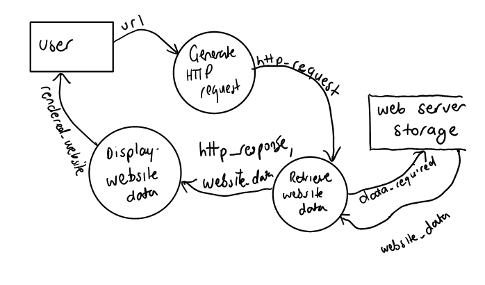
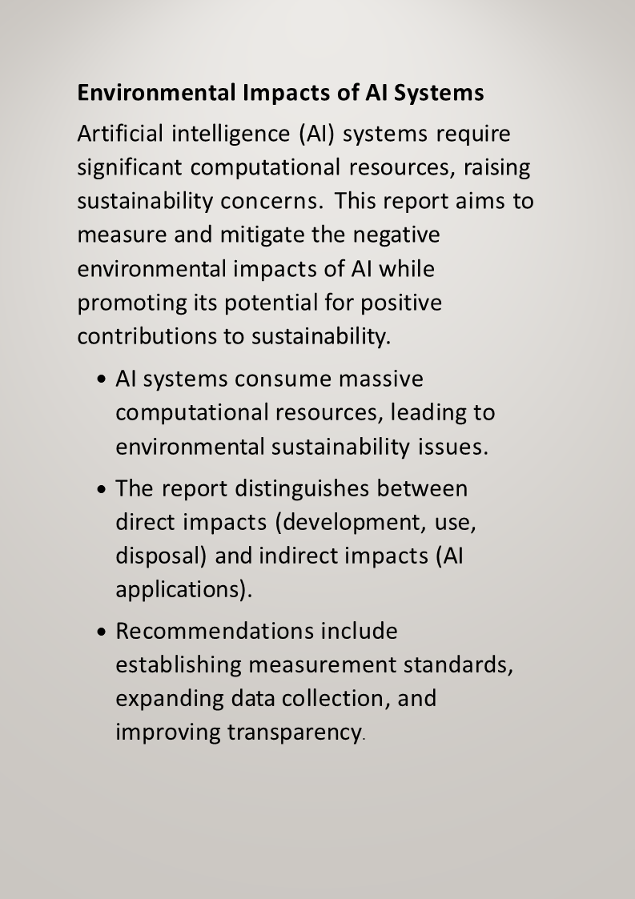
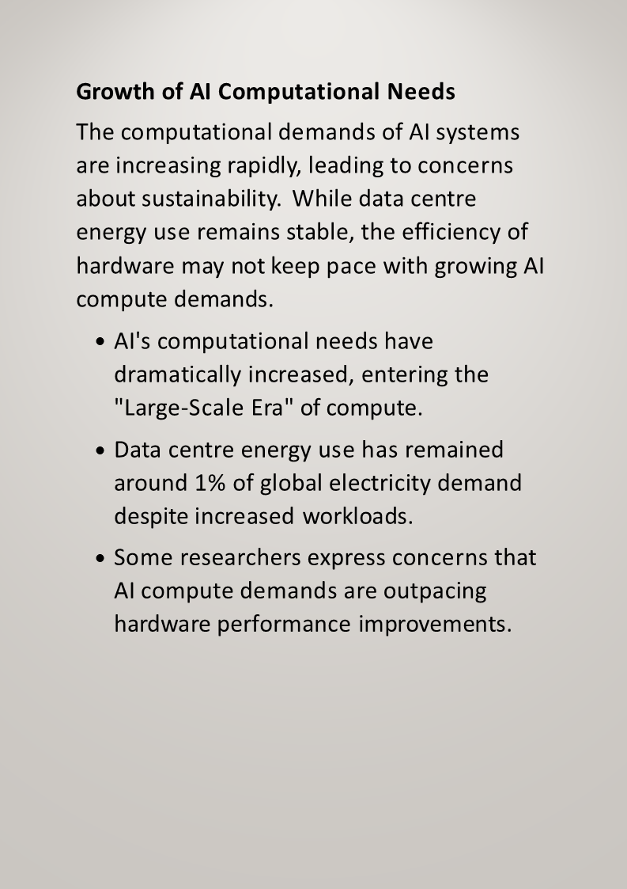
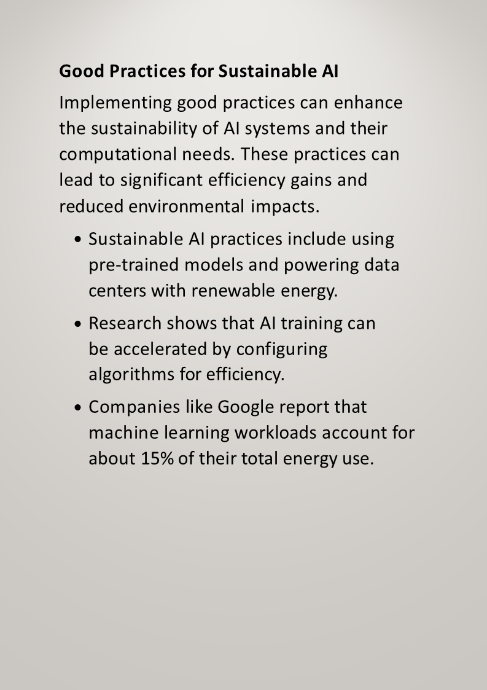
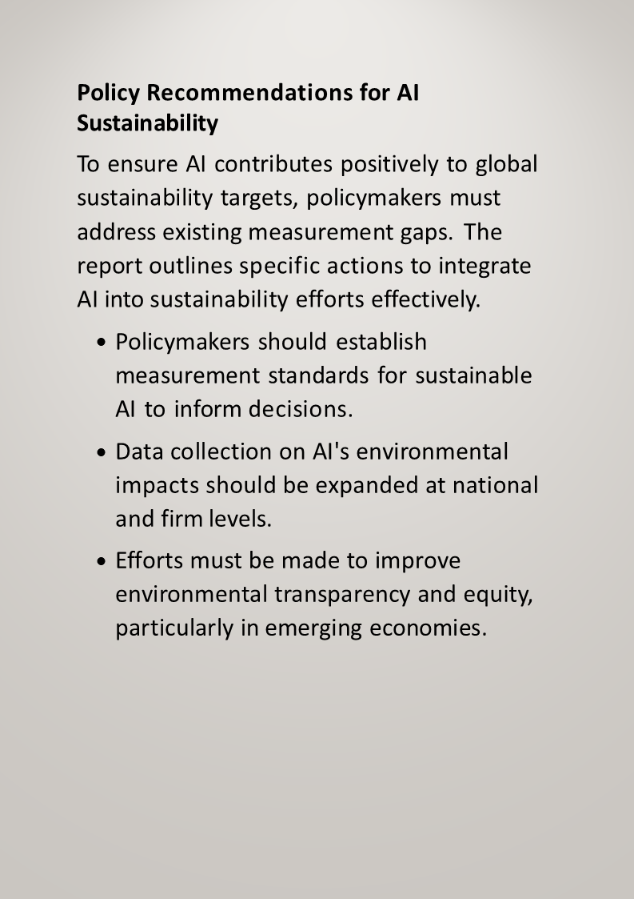
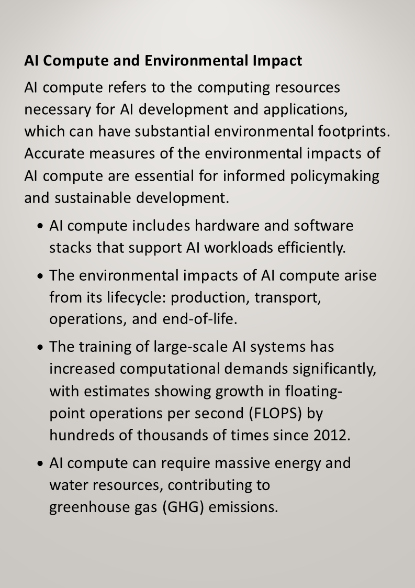
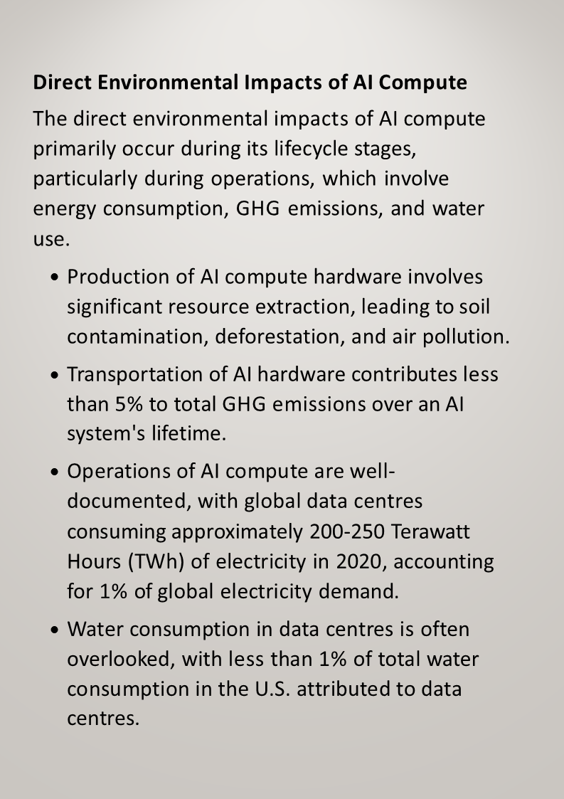
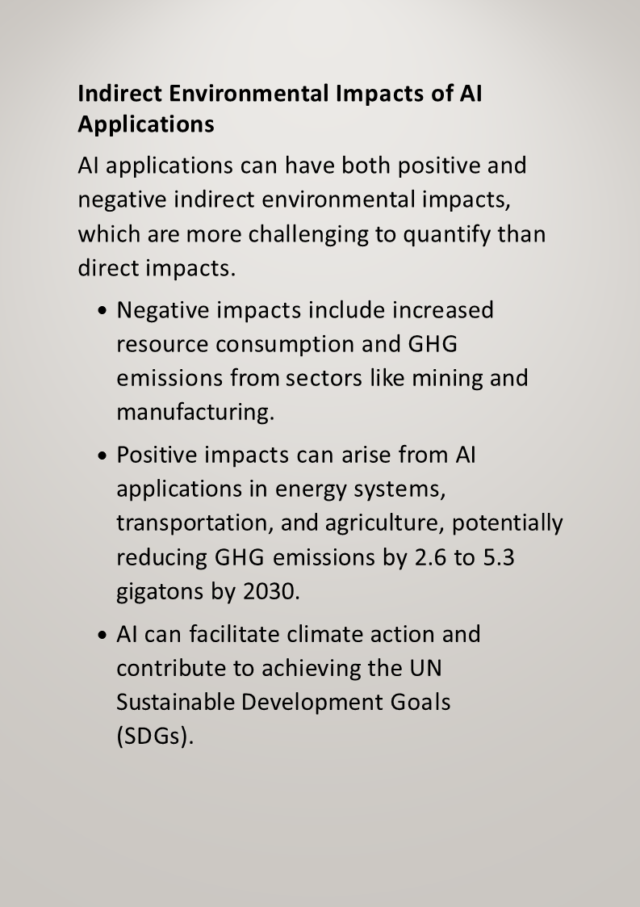
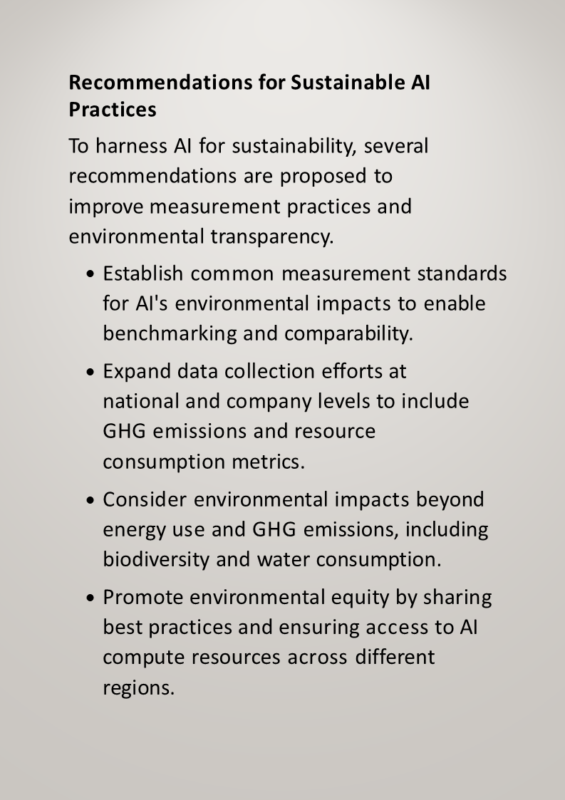

# CSSA Familiarisation

- Syllabus: Software Engineering · Publisher: –
- Status: private
- **Score: – / 32** · answered 0/10 parts · marked 0/10
- Review page: -

---

## 1. 2025 CSSA, Fam_Q1, HTTP vs HTTPS

#### Question 1 — –/1 marks  `MULTI_CHOICE`

What is the difference between HTTP and HTTPS?

- **A.** HTTPS uses encryption to secure data during transmission  ✅ *correct*
- **B.** HTTP is used for mobile devices, while HTTPS is used for desktop
- **C.** HTTP is faster than HTTPS
- **D.** HTTPS can only be used with IPv6

**Your answer:** (none) · **Correct:** A

**Marking criteria:**
- [1] Select correct answer

---

## 2. 2025 CSSA, Fam_Q2,  Robotic Process Automation

#### Question 2 — –/1 marks  `SHORT`

Enter the missing word:

\_\_\_\_\_\_\_\_\_\_\_\_\_\_\_\_\_\_\_\_  Process Automation, automates repetitive tasks by mimicking human actions.

**Your answer:**

_(not answered)_

**Marking rubric:**

| **Criteria** | **Marks** |
|---|---|
| -   Enters correct answer | 1 |

**Sample answer:**

Robotic

---

## 3. 2025 CSSA, Fam_Q3,   Machine Learning techniques

**Stimulus:**

An online retail company is developing a recommendation system to suggest products to users based on their browsing and purchasing history. The software engineering team is considering using machine learning techniques to improve the accuracy of the recommendations and increase customer engagement.

#### Question 3 — –/2 marks  `MULTI_CHOICE`

Which of the following machine learning techniques are appropriate for building a product recommendation system?  
  
**(Multiple items may be selected.)**

- **A.** Supervised learning with labelled purchase data  ✅ *correct*
- **B.** Unsupervised learning for identifying customer segments  ✅ *correct*
- **C.** Reinforcement learning for autonomous vehicle navigation
- **D.** Collaborative filtering to suggest similar products  ✅ *correct*
- **E.** Decision trees for binary classification of defective products

**Your answer:** (none) · **Correct:** A, B, D

**Sample answer:**

The correct answers are:

✅ Supervised learning with labelled purchase data

✅ Unsupervised learning for identifying customer segments

✅ Collaborative filtering to suggest similar products

---

## 4. Clone - 2025 CSSA, Fam_Q4, Modelling Tools & their function

#### Question 4 — –/3 marks  `OBJECTIVE_RESPONSE`

Match the following modelling tools with their function/pupose.

**(Complete the table by selecting one correct radio button per row.)**

| Statement | Correct | Yours | |
|---|---|---|---|
| represents a system by showing the separate subroutines that make up the system and their relationship to each other | Structure Chart | – |  |
| provides a comprehensive description of each variable stored or referred to in a system | Data Dictionary | – |  |
| represents all possible combinations of decisions and their resulting actions | Decision Tree | – |  |
| represents an overview of the entire system and do not show data stores or internal processes | Data Flow Diagram | – |  |
| shows the various interfaces (screens) as well as the links between them | Storyboard | – |  |
| a visual representation of systems that are implemented using the object-oriented paradigm | Class Diagram | – |  |

**Sample answer:**

| **Modelling Tool** | **Function/Purpose** |
|---|---|
| Data Flow Diagram | diagrams represent an overview of the entire system and do not show data stores or internal processes |
| Structure chart | represent a system by showing the separate subroutines that make up the system and their relationship to each other |
| Data Dictionary | provides a comprehensive description of each variable stored or referred to in a system |
| Class Diagram | a visual representation of systems that are implemented using the object-oriented paradigm |
| Storyboard | shows the various interfaces (screens) as well as the links between them |
| Decision Tree | represents all possible combinations of decisions and their resulting actions |

---

## 5. 2025 CSSA, Fam_Q5, Programming the Web – HTTP request DFD

**Stimulus:**

An HTTP request follows these steps: 

-   User types URL which sends an HTTP request through a web browser.
-   The web server receives the HTTP request.
-   The web server processes the request and retrieves the necessary website data from the web server storage.
-   The web server sends the website data and HTTP response back to the user's web browser.

#### Question 5 — –/4 marks  `DRAWING_V2`

Draw a Level 1 Data Flow Diagram (DFD) to represent the process of how an HTTP request works.

**Your answer:**

_(not answered)_

**Marking criteria:**
- [4] Provides a substantially correct data flow diagram that includes suitable external entities, processes and data stores, with suitable data flow indicated
- [3] Provides a relevant data flow diagram that addresses several of the requirements
- [2] Provides a diagram with some correctly labelled data flow diagram symbols
- [1] Provides a diagram that shows some understanding of the scenario

**Marking guidance:**

Sample Answer diagram will be professional re-drawn

**Sample answer:**



---

## 6. 2025 CSSA, Fam_Q6,  Order data packet transmission process

#### Question 6 — –/2 marks  `SORTING_TABLE`

Arrange the following steps in the correct order to describe how data packets are transmitted over the internet using TCP/IP protocols from a source to a destination: 

**(Where top represents the source and bottom represents the destination.)**

**Your answer:**

_(not answered)_

**Marking criteria:**
- [2] Steps in correct order
- [1] lt least 3 steps in correct order

---

## 7. 2025 CSSA, Fam_Q7, Write OOP for a password strength checker

**Stimulus:**

An online products distributor requires users to create accounts with strong password. The strength of a password based on the following criteria:

-            at least 8 characters,
-            the inclusion of uppercase and lowercase letters, numbers, and special characters.
-            A password is considered "Weak" if it fails any of the criteria, otherwise it is a “Strong” password.

The program:

-            Should include meaningful variable names
-            Allow the user to enter a password
-            Uses a function statement to check\_password\_strength.
-            Includes internal comments that annotates the lines of code

#### Question 7 — –/5 marks  `CODING`

Write a Python program that checks the strength of a password based on the stated criteria.

**Your answer:**

_(not answered)_

**Marking rubric:**

Knowledge of Python programming and the ability to apply logical conditions, loops, and string manipulation to assess password strength.

Ability to implement basic security criteria for password validation, including checks for length, uppercase, lowercase, numeric, and special characters.

**Sample answer:**

**Sample Solution 1**

import re

def check\_password\_strength(password):

    if len(password) < 8:

        return "Weak: Password should be at least 8 characters long."

    if not re.search(r"\[A-Z\]", password):

        return "Weak: Password should include at least one uppercase letter."

    if not re.search(r"\[a-z\]", password):

        return "Weak: Password should include at least one lowercase letter."

    if not re.search(r"\[0-9\]", password):

        return "Weak: Password should include at least one number."

    if not re.search(r"\[!@#$%^&\*(),.?\\":{}|<>\]", password):

        return "Weak: Password should include at least one special character."

    return "Strong password!"

password = input("Enter a password to check its strength: ")

print(check\_password\_strength(password))  
  

**Sample Solution 2 ( without re module)**

\# Function to check the strength of the password

def check\_password\_strength(password):

    """

    This function checks the strength of a password based on specific criteria:

    \- At least 8 characters

    \- Contains uppercase and lowercase letters

    \- Contains at least one number

    \- Contains at least one special character

    """

    \# Define the set of allowed special characters

    special\_characters = "!@#$%^&\*(),.?\\":{}|<>"

    \# Check if the password has at least 8 characters

    if len(password) < 8:

        return "Weak"

    \# Check if the password contains at least one uppercase letter

    if not any(char.isupper() for char in password):

        return "Weak"

    \# Check if the password contains at least one lowercase letter

    if not any(char.islower() for char in password):

        return "Weak"

    \# Check if the password contains at least one number

    if not any(char.isdigit() for char in password):

        return "Weak"

    \# Check if the password contains at least one special character

    if not any(char in special\_characters for char in password):

        return "Weak"

    \# If all criteria are met, the password is strong

    return "Strong"

\# Main program to get user input and evaluate password strength

if \_\_name\_\_ == "\_\_main\_\_":

    \# Prompt the user to enter a password

    user\_password = input("Enter a password to check its strength: ")

    \# Call the function and store the result

    strength = check\_password\_strength(user\_password)

    \# Display the result to the user

    print(f"Your password is: {strength}")

---

## 8. 2025 CSSA, Fam_Q8, Impact of AI

**Stimulus:**

Following a report of the Environmental Impacts of Artificial Intelligence Compute and Applications: The AI Footprint by the Organisation for Economic Co-operation and Development (OECD), a summary presentation has been produced below.  

**(Note: Use the arrow icons for move between slides. There are 9 slides in this presentation.)**


















#### Question 8 — –/8 marks  `SHORT`

Analyse the effects of Artifical Intelligence on the Environment.

*Word limit: 240*

**Your answer:**

_(not answered)_

**Marking criteria:**
- [7-8] Provides a comprehensive analysis of the environmental impact of AI and its applications.
- [5-6] Provides a descriptive analysis of the environmental impact of AI and its applications.
- [3-4] Provides some descriptions of the environmental impact of AI and its applications.
- [1-2] Attempts to relate points of the impact of AI to the environment.

**Sample answer:**

## **Environmental Impacts of Artificial Intelligence: An Analytical Perspective**

### **1\. Introduction**

Artificial Intelligence (AI) systems are becoming increasingly integral to modern life, driving innovation across industries. However, their expanding computational demands raise significant environmental concerns. This analysis evaluates both the direct and indirect environmental impacts of AI and explores pathways to mitigate these effects through sustainable practices, improved measurement, and informed policymaking.

* * *

### **2\. Direct Environmental Impacts of AI Systems**

Direct impacts arise from the lifecycle of AI infrastructure—from hardware production to system operation and disposal.

#### **2.1 Production**

-   Manufacturing AI hardware involves mining and processing rare earth materials, resulting in **soil degradation, deforestation, and air and water pollution**.
    
-   High-tech chip fabrication is resource-intensive, with a significant **carbon and material footprint**.
    

#### **2.2 Transportation**

-   Although relatively minor, the transportation of hardware contributes **<5% of total GHG emissions** over an AI system’s lifecycle.
    

#### **2.3 Operational Energy Use**

-   AI workloads in data centers are a primary concern:
    
    -   Global data centers consumed **200–250 TWh in 2020**, approximately **1% of global electricity demand**.
        
    -   AI-specific workloads (e.g., model training) account for a growing portion of this usage, with companies like Google reporting **~15% of total energy use** on machine learning.
        
-   As AI models grow (e.g., large language models), **compute requirements have increased by several orders of magnitude** (e.g., FLOPS increased by 300,000x since 2012).
    

#### **2.4 Water Consumption**

-   AI operations also require substantial cooling, often involving water:
    
    -   Data centers account for **<1% of U.S. water use**, yet this can have **localised impacts** on ecosystems, especially in arid regions.
        

* * *

### **3\. Indirect Environmental Impacts of AI Applications**

AI’s environmental footprint extends beyond hardware, influencing various industries through its applications.

#### **3.1 Negative Indirect Impacts**

-   AI can amplify environmental degradation when applied to **resource-intensive industries**:
    
    -   Automation in **mining or manufacturing** may **increase energy and material consumption**.
        
    -   Algorithmic inefficiencies and redundant AI applications can **worsen overall environmental performance**.
        

#### **3.2 Positive Indirect Impacts**

AI holds transformative potential for sustainability:

-   **Energy**: Smart grids and demand-response systems.
    
-   **Transport**: Optimised logistics and traffic reduction.
    
-   **Agriculture**: Precision farming reduces pesticide and water use.
    

> Estimates suggest AI could reduce **GHG emissions by 2.6–5.3 gigatons** by 2030, supporting the **UN Sustainable Development Goals (SDGs)**.

* * *

### **4\. The Growth of AI Compute and Sustainability Challenges**

The field has entered the **"Large-Scale Era"**, where training foundation models can consume **millions of kWh** per session. While **data center efficiency** has improved, these gains are outpaced by rising demand.

#### **Challenges Identified:**

-   **Hardware improvements** (e.g., chip efficiency) are **not scaling fast enough** to offset growing compute requirements.
    
-   **Lack of measurement standards** and **data transparency** impedes informed decision-making and accountability.
    

* * *

### **5\. Sustainable AI Practices**

#### **5.1 Technical Approaches**

-   **Model efficiency**: Use of pre-trained models, algorithmic optimisation.
    
-   **Hardware utilisation**: Choosing energy-efficient GPUs/TPUs and maximising utilisation rates.
    

#### **5.2 Infrastructure Strategies**

-   **Renewable energy adoption** in data centers.
    
-   **Geographical siting** of data centers in cooler climates or near renewable resources.
    

#### **5.3 Organisational Practices**

-   **Monitoring AI workloads**.
    
-   **Lifecycle assessment (LCA)** of AI projects before deployment.
    

* * *

### **6\. Policy Recommendations for Sustainable AI**

To support sustainable AI development, policymakers must:

#### **6.1 Establish Environmental Metrics**

-   Define **standardised indicators** for GHG emissions, water use, and biodiversity impacts related to AI systems.
    

#### **6.2 Expand Data Collection**

-   Collect AI environmental impact data at **national and firm levels** to enable global benchmarking.
    

#### **6.3 Improve Transparency and Equity**

-   Develop public **reporting standards**.
    
-   Promote **resource sharing** and **best practice dissemination**, particularly for **developing economies**.
    

* * *

### **7\. Conclusion**

AI is a double-edged sword for the environment. While it contributes to **sustainability goals through efficient applications**, its development and deployment processes carry substantial **ecological costs**. Balancing innovation with sustainability requires a coordinated effort among technologists, policymakers, and industry leaders to implement **standards, transparency, and sustainable engineering practices**.

---

## 9. 2025 CSSA, Fam_Q9,   Algorithm

#### Question 9 — –/4 marks  `PSEUDOCODE`

Below is an array that displays the scores of four players from five games of cricket.

|  | 1 | 2 | 3 | 4 |
|---|---|---|---|---|
| 1 | 2 | 144 | 5 | 5 |
| 2 | 3 | 92 | 23 | 20 |
| 3 | 61 | 0 | 11 | 0 |
| 4 | 0 | 211 | 58 | 4 |
| 5 | 5 | 80 | 1 | 0 |

Scores(1, 2) = 144 represents the score in Game 1 by Player 2.

Write an algorithm that will allow the user to calculate the total of a selected player for the five matches.

**Your answer:**

_(not answered)_

**Marking criteria:**
- [4] Provides a substantially correct algorithm with following features:

  Selects a specific player

  Uses a loop to access each score of the player&rsquo;s  

  Calculates the total score

          Incorporates correct algorithm syntax
- [3] Provides a substantially correct algorithm addressing most features
- [2] Provides an algorithm addressing some features
- [1] Attempts an algorithm

**Sample answer:**

BEGIN TotalRuns

SET Total = 0

INPUT PlayerNumber

FOR game = 1 TO 5

Total += Scores(game, PlayerNumber)

NEXT game

DISPLAY("The total runs of player" & PlayerNumber & " is" & Total)

END TotalRuns

---

## 10. 2025 CSSA, Fam_Q10,   SQL

#### Question 10 — –/2 marks  `SQL`

Below is a set of records of students and their grades for an Assessment Task.

**students**

| ID | first\_name | last\_name | grade |
|---|---|---|---|
| 1 | Alice | Johnson | 88 |
| 2 | Ben | Lee | 72 |
| 3 | Clara | Smith | 91 |
| 4 | Daniel | Kim | 85 |
| 5 | Ella | Brown | 95 |
| 6 | Felix | White | 67 |
| 7 | Grace | Martin | 89 |
| 8 | Henry | Wilson | 83 |
| 9 | Isla | Davis | 90 |
| 10 | Jack | Taylor | 76 |

Write an SQL query to display the last names and grades from the students table where the student's grade is greater than 85.

Dataset:
```sql
CREATE TABLE "students" (
  "ID" INTEGER NOT NULL,
  "first_name" TEXT NOT NULL,
  "last_name" BOOLEAN NOT NULL,
  "grade" FLOAT NOT NULL,
  PRIMARY KEY("ID" AUTOINCREMENT)
);

INSERT INTO "students" ("ID", "first_name", "last_name", "grade") VALUES (1, 'Alice', 'Johnson', 88);
INSERT INTO "students" ("ID", "first_name", "last_name", "grade") VALUES (2, 'Ben', 'Lee', 72);
INSERT INTO "students" ("ID", "first_name", "last_name", "grade") VALUES (3, 'Clara', 'Smith', 91);
INSERT INTO "students" ("ID", "first_name", "last_name", "grade") VALUES (4, 'Daniel', 'Kim', 85);
INSERT INTO "students" ("ID", "first_name", "last_name", "grade") VALUES (5, 'Ella', 'Brown', 95);
INSERT INTO "students" ("ID", "first_name", "last_name", "grade") VALUES (6, 'Felix', 'White', 67);
INSERT INTO "students" ("ID", "first_name", "last_name", "grade") VALUES (7, 'Grace', 'Martin', 89);
INSERT INTO "students" ("ID", "first_name", "last_name", "grade") VALUES (8, 'Henry', 'Wilson', 83);
INSERT INTO "students" ("ID", "first_name", "last_name", "grade") VALUES (9, 'Isla', 'Davis', 90);
INSERT INTO "students" ("ID", "first_name", "last_name", "grade") VALUES (10, 'Jack', 'Taylor', 76);
```

**Your answer:**

_(not answered)_

**Marking criteria:**
- [2] Provides a correct answer
- [1] Provides a partially correct answer

**Sample answer:**

SELECT last\_name, grade FROM students  
WHERE grade > 85
