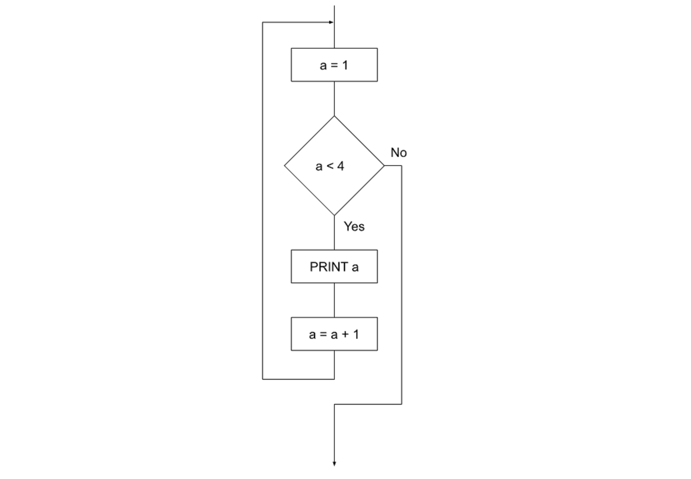
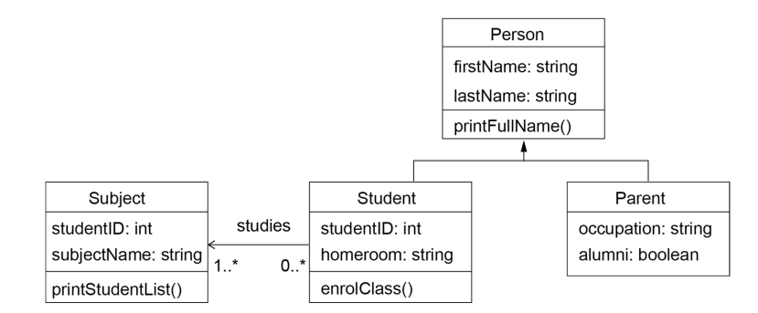

# Girraween Trial

- Syllabus: Software Engineering · Publisher: –
- Status: private
- **Score: – / 80** · answered 0/34 parts · marked 0/34
- Review page: -

---

## 1. Q1 OOP Concepts

#### Question 1 — –/1 marks  `MULTI_CHOICE`

Which of the following concepts in object-oriented programming refers to the mechanism where you can to derive a class from another class for a hierarchy of classes that share a set of attributes and methods.

- **A.** Inheritance
- **B.** Abstraction
- **C.** Polymorphism
- **D.** Encapsulation

**Your answer:** (none) · **Correct:** 

---

## 2. Q2 Modelling Classes

#### Question 2 — –/1 marks  `MULTI_CHOICE`

The preferred diagram for modelling classes is

- **A.** Universal Modelling Language
- **B.** Context diagram
- **C.** Class Data flow diagram
- **D.** Class models

**Your answer:** (none) · **Correct:** 

---

## 3. Q3 Mechatronic Testing

#### Question 3 — –/1 marks  `MULTI_CHOICE`

Which type of testing is extensively used when developing mechatronic solutions.

- **A.** Unit testing
- **B.** Grey box testing
- **C.** Black box testing
- **D.** Oscilloscope testing

**Your answer:** (none) · **Correct:** 

---

## 4. Q4 Flowchart Issue

**Stimulus:**



#### Question 4 — –/1 marks  `MULTI_CHOICE`

What is the most significant issue with this flowchart?

- **A.** There is an endless loop
- **B.** The condition should be a <= 1
- **C.** The variable 'a' is the incorrect data type
- **D.** A non-standard control structure is used

**Your answer:** (none) · **Correct:** 

---

## 5. Q5 DFD Symbol

**Stimulus:**

What does a rectangle symbol represent when used in a data flow diagram?

#### Question 5 — –/1 marks  `MULTI_CHOICE`

- **A.** A data store
- **B.** A subroutine
- **C.** An external entity
- **D.** A manual process

**Your answer:** (none) · **Correct:** 

---

## 6. Q6 Mechatronic Programming Pattern

**Stimulus:**

Consider the following programming pattern common in mechatronics:

```
setup() # runs once
   code...

loop() # infinite loop
   code...
```

#### Question 6 — –/1 marks  `MULTI_CHOICE`

Which statement explains why this programming pattern is common?

- **A.** As the loop allows for repetitive system design.
- **B.** So the hardware can be configured before the software implementation.
- **C.** Because it is a requirement of the IDE.
- **D.** As the loop needs to happen after setup.

**Your answer:** (none) · **Correct:** 

---

## 7. Q7 Algorithm Analysis

**Stimulus:**

Consider the following algorithm. The array arrAge contains 50 elements and is indexed from 0.

```
1 BEGIN
2   sumOfAges = 0
3   FOR index = 0 TO 50 STEP 1
4     sumOfAges = sumOfAges + arrAge(i)
5   NEXT index
6   averageAge = sumOfAges/numItems
7 END
```

#### Question 7a — –/1 marks  `MULTI_CHOICE`

What control structure is used in the algorithm?

- **A.** Multiway loop
- **B.** Post-test loop
- **C.** Counted loop
- **D.** Pre-test loop

**Your answer:** (none) · **Correct:** 

#### Question 7b — –/1 marks  `MULTI_CHOICE`

When coded and executed an error occurs. Which of the following best describes this error?

- **A.** Logic error
- **B.** Syntax error
- **C.** Parsing error
- **D.** Runtime error

**Your answer:** (none) · **Correct:** 

---

## 8. Q8 Software Requirements Document

#### Question 8 — –/2 marks  `MULTI_CHOICE`

Identify the appropriate headings for a 'software requirements' document.

- **A.** Software document
- **B.** Test data
- **C.** Functional requirements
- **D.** Non functional requirements

**Your answer:** (none) · **Correct:** 

---

## 9. Q9 Linear Regression

#### Question 9 — –/1 marks  `MULTI_CHOICE`

In linear regression, what is the primary goal of the model?

- **A.** To predict the value of a dependent variable based on one or more independent variables
- **B.** To classify data into distinct categories
- **C.** To cluster similar data points together
- **D.** To minimize the number of features in the dataset

**Your answer:** (none) · **Correct:** 

---

## 10. Q10 Polynomial Regression

#### Question 10 — –/1 marks  `MULTI_CHOICE`

What type of relationship does polynomial regression model?

- **A.** Non-linear relationships between variables
- **B.** Only linear relationships
- **C.** Random relationships without any pattern
- **D.** Only relationships involving three variables

**Your answer:** (none) · **Correct:** 

---

## 11. Q11 Neural Networks

#### Question 11 — –/1 marks  `MULTI_CHOICE`

Which of the following is a key advantage of using neural networks?

- **A.** They can learn complex patterns from large amounts of data
- **B.** They require less data than traditional models
- **C.** They are always faster than other algorithms
- **D.** They do not require any tuning of parameters

**Your answer:** (none) · **Correct:** 

---

## 12. Q12 Decision Tree

#### Question 12 — –/1 marks  `MULTI_CHOICE`

In a decision tree, what do leaf nodes primarily represent?

- **A.** They are used for splitting the data
- **B.** The concept of different levels of the tree.
- **C.** They represent the decision points in the tree.
- **D.** They are the final output or classification.

**Your answer:** (none) · **Correct:** 

---

## 13. Q13 Supervised Learning

#### Question 13 — –/1 marks  `MULTI_CHOICE`

Which of the following is an example of supervised learning?

- **A.** Classification of emails as spam or not spam
- **B.** Clustering customer segments
- **C.** Market basket analysis
- **D.** Anomaly detection in network traffic

**Your answer:** (none) · **Correct:** 

---

## 14. Q14 Mechatronics Learning

#### Question 14 — –/1 marks  `MULTI_CHOICE`

In mechatronics, which technique would you use to group similar sensor readings without prior labels?

- **A.** Supervised learning
- **B.** Unsupervised learning
- **C.** Reinforcement learning
- **D.** Deep learning

**Your answer:** (none) · **Correct:** 

---

## 15. Q15 Email Protocol

#### Question 15 — –/1 marks  `MULTI_CHOICE`

Email clients send mail using which protocol?

- **A.** SMTP
- **B.** POP3
- **C.** IMAP
- **D.** FTP

**Your answer:** (none) · **Correct:** 

---

## 16. Q16 Context Diagram

**Stimulus:**

The following context diagram describes a food ordering app.

#### Question 16 — –/2 marks  `MULTI_CHOICE`

Based on the diagram, which statements are correct?

- **A.** Food outlets, Customers and Financial Institutions are sub-modules or sub-programs
- **B.** This is a level 0 data flow diagram
- **C.** Food Ordering App is an external entity that interacts with the system
- **D.** Food outlets, Customers and Financial Institutions are external entities
- **E.** The Food Ordering App sends the Order Details to the Food Outlet before the Transaction Status is received

**Your answer:** (none) · **Correct:** 

---

## 17. Q17 CSRF Attack

#### Question 17 — –/1 marks  `MULTI_CHOICE`

A user logs into their bank's website, which allows money transfers via a button. A hacker sends the user a malicious email containing a link. When the user clicks the link, a money transfer request is executed without their knowledge. What type of attack is this?

- **A.** Cross-Site Request Forgery (CSRF)
- **B.** Cross-Site Scripting (XSS)
- **C.** Denial of Service (DoS)
- **D.** SQL Injection

**Your answer:** (none) · **Correct:** 

---

## 18. Q18 Debugging Tools

#### Question 18 — –/4 marks  `OBJECTIVE_RESPONSE`

Match the debugging tool with the definition.

| Statement | Correct | Yours | |
|---|---|---|---|
| Breakpoint |  | – |  |
| Single line step |  | – |  |
| Compiler |  | – |  |
| Debugging output statements |  | – |  |

---

## 19. Q19 Authentication vs Authorisation

#### Question 19 — –/2 marks  `SHORT`

Distinguish between authentication and authorisation.

**Your answer:**

_(not answered)_

---

## 20. Q20 Race Condition

**Stimulus:**

The Python code below defines a function that allows a user to purchase an item.

  

```
import threading
lock = threading.Lock()
def purchase_item(user_id, item_id):
  with lock:
    if inventory[item_id] > 0:
      inventory[item_id] = 0
      confirm_purchase(user_id, item_id)
```

#### Question 20 — –/3 marks  `SHORT`

Explain what a race condition is and how it could affect the purchase\_item function if no lock was implemented.

**Your answer:**

_(not answered)_

---

## 21. Q21 Security Compromise Scenario

#### Question 21 — –/4 marks  `SHORT`

A school's online portal allows students to upload assessment files. Recently, a student discovered that by modifying the URL, they could access and download other students' submitted files. It was also found that students could re-upload their work multiple times, overwriting previous submissions without detection even after the due date.

Describe how confidentiality, accountability and integrity has been compromised in this scenario.

**Your answer:**

_(not answered)_

---

## 22. Q22 Collaboration in Software Engineering

#### Question 22 — –/6 marks  `SHORT`

Discuss the benefits of collaboration in software engineering.

In your response:

-   Highlight at least three key advantages that effective collaboration can bring to a software development project.
-   Provide an example of a collaboration tool and explain how it facilitates collaboration among developers.

**Your answer:**

_(not answered)_

---

## 23. Q23 PWA UI/UX Design

#### Question 23 — –/6 marks  `SHORT`

You have been tasked with designing and developing a Progressive Web App (PWA) aimed at enhancing the accessibility and inclusivity of educational resources for infants school students.

Outline how you would address the following key design principles when creating the user interface (UI) and user experience (UX) of your PWA.

-   Font selection and typography
-   Colour schemes and contrast
-   The use of audio and video elements
-   Navigation design

**Your answer:**

_(not answered)_

---

## 24. Q24 Supervised vs Unsupervised Learning

#### Question 24 — –/4 marks  `SHORT`

Compare and contrast between supervised and unsupervised learning. Give a real world example for each.

**Your answer:**

_(not answered)_

---

## 25. Q25 Algorithm Analysis

**Stimulus:**

For the algorithm

```
1 START myFunction (array[])
2   SET num = array[0]
3   FOR index = 0 TO 4 STEP 1
4     IF array[index] > num
5       num = array[index]
6     ENDIF
7   NEXT index
8   PRINT num
9 END myFunction
```

#### Question 25 — –/8 marks  `SHORT`

a) Outline the purpose of the algorithm.

b) There is an error in the algorithm. Perform a Desk check of the algorithm assuming the passed in array is \[1, 6, 19, 3\] and identify the line and type of error.

c) Identify and outline three improvements you can make to this algorithm.

**Your answer:**

_(not answered)_

---

## 26. Q26 Class Diagram OOP

**Stimulus:**



Based on the provided class diagram for Student Management System discuss the relationships and key principles of Object-Oriented Programming (OOP) that are demonstrated. Your answer should specifically address:

1.  **Inheritance:** Identify an example of inheritance and explain its purpose.
2.  **Encapsulation:** Describe how encapsulation is applied within the classes, referencing attributes and methods.
3.  **Composition or Aggregation:** Explain the relationship between the classes. Justify your answer.

#### Question 26 — –/5 marks  `SHORT`

**Your answer:**

_(not answered)_

---

## 27. Q27 Code Snippet Matching

#### Question 27 — –/2 marks  `OBJECTIVE_RESPONSE`

Match the code snippet with its type.

| Statement | Correct | Yours | |
|---|---|---|---|
| 01101010 |  | – |  |
| int myInt = 8; |  | – |  |
| MOV r24, 8 |  | – |  |
| r4, 29 |  | – |  |

---

## 28. Q28a SQL Errors

#### Question 28a — –/1 marks  `SHORT`

Identify the error in the following SQL query and provide the correct version: `SELECT * FROM users WHERE age = '20';`

**Your answer:**

_(not answered)_

---

## 29. Q28b SQL Errors

#### Question 28b — –/1 marks  `SHORT`

Fix the syntax error in the following SQL statement: `INSERT INTO students VALUES (1, 'John', 'Doe',);`

**Your answer:**

_(not answered)_

---

## 30. Q28c SQL Error

#### Question 28c — –/1 marks  `SHORT`

What is wrong with this SQL query? `UPDATE products SET price = '19.99' WHERE id = 5;`

**Your answer:**

_(not answered)_

---

## 31. Q28d SQL Error

#### Question 28d — –/1 marks  `SHORT`

Identify the mistake in this SQL statement: `SELECT name, age FROM employees WHERE age > '30';`

**Your answer:**

_(not answered)_

---

## 32. Q29 K-Nearest Neighbours Algorithm

**Stimulus:**

The K-Nearest Neighbours (KNN) algorithm is used to classify a new data point by comparing it to existing classified/labelled data points. It calculates the Euclidean distance between the new data point (shown as a question mark on the chart below) and every other point in the training data. It then counts the labels of the k closest points. The most common label among these neighbours is the predicted label assigned to the new point.


#### Question 29 — –/4 marks  `PSEUDOCODE`

Write a pseudocode algorithm for a function called knn. It is passed:

-   **newPoint:** the x and y coordinates of the point to classify as A, B, C or D
-   **tData:** an array of x and y coordinates for all labelled points
-   **tLabels:** an array of strings with the label A, B, C or D for each known point
-   **k:** an integer

  

You may use the following pre-defined functions in your algorithm:

-   **distance(p1, p2):** returns the Euclidean distance between two (x, y) points
-   **sort(pairlist):** sorts an array of \[distance, label\] pairs in ascending order by distance
-   **mode(array):** returns the label that occurs most frequently in an array

  

Your algorithm should return the predicted label for the new data point.

**Your answer:**

_(not answered)_

---

## 33. Q30 Python Banding Program

**Stimulus:**

Your friends have asked you for a simple program to convert their results to a band where:

-   Band 6 = 90 - 100 marks.
-   Band 5 = 80 - 89 marks.
-   Band 4 = 70 - 79 marks.
-   Band 3 = 60 - 69 marks.
-   Band 2 = 50 - 59 marks.
-   Band 1 = 0 - 49 marks.

#### Question 30 — –/8 marks  `CODING`

Write a Python CLI program where students input their grade for atleast 4 different subjects and the program outputs:

-   a Band for each subject along with subject name
-   calculate the average or overall marks and Band
-   print the average/overall marks and band.

Your program must demonstrate efficient logic, validations where applicable, intrinsic documentation, loop/repitition for multiple students.

Attach your program to this question.

**Your answer:**

_(not answered)_
