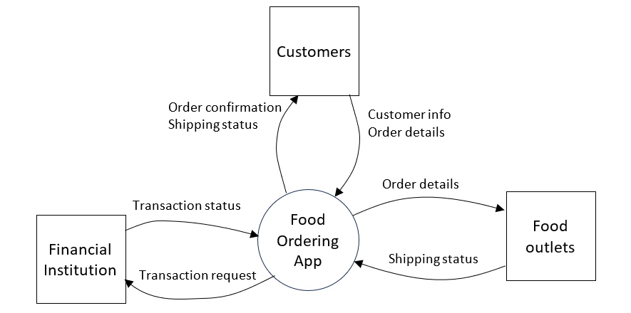
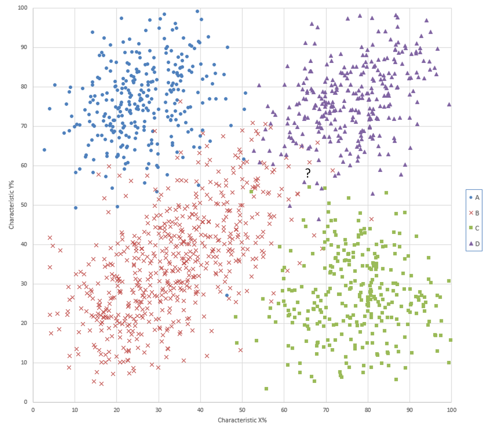
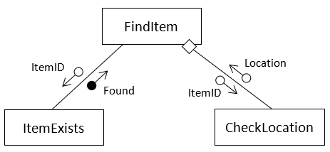

# Independent Trial

- Syllabus: Software Engineering · Publisher: –
- Status: private
- **Score: – / 80** · answered 0/32 parts · marked 0/32
- Review page: -

---

## 1. New Question 1, Privacy by Design

#### Question 1 — –/1 marks  `MULTI_CHOICE`

The “Privacy by Design” approach is defined as:

- **A.** Features added after software is released to lock down stored data.
- **B.** Improvements to processing reliability made after a security breach.
- **C.** Modifications made following user feedback on interface inefficiencies.
- **D.** Building software with data protection measures integrated from the outset.  ✅ *correct*

**Your answer:** (none) · **Correct:** D

---

## 2. New Question 2, CSRF Attack

#### Question 2 — –/1 marks  `MULTI_CHOICE`

A user logs into their bank’s website, which allows money transfers via a button. A hacker sends the user a malicious email containing a link. When the user clicks the link, a money transfer request is executed without their knowledge.

What type of attack is this?

- **A.** Cross-Site Request Forgery (CSRF)  ✅ *correct*
- **B.** Cross-Site Scripting (XSS)
- **C.** Denial of Service (DoS)
- **D.** SQL Injection

**Your answer:** (none) · **Correct:** A

---

## 3. New Question 3, Email Protocol

#### Question 3 — –/1 marks  `MULTI_CHOICE`

Email clients send mail using which protocol?

- **A.** SMTP  ✅ *correct*
- **B.** IMAP
- **C.** FTP
- **D.** POP3

**Your answer:** (none) · **Correct:** A

---

## 4. New Question 4, Client-Side Programming

#### Question 4 — –/1 marks  `MULTI_CHOICE`

In the context of a web application, what is the main role of client-side programming?

- **A.** Managing server databases and application logic.
- **B.** Handling user interface interactions and dynamic content display in the browser.  ✅ *correct*
- **C.** Storing persistent data and authenticating users on the server.
- **D.** Processing requests and sending responses from the web server.

**Your answer:** (none) · **Correct:** B

---

## 5. New Question 5, Automation Benefits

#### Question 5 — –/1 marks  `MULTI_CHOICE`

What is the most effective approach to ensuring that automation benefits society as a whole?

- **A.** Allow market forces to guide the adoption of automation, trusting that economic growth will naturally lead to broader societal benefits.
- **B.** Prioritise technological advancement and productivity gains, with social concerns addressed only after implementation.
- **C.** Encourage collaboration between policymakers, educators, and businesses to promote inclusivity, skill development, and sustainability.  ✅ *correct*
- **D.** Limit the use of automation to industries with low employment rates.

**Your answer:** (none) · **Correct:** C

---

## 6. New Question 6, Regression Model

#### Question 6 — –/1 marks  `MULTI_CHOICE`

A real estate agency wants to build a model to predict whether a house is likely to be sold within 60 days based on features such as its price, location score, number of bedrooms, and age. Based on the scenario above, which regression model is most appropriate, and why?

- **A.** Linear regression, because it can handle multiple input features and will predict the number of days it takes to sell the house.
- **B.** Polynomial regression, because housing data often involves curved relationships between price and location.
- **C.** Logistic regression, because the goal is to classify whether a house will be sold within a specific time frame.  ✅ *correct*
- **D.** Polynomial regression, because the number of bedrooms and age of the house are discrete variables requiring non-linear models.

**Your answer:** (none) · **Correct:** C

---

## 7. New Question 7, Implementation Method

#### Question 7 — –/1 marks  `MULTI_CHOICE`

A new software application is introduced by initially running the program with only a few of its modules active. After confirming that these modules function correctly, the remaining components are gradually activated.

What type of implementation method does this scenario describe?

- **A.** Direct
- **B.** Phased  ✅ *correct*
- **C.** Parallel
- **D.** Pilot

**Your answer:** (none) · **Correct:** B

---

## 8. New Question 8, Agile Development

#### Question 8 — –/1 marks  `MULTI_CHOICE`

Which of the following is true for the Agile Development Approach?

- **A.** Suited to projects with clear requirements and performance is not considered to be critical.
- **B.** Suited to projects with evolving requirements and performance is not considered to be critical.  ✅ *correct*
- **C.** Suited to user-centred projects with clear requirements and performance is critical.
- **D.** Suited to software automation projects, with evolving requirements and performance is critical.

**Your answer:** (none) · **Correct:** B

---

## 9. New Question 9, Sandboxing

#### Question 9 — –/1 marks  `MULTI_CHOICE`

What are the benefits of using sandboxing in software development or deployment?

- **A.** Replaces the need for authentication by isolating users
- **B.** Prevents untrusted code from damaging the host system  ✅ *correct*
- **C.** Allows developers to test software in a controlled environment  ✅ *correct*
- **D.** Reduces the need for secure coding practices in application development
- **E.** Reduces the risk of security vulnerabilities affecting other parts of the system  ✅ *correct*
- **F.** Improves execution speed by isolating software from operating system processes
- **G.** Prevents changes to live data during development and training  ✅ *correct*

**Your answer:** (none) · **Correct:** B, C, E, G

---

## 10. New Question 10, CSS

**Stimulus:**

Consider the following CSS code.

  

```
body {
    background-color: #0000ff;
    color: #00ff00;
    font-family: Arial, serif;
    margin: 20px;
}
h1 {
    color: #ff0000;
    text-align: center;
}
p {
    color: #ffffff;
    font-size: 16px;
}
```

#### Question 10 — –/1 marks  `MULTI_CHOICE`

Which of the following is true for pages styled using the above CSS code?

- **A.** Paragraph text is displayed in white  ✅ *correct*
- **B.** All heading text (h1, h2, etc.) will be red
- **C.** The color property in the body overrides the paragraph text color
- **D.** Only the h1 heading text is centred  ✅ *correct*
- **E.** The background of the page is blue  ✅ *correct*
- **F.** All fonts will have serifs if Arial is not available  ✅ *correct*
- **G.** Body text is hard against the left side of the screen
- **H.** Text not within <h1> or <p> tags will be green  ✅ *correct*
- **I.** All text will be in a font size of 16 pixels

**Your answer:** (none) · **Correct:** A, D, E, F, H

---

## 11. New Question 11, Workplace Automation

#### Question 11 — –/1 marks  `MULTI_CHOICE`

Which of the following impacts are likely to result from increased automation in the workplace?

- **A.** Greater job satisfaction for manual labourers
- **B.** Reduction in demand for some low-skilled jobs  ✅ *correct*
- **C.** Increased access to public transport
- **D.** Improved safety in high-risk work environments  ✅ *correct*
- **E.** More diverse cultural representation in media
- **F.** Decrease in energy consumption from all industries
- **G.** Reduced labour costs for employers  ✅ *correct*
- **H.** Need for workforce reskilling and upskilling  ✅ *correct*

**Your answer:** (none) · **Correct:** B, D, G, H

---

## 12. New Question 12, Context Diagram

**Stimulus:**

The following context diagram describes a food ordering app.



#### Question 12 — –/1 marks  `MULTI_CHOICE`

Based on the above diagram, which statements are correct?

- **A.** Food outlets, Customers and Financial Institutions are sub-modules or sub-programs
- **B.** This is a level 0 data flow diagram  ✅ *correct*
- **C.** Food Ordering App is an external entity that interacts with the system
- **D.** Food outlets, Customers and Financial Institutions are external entities  ✅ *correct*
- **E.** The system is shown as a single process  ✅ *correct*
- **F.** Order details are provided by Customers directly to a Food Outlet
- **G.** The Food Ordering App sends a message to the Customer once their order has been shipped by a Food Outlet  ✅ *correct*
- **H.** The Food Ordering App sends the Order Details to the Food Outlet before the Transaction Status is received

**Your answer:** (none) · **Correct:** B, D, E, G

---

## 13. New Question 13, Security Testing

#### Question 13 — –/2 marks  `OBJECTIVE_RESPONSE`

Match each feature with its correct security testing strategy.

| Statement | Correct | Yours | |
|---|---|---|---|
| Simulates cyber attacks to find and exploit vulnerabilities. | Penetration Testing | – |  |
| Requires either the source code or binary. | Static Application Security Testing (SAST) | – |  |
| Checks for security vulnerabilities without executing the code. | Static Application Security Testing (SAST) | – |  |
| Evaluates environment and runtime issues. | Dynamic Application Security Testing (DAST) | – |  |
| Utilises scanning tools to understand how a target responds to intrusions. | Penetration Testing | – |  |
| Checks for security vulnerabilities while the program is running. | Dynamic Application Security Testing (DAST) | – |  |
| A purely white box testing strategy. | Static Application Security Testing (SAST) | – |  |

---

## 14. New Question 14, Web Development Roles

#### Question 14 — –/2 marks  `OBJECTIVE_RESPONSE`

Match each web development role with the W3C initiative or focus area to which it belongs.

| Statement | Correct | Yours | |
|---|---|---|---|
| Creates standards and working groups to protect user data and privacy | Privacy | – |  |
| Develops standards and guidelines for secure web applications | Web Security | – |  |
| Defines open formats (like XML) for data to be processed by computers | Machine-readable data | – |  |
| Supports web standards for multiple languages and cultural contexts | Internationalisation | – |  |
| Ensures web content is usable by people with disabilities | Web Accessibility Initiative (WAI) | – |  |

---

## 15. New Question 15, Machine Learning Models

#### Question 15 — –/2 marks  `OBJECTIVE_RESPONSE`

Match each application scenario to the most appropriate machine learning model.

| Statement | Correct | Yours | |
|---|---|---|---|
| Training a robot to navigate a maze | Reinforcement learning | – |  |
| Labelling a small set of medical images and using them to classify a larger set | Semi-supervised learning | – |  |
| Predicting student grades based on past results | Supervised learning | – |  |
| Teaching an AI agent to win a game through trial and error | Reinforcement learning | – |  |
| Classifying email as spam or not spam | Semi-supervised learning | – |  |
| Grouping customers based on shopping habits | Unsupervised learning | – |  |

---

## 16. New Question 16, Software Project Phases

#### Question 16 — –/2 marks  `OBJECTIVE_RESPONSE`

Match each task with the correct software project phase.

| Statement | Correct | Yours | |
|---|---|---|---|
| Decide on a suitable software development approach. | Research and planning | – |  |
| Develop, construct and document algorithms. | Producing and implementing | – |  |
| Explore tools used to develop ideas and generate solutions. | Identifying and defining | – |  |
| Use a language-dependent code optimisation technique. | Testing and evaluating | – |  |
| Explore social and ethical issues associated with project work. | Research and planning | – |  |
| Define and analyse the requirements of a problem. | Identifying and defining | – |  |
| Compare actual with expected output | Testing and evaluating | – |  |
| Code the solution in a programming language | Producing and implementing | – |  |

---

## 17. New Question 17, Authentication vs Authorisation

#### Question 17 — –/2 marks  `SHORT`

Distinguish between authentication and authorisation.

**Your answer:**

_(not answered)_

**Sample answer:**

**Authentication**  
Authentication is the process of verifying who you are. The question it answers is: "Are you who you say you are?" It's the first step in granting access to a system. To authenticate, a user provides credentials, which are then checked against a trusted database or system.

Common examples include:

-   **Username and Password:** You enter your username and a password. The system checks if the combination is valid.
-   **Biometrics:** Using a fingerprint or facial recognition to unlock a device.
-   **Multi-Factor Authentication (MFA):** This is a more robust method that requires two or more forms of verification. For example, after entering your password, you might also have to enter a code sent to your phone.

  

**Authorization**  
Once a user has been authenticated, authorization determines what they are allowed to do. The question it answers is: "What are you permitted to access or do?" This process involves checking the user's permissions and access rights.

Examples of authorization include:

-   **Role-Based Access Control (RBAC):** Users are assigned roles, and these roles have specific permissions. A "Student" role might allow a user to view course materials, while a "Teacher" role would allow them to create and edit them.
-   **Discretionary Access Control (DAC):** The owner of a resource can decide who can access it and what they can do. A good example is sharing a Google Doc. The document owner can grant "view only," "comment," or "edit" permissions to others.
-   **Attribute-Based Access Control (ABAC):** This is a more granular method that uses a set of attributes, like a user's department, the time of day, or the data's sensitivity, to decide access. For instance, a system might only allow access to a specific report during business hours.

  

**The Key Difference**  
The simplest way to remember the difference is with a simple analogy:

-   **Authentication** is like showing your ID to get into a building. It proves you're a valid person.
-   **Authorization** is like getting a special keycard that only lets you into certain floors or rooms in that building. It determines what you can do once you're inside.

Authentication is a prerequisite for authorization. You can't decide what a person is allowed to do until you've confirmed who they are.

---

## 18. New Question 18, Race Condition

**Stimulus:**

The Python code below defines a function that allows a user to purchase an item.

  

```
import threading
lock = threading.Lock()
def purchase_item(user_id, item_id):
    with lock:  
        if inventory[item_id] > 0:
            inventory[item_id] -= 1
            confirm_purchase(user_id, item_id)
```

#### Question 18 — –/3 marks  `SHORT`

Explain what a race condition is and how it could affect the purchase\_item function if no lock was implemented.

**Your answer:**

_(not answered)_

**Sample answer:**

A race condition is a problem that can happen in multi-threaded or multi-process applications when multiple threads or processes try to access and modify the same shared resource at the same time. The final outcome depends on the unpredictable timing or order of execution.

  

**How it affects purchase\_item**  
Without the lock, a race condition could lead to a user purchasing an item that is out of stock. Here's how it could happen:

-   A user checks if an item is in stock. The inventory for that item is 1.
-   At the same exact moment, another user also checks the inventory for the same item. The inventory is still 1.
-   The first user purchases the item, and the inventory count goes down to 0.
-   The second user's purchase request goes through based on their earlier check, and they also get the item.

The inventory is now at -1, which is not what you would want.

The **threading.Lock()** object is a mutual exclusion lock that makes sure only one thread can access the code within the **with lock:** block at any given time, preventing this from happening.

---

## 19. New Question 19, Security Compromise

**Stimulus:**

A school’s online portal allows students to upload assessment files. Recently, a student discovered that by modifying the URL, they could access and download other students’ submitted files. It was also found that students could re-upload their work multiple times, overwriting previous submissions without detection even after the due date.

#### Question 19 — –/4 marks  `SHORT`

Describe how confidentiality, accountability and integrity has been compromised in this scenario.

**Your answer:**

_(not answered)_

**Sample answer:**

This scenario is a classic example of security vulnerabilities in a web application. Let's break down how confidentiality, integrity, and accountability were compromised.

  

**Confidentiality**  
Confidentiality is about making sure that information is only accessible to those who are authorised to view it. In this case, the school portal failed to protect the students' assessment files from unauthorised access.

The confidentiality of the files was compromised when the student was able to modify the URL to access and download other students' work. This means the system didn't properly check if the user had the correct permissions to view the file they were requesting. This is often referred to as an Insecure Direct Object Reference (IDOR) vulnerability.

  

**Integrity**  
Integrity refers to maintaining the accuracy and consistency of data. It ensures that data is not altered or corrupted by unauthorised parties.

The integrity of the assessment files was compromised because students could re-upload their work multiple times. Allowing a file to be overwritten without a proper version history or logging system means there's no way to verify the file's state at a specific time, such as the due date. This compromises the validity of the submission, as the original file submitted before the due date could have been changed.

  

**Accountability**  
Accountability is the ability to trace actions to a specific user. It relies on a system's logging and auditing features to prove who did what and when.

Accountability was compromised because the system didn't detect or log the multiple re-uploads after the due date. Without a clear audit trail of file submissions, it's impossible for a teacher to verify when a file was last changed or who changed it. This allows students to modify their work post-deadline without any record of the action, making it difficult to enforce academic rules.

---

## 20. New Question 20, Collaboration Benefits

#### Question 20 — –/6 marks  `SHORT`

Discuss the benefits of collaboration in software engineering.

In your response:

-   Highlight at least three key advantages that effective collaboration can bring to a software development project.
-   Provide an example of a collaboration tool and explain how it facilitates collaboration among developers.

**Your answer:**

_(not answered)_

---

## 21. New Question 21, DNS Function

#### Question 21 — –/2 marks  `SHORT`

Outline the primary function performed by the Domain Name System (DNS).

**Your answer:**

_(not answered)_

**Sample answer:**

The Domain Name System (DNS) acts like the internet's phonebook. Its primary purpose in web data transmission is to translate human-readable domain names (like www.example.com) into machine-readable Internet Protocol (IP) addresses (like 192.0.2.1). When you type a domain name into your browser, DNS lookups occur to find the corresponding IP address of the web server hosting that site, allowing your browser to connect to the correct server and retrieve the web page.

---

## 22. New Question 22, Web Content Management Systems

#### Question 22 — –/3 marks  `SHORT`

Outline the functions performed by web content management systems. Include two examples of web content management systems to assist your response.

**Your answer:**

_(not answered)_

**Sample answer:**

Web Content Management Systems (CMS) are software applications that allow users to create, manage, and modify digital content on a website without needing extensive technical knowledge. They simplify the process of publishing online content, making website management accessible to non-programmers.

  

**Functions of a CMS**  
A CMS performs a variety of functions that cover the entire lifecycle of web content:

-   **Content Creation and Editing:** A CMS provides a user-friendly interface, often a what-you-see-is-what-you-get (WYSIWYG) editor, that lets users write and format content similar to a word processor.
-   **Workflow Management:** It allows for the creation of workflows where content can be drafted by one user, reviewed by another, and approved by a third before being published. This is crucial for larger teams to maintain quality control.
-   **Content Organisation:** A CMS helps organise content into a logical structure using categories, tags, and a navigation menu. This makes it easier for both users and search engines to find information.
-   **Design and Layout:** Most CMS platforms use a templating system that separates content from design. This allows developers to create a consistent look and feel for a website, while content creators can focus on writing without affecting the site's layout.
-   **User Management:** They provide tools to manage user roles and permissions, ensuring that only authorised users can access and modify specific parts of the website.
-   **Version Control:** They can track changes made to content over time, allowing users to revert to a previous version if needed.
-   **Publishing:** The CMS handles the process of making content live on the website, often with a simple click of a button.

  

**Examples of CMS**

-   **WordPress:** This is one of the most popular and widely used CMS platforms in the world. Originally a blogging tool, it has evolved into a full-featured system for building everything from simple blogs to complex e-commerce sites. Its open-source nature and vast library of plugins and themes make it highly flexible.
-   **Squarespace:** is another well-known example, particularly due to its extensive marketing. It's an all-in-one CMS platform that is famous for its simple, drag-and-drop interface and beautiful, ready-made templates. It's often used by small business owners, artists, and students who want to build a professional-looking website or online portfolio without needing to know any code.
-   **Joomla!:** A free and open-source CMS used for publishing web content. It's often seen as more complex than WordPress but offers greater flexibility for building more intricate applications and websites. It is particularly well-suited for social networking, community portals, and corporate websites.

---

## 23. New Question 23, Secure Communication

#### Question 23 — –/4 marks  `SHORT`

Secure encrypted communication between browsers and web servers utilises the https protocol which includes SSL/TLS certificates.

Outline the exchange between browser and web server to:

-   Confirm the identity of the web server
-   Establish a secure session
-   Communicate securely during the session

**Your answer:**

_(not answered)_

**Sample answer:**

Establishing a secure HTTPS connection involves a crucial handshake between the browser and the web server, which confirms the server's identity and sets up an encrypted communication channel. This process is orchestrated by SSL/TLS certificates.

  

**Confirm the Identity of the Web Server**

-   **Browser Hello:** When you type a URL with https://, your browser sends a "Client Hello" message to the web server. This message includes the browser's supported SSL/TLS versions and cryptographic algorithms.
-   **Server Hello and Certificate:** The server responds with a "Server Hello," choosing the highest common SSL/TLS version and a cryptographic suite. Most importantly, it sends its SSL/TLS certificate back to the browser. This certificate is a digital file that contains the server's public key, the domain name, and is signed by a trusted Certificate Authority (CA).
-   **Authentication:** The browser verifies the server's identity by checking the certificate's authenticity. It confirms that the certificate is valid, hasn't expired, and that the domain name in the certificate matches the server it's trying to connect to. It also checks that the certificate was signed by a CA that the browser already trusts. This step prevents a fake server from impersonating the real one.

  

**Establish a Secure Session**

-   **Session Key Exchange:** Once the server's identity is confirmed, the browser generates a unique, single-use pre-master secret and encrypts it using the server's public key from the certificate.
-   **Decrypting the Secret:** The browser sends this encrypted secret to the server. Only the server, with its corresponding private key, can decrypt it.
-   **Symmetric Key Generation:** Both the browser and the server now have the pre-master secret. They each use this secret, along with other data from the handshake, to independently generate the same symmetric session key. Symmetric encryption is much faster and more efficient for ongoing communication than public-key encryption.

  

**Communicate Securely During the Session**  
Once the symmetric session key is established, all subsequent communication between the browser and the server is encrypted using this key.

-   **Encryption:** The browser uses the session key to encrypt all data (e.g., login credentials, form data) before sending it to the server.
-   **Decryption:** The server uses the same session key to decrypt the data.
-   **Ongoing Security:** This process is reversed for data sent from the server back to the browser. The session key ensures that all data transmitted is unreadable to anyone who might be eavesdropping, providing confidentiality and integrity for the duration of the session.

---

## 24. New Question 24, PWA Design Principles

#### Question 24 — –/6 marks  `SHORT`

You have been tasked with designing and developing a Progressive Web App (PWA) aimed at enhancing the accessibility and inclusivity of educational resources for infants school students.

Outline how you would address the following key design principles when creating the user interface (UI) and user experience (UX) of your PWA.

-   Font selection and typography
-   Colour schemes and contrast
-   The use of audio and video elements
-   Navigation design

**Your answer:**

_(not answered)_

**Sample answer:**

Designing a Progressive Web App (PWA) for infant school students requires a focus on simplicity, clarity, and engagement to support accessibility and inclusivity. Here's how you would approach the UI and UX design principles for this project:

  

**Font Selection and Typography**  
For infant school students, the key is legibility and familiarity. You would select a sans-serif font that is simple, with clear letterforms and no unnecessary embellishments. Fonts like Open Sans or Comic Sans are often good choices as they are widely recognized and have a playful, friendly feel. You would use a large font size to ensure that all text is easy to read, especially for students who may have developing eyesight. The use of a consistent font size and weight across the app would help reduce cognitive load and make the interface predictable.

  

**Colour Schemes and Contrast**  
The colour scheme should be vibrant and engaging while maintaining high accessibility standards. You would use a palette with high contrast between the text and the background to make sure that the content is readable for students with visual impairments. For example, a dark blue text on a light yellow or white background works well. The colour scheme would also be used to create clear visual cues for interactive elements, such as using a bright colour for buttons and a muted colour for inactive items. You would avoid using colour alone to convey meaning, as this can be a barrier for students who are colourblind.

  

**The Use of Audio and Video Elements**  
Audio and video are essential for this audience. You would use narrated text and visual animations to reinforce concepts. For instance, a video of a narrator explaining a concept would be paired with a simple animation that shows the concept in action. This multi-sensory approach helps different types of learners. Audio cues, such as a gentle chime for a correct answer or a soft buzz for an incorrect one, would be used to provide immediate, non-verbal feedback. All audio and video content would have closed captions and transcripts to support students who are hearing impaired or who learn better by reading.

  

**Navigation Design**  
Navigation would need to be extremely simple and intuitive. The design would feature large, clear icons that represent different sections or activities. The text labels under the icons would be short and easy to read. A hierarchical navigation structure with a clear "Home" button would be implemented to prevent students from getting lost. The use of a progress bar or a simple visual tracker would show students how far they have progressed in an activity. All interactive elements would be generously spaced to make them easy to tap, even with small fingers. The entire navigation would be designed to require minimal reading and be based primarily on visual recognition.

---

## 25. New Question 25, Supervised vs Unsupervised Learning

#### Question 25 — –/2 marks  `SHORT`

Distinguish between supervised and unsupervised learning.

**Your answer:**

_(not answered)_

**Sample answer:**

Supervised and unsupervised learning are two fundamental categories in machine learning, distinguished by the type of data they use and the task they perform. The main difference lies in whether the training data is labelled.

  

**Supervised Learning**  
In supervised learning, the algorithm is trained on a labelled dataset. This means that each piece of training data comes with a correct "answer" or "label" that the model can learn from. The goal is for the model to learn a mapping from input data to the correct output.

Think of it like a teacher-student relationship. The training data acts as the teacher, providing the correct answers for the model to learn from. Once trained, the model can then be used to predict labels for new, unseen data. A common use case is a model that predicts house prices based on features like size and location, where the training data includes historical prices.

  

**Unsupervised Learning**  
In unsupervised learning, the algorithm is given an unlabelled dataset. There are no correct answers to learn from. The goal is for the model to find hidden patterns, structures, or relationships within the data on its own.

This is more like a student exploring a subject without a teacher. The algorithm looks for similarities and groupings within the data. A classic example is a clustering algorithm that groups customers with similar buying habits for marketing purposes, or a model that finds anomalies in a network for fraud detection. The model isn't told what a "fraudulent transaction" looks like; it simply finds unusual patterns.

---

## 26. New Question 26, Neural Network Learning

#### Question 26 — –/3 marks  `SHORT`

Explain how weights and backpropagation allow a neural network to learn using training data.

**Your answer:**

_(not answered)_

**Sample answer:**

Weights and backpropagation are the core mechanisms that allow a neural network to learn from training data, working together in a continuous feedback loop.

  

**Weights**  
Think of weights as the network's knowledge base. Each connection between neurons in a neural network has an associated weight. When a neural network makes a prediction, the input data is multiplied by these weights as it passes through the network. A higher weight on a particular connection means that the input from the connected neuron is considered more important for the network's output.

Initially, these weights are set to small, random values. The goal of the learning process is to adjust these weights so that the network's predictions become more accurate.

  

**Backpropagation**  
Backpropagation is the process of adjusting the weights. It's an algorithm that calculates the "error" of the network's prediction and then systematically distributes that error back through the network, from the output layer to the input layer.

Here's how it works in simple terms:

-   **Forward Pass:** The neural network takes a training data point (e.g., an image of a cat) and performs a forward pass to make a prediction.
-   **Calculate Error:** The network's prediction is compared to the actual answer (the image is a cat). The difference between the prediction and the actual answer is the error.
-   **Backward Pass:** Backpropagation then takes this error and propagates it backward through the network. It calculates how much each individual weight contributed to the total error.
-   **Weight Adjustment:** Using an optimization algorithm (like gradient descent), the weights are adjusted. Weights that contributed to a larger error are changed more, while those that led to a correct prediction are changed less. This process is repeated thousands or millions of times with different training examples.

In short, weights hold the knowledge, and backpropagation is the method for refining that knowledge by learning from mistakes. The cycle of forward pass, error calculation, and backward pass allows the network to iteratively improve its predictions.

---

## 27. New Question 27, Predicting Test Scores

#### Question 27 — –/4 marks  `SHORT`

You have been asked to create a program that predicts student test scores based on the number of hours they studied.

-   Identify the most appropriate machine learning regression algorithm for this task.
-   Briefly outline how you would implement this using object oriented programming (OOP).
-   List two features your model would require to function effectively.

**Your answer:**

_(not answered)_

**Sample answer:**

The most appropriate machine learning regression algorithm for predicting student test scores based on hours studied is **Simple Linear Regression**.

This is because the problem involves a single independent variable (hours studied) and a single dependent variable (test score) with the assumption of a linear relationship between them. This algorithm is straightforward, easy to interpret, and highly effective for this type of problem.

  

**Implementing with OOP**  
To implement this using object-oriented programming, you could create a **ScorePredictor** class. This class would encapsulate the data and the methods for training the model and making predictions.

Here is a brief outline:

-   **Class:** ScorePredictor
-   **Attributes:**
    -   **slope:** A variable to store the calculated slope of the regression line.
    -   **intercept:** A variable to store the calculated y-intercept of the regression line.
-   **Methods:**
    -   **\_\_init\_\_(self, hours\_studied, test\_scores):** The constructor would take the training data (hours studied and test scores) as input.
    -   **train(self):** This method would calculate the slope and intercept using the training data. This is where the core regression formula would be applied.
    -   **predict(self, new\_hour):** This method would take a new value for hours studied and use the trained slope and intercept to predict the corresponding test score. It would use the formula: y = mx + b.

  

**Required Model Features**  
Your model would require two key features to function effectively:

-   **A training dataset:** The model needs a set of historical data points, consisting of pairs of "hours studied" and "test score," to learn the relationship between the two variables. Without this, the model has nothing to train on.
-   **An equation for prediction:** The model needs a defined mathematical formula, in this case, the linear regression equation (y=mx+b), to make predictions on new data. The **train** method is responsible for finding the optimal m and b values.

---

## 28. New Question 28, KNN Algorithm

**Stimulus:**

The K-Nearest Neighbours (KNN) algorithm is used to classify a new data point by comparing it to existing classified/labelled data points. It calculates the Euclidean distance between the new data point (shown as a question mark on the chart below) and every other point in the training data. It then counts the labels of the k closest points. The most common label among these neighbours is the predicted label assigned to the new point.



#### Question 28 — –/6 marks  `PSEUDOCODE`

Write a pseudocode algorithm for a function called knn. It is passed:

-   **newPoint:** the x and y coordinates of the point to classify as A, B, C or D
-   **tData:** an array of x and y coordinates for all labelled points
-   **tLabels:** an array of strings with the label A, B, C or D for each known point
-   **k:** an integer

You may use the following pre-defined functions in your algorithm:

-   **distance(p1, p2):** returns the Euclidian distance between two (x, y) points
-   **sort(pairlist):** sorts an array of \[distance, label\] pairs in ascending order by distance
-   **mode(array):** returns the label that occurs most frequently in an array

Your algorithm should return the predicted label for the new data point.

**Your answer:**

_(not answered)_

**Sample answer:**

```
function knn(newPoint, tData, tLabels, k):
    // 1. Create an empty list to store distances and labels
    distancesAndLabels = []
    // 2. Loop through each point in the training data
    for i from 0 to length(tData) - 1:
        // 3. Get the current training point and its label
        currentPoint = tData[i]
        currentLabel = tLabels[i]
        // 4. Calculate the Euclidean distance between the new point and the current training point
        d = distance(newPoint, currentPoint)
        // 5. Add the distance and its corresponding label to the list
        distancesAndLabels.append([d, currentLabel])
    // 6. Sort the list of pairs in ascending order based on distance
    sortedDistances = sort(distancesAndLabels)
    // 7. Create a new list to hold the labels of the k nearest neighbours
    kNearestLabels = []
    // 8. Loop k times to get the labels of the k closest points
    for i from 0 to k - 1:
        // 9. Get the label from the sorted list and add it to the kNearestLabels array
        kNearestLabels.append(sortedDistances[i][1])
    // 10. Determine the most frequent label among the k nearest neighbours
    predictedLabel = mode(kNearestLabels)
    // 11. Return the predicted label
    return predictedLabel
```

---

## 29. New Question 29, Gantt Charts

#### Question 29 — –/2 marks  `SHORT`

How can Gantt charts assist project managers ensure project deadlines are met?

**Your answer:**

_(not answered)_

**Sample answer:**

Gantt charts are powerful visual tools that help project managers ensure project deadlines are met by providing a clear, holistic view of a project's timeline and progress. They essentially function as a roadmap, allowing managers to see not only what tasks need to be done, but also when, in what order, and by whom.

  

**Visualizing the Timeline**  
Gantt charts break down a large project into smaller, manageable tasks. Each task is represented by a horizontal bar on a timeline, with the bar's length corresponding to the task's duration. This visual representation makes it easy to see if a project is on track. You can quickly spot potential delays by looking at how the current date line aligns with the progress bars. This clarity helps in setting realistic deadlines from the very beginning.

  

**Identifying Dependencies**  
One of the most important features of a Gantt chart is its ability to show task dependencies. These are the relationships between tasks where one task cannot begin until another is completed. For example, in a software project, you can't start coding a module until the design for that module is finalized. A Gantt chart uses lines or arrows to connect these dependent tasks, allowing a project manager to see how a delay in one area will affect all subsequent tasks. This helps prevent bottlenecks and allows for proactive adjustments.

  

**Progress Tracking and Resource Management**  
As work progresses, a Gantt chart is updated to reflect the percentage of each task that has been completed. This provides a real-time snapshot of the project's health. By comparing planned progress with actual progress, a manager can identify tasks that are falling behind schedule. This information is crucial for making informed decisions, such as reallocating resources or adjusting the timeline. It also provides transparency for team members and stakeholders, as everyone can see who is responsible for each task and where the project stands.

---

## 30. New Question 30, FindItem Pseudocode

**Stimulus:**



#### Question 30 — –/3 marks  `PSEUDOCODE`

Write a possible pseudocode algorithm for the FindItem routine based on the following structure chart.

**Your answer:**

_(not answered)_

**Sample answer:**

```
BEGIN FindItem(itemToFind):

    // Step 1: Check if the item exists in the list by calling the ItemExists module.
    // The black circle on the structure chart indicates a pass-by-value of the 'Found' boolean result.
    Found = ItemExists(itemToFind)
    initialise Location TO -1

    // Step 2: Use a selection structure to determine the next action.
    IF Found IS TRUE:
        // Step 3: If the item exists, call the CheckLocation module to find its index.
        // The structure chart shows ItemID is passed to CheckLocation, and Location is returned.
        Location = CheckLocation(itemToFind)        
     ENDIF

     // Step 4: Return the location found.
     RETURN Location

END FUNCTION
```

---

## 31. New Question 31, Backup and Version Control

#### Question 31 — –/4 marks  `SHORT`

Discuss the role and importance of programmed data backup and version control when producing and implementing code.

**Your answer:**

_(not answered)_

**Sample answer:**

When you're producing and implementing code, programmed data backup and version control are two essential practices that protect your work and support a collaborative environment. While they have different primary roles, they both contribute to the overall resilience and integrity of your projects.

  

**Programmed Data Backup**  
Programmed data backup is the automated process of creating and storing copies of your files and data. It's a fundamental safety net against data loss.

-   **Role:** The main role is to safeguard your code and project data from unforeseen disasters. This includes hardware failure, accidental deletion, cyber-attacks, or natural disasters. By automating the process, you ensure that backups are performed regularly without manual intervention, reducing the risk of human error.
-   **Importance:** Its importance lies in disaster recovery. If something catastrophic happens, a recent backup allows you to restore your codebase and get back to work quickly, minimising downtime and potential financial loss. It's the last line of defence for your project's integrity.

  

**Version Control**  
Version control, managed by a system like Git, is a method of tracking and managing changes to code. It's designed for collaboration and maintaining a complete history of a project.

-   **Role:** The main role is to track every change made to the code over time. This creates a detailed history, showing who made what changes, when, and why. It also facilitates collaboration by allowing multiple developers to work on the same project simultaneously without overwriting each other's work. It enables merging changes and resolving conflicts.
-   **Importance:** Its importance is in change management and collaboration. It allows developers to revert to a previous version of the code if a new change introduces a bug, providing a safety net for development. It also makes teamwork efficient and organised. Each developer can work on their own branch of the code and then merge it back into the main project.

  

**Summary**  
In short, programmed data backup is about protecting your entire project from catastrophic loss, while version control is about managing the evolution of your codebase and enabling team collaboration. You need both for a robust software development workflow. A good backup system can save you from a hard drive failure, but only version control can tell you which line of code broke the build last Tuesday.

---

## 32. New Question 32, Wagile vs Agile

#### Question 32 — –/6 marks  `SHORT`

Compare the Wagile and Agile software development approaches.

In your response:

-   Outline the key characteristics of each approach.
-   Discuss one advantage and one disadvantage of each.
-   Justify a project scenario where pure Agile would be more suitable than Wagile.

**Your answer:**

_(not answered)_

**Sample answer:**

Agile and Wagile are two distinct approaches to software development. Agile is an iterative, flexible methodology, while Wagile is a hybrid model that combines elements of both the rigid Waterfall and flexible Agile approaches.

  

**Key Characteristics**

**Agile** is a mindset and a set of principles defined by the Agile Manifesto. It focuses on:

-   **Iterative Development:** The project is broken down into small, time-boxed cycles called sprints (typically 1-4 weeks).
-   **Flexibility:** It welcomes changing requirements, even late in development.
-   **Collaboration:** There is constant communication and collaboration between the development team and the customer.
-   **Working Software:** The primary measure of progress is working software, not documentation.

**Wagile** (or hybrid) is often an unintentional state that arises when a team tries to implement Agile principles within an organisation that is still fundamentally structured around a Waterfall model. It typically involves:

-   **Waterfall-like Planning:** A significant amount of upfront planning and detailed requirements gathering occur before development begins.
-   **Agile-like Execution:** Once the planning is done, the development team uses Agile methods, like sprints, to build the product.
-   **Documentation-Heavy:** It often maintains the extensive documentation common in Waterfall.
-   **Limited Flexibility:** Changes after the initial planning phase can be difficult and costly to implement, much like in Waterfall.

  

**Advantages and Disadvantages**

**Agile**

-   **Advantage:** Adaptability. The ability to respond to changing requirements and customer feedback throughout the project is a major strength. This leads to a final product that is more aligned with market needs and customer desires.
-   **Disadvantage:** Lack of predictability. With constantly evolving requirements, it can be difficult to accurately estimate a final timeline or budget at the start of a project, which can be challenging for stakeholders who need a clear plan.

**Wagile**

-   **Advantage:** Structured flexibility. Wagile provides a middle ground. It offers the predictability of upfront planning from the Waterfall model while allowing for iterative development and some flexibility during the execution phase. This can be useful for companies that are transitioning from a traditional model to a more Agile one.
-   **Disadvantage:** Potential for confusion and conflict. The combination of two fundamentally different philosophies can lead to friction. Teams may struggle with the clash between rigid upfront planning and the desire for continuous change, leading to a dysfunctional process where neither approach is fully embraced.

  

**Project Scenario for Pure Agile**  
A pure Agile approach would be far more suitable than Wagile for a project involving a startup developing an innovative mobile application for a new market.

In this scenario, the market is highly unpredictable, and the end-goal is not fully defined at the start. The startup needs to "fail fast" and pivot based on early user feedback and market trends.

With Wagile, the extensive upfront planning would be a waste of time and resources, as the initial requirements are likely to change dramatically. The rigid plan would hinder the ability to respond to new information. In contrast, an Agile approach would allow the startup to build a Minimum Viable Product (MVP), get it into users' hands quickly, gather feedback, and iterate in short cycles, ensuring that the final product is what the market actually wants. The project's success is tied directly to its ability to embrace and respond to change, which is the core principle of Agile.
