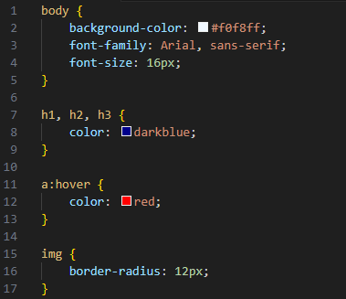
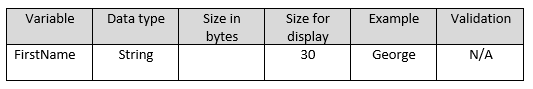
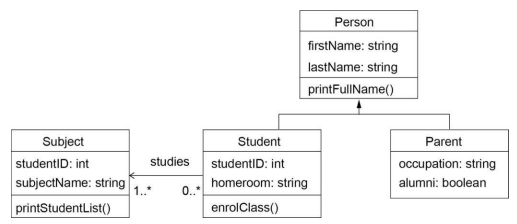
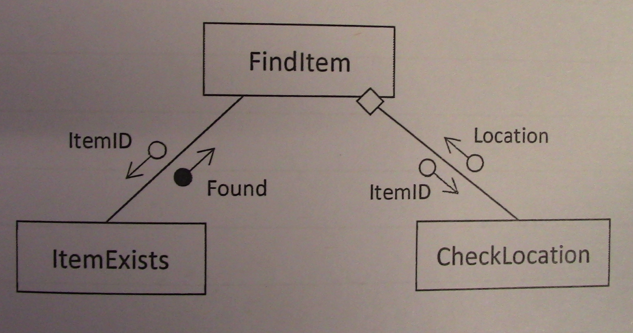
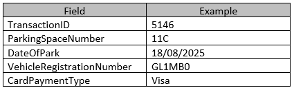

# Merewether Trial

- Syllabus: Software Engineering · Publisher: –
- Status: private
- **Score: – / 80** · answered 0/32 parts · marked 0/32
- Review page: -

---

## 1. MHSTrial2025 - Question 1

#### Question 1 — –/1 marks  `MULTI_CHOICE`

The "Privacy be Design" approach is defined as:

- **A.** Features added after software is released to lock down sotred data.
- **B.** Improvements to processing reliability made after a security breach.
- **C.** Modifications made following user feedback on interface inefficiencies.
- **D.** Buliding software with data protection measures integrated from the outset of a project.  ✅ *correct*

**Your answer:** (none) · **Correct:** D

---

## 2. MHSTrial2025 - Question 2

#### Question 2 — –/1 marks  `MULTI_CHOICE`

Email clients send mail using which protocol?

- **A.** SMTP  ✅ *correct*
- **B.** IMAP
- **C.** FTP
- **D.** POP3

**Your answer:** (none) · **Correct:** A

---

## 3. MHSTrial2025 - Question 3

#### Question 3 — –/1 marks  `MULTI_CHOICE`

What is the most effective approach for ensuring that automation benefits society as a whole?

- **A.** Allow market forces to guide the adoption of automation, trusting that economic growth will naturally lead to broader societal benefits.
- **B.** Priorotise technological advancement and productivity gains, with social concerns addressed only after implementation.
- **C.** Encourage collaboration between policymakers, educators, and businesses to promote inclusivity, skill development, and sustainability.  ✅ *correct*
- **D.** Limit the use of automation to industries with low employment rates.

**Your answer:** (none) · **Correct:** C

---

## 4. MHSTrial2025 - Question 4

#### Question 4 — –/1 marks  `MULTI_CHOICE`

A new software application is introduced by initially running the program with only a few of its modules active. After confirming that these modules function correctly, the remaining components are gradually activated.

What type of implementation method does this scenario describe?

- **A.** Direct
- **B.** Phased  ✅ *correct*
- **C.** Parallel
- **D.** Pilot

**Your answer:** (none) · **Correct:** B

---

## 5. MHSTrial2025 - Question 5

**Stimulus:**



#### Question 5 — –/1 marks  `MULTI_CHOICE`

The code sample stimulus is written using which coding langauge?

- **A.** Python
- **B.** HTML
- **C.** JSON
- **D.** CSS  ✅ *correct*

**Your answer:** (none) · **Correct:** D

---

## 6. MHSTrial2025 - Question 6

#### Question 6 — –/1 marks  `MULTI_CHOICE`

A user logs into their bank's website, which allows money transfer via a button. A hacker sends the user a malicious email containing a link. When the user clicks the link, a money transfer request is executed without their knowledge.

What type of attack is this?

- **A.** Cross-Site Request Forgery (CSRF)  ✅ *correct*
- **B.** Cross-Site Scripting (XSS)
- **C.** Denial of Service (DoS)
- **D.** SQL Injection

**Your answer:** (none) · **Correct:** A

---

## 7. MHSTrial2025 - Question 7

**Stimulus:**



#### Question 7 — –/1 marks  `MULTI_CHOICE`

Using the excerpt from the Data Dictionary stimulus, how many bytes of storage are required to store the FirstName attribute?

- **A.** 9
- **B.** 30  ✅ *correct*
- **C.** 6
- **D.** 25

**Your answer:** (none) · **Correct:** B

---

## 8. MHSTrial2025 - Question 8

#### Question 8 — –/1 marks  `MULTI_CHOICE`

Which of the following statements accurately describes the use of Gantt charts in software development?

- **A.** Gantt charts can only be used when implementing an WAgile software development approach.
- **B.** Gantt charts are useful for identifying a broad range of likely software bugs and errors present in code.
- **C.** Gantt charts provide a visual representation of the sub-tasks in the software development process.  ✅ *correct*
- **D.** Gantt charts are useful for scheduling individual development tasks and personnel, not overall project timelines.

**Your answer:** (none) · **Correct:** C

---

## 9. MHSTrial2025 - Question 9

#### Question 9 — –/1 marks  `MULTI_CHOICE`

A programmer wishes to iterate through an array of an unknown length. Which control structure syntax would be most helpful?

- **A.** WHILE&hellip; ENDWHILE
- **B.** IF&hellip; ENDIF
- **C.** FOR&hellip; NEXT  ✅ *correct*
- **D.** CASEWHERE&hellip; ENDCASE

**Your answer:** (none) · **Correct:** C

---

## 10. MHSTrial2025 - Question 10

#### Question 10 — –/1 marks  `MULTI_CHOICE`

A computerised testing application is being developed. For one type of question the user must select all the correct answers from a total of 5 possible answers.

Which screen element would be best to use for this type of question?

- **A.** Checkbox  ✅ *correct*
- **B.** Radio button
- **C.** Command button
- **D.** Text area

**Your answer:** (none) · **Correct:** A

---

## 11. MHSTrial2025 - Question 11

**Stimulus:**

BEGIN MainProgram  
      a = 1  
      b = 2

      IF b > 1 THEN  
            WHILE a < 4  
                  DoThings()  
                  a = a + 1  
            ENDWHILE  
      ENDIF

      PRINT a, b  
END MainProgram

#### Question 11 — –/1 marks  `MULTI_CHOICE`

Using the pseudocode stimulus, which of the following structure charts most accurately represents the algorithm?

- **A.** 
- **B.** 
- **C.**   ✅ *correct*
- **D.** 

**Your answer:** (none) · **Correct:** C

---

## 12. MHSTrial2025 - Question 12

**Stimulus:**

BEGIN AgeDetermination(age)

      CASEWHERE age <=

            1: AgeDetermination = “Infant”

            4: AgeDetermination = “Toddler”

            12: AgeDetermination = “Child”

            18: AgeDetermination = “Teenager”

            OTHERWISE: AgeDetermination = “Adult”

      ENDCASE

      RETURN AgeDetermination

END AgeDetermination

#### Question 12 — –/1 marks  `MULTI_CHOICE`

Using the pseudocode stimulus, if an age of 19 is input by a user, what AgeDetermination should be returned?

- **A.** Infant
- **B.** Child
- **C.** Teenager
- **D.** Adult  ✅ *correct*

**Your answer:** (none) · **Correct:** D

---

## 13. MHSTrial2025 - Question 13

#### Question 13 — –/1 marks  `MULTI_CHOICE`

Wordle is an online daily word challenge where users have six chances to guess a 5 letter word. Susan has the second and third letters of today’s word but not the other three. Being particularly resourceful, she has access to a database that contains every 5 letter word in the English language. Susan’s known two letters are “RO”. Which SQL wildcard statement will help Susan narrow her guesses?

- **A.** *RO*
- **B.** ?RO?
- **C.** ?RO*  ✅ *correct*
- **D.** *RO?

**Your answer:** (none) · **Correct:** C

---

## 14. MHSTrial2025 - Question 14

#### Question 14 — –/1 marks  `MULTI_CHOICE`

A weather application uses a HTTP GET request to safely and securely retrieve forecast data from an external weather service.

Which statement best describes this interaction?

- **A.** The weather application sends raw database queries directly to the weather service.
- **B.** The weather application requests structured data from the weather service&rsquo;s API.  ✅ *correct*
- **C.** The weather application directly reads sensor values from the weather station&rsquo;s hardware.
- **D.** The weather service automatically pushes new data to the weather application every minute without a request.

**Your answer:** (none) · **Correct:** B

---

## 15. MHSTrial2025 - Question 15

#### Question 15 — –/1 marks  `MULTI_CHOICE`

Which of the following is **NOT** a bias mitigation strategy that developers can include in the implementation of Machine Learning and Artificual Intelligence solutions?

- **A.** Implement fairness metrics to evaluate whether models treat all groups equitably.
- **B.** Ensure that datasets are collected from a wide range of sources and populations to capture diverse perspectives and experiences.
- **C.** Choose specific datasets that reflect the preferences or experiences of developers and data scientists.  ✅ *correct*
- **D.** Conduct regular audits of datasets and models including testing models on different demographic groups.

**Your answer:** (none) · **Correct:** C

---

## 16. MHSTrial2025 - Question 16

#### Question 16 — –/1 marks  `MULTI_CHOICE`

Acceptance testing can be defined as?

- **A.** Testing that ensures each function of the software application operates in accordance with the specified requirements.
- **B.** Testing that involves releasing software to a limited audience outside of the development team.
- **C.** Testing that examines how software performs under a large volume of data.
- **D.** Testing that determines whether the software meets the agreed-upon criteria for delivery and is ready for release.  ✅ *correct*

**Your answer:** (none) · **Correct:** D

---

## 17. MHSTrial2025 - Question 17

**Stimulus:**



#### Question 17 — –/1 marks  `MULTI_CHOICE`

Using the Class Diagram stimulus, which of the following statements is true?

- **A.** Person inherits from Student and Parent
- **B.** A student must study 1 or more subjects  ✅ *correct*
- **C.** A subject must have 1 or more students
- **D.** Student inherits from Subject

**Your answer:** (none) · **Correct:** B

---

## 18. MHSTrial2025 - Question 18

#### Question 18 — –/1 marks  `MULTI_CHOICE`

Which of the following is **NOT** a key concept in understanding secure software design?

- **A.** Availability
- **B.** Application  ✅ *correct*
- **C.** Integrity
- **D.** Accountability

**Your answer:** (none) · **Correct:** B

---

## 19. MHSTrial2025 - Question 19

#### Question 19 — –/1 marks  `MULTI_CHOICE`

The following statement describes which specific Internet technology?

**"The header contains source and destination IP addresses. The actual data comes next for information or message exhange. The last component is the footer."**

- **A.** Data packet  ✅ *correct*
- **B.** Securty certificate
- **C.** Internet Uniform Resource Locator (URL)
- **D.** Flask database

**Your answer:** (none) · **Correct:** A

---

## 20. MHSTrial2025 - Question 20

**Stimulus:**

from django.db import models

class MusicTrack(models.Model):  
title = models.CharField(max\_length=100)  
artist = models.CharField(max\_length=50)  
genre = models.CharField(max\_length=50)  
release\_date = models.DateField()

#### Question 20 — –/1 marks  `MULTI_CHOICE`

Using the Object-Relational Mapping (ORM) stimulus, the code to retrieve all 'Pop' tracks would be?

- **A.** pop_tracks = MusicTrack.objects.filter(genre='Pop')  ✅ *correct*
- **B.** pop_tracks = genre.objects.filter(MusicTrack='Pop')
- **C.** MusicTrack.objects.filter(genre='Pop') = pop_tracks
- **D.** pop_tracks == genre.objects.filter(MusicTrack='Pop')

**Your answer:** (none) · **Correct:** A

---

## 21. MHSTrial2025 - Question 21

**Stimulus:**

BEGIN AverageListOfNumbers

      average = -1

      arrayOfNumbers = GetNumbers

      IF number of items in arrayOfNumbers <> 0 THEN

            average = CalculateAverage(arrayOfNumbers)

            PrintAverageToScreen(average)

      ELSE

            PRINT “No numbers entered”

      ENDIF

END AverageListOfNumbers

#### Question 21 — –/4 marks  `DRAWING_V2`

Using the stimulus material, construct a structure chart to represent this algorithm.

**Your answer:**

_(not answered)_

**Marking criteria:**
- [4] Students construct a fully correct structure chart for the given algorithm
- [3] Students construct a mostly correct structure chart for the given algorithm
- [2] Students construct a structure chart with some correct components for the given algorithm
- [1] Students attempt to create a structure chart

**Sample answer:**


---

## 22. MHSTrial2025 - Question 22

#### Question 22 — –/6 marks  `SHORT`

Explain the three types of machine learning.

**Your answer:**

_(not answered)_

**Marking criteria:**
- [6] Students correctly explain the three types of machine learning
- [4-5] Students correctly explain two types of machine learning
- [2-3] Students correctly describe the three types of machine learning
- [1] Students correctly identify types of machine learning

**Sample answer:**

The three main types of machine learning are supervised learning, unsupervised learning, and deep learning.

  

Supervised learning occurs when an algorithm is trained on labelled data, where both the input and the correct output are provided. The system learns patterns by comparing its predictions with the known answers and adjusting to improve accuracy. This approach is commonly used in applications such as spam email detection, handwriting recognition, and medical diagnosis, where large sets of labelled examples are available.

  

Unsupervised learning works with unlabelled data, meaning the algorithm must identify hidden patterns or relationships without predefined answers. It is typically used for clustering, grouping, or anomaly detection. For example, businesses use unsupervised learning to segment customers into different market groups or streaming platforms use it to suggest similar movies based on viewing history. Unlike supervised learning, there is no “correct” output provided.

  

Deep learning is a specialised form of machine learning that uses artificial neural networks with many layers (“deep” networks) to process data. These networks can automatically learn features from raw inputs, making them highly effective for tasks involving complex, unstructured data such as images, speech, or video. For example, deep learning powers facial recognition systems, natural language processing (such as virtual assistants), and autonomous vehicles. Deep learning requires large datasets and significant computing power but achieves high accuracy in solving complex problems.

---

## 23. MHSTrial2025 - Question 23

**Stimulus:**



#### Question 23 — –/3 marks  `SHORT`

Using the structure chart stimulus, write a possible pseudocode algorithm for the FindItem routine.

**Your answer:**

_(not answered)_

**Marking criteria:**
- [3] Students construct a fully correct pseudocode algorithm for the FindItem routine
- [2] Students construct a somewhat correct pseudocode algorithm for the FindItem routine or a fully correct routine using Python rather than pseudocode
- [1] Students attempt to construct a pseudocode algorithm for the FindItem routine

**Sample answer:**

```
BEGIN FindItem(ItemID)
    Found = ItemExists(ItemID)
    IF Found THEN
        Location = CheckLocation(ItemID)
    ENDIF
    RETURN Location
END
```

---

## 24. MHSTrial2025 - Question 24

#### Question 24 — –/4 marks  `SHORT`

Discuss the role and importance of programmed data backup and version control when producing and implementing code.

**Your answer:**

_(not answered)_

**Marking criteria:**
- [4] Students correctly discuss the role and importance of programmed data backup and version control when producing and implementing code, providing definitions and examples
- [3] Students correctly discuss the role and importance of programmed data backup and version control
- [2] Students correctly identify the role and importance of programmed data backup and version control
- [1] Students correctly identify the role and importance of programmed data backup or version control

**Sample answer:**

Programmed data backup refers to the automated process of regularly saving copies of code and project files so they can be restored if data is lost or corrupted. This is important because it protects against hardware failure, accidental deletion, or cyber-attacks, ensuring that critical work is not permanently lost. For example, cloud-based backups such as Google Drive or automated server backups allow developers to recover previous versions of source code after a system crash.

  

Version control is a system that tracks changes to code over time, allowing multiple developers to collaborate while maintaining a record of modifications. Its importance lies in preventing conflicts, enabling rollbacks to earlier versions if errors occur, and supporting collaborative workflows. Tools such as Git and GitHub provide branching, merging, and commit history features that make large-scale software development efficient and reliable.

---

## 25. MHSTrial2025 - Question 25

**Stimulus:**

A library management system allows users to register online.

The registration form must collect user details, a secure PIN and confirm the user's identity via a preferred notification method.

The PIN requirements are:

-   Exactly 4 numeric digits
-   No repeated digits (e.g. 1123 or 1231 is invalid)
-   No letters or special character

#### Question 25 — –/4 marks  `DRAWING_V2`

Using the information in the stimulus, construct a user interface design for registration. Label all form fields clearly.

**Your answer:**

_(not answered)_

**Marking criteria:**
- [4] Students construct a fully correct user interface for use in registration, including labels for all fields
- [3] Students construct a fully correct user interface for use in registration
- [2] Students construct a mostly correct user interface for use in registration
- [1] Students attempt to construct a user interface for use in registration

**Sample answer:**


---

## 26. MHSTrial2025 - Question 26

**Stimulus:**

A hospital requires software to manage their operating theatre bookings. The new software should have the following features:

-   Details of each patient’s operation are entered from a digital booking card supplied by a surgeon’s team. Details include the patient details (first name, surname, age, weight(kgs)), name of the surgeon (surname), type of operation (internal or external), date of the operation, and the times the operating theatre will be required ('morning' or 'afternoon')
-   The software will check if the theatre is available at those times ('morning' or 'afternoon') and display an appropriate message
-   At the start of each day a printout is generated for each surgeon’s team showing the list of operations they have scheduled for that day

#### Question 26 — –/8 marks  `CODING`

Using the stimulus information, synthesise a Python program that captures all required information for a patient's operation and outputs a confirmation receipt to the user. The program should include simple error checking and validation.

**Your answer:**

_(not answered)_

**Marking criteria:**
- [8] Students construct a substantially correct algorithm that includes:Correct use Python syntaxCaptures all required informationUses error checkingUses validationPrints all required information from the confirmation receiptUses sound intrinsic documentationInterprets without error
- [6-7] Students construct a correct algorithm with many of the features above
- [4-5] Students construct a correct algorithm with some of the features above
- [3-2] Students construct a correct algorithm with few of the features above
- [1] Students construct an algorithm that shows some understanding of the problem

**Sample answer:**

```
fname = input("Enter patient's first name: ")
sname = input("Enter patient's surname: ")

age = input("Enter age: ")
while not age.isdigit():
    age = input("Invalid, enter a number for age: ")
age = int(age)

weight = input("Enter weight (kgs): ")
while not weight.isdigit():
    weight = input("Invalid, enter a number for weight: ")
weight = int(weight)

surgeon = input("Enter surgeon's surname: ")

op_type = input("Type of operation (internal/external): ").lower()
while op_type not in ["internal", "external"]:
    op_type = input("Invalid, enter internal or external: ")

date = input("Enter date (DD/MM/YYYY): ")

time = input("Enter time (morning/afternoon): ").lower()
while time not in ["morning", "afternoon"]:
    time = input("Invalid, enter morning or afternoon: ")

booked = False
if booked:
    print("Theatre not available, please reschedule.")
else:
    print("\n-- Confirmation Receipt --")
    print("Patient:", fname, sname)
    print("Age:", age, "Weight:", weight, "kg")
    print("Surgeon:", surgeon)
    print("Operation:", op_type)
    print("Date:", date, "Time:", time)
    print("Booking successful.")
```

---

## 27. MHSTrial2025 - Question 27

#### Question 27 — –/3 marks  `SHORT`

Contrast live and simulated testing in the creation of a software solution.

**Your answer:**

_(not answered)_

**Marking criteria:**
- [3] Students correctly contrast live and simulated testing
- [2] Students correctly describe live and simulated testing
- [1] Students identify properties of live or simulated testing

**Sample answer:**

Live testing is the process of evaluating software in its actual operating environment with real users, data, and hardware. It provides accurate feedback on performance, usability, and reliability but carries risks if errors affect end-users.

  

Simulated testing, by contrast, uses controlled environments or models to imitate real-world conditions without exposing the system to actual users or data. It allows developers to test safely, repeat scenarios, and detect issues early before deployment.

---

## 28. MHSTrial2025 - Question 28

**Stimulus:**

A new parking payment software system is being developed that will allow carpark users to purchase a ticket with their credit card. Carpark users will enter their vehicle numberplate details via the parking payment software system along with their credit card details. Once a successful transaction is completed, the parking details are stored in a database and a ticket receipt is printed. The receipt is placed on the car’s dashboard so it is visible to carpark officials.

The current version of the proposed payment system database utilises a flat-file structure in a ‘Transaction’ table:



#### Question 28 — –/3 marks  `SHORT`

Using the stimulus material, synthesise an SQL statement that could be used to query the following details from the stored data:

All vehicles that parked in space 1A on or before 10/04/25 and whose payee was a Visa card holder.

**Your answer:**

_(not answered)_

**Marking criteria:**
- [3] Students synthesise a fully correct SQL statement for the for the given scenario
- [2] Students synthesise a somewhat correct SQL statement for the for the given scenario
- [1] Students attempt to create an SQL statement

**Sample answer:**

```
SELECT Transaction.VehicleRegistrationNumber, Transaction.DateOfPark
FROM Transaction
WHERE Transaction.ParkingSpace = “1A” AND
    Transaction.DateOfPark <= 10/04/25 AND
    Transaction.CardPaymentType = “Visa”
ORDERBY Transaction.DateOfPark DESCENDING
```

---

## 29. MHSTrial2025 - Question 29

#### Question 29 — –/8 marks  `SHORT`

Assess the impact of automation on the individual, society and the environment.

**Your answer:**

_(not answered)_

**Marking criteria:**
- [8] Students correctly assess the impact of automation on the individual, society and the environment
- [6-7] Students correctly assess the impact of automation on two of the three areas above
- [4-5] Students correctly outline the impact of automation on two of the areas above
- [3-2] Students correctly outline the impact of automation on one of the areas above
- [1] Students correctly describe automation

**Sample answer:**

The impact of automation can be assessed at the level of the individual, society, and the environment, with both benefits and drawbacks evident.

  

For the individual, automation often increases efficiency by removing repetitive tasks, freeing workers to focus on creative or analytical roles. For example, software engineers use automated testing to reduce manual errors and save time. However, automation can also cause job displacement, particularly in industries such as manufacturing or retail, where machines replace human labour. Individuals may require retraining or upskilling to remain employable, creating both opportunities and challenges.

  

At the level of society, automation contributes to economic growth by enabling mass production and lowering costs. It improves access to goods and services, such as self-service checkouts and automated banking systems, which increase convenience. Yet it can also widen social inequality if certain groups lose employment while others benefit from higher productivity. The shift towards automation may also raise ethical concerns, such as the reduction of human interaction in services like healthcare or customer support.

  

For the environment, automation can reduce waste and improve sustainability when systems are designed for efficiency. For instance, automated energy management in smart buildings lowers electricity consumption, while precision agriculture reduces fertiliser and water use. On the other hand, widespread automation can increase energy demand, particularly with large-scale data centres and robotics manufacturing, potentially contributing to carbon emissions if not powered by renewable sources.

---

## 30. MHSTrial2025 - Question 30

#### Question 30 — –/8 marks  `CODING`

A program is required to compare the marks of two HSC students studying Software Engineering.

Synthesise a Python program that will:

-   Capture four assessment marks for each student out of 20, 20, 30 and 30 respectively (marks will be awarded for more complex data structures and error checking/validation)
-   Output the course total out of 100 for each student
-   Output the course average for each student
-   Identify and output which student has achieved the highest total mark from the completion of all four assessments

**Your answer:**

_(not answered)_

**Marking criteria:**
- [8] Students construct a substantially correct algorithm that includes:Correct use Python syntaxCaptures all required informationUses complex data structures [1D array or greater]Uses error checkingUses data validation or masking to capture correct valuesPrints all required information regarding totals, average and highest markUses sound intrinsic documentationInterprets without error
- [6-7] Students construct a correct algorithm with many of the features above
- [4-5] Students construct a correct algorithm with some of the features above
- [3-2] Students construct a correct algorithm with few of the features above
- [1] Students construct an algorithm that shows some understanding of the problem

**Sample answer:**

```
def capture_student_marks(student_name):
    max_marks = [20, 20, 30, 30]
    student_marks = []
    for index, max_mark in enumerate(max_marks):
        mark = input(f"Enter mark {index+1} for {student_name} (out of {max_mark}): ")
        while not mark.isdigit() or int(mark) < 0 or int(mark) > max_mark:
            mark = input(f"Invalid entry, enter a number between 0 and {max_mark}: ")
        student_marks.append(int(mark))
    return student_marks

student1_marks = capture_student_marks("Student 1")
student2_marks = capture_student_marks("Student 2")

student1_total = sum(student1_marks)
student2_total = sum(student2_marks)

student1_average = student1_total / len(student1_marks)
student2_average = student2_total / len(student2_marks)

print("\n-- Results --")
print(f"Student 1 - Total:", student1_total, "/100 Average:", student1_average)
print(f"Student 2 - Total:", student2_total, "/100 Average:", student2_average)

if student1_total > student2_total:
    print("Highest total achieved by: Student 1")
elif student2_total > student1_total:
    print("Highest total achieved by: Student 2")
else:
    print("Both students achieved the same total")
```

---

## 31. MHSTrial2025 - Question 31

#### Question 31 — –/4 marks  `SHORT`

Recommend ways in which accessibility features can be implemented into web content to assist a wide range of users, including those with disabilities.

**Your answer:**

_(not answered)_

**Marking criteria:**
- [4] Students correctly recommend ways in which accessibility features can be implemented into web content to assist a wide range of users, including those with disabilities
- [3] Students correctly recommend ways in which accessibility features can be implemented into web content to assist users
- [2] Students correctly identify recommend accessibility features for users
- [1] Students correctly identify accessibility features

**Sample answer:**

Accessibility features can be implemented into web content to support a wide range of users. Adding alt text for images allows screen readers to describe visual content to people with vision impairments. Keyboard navigation ensures that users who cannot operate a mouse can move through menus and links using only the keyboard. Providing high colour contrast and options for resizable text assists users with low vision or colour blindness. Finally, adding captions and transcripts for audio and video content supports users with hearing impairments and also benefits those in sound-sensitive environments.

---

## 32. MHSTrial2025 - Question 32

#### Question 32 — –/5 marks  `SHORT`

Describe web Content Management Systems (CMS) and justify why an experienced web developer would choose to use HTML, CSS and JavaScript while a beginner would use a CMS.

**Your answer:**

_(not answered)_

**Marking criteria:**
- [5] Students correctly describe CMS and justify use differences between experienced and beginner programmers based on the properties of the provided technologies
- [4] Students correctly describe CMS and justify use differences between experienced and beginner programmers
- [3] Students correctly describe CMS and identify differences between experienced and beginner programmers
- [2] Students correctly justify use differences between experienced and beginner programmers
- [1] Students describe experienced and beginner programmers

**Sample answer:**

A Content Management System (CMS) is software that enables users to create, manage, and publish digital content such as websites without needing to build everything from scratch. Popular examples include WordPress, Joomla, and Drupal. CMS platforms typically provide templates, drag-and-drop interfaces, and plugin systems to extend functionality.

  

For beginner programmers, CMS tools are valuable because they offer pre-designed templates, WYSIWYG (What You See Is What You Get) editors, and simple plugin installations. These features allow beginners to build functional websites quickly without requiring deep coding knowledge. The emphasis is on ease of use and reducing complexity.

  

For experienced programmers, CMS tools are used differently. They can customise themes through direct editing of HTML, CSS, and JavaScript, develop custom plugins, and optimise databases for performance and scalability. Experienced developers leverage the flexibility of a CMS to integrate APIs, ensure security, and meet specific client requirements that go beyond the default tools.

  

The difference arises from the properties of CMS technologies: their user-friendly interfaces support beginners in creating basic sites, while their open, extensible architecture enables experts to create highly customised, secure, and scalable solutions. This justifies why CMS platforms meet the needs of both novice and advanced users but in very different ways.
