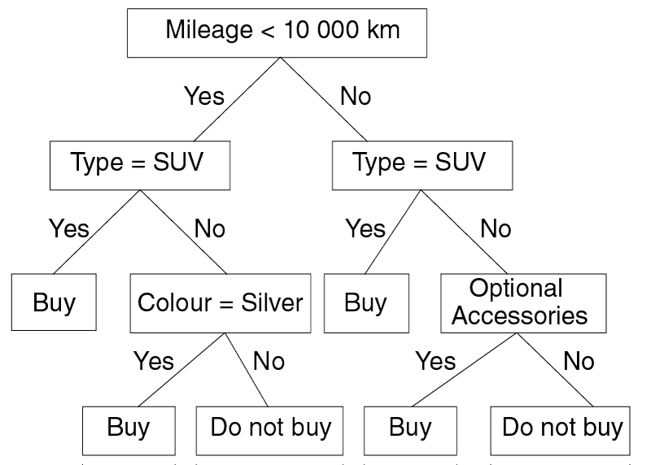
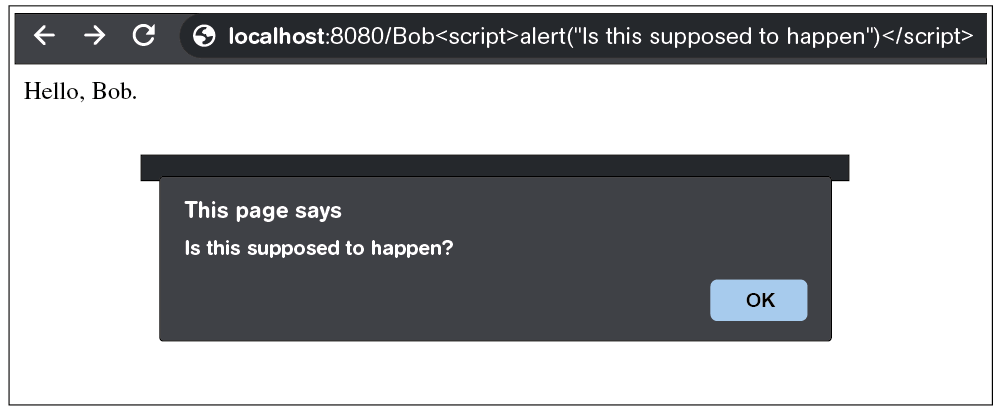
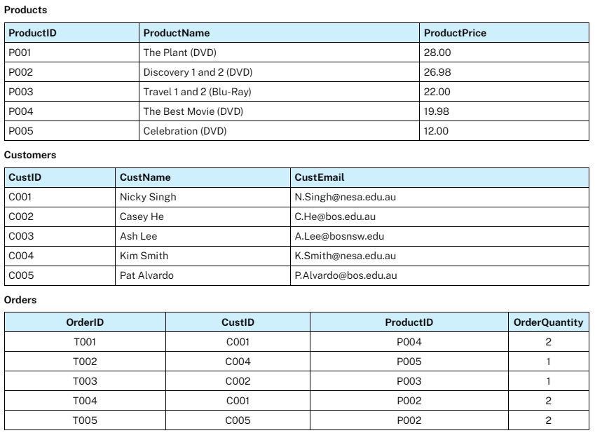
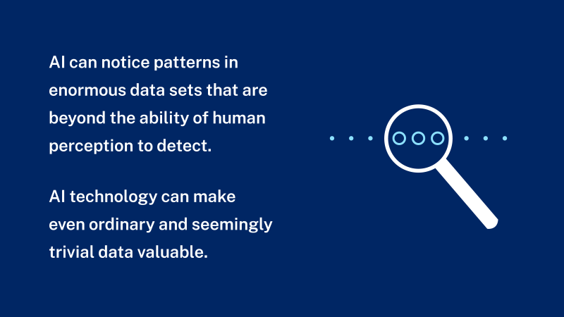
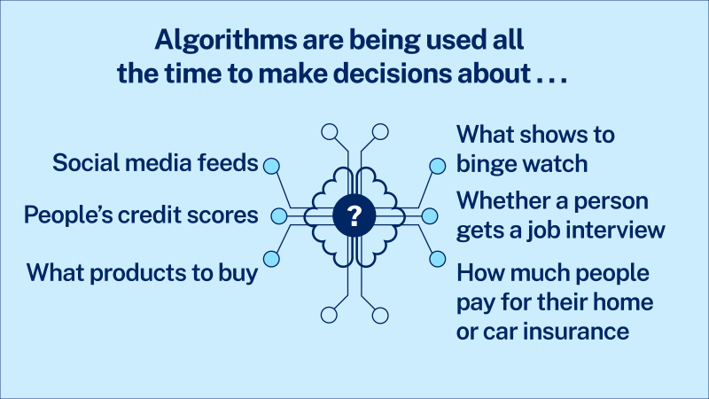
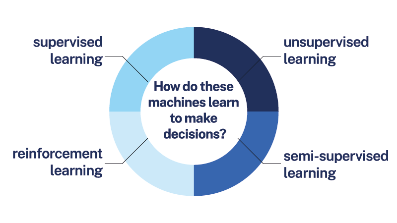
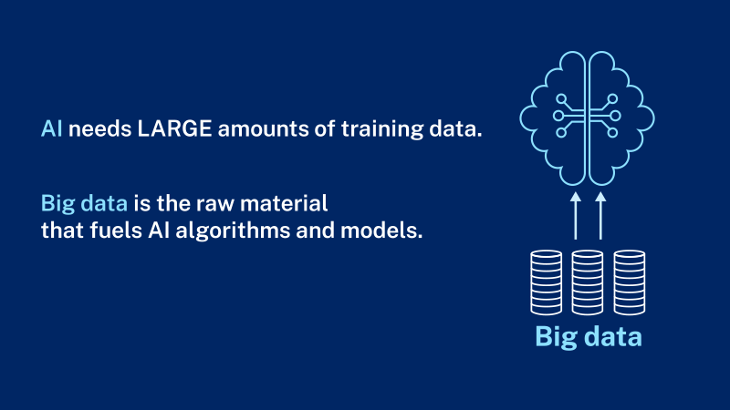

# NESA HSC Familiarisation

- Syllabus: Software Engineering · Publisher: –
- Status: private
- **Score: – / 53** · answered 0/18 parts · marked 0/18
- Review page: -

---

## 1. Question 1, Software Development Steps

#### Question 1 — –/1 marks  `SORTING_TABLE`

Place the following software development steps in the correct order by clicking and holding each step and dragging it into its position.

**Your answer:**

_(not answered)_

**Sample answer:**

1.  Determining specifications
2.  Design
3.  Development
4.  Testing and debugging
5.  Installation
6.  Maintenance

---

## 2. Question 2, SQL Query

**Stimulus:**

An online business is planning to use a database to keep track of its products. The contents of the **Products** table during testing are shown.

**Products**

| ProductID | ProductName | ProductPrice |
|---|---|---|
| P001 | The Plant (DVD) | 28.00 |
| P002 | Discovery 1 and 2 (DVD) | 26.98 |
| P003 | Travel 1 and 2 (Blu-Ray) | 22.00 |
| P004 | The Best Movie (DVD) | 19.98 |
| P005 | Celebration (DVD) | 12.00 |

  

After executing a SQL query, the following results were obtained.

| ProductName | ProductPrice |
|---|---|
| The Plant (DVD) | 28.00 |
| Discovery 1 and 2 (DVD) | 26.98 |
| Travel 1 and 2 (Blu-Ray) | 22.00 |

#### Question 2 — –/3 marks  `MULTI_CHOICE`

Which of the following SQL queries would produce the results shown?

- **A.** SELECT ProductName, ProductPrice FROM Products WHERE ProductPrice >= 22.00 ORDER BY ProductPrice DESC;  ✅ *correct*
- **B.** SELECT * FROM Products WHERE ProductPrice > 22.00 ORDER BY ProductName ASC;
- **C.** SELECT ProductName, ProductPrice FROM Products WHERE ProductPrice <= 28.00 ORDER BY ProductPrice ASC;
- **D.** SELECT ProductName, ProductPrice FROM Products WHERE ProductName LIKE '%DVD%' ORDER BY ProductID DESC;

**Your answer:** (none) · **Correct:** A

---

## 3. Question 3, Email Protocols

#### Question 3 — –/2 marks  `OBJECTIVE_RESPONSE`

Match each of the features to the relevant protocol(s).

| Statement | Correct | Yours | |
|---|---|---|---|
| Commonly used for sending email | SMTP | – |  |
| Commonly used for receiving email | POP3, IMAP | – |  |
| Allows email to synchronise across devices | IMAP | – |  |
| Server deletes messages when they are downloaded and opened | POP3 | – |  |

---

## 4. Question 4, Structure Chart

**Stimulus:**

This structure chart describes a hotel booking system.


#### Question 4 — –/2 marks  `MULTI_CHOICE`

Select the items that are **TRUE** about this structure chart.  
**(Multiple items may be selected.)**

- **A.** Booking made is a flag.  ✅ *correct*
- **B.** Login is the first module called.  ✅ *correct*
- **C.** Booking ID may only be true or false.
- **D.** Display new bookings may not be executed.  ✅ *correct*
- **E.** Members do not need to log in to browse hotels.
- **F.** A choice is continually offered between Browse hotels and Book.  ✅ *correct*
- **G.** Login calls Enter member details and validate when Member ID is set to true.

**Your answer:** (none) · **Correct:** A, B, D, F

---

## 5. Question 5, Test Data

**Stimulus:**

Consider the following algorithm.

BEGIN determineGrade
    get Mark
    CASEWHERE Mark
        >=80 : Grade = "H"
        >=50 : Grade = "P"
        OTHERWISE : Grade = "N"
    ENDCASE
    print Grade
End determineGrade

#### Question 5 — –/3 marks  `SHORT`

Provide a set of 5 test data that will thoroughly test the algorithm. Include the expected outputs and reasons for inclusion. You may assume that all input data are valid.

_Please format your answer in three columns: Test data (Mark), Expected output (Grade), and Reason for inclusion._

**Your answer:**

_(not answered)_

**Marking criteria:**
- [3] Provides a set of test data within the table that will thoroughly test the algorithmIncludes expected outputs and reasons for inclusion
- [2] Provides a set of test data that tests most boundaries and/or pathsIncludes most of the expected outputs and reasons for inclusion
- [1] Provides some relevant information

**Sample answer:**

| Test data   (Mark) | Expected output   (Grade) | Reason for inclusion |
|---|---|---|
| 85 | H | Testing greater than 80 |
| 80 | H | Testing boundary value (80) |
| 60 | P | Testing between 50 and 80 |
| 50 | P | Testing boundary value (50) |
| 45 | N | Testing ‘otherwise’ (below 50) |

---

## 6. Question 6, Sandboxing

**Stimulus:**

A new operating system is to be developed for a mobile phone. The operating system needs to allow users to install a variety of third-party applications such as social media applications and games on the phone.

#### Question 6 — –/3 marks  `SHORT`

Discuss the use of sandboxing in this operating system.

**Your answer:**

_(not answered)_

**Marking criteria:**
- [3] Provides a thorough discussion of the use of sandboxing in the operating system
- [2] Shows some understanding of the advantages and/or disadvantages of the use of sandboxing
- [1] Identifies a feature of sandboxing

**Sample answer:**

Sandboxing allows each application to be isolated so that it cannot pose a security risk by accessing system resources or other applications. However, it requires more resources as each application requires its own container. It may also be less convenient for users to access resources such as the device’s camera or files as the sandbox will either prevent access or make it more difficult.

  

**Answers could include:**

Sandboxing limits the resource use of different processes (eg applications) running on the device, ensuring that if a process contains bad code, such as a memory leak, it does not consume all the resources of the operating system – potentially starving other processes, or the operating system itself, of resources.

---

## 7. Question 7, Decision Tree

**Stimulus:**

Consider the following decision tree of a trained machine learning model that determines whether to purchase a vehicle.



#### Question 7(a) — –/1 marks  `OBJECTIVE_RESPONSE`

Using the decision tree, determine the outcome of each of the following situations.

| Statement | Correct | Yours | |
|---|---|---|---|
| Mileage = 8000 km, Colour = Silver, Optional Accessories = No | Buy | – |  |
| Mileage = 11 000 km, Colour = Red, Optional Accessories = Yes | Buy | – |  |
| Type = SUV, Colour = Red, Optional Accessories = No | Buy | – |  |

#### Question 7(b) — –/3 marks  `DRAWING_V2`

The decision tree can be simplified without compromising its logic. Redraw the decision tree to reduce the number of branches.

**Your answer:**

_(not answered)_

**Marking criteria:**
- [3] Draws a correctly simplified decision tree
- [2] Draws a simplified decision tree with most of the logic
- [1] Shows some understanding of the requirement

**Sample answer:**


---

## 8. Question 8, Algorithm Correction

**Stimulus:**

The following subroutine is intended to search an array for an item and output the position of that item in the array. There are several mistakes in the algorithm.

The array is called **ItemArray** and it is indexed from 1.

#### Question 8 — –/3 marks  `PSEUDOCODE`

Copy the algorithm into the space below and modify the algorithm logic so that it achieves its intended purpose.

  
BEGIN Search (SearchItem) Set LastIndex to the number of elements in ItemArray Index = 1 WHILE Found = FALSE OR Index < LastIndex IF Index = SearchItem THEN Found = TRUE ENDIF ENDWHILE IF Found = TRUE THEN Display 'Position', Index ELSE Display 'Not found' ENDIF END Search

**Your answer:**

_(not answered)_

**Marking criteria:**
- [3] Correctly modifies the algorithm to achieve its intended purpose
- [2] Corrects some mistakes in the algorithm
- [1] Shows some understanding of the problem

**Sample answer:**

```
BEGIN Search (SearchItem)
  Set LastIndex to the number of elements in ItemArray
  Found = FALSE
  Index = 1
  WHILE Found = FALSE AND Index < LastIndex + 1
    IF ItemArray(Index) = SearchItem THEN
      Found = TRUE
    ENDIF
    Index = Index + 1
  ENDWHILE
  IF Found = TRUE THEN
    Display ‘Position’, Index – 1
  ELSE
    Display ‘Not found’
  ENDIF
END Search
```

---

## 9. Question 9, UI and Python

**Stimulus:**

An online store allows users to register for an account using their name, phone number and date of birth. Users must also create a username and password.

Each username must satisfy these rules:

-   There must be no more than 8 characters.
-   Only uppercase and lowercase letters are accepted.
-   The character "<" is not allowed, to prevent attempts at injecting code through the username.

#### Question 9(a) — –/3 marks  `DRAWING_V2`

Design a user interface for registering an account. Clearly label all features.

**Your answer:**

_(not answered)_

**Marking criteria:**
- [3] Provides a user interface suitable for users to register an account, with features labelled
- [2] Designs a user interface with some relevant features
- [1] Shows some understanding of the problem

**Sample answer:**


#### Question 9(b) — –/3 marks  `CODING`

Write a function in Python that will check whether a username satisfies the rules.

Starter code (PYTHON):
```
# Write your Python function here
```

**Your answer:**

_(not answered)_

**Marking criteria:**
- [3] Provides a correct function in Python that checks whether a username satisfies the rules
- [2] Provides a partially correct function in Python that attempts to check whether a username satisfies the rules
- [1] Shows some understanding of the problem and Python programming

**Sample answer:**

```
def validateUsername(username):
  # Length check
  if len(username) > 8:
    return False
  # Alpha character only check
  elif username.isalpha() == False:
    return False
  # < character check
  elif "<" in username:
    return False
  # If we reach here then the username meets the requirements
  return True
```

_Answers may include print statements to test the code  
eg print(validateUsername("test"))_

---

## 10. Question 10, Web Performance

**Stimulus:**

Consider the following source code for a web page.

<html>
<body>
<link rel="stylesheet" href="style3.css"/>
<script src="image-gallery.js"/><!--this script is slow to load-->
<link rel="stylesheet" href="styles1.css"/>
<link rel="stylesheet" href="styles2.css"/>
<h1>My Awesome Website!</h1>
<p>I hope you like my website, I spent a lot of time designing it.</p>
<h2>Photos from my holiday</h2>


</body>
</html>

#### Question 10 — –/4 marks  `SHORT`

The web page is loading too slowly. Explain how the load time of this page can be improved.

**Your answer:**

_(not answered)_

**Marking criteria:**
- [4] Explains how the load time of the web page can be improved
- [3] Outlines how some issues affecting the load time can be resolved
- [2] Identifies issues affecting the load time
OROutlines how to resolve ONE issue affecting the load time
- [1] Provides some relevant information

**Sample answer:**

The images can be resized to 640 x 480 beforehand so that the webpage does not need to load the large 4000 x 3000 images. The multiple CSS style sheets could be converted into a single .css file, reducing the number of HTTP requests the browser needs to send. If the "image-gallery.js" JavaScript file at the top of the source code loads slowly, it can be moved to the bottom just above </body> so that it will not block the rest of the page from loading.

  

**Answers could include:**

If the "image-gallery.js" JavaScript file at the top of the source code loads slowly, the "async" property can be added to the <script> tag so that it can load in parallel with the rest of the page.

---

## 11. Question 11, Web Vulnerability

**Stimulus:**

Bob is testing a website for vulnerability. The website allows the user to add their name at the end of the URL and prints their name on the webpage.

In addition to his name, Bob has added some code to the URL and the following is displayed.



#### Question 11(a) — –/1 marks  `MULTI_CHOICE`

What type of vulnerability is being demonstrated?

- **A.** Invalid redirecting
- **B.** Cross site scripting  ✅ *correct*
- **C.** Broken authentication
- **D.** Cross site request forgery

**Your answer:** (none) · **Correct:** B

#### Question 11(b) — –/2 marks  `SHORT`

Explain ONE way to minimise this vulnerability.

**Your answer:**

_(not answered)_

**Marking criteria:**
- [2] Explains ONE way to minimise the vulnerability
- [1] Provides some relevant information

**Sample answer:**

The website could check and change user input so that markup and script become plain text. This will still allow the page to display the information but will prevent it from executing script code.

  

_Note: For example, special characters such as < > and ( ) would be encoded to their HTML equivalent (%3C %3E and %28 %29)._

---

## 12. Question 12, SQL

**Stimulus:**

An online business is planning to use a database to keep track of its products, customers and orders. The contents of the Products, Customers and Orders tables during testing are shown.



#### Question 12(a) — –/2 marks  `SHORT`

The following SQL query is run to test the database.

SELECT ProductName, ProductPrice 
FROM Products 
WHERE ProductPrice > 22.00 
ORDER BY ProductPrice ASC

Fill in the table below with the result of running the SQL query. You may not need to use all the rows or columns.

**Your answer:**

_(not answered)_

**Marking criteria:**
- [2] Provides the correct output for the SQL query, including the correct ordering of the rows
- [1] Provides some relevant information

**Sample answer:**

```
ProductName           ProductPrice
Discovery 1 & 2 (DVD)   26.98
The Plant (DVD)         28.00
```

#### Question 12(b) — –/3 marks  `SQL`

The contents of the Orders table need to be displayed as follows.

| Customer | Product | Quantity |
|---|---|---|
| Nicky Singh | The Best Movie (DVD) | 2 |
| Kim Smith | Celebration (DVD) | 1 |
| Casey He | Travel 1 and 2 (Blu-Ray) | 1 |
| Nicky Singh | Discovery 1 and 2 (DVD) | 2 |
| Pat Alvardo | Discovery 1 and 2 (DVD) | 2 |

Write a SQL query that can produce this result.

Dataset:
```sql
CREATE TABLE Products (ProductID TEXT, ProductName TEXT, ProductPrice REAL); INSERT INTO Products VALUES ('P001', 'The Plant (DVD)', 28.00), ('P002', 'Discovery 1 and 2 (DVD)', 26.98), ('P003', 'Travel 1 and 2 (Blu-Ray)', 22.00), ('P004', 'The Best Movie (DVD)', 19.98), ('P005', 'Celebration (DVD)', 12.00); CREATE TABLE Customers (CustID TEXT, CustName TEXT, CustEmail TEXT); INSERT INTO Customers VALUES ('C001', 'Nicky Singh', 'N.Singh@nesa.edu.au'), ('C002', 'Casey He', 'C.He@bos.edu.au'), ('C003', 'Ash Lee', 'A.Lee@bosnsw.edu.au'), ('C004', 'Kim Smith', 'K.Smith@nesa.edu.au'), ('C005', 'Pat Alvardo', 'P.Alvardo@bos.edu.au'); CREATE TABLE Orders (OrderID TEXT, CustID TEXT, ProductID TEXT, OrderQuantity INTEGER); INSERT INTO Orders VALUES ('T001', 'C001', 'P004', 2), ('T002', 'C004', 'P005', 1), ('T003', 'C002', 'P003', 1), ('T004', 'C001', 'P002', 2), ('T005', 'C005', 'P002', 2);
```

**Your answer:**

_(not answered)_

**Marking criteria:**
- [3] Provides a correct SQL query
- [2] Provides a substantially correct SQL query with at least TWO of the following features:renaming the columnsselecting the three tablesjoining the tables
- [1] Shows some understanding of renaming the columns or joining the tables

**Sample answer:**

```
SELECT Customers.CustName as 'Customer', Products.ProductName as 'Product',
Orders.OrderQuantity as 'Quantity'
FROM Products, Customers, Orders
WHERE Orders.ProductID = Products.ProductID
AND Orders.CustID = Customers.CustID
ORDER BY Orders.OrderID ASC
```

---

## 13. Question 13, Python Game

**Stimulus:**

In a computer game, each player has 10 rounds and the maximum score for each round is 5. The score for each round is equal to the number of points, except when bonus points are assigned. Every time a player scores 5, the score from the next round is added as bonus points. If a player scores 5 in the last round, they get 10 points.

A player's scores and corresponding points for a full game are shown.

**Round:** 1, 2, 3, 4, 5, 6, 7, 8, 9, 10  
**Score:** 3, 5, 5, 2, 1, 4, 0, 1, 4, 5  
**Points:** 3, 10, 7, 2, 1, 4, 0, 1, 4, 10

#### Question 13 — –/6 marks  `CODING`

Write a program in Python that will:

-   display the player's scores and corresponding points
-   calculate and display the total points for the player, taking into account the bonuses.

Start your program with: scores = \[3,5,5,2,1,4,0,1,4,5\]

  

The output of the program should match the following:

Round   Score   Points
1       3       3
2       5       10
3       5       7
4       2       2
5       1       1
6       4       4
7       0       0
8       1       1
9       4       4
10      5       10
TOTAL POINTS: 42

Starter code (PYTHON):
```
# Write your code here
```

**Your answer:**

_(not answered)_

**Marking criteria:**
- [6] Provides a substantially correct solution including all of the following features:looping correctlyreferring to contents of the data structure correctlydisplaying the player’s scores and corresponding pointscalculating the total pointstaking bonus points into accounthandling the final round correctlyas shown
- [5] Provides a solution that shows understanding of most of the above features
- [3–4] Provides a solution that shows understanding of some features
- [2] Provides a solution that shows understanding of one feature
- [1] Shows some understanding of the requirement

**Sample answer:**

```
# Input code
scores = [3,5,5,2,1,4,0,1,4,5]

# Display the scores and points
# Header row
print("Round\tScore\tPoints")
totalPoints = 0

# Calculate the points and print
for i in range(len(scores)):
  roundNumber = i + 1
  score = scores[i]
  points = score

  # Check if any bonuses apply and NOT the final round
  if points == 5 and i != 9:
    # Add the points from the next round as bonus points
    points += scores[i + 1]

  # Check if the final round bonus applies
  if points == 5 and i == 9:
    # Give the bonus points of 10
    points = 10

  # Add to the total points tally
  totalPoints += points

  # Print the results
  print(str(roundNumber) + "\t" + str(score) + "\t" + str(points))

print("\nTOTAL POINTS: " + str(totalPoints))
```

---

## 14. Question 14, AI in Society

**Stimulus:**

The following slideshow was prepared by a student as part of a research project.

Navigate the slideshow by clicking the forward and backward arrows.












#### Question 14 — –/8 marks  `SHORT`

Assess the use of artificial intelligence in our society. Support your answer with information from the slideshow.

**Your answer:**

_(not answered)_

**Marking criteria:**
- [8] Makes an informed judgement about the use of artificial intelligence in our society, demonstrating comprehensive understanding of its use and effectsSupports answer with information from the slideshow
- [6–7] Shows a broad understanding of the use of artificial intelligence and its advantages and disadvantagesIncludes some information from the slideshow
- [4–5] Shows a sound understanding of the use of artificial intelligenceOutlines some of its advantages and/or disadvantages
- [2–3] Shows some understanding of artificial intelligence
- [1] Provides some relevant information

**Sample answer:**

Answers could include reference to the following:

-   explore models of training Machine Learning (ML), including:
    -   supervised learning
    -   unsupervised learning
    -   semi-supervised learning
    -   reinforcement learning.
-   investigate common applications of key Machine Learning (ML) algorithms, including:
    -   data analysis and forecasting
    -   virtual personal assistants
    -   image recognition.
-   assess the impact of automation on the individual, society and the environment, including:
    -   safety of workers
    -   people with disability
    -   the nature and skills required for employment
    -   production efficiency, waste and the environment
    -   the economy and distribution of wealth.
-   explore by implementation how patterns in human behaviour influence ML and AI software development, including:
    -   psychological responses
    -   patterns related to acute stress response
    -   cultural protocols
    -   belief systems.
-   investigate the effect of human and data set source bias in the development of ML and AI solutions
-   apply security features incorporated into software including data protection, security, privacy and regulatory compliance
-   use and explain the ‘privacy by design’ approach in the development of software solutions, including:
    -   proactive not reactive
    -   embed privacy into design
    -   respect for user privacy.
-   evaluate the social, ethical, and legal issues and ramifications that affect people and enterprises resulting from the development and implementation of software, including:
    -   employment
    -   privacy
    -   digital disruption.
-   data mining
-   streaming service management.
