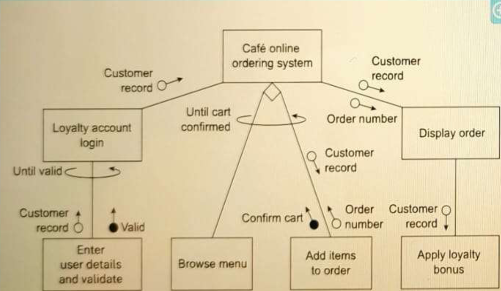
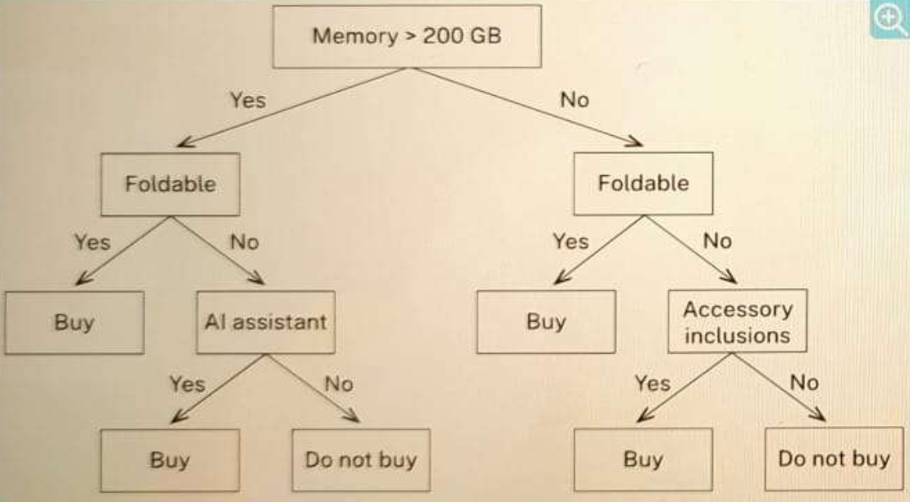
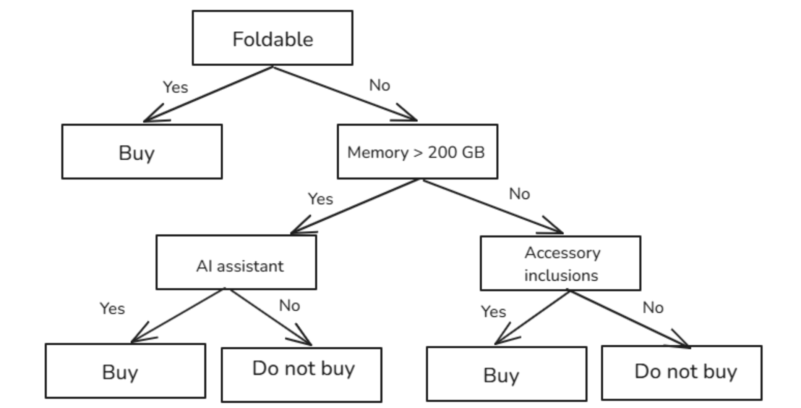
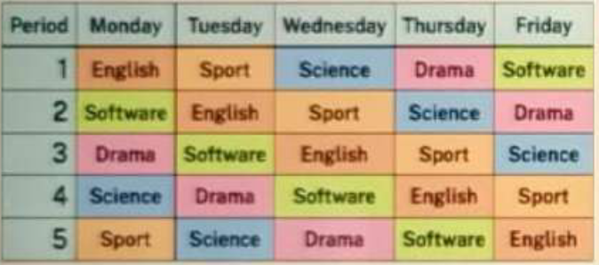
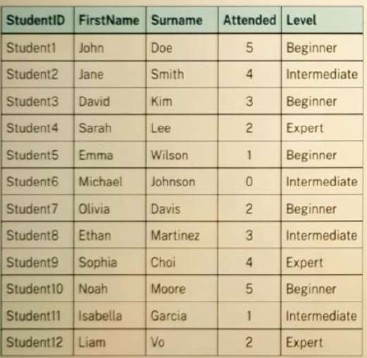
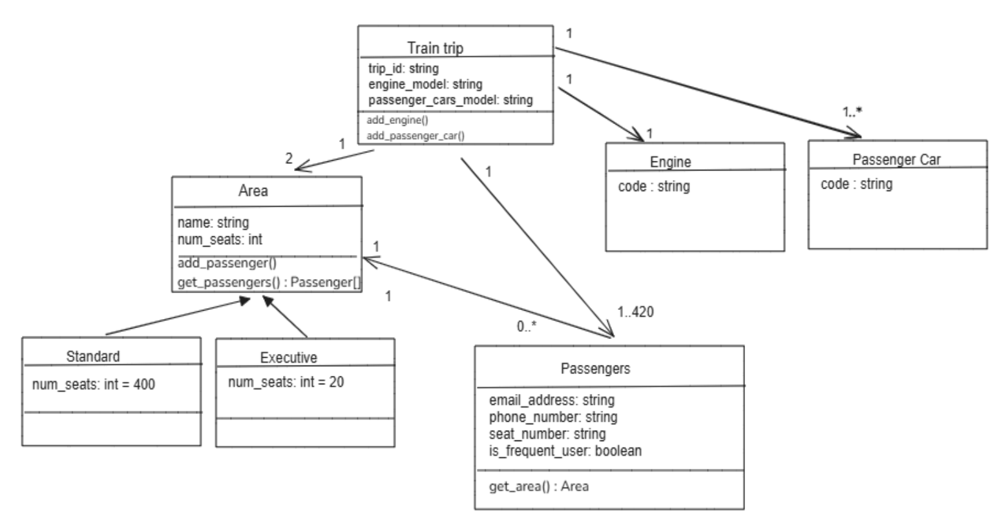
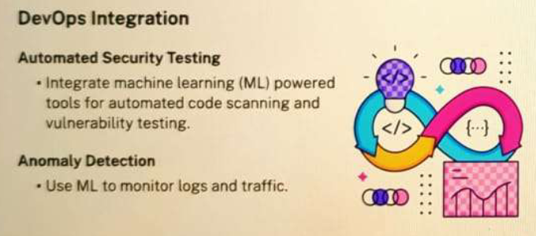
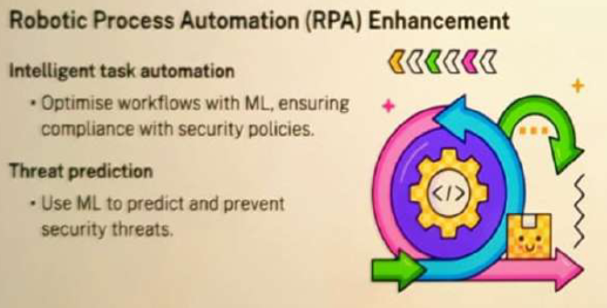
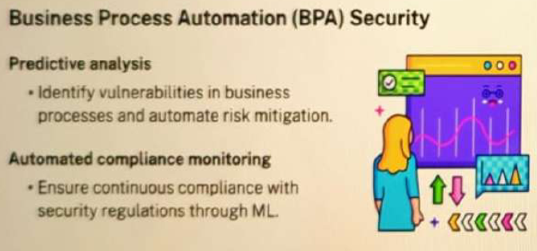

# NESA HSC Sample Exam

- Syllabus: Software Engineering · Publisher: –
- Status: private
- **Score: – / 80** · answered 0/32 parts · marked 0/32
- Review page: -

---

## 1. HSC SE 2025, Q1, Requirements Definition

#### Question 1 — –/1 marks  `MULTI_CHOICE`

Which of the following should take place during the requirements definition step when developing a software solution?

- **A.** Identifying algorithms to be used
- **B.** Documenting security vulnerabilities
- **C.** Identifying potential security threats in the software
- **D.** Documenting the needs and constraints of the software  ✅ *correct*

**Your answer:** (none) · **Correct:** D

---

## 2. HSC SE 2025, Q2, SMTP Protocol

#### Question 2 — –/1 marks  `MULTI_CHOICE`

Which of the following best describes SMTP?

- **A.** A protocol for email transmission  ✅ *correct*
- **B.** A set of rules to securely transfer files across a network
- **C.** A set of rules for securing communication between computers
- **D.** A protocol used for synchronising communication across networks

**Your answer:** (none) · **Correct:** A

---

## 3. HSC SE 2025, Q3, Client Data Security

**Stimulus:**

A company conducts all of its consultations with its clients via its website.

#### Question 3 — –/1 marks  `MULTI_CHOICE`

Which of the following is the best way for the company to maintain the security of its clients' data?

- **A.** Implement data encryption  ✅ *correct*
- **B.** Ensure that the software is user-friendly
- **C.** Focus on software that incorporates metadata
- **D.** Use software that allows for easy data integration with other platforms

**Your answer:** (none) · **Correct:** A

---

## 4. HSC SE 2025, Q4, Collaboration Benefits

#### Question 4 — –/1 marks  `MULTI_CHOICE`

Which of the following are benefits of collaborating with others when developing software solutions? (More than one may be selected.)

- **A.** Privacy is improved.
- **B.** Security of data is increased.
- **C.** Intellectual property is protected.
- **D.** Different points of view can be considered.  ✅ *correct*
- **E.** Tasks can be delegated to those with expertise.  ✅ *correct*

**Your answer:** (none) · **Correct:** D, E

---

## 5. HSC SE 2025, Q5, System Implementation Methods

#### Question 5 — –/1 marks  `OBJECTIVE_RESPONSE`

New systems can be implemented in a number of different ways. Match the implementation methods to their characteristics by selecting the corresponding option in each row.

| Statement | Correct | Yours | |
|---|---|---|---|
| The new system runs immediately with no delay. | Direct | – |  |
| The new system gradually replaces the old system. | Phased | – |  |
| The new system and the old system run at the same time. | Parallel | – |  |
| The new system is trialled with a small group of users and then implemented entirely when ready. | Pilot | – |  |

---

## 6. HSC SE 2025, Q6, Framework Selection

**Stimulus:**

A company is creating a new online application.

#### Question 6 — –/1 marks  `MULTI_CHOICE`

Which of the following is the least important consideration when choosing an open-source front-end web framework for the new application?

- **A.** Popularity of the framework on social media  ✅ *correct*
- **B.** Quality of existing framework documentation
- **C.** Knowledge of the framework within the company's development team
- **D.** Compatibility of the framework with the company's existing technology

**Your answer:** (none) · **Correct:** A

---

## 7. HSC SE 2025, Q7, Python to Pseudocode

**Stimulus:**

Consider the following Python code.

```
for index in range(n):
    print(index)
```

#### Question 7 — –/1 marks  `MULTI_CHOICE`

Select the correct option to complete the equivalent pseudocode.

```
FOR index = ...
    DISPLAY index
NEXT index
```

- **A.** 1 TO n
- **B.** 0 TO n-1  ✅ *correct*
- **C.** 1 TO n-1
- **D.** 0 TO n

**Your answer:** (none) · **Correct:** B

---

## 8. HSC SE 2025, Q8, SAST vs DAST

**Stimulus:**

The strategies listed below can be used to test the security of a web application that contains a database.

#### Question 8 — –/2 marks  `OBJECTIVE_RESPONSE`

Classify each strategy as EITHER static application security testing (SAST) OR dynamic application security testing (DAST).

| Statement | Correct | Yours | |
|---|---|---|---|
| Simulate attacks on the web application | Dynamic Application Security Testing (DAST) | – |  |
| Check the way SQL queries are constructed | Static Application Security Testing (SAST) | – |  |
| Test the database's web interface for vulnerabilities | Dynamic Application Security Testing (DAST) | – |  |
| Test the web application used to interact with the database when it is running | Dynamic Application Security Testing (DAST) | – |  |
| Analyse the code for connecting to the database to identify security vulnerabilities | Static Application Security Testing (SAST) | – |  |

---

## 9. HSC SE 2025, Q9, Algorithm Ordering

**Stimulus:**

Place the following steps of a number guessing game algorithm in the correct order by dragging the steps into position.

BEGIN GuessingGame

Set guess = -1

...

END GuessingGame

#### Question 9 — –/2 marks  `SORTING_TABLE`

**Your answer:**

_(not answered)_

**Sample answer:**

-   Set number = random integer between 0 and 100
-   WHILE guess <> number
-   Display "Guess a number between 0 and 100:"
-   Get guess
-   ENDWHILE
-   Display "Well Done"

---

## 10. HSC SE 2025, Q10, Structure Chart Analysis

**Stimulus:**

This structure chart describes an online ordering system for a café.



#### Question 10 — –/2 marks  `MULTI_CHOICE`

Which of the following statements are TRUE about this structure chart? (More than one may be selected.)

- **A.** Confirm cart is Boolean.  ✅ *correct*
- **B.** Order number is a control variable.
- **C.** A valid loyalty account is not required for online ordering.
- **D.** The order cannot be displayed until the cart is confirmed.  ✅ *correct*
- **E.** A choice is repeatedly offered between Browse menu and Add items to order.  ✅ *correct*

**Your answer:** (none) · **Correct:** A, D, E

---

## 11. HSC SE 2025, Q11, Algorithm Testing

**Stimulus:**

Consider the following algorithm.

```
BEGIN responsiveScreen
  Get ScreenSize
  IF ScreenSize >= 1024 THEN
    Viewport = 'Desktop'
  ELSEIF ScreenSize >= 768 THEN
    Viewport = 'Tablet'
  ELSE
    Viewport = 'Phone'
  ENDIF
  Display "Display set to ", Viewport
END responsiveScreen
```

#### Question 11 — –/3 marks  `SHORT`

Provide a set of 5 test data that will thoroughly test the algorithm. Include the expected outputs and reasons for inclusion. You may assume that all input data are valid. Please format your answer like a table.

**Your answer:**

_(not answered)_

**Marking criteria:**
- [3] • Provides a set of test data that will thoroughly test the algorithm
• Includes expected outputs and reasons for inclusion
- [2] • Provides a set of test data that tests most of the boundaries and paths
• Includes the relevant expected outputs and reasons for inclusion
- [1] • Provides some relevant information

**Sample answer:**

| Test data (ScreenSize) | Expected output (Viewport) | Reason for inclusion |
|---|---|---|
| 1024 | Desktop | Boundary check |
| 768 | Tablet | Boundary check |
| 100 | Phone | Below lowest screen size check |
| 850 | Tablet | Between Tablet and Desktop |
| 2000 | Desktop | Above highest screen size check |

---

## 12. HSC SE 2025, Q12, Web Development

#### Question 12 (a) — –/3 marks  `SHORT`

Explain how a web developer could test a website for cross-platform compatibility.

**Your answer:**

_(not answered)_

**Marking criteria:**
- [3] Explains how a developer could test a website for cross-platform compatibility
- [2] Outlines how to test a website for cross-platform compatibility
OR
Identifies strategies to test a website for cross-platform compatibility
- [1] Provides some relevant information

**Sample answer:**

A web developer can use browser developer tools. These tools, built into most modern browsers, allow developers to simulate how their website looks and behaves on different devices and screen sizes. By using these tools, developers can identify and fix any issues related to cross-platform compatibility, ensuring that the website works well across a variety of devices and browsers.

  

**Answers could include:**

-   The use of online tools built specifically for testing cross-platform compatibility
-   Conducting manual testing on different devices and browsers can help identify any remaining issues
-   The developer could validate the website's code using the W3C Markup Validation Service to ensure it meets the web standards.

#### Question 12 (b) — –/3 marks  `SHORT`

Explain how the load time of a web page can be improved using a progressive web app (PWA).

**Your answer:**

_(not answered)_

**Marking criteria:**
- [3] Explains how the load time of a web page can be improved using a progressive web app (PWA)
- [2] Outlines some features of a progressive web app (PWA)
and/or
issues affecting load time
- [1] Provides some relevant information

**Sample answer:**

A progressive web app (PWA) can improve load times by pre-caching important resources, allowing files such as image-gallery.js and video-gallery.js to be loaded into memory or cache while the rest of the page loads. PWAs also use service workers to cache resources, ensuring faster load times on repeat visits and offline functionality. Background synchronisation and background fetching can update content in the background, so users see the latest information without slowing down the initial load.

---

## 13. HSC SE 2025, Q13, Data Transfer Protocols

#### Question 13 — –/3 marks  `SHORT`

Describe the function of protocols in the transfer of data. In your answer, refer to a specific web protocol.

**Your answer:**

_(not answered)_

**Marking criteria:**
- [3] Describes the function of protocols in the transfer of data, with reference to a specific web protocol
- [2] Describes the function of protocols in the transfer of data
OR
Provides an example of a web protocol and its use
- [1] Provides some relevant information

**Sample answer:**

Protocols are important in data transfer as they establish rules for communication between devices connected to a network, such as the internet. HTTP (Hypertext Transfer Protocol) enables browsers to request web content from servers, which respond with the requested data. The protocol defines the structure of requests and the response so that data transfer can occur.

  

**Answers could include:**

-   TCP/IP
-   DNS
-   FTP, SFTP
-   SSL, TLS
-   SMTP, POP 3, IMAP
-   Data packets.

---

## 14. HSC SE 2025, Q14, Pseudocode Algorithm

**Stimulus:**

PseudoPizza creates and sells custom-designed pizzas.

The price of a small pizza is $10. The following costs are added, depending on the size of the pizza base and the number of toppings chosen.

-   Medium size: $2
-   Large size: $4
-   Each topping: $1.50

An algorithm is needed to calculate the cost of pizzas ordered for a customer. The algorithm should calculate and display the cost of each pizza and the total cost of the order.

#### Question 14 — –/3 marks  `PSEUDOCODE`

Write the algorithm using pseudocode. Include at least one subroutine in your answer. You may assume that all inputs are valid.

**Your answer:**

_(not answered)_

**Marking criteria:**
- [3] Provides substantially correct pseudocode
Includes at least ONE subroutine
- [2] Provides pseudocode that addresses some of the requirements
- [1] Shows some understanding of the problem

**Sample answer:**

```
BEGIN main
  Get num_pizzas
  total_cost = 0
  FOR i = 1 TO num_pizzas
    Get pizza_size
    Get num_toppings
    cost_per_pizza = calculate_pizza_cost(pizza_size, num_toppings)
    DISPLAY cost_per_pizza
    total_cost = total_cost + cost_per_pizza
  NEXT i
  DISPLAY total_cost
END main

BEGIN calculate_pizza_cost(size, num_toppings)
  base_price = 10
  topping_price = 1.5
  IF size = "Medium" THEN
    base_price = base_price + 2
  ELSEIF size = "Large" THEN
    base_price = base_price + 4
  ENDIF
  pizza_cost = base_price + num_toppings * topping_price
  RETURN pizza_cost
END calculate_pizza_cost
```

---

## 15. HSC SE 2025, Q15, Machine Learning in Data Analysis

#### Question 15 — –/3 marks  `SHORT`

Describe how machine learning algorithms can be used in data analysis.

**Your answer:**

_(not answered)_

**Marking criteria:**
- [3] Describes how machine learning algorithms can be used in data analysis
- [2] Outlines some features of machine learning algorithms relevant to data analysis
- [1] Provides some relevant information

**Sample answer:**

Machine learning algorithms can be trained with a subset of the data to automatically identify patterns and trends within large datasets. The algorithms can handle complex relationships and nonlinearities present in the data allowing for efficient and comprehensive analysis. Machine learning can also be used for predictions and forecasting. These models can learn from new data over time, continuously improving their analysis and predictive accuracy and performance.

---

## 16. HSC SE 2025, Q16, CSS Debugging

**Stimulus:**

A developer added a cascading style sheet (CSS) to their company's website.

  

The developer had expected the HTML code to display Image 1, but Image 2 is being displayed.


**index.html**

```
<!DOCTYPE html>
<html lang="en">
<head>
  <title>Welcome to Software</title>
  <link rel="stylesheet" href="main.css">
</head>
<body>
  <h1>Software</h1>
  <p><span id="se_items">Software</span> includes code.</p>
</body>
</html>
```

  
**main.css**

```
body {
  font-family: Arial;
}
h1 {
  font-weight: bold;
  text-align: center;
}
#se_item {
  font-style: italic;
  font-weight: bold;
}
```

#### Question 16 (a) — –/1 marks  `MULTI_CHOICE`

Referring to the code, what is the cause of the problem?

- **A.** Font family is missing.
- **B.** Attribute of <p> has not been defined.
- **C.** main.css has not been correctly referenced.
- **D.** The id "se_item" has not been correctly referenced.  ✅ *correct*

**Your answer:** (none) · **Correct:** D

#### Question 16 (b) — –/2 marks  `SHORT`

Outline TWO benefits of adding CSS to the company's website.

**Your answer:**

_(not answered)_

**Marking criteria:**
- [2] Outlines TWO benefits of adding CSS to the company's website
- [1] Provides some relevant information

**Sample answer:**

It can provide the same look and feel across the company’s websites for consistency and ease of use. Separate html and CSS code can allow developers to work independently on files.

---

## 17. HSC SE 2025, Q17, SQL Query

**Stimulus:**

A shop uses an online database for recording its stock. The database contains a Products table and a Suppliers table. The prices are in dollars and the masses are in grams. The shop wants to identify all the products with a mass of at least 50 grams that are produced by Yumtreats.


#### Question 17 — –/3 marks  `SQL`

Write an SQL query to display the product names and supplier names, in descending order by product name.

Dataset:
```sql
CREATE TABLE Suppliers (SupplierID TEXT PRIMARY KEY, Name TEXT); CREATE TABLE Products (ProductID TEXT PRIMARY KEY, Name TEXT, Price REAL, Mass INTEGER, Producer TEXT, Quantity INTEGER, SupplierID TEXT, FOREIGN KEY(SupplierID) REFERENCES Suppliers(SupplierID)); INSERT INTO Suppliers VALUES ('SID001', 'The Lolly Pop'), ('SID002', 'Sugar Rush Hour'), ('SID003', 'Sweet Retreat'); INSERT INTO Products VALUES ('PID001', 'TruffleSway', 1.00, 30, 'Yumtreats', 100, 'SID001'), ('PID002', 'PeanutPop', 1.00, 35, 'Yumtreats', 500, 'SID002'), ('PID003', 'Carameluxe', 2.20, 50, 'Yumtreats', 100, 'SID003'), ('PID004', 'BerryBlend', 1.25, 50, 'Yumtreats', 8, 'SID001'), ('PID005', 'Chocolate Cascade', 1.25, 52, 'Yumtreats', 50, 'SID002'), ('PID006', 'Hazelnut Symphony', 2.50, 50, 'Sugaryum', 0, 'SID003'), ('PID007', 'Caramel Delight', 2.50, 40, 'Treatopia', 20, 'SID002'), ('PID008', 'ChocoGlow', 2.50, 55, 'Treatopia', 95, 'SID002');
```

**Your answer:**

_(not answered)_

**Marking criteria:**
- [3] Provides a correct SQL query
- [2] Provides a SQL query that addresses some of the requirements
- [1] Shows some understanding of SQL

**Sample answer:**

```
SELECT Products.Name AS 'Product', Suppliers.Name AS 'Supplier'
FROM Products, Suppliers
WHERE Products.SupplierID = Suppliers.SupplierID
AND Products.Producer = 'Yumtreats'
AND Products.Mass >= 50
ORDER BY Products.Name DESC
```

---

## 18. HSC SE 2025, Q18, Input Validation

**Stimulus:**

An online site requires its users to create accounts. Each username must satisfy the following rules:

1.  It must be at least 8 characters long.
2.  It must start with an uppercase letter.
3.  The second last character must be a lowercase letter.
4.  The last character must be numeric.

An example of a valid username is NESA24s3.

#### Question 18 (a) — –/3 marks  `SHORT`

Explain how defensive data input handling practices can be implemented for this website.

**Your answer:**

_(not answered)_

**Marking criteria:**
- [3] Explains how defensive data input handling practices can be implemented for the website
- [2] Outlines some features of data input handling practices
- [1] Provides some relevant information

**Sample answer:**

Data sanitisation using client-side scripting can clean the data and remove dangerous input. Input validation on the client-side can check that entered data meets all of the requirements before getting processed by the server. Errors generated by data not meeting rules can be shown to the user.

#### Question 18 (b) — –/3 marks  `CODING`

Write a function with Python that will check whether a username satisfies the rules.

Starter code (PYTHON):
```
# Write your code here
```

**Your answer:**

_(not answered)_

**Marking criteria:**
- [3] Provides a correct function in Python to check whether a username satisfies the rules
- [2] Provides a partially correct function in Python to check the username
- [1] Shows some understanding of the problem and Python programming

**Sample answer:**

```
def validate_username(username):
  valid = True
  # length check
  if len(username) < 8:
    valid = False
  elif (not username[0].isupper()):
    valid = False
  elif (not username[-2].islower()):
    valid = False
  elif (not username[-1].isdigit()):
    valid = False
  return valid
```

---

## 19. HSC SE 2025, Q19, Authentication and Authorisation

**Stimulus:**

An app is being developed for use in a school. It will allow teachers to upload and assign work, and track student homework. Students can download work and upload their completed responses for marking.

#### Question 19 — –/4 marks  `SHORT`

Explain how authentication and authorisation could be applied to this app.

**Your answer:**

_(not answered)_

**Marking criteria:**
- [4] Explains how authentication and authorisation could be applied to the app
- [3] Explains how authentication or authorisation could be applied to the app
OROutlines how authentication and authorisation could be applied to the app
- [2] Outlines some features of authentication and/or authorisation
- [1] Provides some relevant information

**Sample answer:**

Authentication ensures that only staff and students with valid usernames and passwords, which should be encrypted in storage (eg using hashing), can access the app. Authorisation controls access to specific features of the app based on user roles or groups. Teachers may have permissions to upload, assign and track homework, while students can only download tasks and upload completed work. By organising users into specific roles or groups, the app restricts access to appropriate functionality, ensuring that each user can only perform actions relevant to their role or group.

---

## 20. HSC SE 2025, Q20, Decision Tree

**Stimulus:**

Consider the following decision tree of a trained machine learning model that determines whether to purchase a mobile phone.



#### Question 20 (a) — –/1 marks  `OBJECTIVE_RESPONSE`

Using the decision tree, determine the outcome of each of the following situations.

| Statement | Correct | Yours | |
|---|---|---|---|
| Memory = 256 GB, AI Assistant = Yes, Accessory inclusions = No | Buy | – |  |
| Memory = 128 GB, AI Assistant = No, Accessory inclusions = Yes | Buy | – |  |
| Foldable = Yes, AI Assistant = No, Accessory inclusions = No | Buy | – |  |

#### Question 20 (b) — –/3 marks  `DRAWING_V2`

The decision tree can be simplified without compromising its logic. Redraw the decision tree to reduce the number of branches.

**Your answer:**

_(not answered)_

**Marking criteria:**
- [3] Draws a correctly simplified decision tree
- [2] Draws a simplified decision tree with most of the logic
- [1] Shows some understanding of the requirement

**Sample answer:**



---

## 21. HSC SE 2025, Q21, 2D Arrays and Python

**Stimulus:**

At a school, each student studies five subjects. The school timetable has five periods each day, and each period is allocated to a different subject. The subjects shift to a different period each day so that each subject will appear in all five periods during the week. An example of a student timetable is shown below.



#### Question 21 (a) — –/1 marks  `MULTI_CHOICE`

If the timetable is stored as a 2D array, what is the correct Python snippet for accessing the subject that is on Monday Period 3?

- **A.** timetable[2][0]
- **B.** timetable[0][2]  ✅ *correct*
- **C.** timetable[3][1]
- **D.** timetable[1][3]

**Your answer:** (none) · **Correct:** B

#### Question 21 (b) — –/5 marks  `CODING`

In this example, the student studies English, Software, Drama, Science and Sport. From Monday to Friday, English is held in Period 1, Period 2, Period 3, Period 4 and Period 5. Software is held in Period 2, Period 3, Period 4, Period 5 and then Period 1. A similar pattern can be observed for the other subjects.

You are required to write a Python program to print out the timetable in the following format:

  

Monday  
  Period 1: English  
  Period 2: Software  
  Period 3: Drama  
  Period 4: Science  
  Period 5: Sport  
and so on...

  

Start your program with `subjects = ["English", "Software", "Drama", "Science", "Sport"]`

Different students may study different subjects.

The program will be used by different students to print out their timetable by changing the subjects listed in the first line of code.

Starter code (PYTHON):
```
subjects = ["English", "Software", "Drama", "Science", "Sport"]

# Write your Python program using subroutines.
```

**Your answer:**

_(not answered)_

**Marking criteria:**
- [5] Provides a substantially correct Python program that addresses the following requirements:Places each subject in the correct periodDisplays all 5 days of the timetableProvides a solution with appropriate subroutinesProgrammatically builds the timetable
- [4] Provides a Python program that addresses most of the requirements
- [3] Provides Python code that addresses some of the requirements
- [2] Provides Python code that addresses a requirement
- [1] Shows some understanding of the problem

**Sample answer:**

```
subjects = ["English", "Software", "Drama", "Science", "Art"]
NUM_DAYS = 5
NUM_PERIODS = 5
DAYS_OF_WEEK = ["Monday", "Tuesday", "Wednesday", "Thursday",
"Friday"]

def create_timetable(subjects):
  timetable = []
  for day in range(NUM_DAYS):
    periods = []
    for period in range(NUM_PERIODS):
      periods.append(subjects[(period - day) % NUM_PERIODS])
    timetable.append(periods)
  return timetable

def print_timetable(timetable):
  print()
  for day in range(NUM_DAYS):
    print(f"{DAYS_OF_WEEK[day]}")
    for period in range(NUM_PERIODS):
      print(f"\tPeriod {period+1}: {timetable[day][period]}")
  print()

timetable = create_timetable(subjects)
print_timetable(timetable)
```

---

## 22. HSC SE 2025, Q22, SQL and Race Conditions

**Stimulus:**

An online relational database is used to keep track of students at a coding club. The contents of the Students table are shown.



#### Question 22 (a) — –/2 marks  `SQL`

Write an SQL query to generate the number of students at each level.

Dataset:
```sql
CREATE TABLE Students (StudentID TEXT, FirstName TEXT, Surname TEXT, Attended INTEGER, Level TEXT); INSERT INTO Students VALUES ('Student1', 'John', 'Doe', 5, 'Beginner'), ('Student2', 'Jane', 'Smith', 4, 'Intermediate'), ('Student3', 'David', 'Kim', 3, 'Beginner'), ('Student4', 'Sarah', 'Lee', 2, 'Expert'), ('Student5', 'Emma', 'Wilson', 1, 'Beginner'), ('Student6', 'Michael', 'Johnson', 0, 'Intermediate'), ('Student7', 'Olivia', 'Davis', 2, 'Beginner'), ('Student8', 'Ethan', 'Martinez', 3, 'Intermediate'), ('Student9', 'Sophia', 'Choi', 4, 'Expert'), ('Student10', 'Noah', 'Moore', 5, 'Beginner'), ('Student11', 'Isabella', 'Garcia', 1, 'Intermediate'), ('Student12', 'Liam', 'Vo', 2, 'Expert');
```

**Your answer:**

_(not answered)_

**Marking criteria:**
- [2] Correctly completes the SQL query
- [1] Correctly completes part of the SQL query

**Sample answer:**

```
SELECT Level, COUNT(Level)
FROM Students
GROUP BY Level
```

#### Question 22 (b) — –/3 marks  `SHORT`

Race conditions have been identified as a potential issue for this database. Provide an example of when a race condition may occur in this scenario and outline how secure code could be implemented to prevent it.

**Your answer:**

_(not answered)_

**Marking criteria:**
- [3] Provides an example of when a race condition may occur in this scenarioOutlines how secure code could be implemented to prevent it
- [2] Outlines some features of race conditions
- [1] Provides some relevant information

**Sample answer:**

With multiple teachers potentially accessing the database at the same time, race conditions can allow malicious users to gain unauthorised access. Authentication could be used to restrict access to the database, and code can be written to use atomic transactions and database locks to time the reading and writing of data.

---

## 23. HSC SE 2025, Q23, Machine Learning Concepts

#### Question 23 (a) — –/3 marks  `SHORT`

How can the effects of human bias be minimised when training machine learning algorithms?

**Your answer:**

_(not answered)_

**Marking criteria:**
- [3] Shows thorough understanding of how the effects of human bias on the training of machine learning algorithms can be minimised
- [2] Outlines some effects of human bias on machine learning
OROutlines some features of the training of machine learning algorithms
- [1] Provides some relevant information

**Sample answer:**

Training data is initially selected by humans, who may unintentionally introduce their own biases. To minimise this, ensure that training data is representative of the problem the ML model will address. Reviewing data by individuals from diverse backgrounds could identify and reduce potential biases, ensuring fairer and accurate model performance.

#### Question 23 (b) — –/3 marks  `SHORT`

Compare linear regression and K-nearest neighbour.

**Your answer:**

_(not answered)_

**Marking criteria:**
- [3] Compares linear regression and K-nearest neighbour
- [2] Outlines features of linear regression and/or K-nearest neighbour
- [1] Provides some relevant information

**Sample answer:**

Linear regression and K-nearest neighbours (KNN) are both supervised learning algorithms that make predictions from labelled data. The key difference is how they handle data: linear regression assumes a linear relationship between input features and the target variable, while KNN makes predictions based on the closest ‘K’ training examples, allowing it to handle more complex, non-linear patterns. However, KNN can be more computationally expensive than linear regression and is usually slower.

---

## 24. HSC SE 2025, Q24, Class Diagram

**Stimulus:**

A train company wants a class diagram that models the relationship between long-distance train trips and passengers.  
  
**The long-distance train has:**

-   a unique trip identifier (eg AL456)
-   a model code for the train engine (eg E67) and a model code (eg P9754) for each of the passenger cars
-   two different areas ('Standard' and 'Executive'). The Executive area has 20 seats and there are 400 seats in the Standard area.

**Each passenger:**

-   has contact details including an email address and phone number
-   purchases a 'Standard' or 'Executive' ticket and is given a seat number (eg 25D)
-   may be a frequent traveller.

#### Question 24 — –/4 marks  `DRAWING_V2`

Create a class diagram for the train company.

**Your answer:**

_(not answered)_

**Marking criteria:**
- [4] Creates a substantially correct class diagram that includes suitable classes with attributes, and methods showing inheritance, relationships and multiplicity
- [3] Creates a class diagram that represents most features of the system
- [2] Creates a class diagram with some features of the system
- [1] Provides a diagram that shows some understanding of the scenario

**Sample answer:**



---

## 25. HSC SE 2025, Q25, Security Enhancements

**Stimulus:**

A telecommunications company had a recent security breach which prompted a review to improve the security of its systems. It has contracted QuidantCon to propose security enhancements to its systems. Please review QuidantCon's Proposal in the slider below.







#### Question 25 — –/8 marks  `SHORT`

Discuss QuidantCon's proposal for security enhancements to the company's systems.

**Your answer:**

_(not answered)_

**Marking criteria:**
- [8] Discusses the proposal for security enhancements to the company’s systems, with reference to machine learning (ML) in DevOps, robotic process automation (RPA) and business process automation (BPA) from the slideshow
- [6–7] Outlines advantages and disadvantages of the proposal, with reference to at least TWO of these areas: machine learning (ML) in DevOps, robotic process automation (RPA), business process automation (BPA)
- [4–5] Outlines some advantages and/or disadvantages of the proposal, with reference to machine learning (ML) in DevOps and/or robotic process automation (RPA) and/or business process automation (BPA)
- [2–3] Shows some understanding of the features of the proposal
- [1] Provides some relevant information

**Sample answer:**

QuidantCon's proposal for the company suggests leveraging machine learning (ML) and automation to bolster security measures. One key benefit is the automation of security testing and vulnerability scanning, facilitated by integrating ML-powered tools into the DevOps pipeline. This approach ensures continuous security testing and provides rapid feedback to developers, allowing for early detection of security issues and reducing the risk of vulnerabilities being exploited. The frequent and automated testing improves the overall security position and enhances compliance with industry standards. Additionally, ML algorithms can analyse vast amounts of data to detect patterns and anomalies, which is crucial for proactive threat identification. This capability enables the company to identify security risks proactively, learn from past incidents, and predict future attacks, thereby enhancing their overall security measures.

QuidantCon's proposal for the company also raises some concerns. One key issue is the need for high-quality data for ML algorithms to work effectively. If the data is inconsistent or incomplete, the ML models may not perform well, leading to false positives or missed threats. Another concern is the complexity of implementing ML solutions, which can be challenging and may require specialised skills and training. This complexity could result in integration challenges, higher costs, and delays. Additionally, ML systems can be biased, potentially affecting security decisions. Security and privacy are also critical, as handling sensitive data requires protection against unauthorised access and breaches. These concerns emphasise the need for a careful and balanced approach when considering ML and automation in security practices.

  

**Answers could include:**

-   Automation of security testing and vulnerability scanning:
    -   Automation of security testing including the use software tools to automatically test the security of an application or system
    -   Conducting scans for vulnerabilities, misconfigurations, and potential threats
    -   Automation helps in detecting security issues early in the development lifecycle, reducing the risk of vulnerabilities being exploited
    -   Automation also enables more frequent testing, improving overall security posture and compliance with security standards
    -   Integration of automation into the DevOps pipeline, allowing for continuous security testing and rapid feedback to developers.
-   Use of machine learning powered tools to enhance security practices:
    -   Machine learning helps in identifying security risks by analysing vast amounts of data to detect patterns and anomalies that may indicate a potential threat
    -   Machine learning algorithms can learn from past security incidents and use this knowledge to predict and prevent future attacks
    -   Machine learning can automate the analysis of security logs and events, providing real time insights
    -   Machine learning can assist in automating incident response in RPA, enabling faster and more effective mitigation of security risks.
-   Safe and efficient operation of Robotic Process Automation (RPA) bots:
    -   Machine learning algorithms for real-time detection and response to security threats
    -   Machine learning algorithms can continuously monitor RPA bot behaviour to detect any anomalies or deviations from normal operation
    -   By analysing data on bot performance and interactions, machine learning can identify potential security threats or operational issues
    -   Machine learning can optimise the performance of RPA bots by identifying areas for improvement and suggesting enhancements.
-   Protection of Business Process Automation workflows from cyber threats
    -   Machine learning algorithms can analyse BPA workflows to identify potential vulnerabilities
    -   By continuously monitoring BPA processes, machine learning can detect and respond to cyber threats in real-time
    -   Machine learning can automate the implementation of security controls and policies
    -   Machine learning can enhance BPA workflows by predicting and preventing potential security breaches.
-   Additional benefits of machine learning in security:
    -   Improved efficiency and accuracy in detecting security threats
    -   Enhanced ability to respond to security incidents in real-time
    -   Ensuring security and compliance while automating business processes.
-   Disadvantages of ML in Security:
    -   Complexity and learning curve
    -   Dependency on data quality
    -   Potential for bias
    -   Security and privacy concerns
    -   Integration challenges
    -   Cost considerations.
