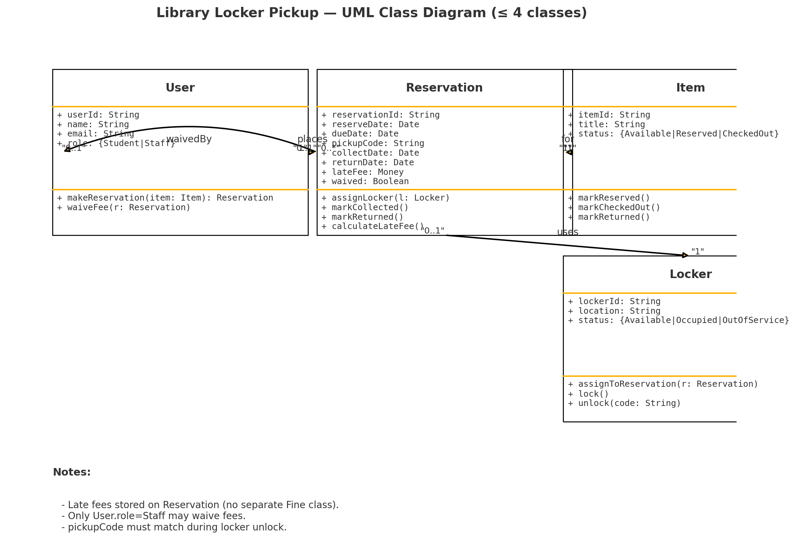
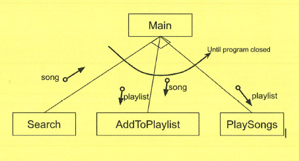
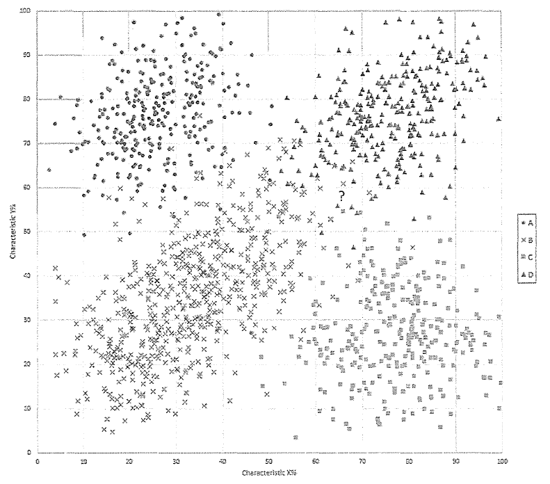
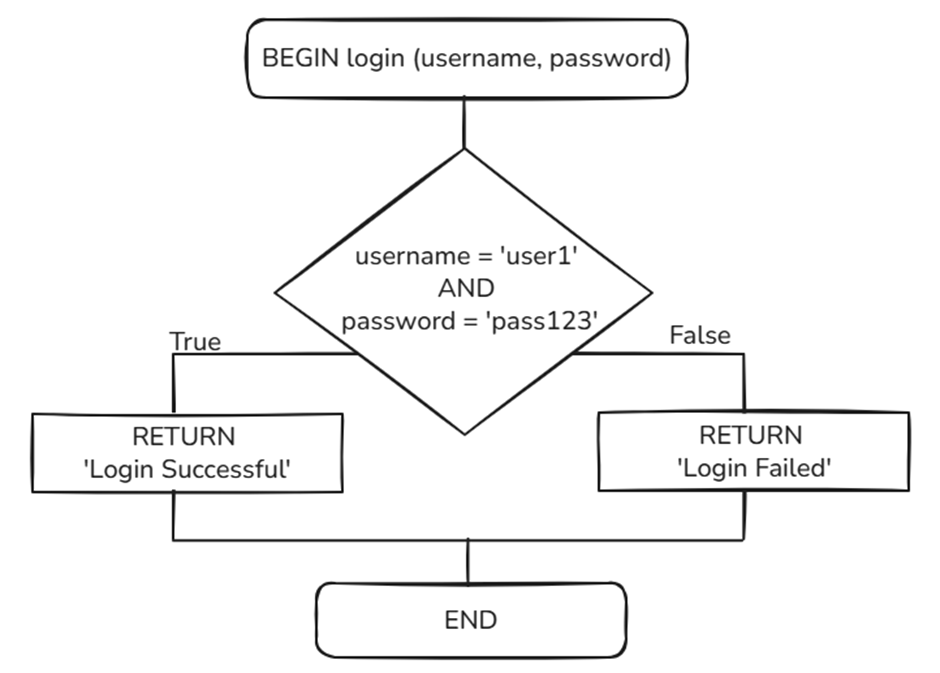
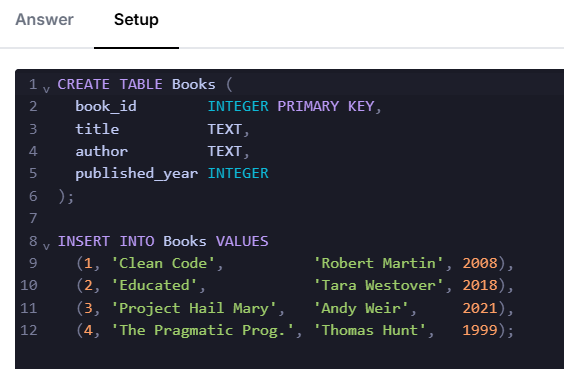

# Normanhurst Trial

- Syllabus: Software Engineering · Publisher: –
- Status: private
- **Score: – / 80** · answered 0/29 parts · marked 0/29
- Review page: -

---

## 1. SE: Selection - Project phases

#### Question 1 — –/3 marks  `OBJECTIVE_RESPONSE`

Match each task with the correct software project phase.

| Statement | Correct | Yours | |
|---|---|---|---|
| Analyse requirements | Identifying and defining | – |  |
| Choose lifecycle model | Research and planning | – |  |
| Investigate tools & brainstorm | Research and planning | – |  |
| Optimise compiled code | Producing and implementing | – |  |
| Research social / ethical issues | Research and planning | – |  |
| Write source code | Producing and implementing | – |  |
| Compare expected vs actual output | Testing and evaluating | – |  |
| Draft algorithms & documentation | Producing and implementing | – |  |

**Marking criteria:**
- [3] 7-8 correct
- [2] 4-6 correct
- [1] 1-3 correct

---

## 2. SE: MC - Regression Model

#### Question 2 — –/1 marks  `MULTI_CHOICE`

A real estate agency wants to build a model to predict whether a house is likely to be sold  
within 60 days based on features such as its price, location score, number of bedrooms, and  
age. Based on the scenario above, which regression model is most appropriate, and why?

- **A.** Linear regression, because it can handle multiple input features and will predict the number of days it takes to sell the house.
- **B.** Polynomial regression, because housing data often involves curved relationships between price and location.
- **C.** Logistic regression, because the goal is to classify whether a house will be sold within a specific time frame.  ✅ *correct*
- **D.** Polynomial regression, because the number of bedrooms and age of the house are discrete variables requiring non-linear models.

**Your answer:** (none) · **Correct:** C

---

## 3. SE: MC - Implementation Method

#### Question 3 — –/1 marks  `MULTI_CHOICE`

A new payroll system is first switched on for only the HR department, then gradually for other departments once stability is confirmed. Which implementation strategy is this?

- **A.** Direct
- **B.** Phased  ✅ *correct*
- **C.** Parallel
- **D.** Pilot

**Your answer:** (none) · **Correct:** B

---

## 4. SE: MC - Email Protocols

#### Question 4 — –/1 marks  `MULTI_CHOICE`

An email client downloads messages from a mail server while leaving copies on the server. Which protocol is used for this purpose?

- **A.** SMTP
- **B.** IMAP
- **C.** FTP
- **D.** POP3  ✅ *correct*

**Your answer:** (none) · **Correct:** D

---

## 5. SE: MCM - Sandboxing

#### Question 5 — –/4 marks  `MULTI_CHOICE`

What are the benefits of using sandboxing in software development or deployment?

{Multiple items may be selected).

- **A.** Replaces the need for authentication by isolating users
- **B.** Isolates untrusted code  ✅ *correct*
- **C.** Enables controlled testing  ✅ *correct*
- **D.** Reduces the need for secure coding practices in application development
- **E.** Reduces the risk of security vulnerabilities affecting other parts of the system  ✅ *correct*
- **F.** Improves execution speed by isolating software from operating system processes
- **G.** Protects live data during development and training  ✅ *correct*

**Your answer:** (none) · **Correct:** B, C, E, G

---

## 6. SE: MC - Automation Social

#### Question 6 — –/1 marks  `MULTI_CHOICE`

What is the most effective approach to ensuring that automation benefits society as a  
whole?

- **A.** Allow market forces to guide the adoption of automation, trusting that economic growth will naturally lead to broader societal benefits.
- **B.** Prioritise technological advancement and productivity gains, with social concerns addressed only after implementation.
- **C.** Encourage collaboration between policymakers, educators, and businesses to promote inclusivity, skill development, and sustainability.  ✅ *correct*
- **D.** Limit the use of automation to industries with low employment rates.

**Your answer:** (none) · **Correct:** C

---

## 7. SE:MC - Type of Attack

#### Question 7 — –/1 marks  `MULTI_CHOICE`

A user logs into their bank's website, which allows money transfers via a button. A hacker  
sends the user a malicious email containing a link. When the user clicks the link, a money  
transfer request is executed without their knowledge.

What type of attack is this?

- **A.** Cross-Site Request Forgery (CSRF)  ✅ *correct*
- **B.** Cross-Site Scripting (XSS)
- **C.** Denial of Service (DoS)
- **D.** SQL Injection

**Your answer:** (none) · **Correct:** A

---

## 8. SE: MCM - CSS

#### Question 8 — –/4 marks  `MULTI_CHOICE`

Consider the following CSS code.

  
body {  
    background-color: #00ff00;  
    color: #ff0000;  
    margin: 10px;  
    font-family: Aptos, bold;  
}  
h1 {  
    color: #000000;  
    text-align: left;  
}  
p {  
    font-size: 18px;  
}  
  
Which of the following is true for pages styled using the above CSS code?

{Multiple items may be selected).

- **A.** Paragraph text is displayed in white
- **B.** All heading text {h1, h2, etc.) will be black
- **C.** The color property in the body overrides the h1 text color
- **D.** Only the h1 heading text is left-aligned  ✅ *correct*
- **E.** The background of the page is green  ✅ *correct*
- **F.** All fonts will be bold if Aptos is not available  ✅ *correct*
- **G.** Body text is hard against the left side of the screen
- **H.** Text within <p> tags will be red  ✅ *correct*
- **I.** All text will be in a font size of 18 pixels

**Your answer:** (none) · **Correct:** D, E, F, H

---

## 9. SE: MC - Q11 DoE 2025

#### Question 9 — –/1 marks  `MULTI_CHOICE`


Which Machine Learning model is most appropriate for predicting new values based on the data given in the graph?

- **A.** Decision tree
- **B.** Polynomial regression  ✅ *correct*
- **C.** Linear regression
- **D.** K Nearest Neighbour

**Your answer:** (none) · **Correct:** B

---

## 10. SE: MC - Q10 DoE 2025

**Stimulus:**

There are many different algorithms available for encrypting data, each with different strengths and weaknesses.

#### Question 10 (a) — –/1 marks  `MULTI_CHOICE`

In which software development step would a software engineering team need to decide on the specific algorithm they will use?

- **A.** Requirements Definition
- **B.** Design  ✅ *correct*
- **C.** Development
- **D.** Integration

**Your answer:** (none) · **Correct:** B

#### Question 10 (b) — –/3 marks  `SHORT`

Hashing algorithms are used to create a unique representation of data. They have many uses in encryption and security.

Identify 3 essential features of a hashing algorithm.

**Your answer:**

_(not answered)_

---

## 11. SE: MC - Q2 DoE 2025

#### Question 11 — –/1 marks  `MULTI_CHOICE`

Which language is typically used for client-side programming?

- **A.** PHP
- **B.** Python
- **C.** JavaScript  ✅ *correct*
- **D.** SQL

**Your answer:** (none) · **Correct:** C

---

## 12. SE: MC - Q3 DoE 2025

#### Question 12 — –/1 marks  `MULTI_CHOICE`

A common machine learning model for unsupervised machine learning is:

- **A.** Logistic regression
- **B.** Linear regression
- **C.** Neural network
- **D.** K-Nearest Neighbour  ✅ *correct*

**Your answer:** (none) · **Correct:** D

---

## 13. SE: Class Diagram (4)

#### Question 13 — –/5 marks  `DRAWING_V2`

A school library lets students reserve items online and collect them from smart lockers. If an item is returned late, a late fee is recorded on the reservation. Staff can waive this fee. The system treats all people as Users with a role (Student or Staff).

Draw a class diagram using no more than four classes (use exactly these four):

-   User (represents both students and staff)
-   Item
-   Reservation
-   Locker

**Your answer:**

_(not answered)_

**Marking criteria:**
- [5] Develops a substantially correct class diagram with correct notation
- [4] Develops a mostly correct class diagrams with one significant omission or minor errors
- [3] Develops a class diagram with some logical inaccuracies or omissions in detail
- [2] Develops a partial class diagram
- [1] Demonstrates some understanding of a class diagram

**Sample answer:**



---

## 14. SE: Structure (4)

#### Question 14 — –/4 marks  `DRAWING_V2`

Consider the following algorithm below written for a music program.

BEGIN Main  
    REPEAT  
        GET choice  
        CASEWHERE choice is:  
            "Search": song = Search()  
            "Add to Playlist": AddToPlaylist(song, playlist)  
            "Play playlist": PlaySongs(playlist)  
        ENDCASE  
     UNTIL software is closed  
END Main

Draw a structure chart that represents the music program.

**Your answer:**

_(not answered)_

**Marking criteria:**
- [4] Provides a structure chart that correctly addresses:

The hierarchy of modules
Repetition
Choice between modules
Parameters passed
- [3] Provides a structure chart that addresses THREE of the requirements
- [2] Provides a structure chart that addresses TWO of the requirements
- [1] Provides a structure chart that addresses ONE of the requirements

**Sample answer:**



---

## 15. SE: DFD0 (3)

#### Question 15 — –/3 marks  `DRAWING_V2`

A high school canteen app lets students pre-order lunch, pay digitally, and pick up via QR code. The system integrates with a payment gateway and a menu/inventory database.

  
Draw a Level 0 data flow diagram for the “Smart Canteen System”.

**Your answer:**

_(not answered)_

**Marking criteria:**
- [3] Develops a substantially correct Level 0 DFD
- [2] Develops a mostly correct Level 0 DFD with some errors
- [1] Demonstrates some understanding of a Level 0 DFD

---

## 16. SE: OOP Code (7)

#### Question 16 — –/7 marks  `CODING`

Create a class called Vehicle with a constructor that takes in the make, model and year.

The class should have methods get\_make(), get\_model(), and get\_year() that return the respective values.

Create two classes, Car and Truck, that inherit from Vehicle.

The Car class should have an additional method get\_type() that returns “Car” and the Truck class should have an additional method get\_type() that returns “Truck”.

Create instances of both classes and call the methods to display the values.

**Your answer:**

_(not answered)_

**Marking criteria:**
- [7] Produces a compilable correct algorithm to meet all requirements:

OOP Syntax
Correct class/method names and attributes
Constructor
Methods
Inheritance
Polymorphism
Object instantiation
Display output
- [6] Produces an algorithm which completes at least 6 of the listed steps.
- [5] Produces an algorithm which completes at least 5 of the listed steps.
- [4] Produces an algorithm which completes at least 4 of the listed steps.
- [3] Produces an algorithm which completes at least 3 of the listed steps.
- [2] Produces an algorithm which completes at least 2 of the listed steps.
- [1] Produces an algorithm which completes at least 1 of the listed steps.

**Sample answer:**

class Vehicle:  
    def \_\_init\_\_(self, make, model, year):  
        self.\_make = make  
        self.\_model = model  
        self.\_year = year

    def get\_make(self):  
        return self.\_make

    def get\_model(self):  
        return self.\_model

    def get\_year(self):  
        return self.\_year

  
class Car(Vehicle):  
    def get\_type(self):  
        return "Car"

  
class Truck(Vehicle):  
    def get\_type(self):  
        return "Truck"

  
\# Create instances  
my\_car = Car("Toyota", "Corolla", 2022)  
my\_truck = Truck("Ford", "Ranger", 2021)

\# Display values  
for vehicle in (my\_car, my\_truck):  
    print(f"Type: {vehicle.get\_type()}")  
    print(f"Make: {vehicle.get\_make()}")  
    print(f"Model: {vehicle.get\_model()}")  
    print(f"Year: {vehicle.get\_year()}")  
    print("-" \* 30)

---

## 17. SE: Code (6)

#### Question 17 — –/6 marks  `CODING`

The K-Nearest Neighbours (KNN) algorithm is used to classify a new data point by comparing it to existing classified/labelled data points. It calculates the Euclidean distance between the new data point (shown as a question mark on the chart below) and every other point in the training data. It then counts the labels of the k closest points. The most common label among these neighbours is the predicted label assigned to the new point.



Write an algorithm for a function called **knn**. It is passed:

-   newPoint: the x and y coordinates of the point to classify as A, B, C or D
-   tData: an array of x and y coordinates for all labelled points
-   tlabels: an array of strings with the label A, B, C or D for each known point
-   k: an integer

You may use the following pre-defined functions in your algorithm:

-   distance(p1, p2): returns the Euclidian distance between two (x, y) points.  
    _eg. distance(\[x1, y1\], \[x2,y2\])_
-   sort(pairlist): sorts an array of \[distance, label\] pairs in ascending order by distance
-   mode(array): returns the label that occurs most frequently in an array

Your algorithm should return the predicted label for the new data point.

**Your answer:**

_(not answered)_

**Marking criteria:**
- [6] Produces a substantially correct algorithm which:
&bull; Accepts the correct parameters and returns the label
&bull; Calculates distance between the test point and all training points
&bull; Selects the k closest points
&bull; Extracts labels and determines the most common label
&bull; Uses provided helper functions appropriately and efficiently
- [5] Produces an algorithm which completes at least four of the listed steps with minor errors.
- [4] Produces an algorithm which completes at least three of the listed steps but contains errors.
- [3] Produces an algorithm which completes at least two of the listed steps but contains errors.
- [2] Produces an algorithm which attempts some of the listed steps, but with significant errors.
- [1] Makes an attempt at an algorithm which relates to the question.

**Sample answer:**

def knn(newPoint, tData, tlabels, k):  
    distances = \[\]  
    FOR i = 0 TO length of tData STEP 1  
        d = distance(newPoint, tData\[i\])  
        append \[d, tlabels\[i\]\] to distances  
    NEXT i  
    distances= sort(distances)

    nearest=\[\]  
    FOR i = 0 TO k - 1 STEP 1  
        append distances\[i\]\[1\] to nearest  
    NEXT i

    label = mode(nearest)  
    return label

  
The above pseudocode uses Python-like syntax to specify arrays as lists. There is no direction in course specifications, so given Python is now specified we presume such syntax is preferred or at least will be equally acceptable to HSC examiners.

---

## 18. SE: SA - CIA (4)

#### Question 18 — –/4 marks  `SHORT`

The school’s submission portal stores assessment files behind API endpoints such as  
`/api/submissions/{classCode}/{studentId}/{filename}`.  
While uploading, a student notices in the browser’s Network tab that the `studentId` in the URL is sequential. By changing this value, they can download other students’ files (the server does not re-check ownership). The portal also lets students re-upload a file with the same name via `PUT /api/submissions`, which silently overwrites the existing file. Finally, the portal accepts a client-supplied `submittedAt` timestamp that is not validated server-side, allowing students to backdate uploads after the deadline.

Describe how confidentiality, accountability and integrity has been compromised in this  
scenario.

**Your answer:**

_(not answered)_

**Marking criteria:**
- [4] Clearly describes how confidentiality, accountability and integrity has been compromised.
- [3] Describes how confidentiality, accountability and integrity has been compromised.
- [2] Describes how TWO of confidentiality, accountability and integrity has been compromised.
- [1] Provides a response with some relevance to compromised confidentiality, accountability or
integrity.

**Sample answer:**

-   **Confidentiality:** Other students’ work is exposed through broken access control, changing `studentId` grants unauthorised read access to private files.
    
-   **Integrity:** The overwrite on PUT lets a student alter or replace a prior submission (even a graded one) and the unvalidated `submittedAt` allows backdating, so stored records no longer reliably reflect the true content or time.
    
-   **Accountability:** With no versioning or immutable audit trail, the system cannot prove who changed what and when; accepting client timestamps undermines non-repudiation.
    
-   **Synthesis/impact:** Together, these flaws break the CIA goals of the system, private work is leaked, records can be tampered with, and actions aren’t traceable, requiring server-side authorisation checks, server-generated timestamps, and write-once versioning to remediate.

---

## 19. SE: Code (4)

#### Question 19 — –/4 marks  `CODING`

In the 20 x 20 grid below, four numbers along a row have been marked in red.

08 02 22 97 38 15 00 40 00 75 04 05 07 78 52 12 50 77 91 08  
49 49 99 40 17 81 18 57 60 87 17 40 98 43 69 48 04 56 62 00  
81 49 31 73 55 79 14 **29 93 71 40** 67 53 88 30 03 49 13 36 65  
52 70 95 23 04 60 11 42 69 24 68 56 01 32 56 71 37 02 36 91  
22 31 16 71 51 67 63 89 41 92 36 54 22 40 40 28 66 33 13 80  
24 47 32 60 99 03 45 02 44 75 33 53 78 36 84 20 35 17 12 50  
32 98 81 28 64 23 67 10 26 38 40 67 59 54 70 66 18 38 64 70  
67 26 20 68 02 62 12 20 95 63 94 39 63 08 40 91 66 49 94 21  
24 55 58 05 66 73 99 26 97 17 78 78 96 83 14 88 34 89 63 72  
21 36 23 09 75 00 76 44 20 45 35 14 00 61 33 97 34 31 33 95  
78 17 53 28 22 75 31 67 15 94 03 80 04 62 16 14 09 53 56 92  
16 39 05 42 96 35 31 47 55 58 88 24 00 17 54 24 36 29 85 57  
86 56 00 48 35 71 89 07 05 44 44 37 44 60 21 58 51 54 17 58  
19 80 81 68 05 94 47 69 28 73 92 13 86 52 17 77 04 89 55 40  
04 52 08 83 97 35 99 16 07 97 57 32 16 26 26 79 33 27 98 66  
88 36 68 87 57 62 20 72 03 46 33 67 46 55 12 32 63 93 53 69  
04 42 16 73 38 25 39 11 24 94 72 18 08 46 29 32 40 62 76 36  
20 69 36 41 72 30 23 88 34 62 99 69 82 67 59 85 74 04 36 16  
20 73 35 29 78 31 90 01 74 31 49 71 48 86 81 16 23 57 05 54  
01 70 54 71 83 51 54 69 16 92 33 48 61 43 52 01 89 19 67 48

The product of these numbers is 7,759,480.

Write a function in Python called 'GreatestProduct' which takes in a 2D array (20 x 20) and returns the greatest product of four adjacent numbers in the same direction (up, down, left, or right).

**Your answer:**

_(not answered)_

**Marking criteria:**
- [4] Writes a correct algorithm to satisfy the problem requirements
- [3] Writes a mostly correct algorithm to satisfy the problem requirements with minor errors
- [2] Writes an algorithm to satisfy some problem requirements
- [1] Demonatrates some understanding of an algorithm to solve a problem

**Sample answer:**

def GreatestProduct(grid):  
    GRID\_SIZE   = 20      # rows and columns  
    RUN\_LENGTH  = 4       # how many consecutive numbers to multiply  
    max\_product = 0

    for row in range(GRID\_SIZE):  
        for col in range(GRID\_SIZE):

            # ---- horizontal product (to the right) ----  
            if col <= GRID\_SIZE - RUN\_LENGTH:  
                product = 1  
                for offset in range(RUN\_LENGTH):  
                    product \*= grid\[row\]\[col + offset\]  
                max\_product = max(max\_product, product)

            # ---- vertical product (downwards) ----  
            if row <= GRID\_SIZE - RUN\_LENGTH:  
                product = 1  
                for offset in range(RUN\_LENGTH):  
                    product \*= grid\[row + offset\]\[col\]  
                max\_product = max(max\_product, product)

    return max\_product

---

## 20. SE: SA - validation/sanitation (2) Q7 DoE 2025

#### Question 20 — –/2 marks  `SHORT`

Briefly describe the difference between input validation and input sanitisation as defensive data input handling practices, providing an example of each.

**Your answer:**

_(not answered)_

**Marking criteria:**
- [2] Describes validation and sanitation with appropriate examples.
- [1] Describes validation and sanitation with poorly chosen examples or no examples.

**Sample answer:**

Input validation involves checking the data provided by users to ensure it meets specific criteria, eg ensuring a phone number is numeric.

Input sanitation involves cleaning or altering the input data to remove or neutralise potentially harmful elements, eg SQL injection or XSS.

---

## 21. SE: SA - ML & BPA (4) Q15 DoE 2025

#### Question 21 — –/4 marks  `SHORT`

Click Shoe Warehouse is an online store for Australian-made shoes.

They want to know which of their shoe sizes and styles sell the best in each season.

They have prepared a spreadsheet with 10 years of monthly sales history, organised by style and size. 

Explain how Machine Learning and Business Process Automation can help ‘Click Shoe Warehouse’ achieve its goal.

**Your answer:**

_(not answered)_

**Marking criteria:**
- [4] Comprehensive explanation of how Machine Learning can analyse sales data to identify patterns in shoe sizes and styles for each season.

Detailed understanding of how Business Process Automation can streamline data processes and improve efficiency.

Clear integration of Machine Learning and Automation, demonstrating how they work together to forecast trends and automate inventory adjustments.

Provides specific, relevant examples of practical implications for Click Shoe Warehouse, such as optimising stock levels and improving marketing strategies.
- [3] Good explanation of how Machine Learning identifies patterns in sales data, but may lack some detail.

Describes how Business Process Automation improves efficiency, though with less depth.

Some integration of Machine Learning and Automation concepts, showing partial understanding of their combined impact.

Offers examples of practical implications, but they may be less specific or relevant.
- [2] Basic mention of Machine Learning with limited explanation of its role in analysing sales data.

Brief or unclear description of Business Process Automation.

Minimal integration of the two concepts; understanding of their combined impact is weak.

Provides vague or general examples of implications for the business.
- [1] Inadequate or incorrect explanation of Machine Learning and its application.

Little to no mention or inaccurate depiction of Business Process Automation.

No integration of concepts; fails to demonstrate understanding of their relationship.

Lacks practical examples or fails to connect implications to Click Shoe Warehouse.

**Sample answer:**

Machine Learning (ML) and Business Process Automation (BPA) can significantly enhance the operations and overall efficiency of Click Shoe Warehouse, helping the company achieve its goals in several ways:

ML algorithms can analyse customer behaviour and preferences to provide personalised product recommendations. By understanding past purchases and browsing habits, Click Shoe Warehouse can enhance customer experience and increase sales.

ML can predict demand for various shoe styles and sizes based on trends, seasonality, and historical data. This can help Click Shoe Warehouse optimise inventory levels, reduce stockouts, and minimise excess inventory.

ML models can analyse market trends, competitor pricing, and customer sensitivity to price changes. This enables Click Shoe Warehouse to set optimal prices that maximise profit margins while remaining competitive.

By using ML algorithms, the warehouse can segment customers based on their purchasing behaviour and demographics. This segmentation allows for targeted marketing campaigns that are more likely to resonate with specific customer groups.

ML can help identify unusual patterns in transaction data, enabling Click Shoe Warehouse to detect and prevent fraudulent activities, thereby protecting the business and its customers.

Automating the order fulfilment process can streamline operations, reduce human error, and speed up delivery times. BPA can manage order confirmations, invoicing, and shipping notifications efficiently.

Implementing chatbots and automated response systems can enhance customer service by providing instant responses to queries regarding product availability, order status, and return policies. This improves customer satisfaction and reduces the workload on customer service representatives.

BPA can automate communication with suppliers, track shipments, and manage procurement processes. This leads to a more efficient supply chain, ensuring that Click Shoe Warehouse maintains optimal stock levels and reduces lead times.

Automation tools can manage and execute marketing campaigns across multiple channels (email, social media, etc.). This ensures that marketing efforts are timely and consistent, while also allowing for data-driven adjustments based on performance metrics.

BPA can streamline data collection and reporting processes, providing real-time insights into sales performance, customer behaviour, and operational efficiency. This data can inform strategic decisions and help Click Shoe Warehouse adapt to market changes quickly.

By integrating Machine Learning and Business Process Automation, Click Shoe Warehouse can enhance operational efficiency, improve customer satisfaction, and drive revenue growth. ML provides valuable insights and predictive capabilities, while BPA streamlines processes and reduces manual workload, allowing the company to focus on strategic initiatives and customer engagement. Together, these technologies can help Click Shoe Warehouse achieve its business goals effectively.

---

## 22. SE: SA - ML and AI impacts (5) Q18 DoE 2025

#### Question 22 — –/5 marks  `SHORT`

Assess positive and negative impacts of machine learning and artificial intelligence on production efficiency, waste and the environment.

**Your answer:**

_(not answered)_

**Marking criteria:**
- [5] Elaborates both several positive and several negative potential impacts, providing a reasonable (more optimistic than cautious) balance between them
- [4] Provides both several positive and several negative potential impacts, but does not elaborate them sufficiently
- [3] Elaborates only several positive impacts without discussing negative ones

OR

Elaborates only several negative impacts without discussing positive ones
- [2] Outlines only 1 positive AND 1 negative potential impact without elaborating
- [1] Outlines only 1 positive OR 1 negative potential impact without elaborating

**Sample answer:**

While AI and ML hold significant promise for enhancing the production efficiency and reduce waste that pollutes the environment, they also pose challenges that need to be addressed to ensure that benefits are maximised while minimising negative impacts on the environment and society.

 Potential positive impacts:

-   Increased Production Efficiency – AI and ML can optimise manufacturing processes by analysing data and identifying inefficiencies. This leads to faster production times, reduced downtime, and more streamlined operations, ultimately maximising output.
-   Waste Reduction – AI can help in minimising waste by predicting demand more accurately, leading to better inventory management. By aligning production closely with actual demand, manufacturers can reduce overproduction and excess inventory, which contributes to waste.
-   Resource Optimisation – Machine learning algorithms can improve the use of materials by identifying the most efficient ways to utilise resources during production. This can lead to lower material costs and less waste, contributing positively to environmental sustainability.
-   Predictive Maintenance – AI can monitor equipment performance and predict failures before they occur. This proactive approach to maintenance not only extends the lifespan of machinery but also decreases the likelihood of unexpected breakdowns, reducing waste and improving efficiency.Potential negative impacts: 

-   Energy Consumption – The implementation of AI systems can lead to significantly increased energy consumption, particularly if the infrastructure required to support these technologies is not energy efficient. This could counteract some environmental benefits.
-   E-waste Generation – The rapid advancement of AI technologies may lead to shorter product lifespans for machinery and devices, contributing to increased electronic waste (e-waste) if not managed properly.

---

## 23. SE: SA - Stubs (5) Q21 DoE 2025

**Stimulus:**



#### Question 23 (a) — –/1 marks  `CODING`

The algorithm flowchart shown describes a stub for a login function.

Implement this stub in python code.

**Your answer:**

_(not answered)_

#### Question 23 (b) — –/2 marks  `SHORT`

One simple test has been provided below.

Provide at least TWO more tests that could be used, with a comment justifying the use of each one.

\# Test cases  
  
IF login("user1", "pass123") == "Login successful" THEN  
  
       PRINT "Test case 1 passed"  
  
ELSE  
  
       PRINT "Test case 1 failed"

**Your answer:**

_(not answered)_

**Sample answer:**

Answers could include

\-          Two incorrect parameters

\-          One incorrect and one correct parameter

\-          Empty strings

\-          Wrong number of parameters

Eg:

assert login("user1", "wrongpass") \== "Login failed", "Test case 2 failed"

assert login("wronguser", "pass123") \== "Login failed", "Test case 3 failed"

assert login("", "") \== "Login failed", "Test case 4 failed"

#### Question 23 (c) — –/2 marks  `SHORT`

You are tasked with writing an error message to return to users in situations where their login attempt fails. This could happen when the password is entered incorrectly or when the username is incorrect.

What should you consider when creating these messages?

**Your answer:**

_(not answered)_

**Marking criteria:**
- [2] Identifies two considerations, including one related to security.
- [1] Identifies one security consideration OR

Identifies TWO non-security considerations

**Sample answer:**

Answers could include:

\-          Limit exposure of information (eg That username does not exist)

\-          Provide friendly and non-threatening messaging

\-          Ensure the message is helpful (eg a password reset link).

---

## 24. SE: SA - Communications (5) Q22 DoE 2025

**Stimulus:**

An Australian toy manufacturing company has recently been established, with offices around the country.

Toy manufacturing is subject to strict environmental, workplace health and safety, national and international regulatory frameworks, enforced by the agency AusToy.

#### Question 24 (a) — –/3 marks  `null`

Explain communications issues that may arise due to stakeholders being located all over the country.

**Your answer:**

_(not answered)_

**Marking criteria:**
- [3] The response clearly identifies and explains multiple communication issues that may arise due to the geographical distribution of stakeholders.

Explanations are directly relevant to the context of the toy manufacturing company and its regulatory environment.

Demonstrates a strong understanding of the implications of the identified issues, including potential impacts on project collaboration, decision-making, or compliance.
- [2] The response identifies and explains some communication issues related to stakeholder distribution, but may lack some detail.

Provides explanations that are generally relevant to the context, though some points may be less directly connected.

Shows a moderate understanding of the implications, with some analysis of potential impacts on the company.
- [1] The response identifies at least one communication issue, but explanations are limited or unclear.

Relevance to the context of the toy manufacturing company is weak or not clearly established.

Demonstrates a basic understanding of the implications, but lacks depth in analysis or connection to broader impacts.

**Marking guidance:**

Students may respoond and be awarded marks for any of the following:

Australia has multiple time zones, which can complicate scheduling meetings or collaborative work sessions. For instance, coordinating a meeting between stakeholders in Sydney and Perth may require careful planning to accommodate different working hours. This can lead to delays in decision-making and project timelines.

Different regions may have distinct cultural norms, communication styles, and business practices. Stakeholders from various backgrounds may interpret messages differently, leading to misunderstandings or misinterpretations. This can impact teamwork and the overall effectiveness of communication.

While technology facilitates communication, not all stakeholders may have equal access to high-speed internet or the latest communication tools, particularly in remote areas. This can lead to frustration and hinder effective collaboration if some team members struggle to participate fully in meetings or discussions.

Physical separation can make it challenging to build relationships and rapport among stakeholders. Face-to-face interactions often foster trust and understanding, which can be harder to achieve through virtual communication. This isolation can result in a lack of engagement and team cohesion.

With multiple communication channels (emails, messaging platforms, video calls), there is a risk of information overload, where stakeholders may miss important updates or context. Conversely, miscommunication can occur when information is not conveyed clearly, leading to confusion about project requirements or expectations.

Given the strict regulatory frameworks the company must adhere to, communication regarding compliance issues may become complicated. Different stakeholders may have varying levels of understanding or interpretation of these regulations, which can lead to inconsistencies in implementation or reporting.

Gathering feedback from stakeholders who are geographically dispersed can be challenging. Delays in feedback can slow down project progress and may result in a lack of alignment on project goals and deliverables. It is essential to establish clear channels and timelines for feedback to mitigate this issue.

**Sample answer:**

The geographical distribution of stakeholders in the toy manufacturing company can lead to various communication challenges, including time zone differences, cultural variations, technology access issues, and the complexities of regulatory compliance. Addressing these issues proactively through effective communication strategies and tools is vital for fostering collaboration and ensuring project success.

#### Question 24 (b) — –/2 marks  `SHORT`

Compare and contrast Hybrid (also called WAgile) and Waterfall software development methodologies in developing software to control the manufacturing of their toys.

**Your answer:**

_(not answered)_

**Marking criteria:**
- [2] The response clearly identifies and describes both WAgile and Waterfall methodologies, including key characteristics of each.
Effectively compares and contrasts the advantages and disadvantages of both methodologies, providing relevant insights for the context of toy manufacturing.
Demonstrates a strong understanding of how the methodologies apply to the specific context of toy manufacturing, offering a well-reasoned conclusion on which methodology may be more suitable based on the company's needs.
- [1] The response identifies and describes both WAgile and Waterfall methodologies, but may lack some detail.
Provides a comparison of the advantages and disadvantages, though some insights may be less relevant to the context.
Shows a moderate understanding of the application to toy manufacturing, with a conclusion that is somewhat reasoned but not fully developed.

**Marking guidance:**

_Students may be awarded marks for any of the following:_

**Waterfall methodology**

**Description**: the waterfall methodology is a linear and sequential approach to software development. It consists of distinct phases: requirements gathering, design, implementation, testing, deployment, and maintenance. Each phase must be completed before moving on to the next.

**Advantages**:

-   **Clear structure**: the waterfall model provides a clear framework and timeline, making it easy to manage and track progress.
-   **Well-defined requirements**: since the requirements are gathered upfront, there is less ambiguity about what needs to be developed, which can be beneficial in regulated environments like toy manufacturing.
-   **Documentation**: each phase produces documentation, which can be useful for compliance and reference purposes, especially regarding regulatory requirements.

**Disadvantages**:

-   **Inflexibility**: once a phase is completed, making changes can be difficult and costly. This can be a significant drawback in a fast-paced manufacturing environment where requirements may evolve.
-   **Late testing**: testing occurs after development, which can lead to the discovery of major issues late in the process, potentially affecting production timelines.

**Wagile methodology**

**Description**:  
wagile is a hybrid approach that combines elements of agile and waterfall methodologies. It focuses on flexibility and iterative development while still providing some structure. Wagile allows for incremental progress and regular feedback throughout the development process.

**Advantages**:

-   **Flexibility**: wagile allows for changes and adjustments to be made throughout the development process, accommodating new requirements or feedback from stakeholders.
-   **Frequent iterations**: the iterative nature allows for regular testing and feedback, which can lead to higher quality software that better meets the needs of the manufacturing process.
-   **Collaboration**: wagile promotes collaboration among stakeholders, helping to ensure that the software aligns with the evolving needs of the toy manufacturing operations and regulatory frameworks.

**Disadvantages**:

-   **Less predictable**: the flexibility of wagile can make it harder to predict timelines and budgets, which may pose challenges for project management.
-   **Potential for scope creep**: the ability to make changes throughout the process can lead to scope creep if not managed properly, potentially affecting the project's focus.

**Comparison**

-   **Structure vs. Flexibility**: waterfall is structured and sequential, making it straightforward but inflexible. In contrast, wagile provides flexibility and adaptability, which can be beneficial in a dynamic manufacturing environment.
-   **Testing timing**: waterfall conducts testing after development, while wagile incorporates testing throughout the process, allowing for quicker identification of issues.
-   **Stakeholder involvement**: wagile encourages ongoing stakeholder interaction and feedback, whereas waterfall may limit stakeholder involvement to the initial requirements phase.

**Sample answer:**

In developing software for controlling toy manufacturing, the choice between WAgile and Waterfall methodologies depends on the company's specific needs. If the manufacturing process requires strict adherence to regulations and well-defined requirements, Waterfall may be more suitable. However, if the company values flexibility and the ability to adapt to changing needs, WAgile could provide a better framework for success by fostering collaboration and iterative improvements.

---

## 25. SE: SQL Library (3)

**Stimulus:**



#### Question 25 — –/3 marks  `SQL`

A public library stores book details. Management needs a report showing all books published after 2015, listed from the newest title to the oldest.  
  
Write SQL to output this data, meeting the criteria above.

Dataset:
```sql
CREATE TABLE Books (
  book_id        INTEGER PRIMARY KEY,
  title          TEXT,
  author         TEXT,
  published_year INTEGER
);

INSERT INTO Books VALUES
  (1, 'Clean Code',          'Robert Martin', 2008),
  (2, 'Educated',            'Tara Westover', 2018),
  (3, 'Project Hail Mary',   'Andy Weir',     2021),
  (4, 'The Pragmatic Prog.', 'Thomas Hunt',   1999);
```

**Your answer:**

_(not answered)_

**Marking criteria:**
- [3] Writes correct SQL code, addressing the criteria
- [2] Writes SQL code, addressing most of criteria
- [1] Demonstrates some understanding of SQL

**Sample answer:**

SELECT title, author  
FROM   Books  
WHERE  published\_year > 2015  
ORDER  BY published\_year DESC;
