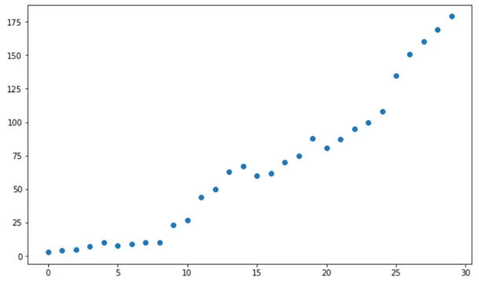
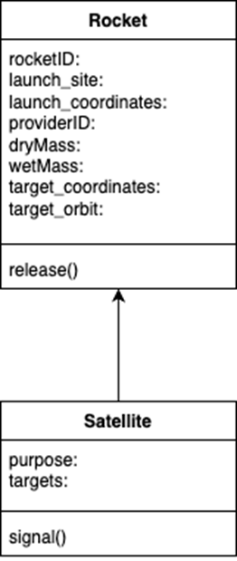
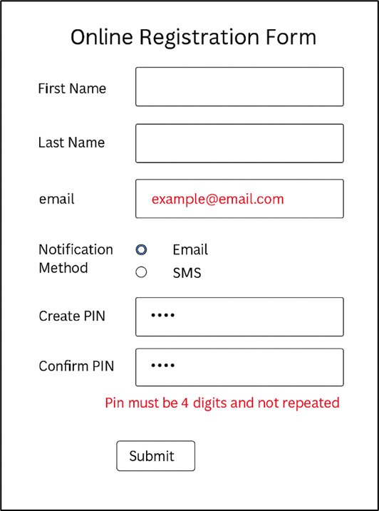

# NSW DoE Sample Exam

- Syllabus: Software Engineering · Publisher: –
- Status: private
- **Score: – / 80** · answered 0/29 parts · marked 0/29
- Review page: -

---

## 1. Multiple Choice: PWA (Q1,DoE,2025)

#### Question 1 — –/1 marks  `MULTI_CHOICE`

What is a key feature of progressive web apps (PWAs)?

- **A.** Requires a constant internet connection
- **B.** Can be installed like native apps  ✅ *correct*
- **C.** Only work in Internet Explorer
- **D.** Do not use JavaScript

**Your answer:** (none) · **Correct:** B

**Marking rubric:**

Identifies the correct answer

---

## 2. Multiple choice: SE Client side ( Q2, DoE,2025)

#### Question 2 — –/1 marks  `MULTI_CHOICE`

Which language is typically used for client-side programming?

- **A.** PHP
- **B.** Python
- **C.** JavaScript  ✅ *correct*
- **D.** SQL

**Your answer:** (none) · **Correct:** C

**Marking criteria:**
- [1] correct answer

---

## 3. Multiple choice : Machine learning (Q3, DoE, 2025)

#### Question 3 — –/1 marks  `MULTI_CHOICE`

A common machine learning model for unsupervised machine learning is:

- **A.** Logistic regression
- **B.** Linear regression
- **C.** Neural network  ✅ *correct*
- **D.** K-Nearest Neighbour

**Your answer:** (none) · **Correct:** C

**Marking criteria:**
- [1] correct answer

---

## 4. Complex table: Security (Q4, DoE,2025)

#### Question 4 — –/2 marks  `OBJECTIVE_RESPONSE`

Match the correct defintion to the concept using the drop down list provided

| Statement | Correct | Yours | |
|---|---|---|---|
| Converts encrypted data back into a readable format | Decryption | – |  |
| Used to verify the authenticity and integrity of a message | Digital Signature | – |  |
| Converts readable data into a coded format to protect privacy | Encryption | – |  |
| Converts data into a fixed-length value that cannot be reversed | Hashing | – |  |
| Data that has not been encrypted or protected | Plain Text | – |  |
| Security protocols that enable encrypted communication over a network | SSL/TLS | – |  |

**Marking criteria:**
- [2] Correctly matches 5 or 6 concepts to their correct definitions
- [1] Correctly matches at least 4 concepts

**Sample answer:**

| Concept | Definition |
|---|---|
| Decryption | Converts encrypted data back into a readable format |
| Digital Signature | Used to verify the authenticity and integrity of a message |
| Encryption | Converts readable data into a coded format to protect privacy |
| Hashing | Converts data into a fixed-length value that cannot be reversed |
| Plain Text | Data that has not been encrypted or protected |
| SSL/TLS | Security protocols that enable encrypted communication over a network |

---

## 5. Multiple choice: SE development approaches  (Q5, DoE,2025)

#### Question 5 — –/1 marks  `MULTI_CHOICE`

Which of the following best describes the Agile software development approach?

_Choose as many answers as apply_

- **A.** It produces code faster than the Waterfall approach  ✅ *correct*
- **B.** It uses strict progression of steps through its life cycle.
- **C.** It uses an iterative workflow.  ✅ *correct*
- **D.** It uses a software program called 'Agile'.

**Your answer:** (none) · **Correct:** A, C

**Marking criteria:**
- [1] Identifies both descriptions correctly

---

## 6. Extended response: Version control (Q6, DoE,2025)

#### Question 6 — –/2 marks  `SHORT`

List 3 reasons why a web development team might use version control in the development of a website?

**Your answer:**

_(not answered)_

**Sample answer:**

1.  collaboration: Version control systems allow multiple developers to work on the same project simultaneously without overwriting each other's changes. This facilitates teamwork and helps manage contributions from different team members effectively.
    
2.  tracking changes: Version control provides a complete history of changes made to the codebase, allowing developers to track modifications over time. This makes it easy to identify when changes were made, by whom, and the reasons behind those changes.
    
3.  backup and recovery: With version control, developers can easily revert to previous versions of the code if something goes wrong. This ensures that there is a safety net in place, allowing the team to recover from mistakes or bugs introduced in the development process.

---

## 7. Short answer: SE data input (Q7,DoE, 2025)

#### Question 7 — –/2 marks  `SHORT`

Briefly describe the difference between input validation and input sanitisation as defensive data input handling practices, providing an example of each.

**Your answer:**

_(not answered)_

**Marking criteria:**
- [2] Describes validation and sanitation with appropriate examples.
- [1] Describes validation and sanitation with poorly chosen examples or no examples.

**Sample answer:**

Input validation involves checking the data provided by users to ensure it meets specific criteria, eg ensuring a phone number is numeric.

Input sanitation involves cleaning or altering the input data to remove or neutralise potentially harmful elements, eg SQL injection or XSS.

---

## 8. Extended response: Front end and back end (Q8, DoE, 2025)

#### Question 8 — –/3 marks  `SHORT`

Discuss the differences between front-end and back-end web programming.

**Your answer:**

_(not answered)_

**Marking criteria:**
- [3] Clearly identifies and explains at least three key differences between front-end and back-end web programming. Demonstrates a strong understanding of the roles and technologies involved in both areas.Uses relevant examples or terminology to support the explanations.
- [2] Identifies and explains at least two key differences between front-end and back-end web programming. Shows a basic understanding of the roles and technologies, but may lack depth in explanation. Provides some examples or terminology, but they may not fully support the discussion.
- [1] Identifies only one difference or provides a vague explanation of the terms front-end and back-end. Lacks clarity and depth in understanding the roles and technologies involved. May include irrelevant information or examples that do not contribute to the discussion.

**Sample answer:**

Front-end web programming refers to the development of the client side of a web application. It involves everything that users see and interact with in their web browsers. The primary focus is on user interface (UI) and user experience (UX).

Back-end web programming refers to the server side of a web application. It involves the logic, database interactions, and server configuration that power the application behind the scenes.

---

## 9. Complex table: SE Project work (Q9, DoE, 2025)

**Stimulus:**

Tools and processes are used  by software engineers to generate solutions for clients based on their requirements.

#### Question 9 — –/2 marks  `OBJECTIVE_RESPONSE`

Match the terms for these tools and processes to their definition.

| Statement | Correct | Yours | |
|---|---|---|---|
| A set of processes or rules to be followed to solve problems. | algorithm | – |  |
| A table which represents data items, their data types, format, size, and validation rules if they apply. | data dictionary | – |  |
| Performance of tasks to ensure that developed software continues to meet requirements. | quality assurance | – |  |
| A set of instructions written in a programming language to perform specific tasks. | source code | – |  |
| Checking if developed software meets requirements or specifications. | evaluation | – |  |
| A sequence of sketches or mock-ups to represent how users navigate through different screens. | storyboard | – |  |

**Marking criteria:**
- [2] Correctly matches all 6 terms and definitions
- [1] Correctly matches  3 terms and definitions

**Marking guidance:**

This criteria is based on a third of a mark per correct question.Teachers may need to adjust the final examination total should they use half marks.

**Sample answer:**

| **Term** | **Definition** |
|---|---|
| algorithm | A set of processes or rules to be followed to solve problems. |
| data dictionary | A table which represents data items, their data types, format, size, and validation rules if they apply. |
| quality assurance | Performance of tasks to ensure that developed software continues to meet requirements. |
| source code | A set of instructions written in a programming language to perform specific tasks. |
| evaluation | Checking if developed software meets requirements or specifications. |
| storyboard | A sequence of sketches or mock-ups to represent how users navigate through different screens. |

---

## 10. Multi choice: Software development ( Q10, DoE, 2025)

**Stimulus:**

There are many different algorithms available for encrypting data, each with different strengths and weaknesses.

#### Question 10 (a) — –/1 marks  `MULTI_CHOICE`

In which software development step would a software engineering team need to decide on the specific algorithm they will use?

- **A.** Requirements Definition
- **B.** Design  ✅ *correct*
- **C.** Development
- **D.** Integration

**Your answer:** (none) · **Correct:** B

**Sample answer:**

B. Design

#### Question 10 (b) — –/3 marks  `SHORT`

Hashing algorithms are used to create a unique representation of data. They have many uses in encryption and security.

Identify 3  essential features of a hashing algorithm.

**Your answer:**

_(not answered)_

**Marking criteria:**
- [3] Clearly identifies and explains three essential features of a hashing algorithm.

Each feature is accurately described, demonstrating a strong understanding of how it relates to encryption and security.

May include relevant examples or implications of each feature.
- [2] Identifies and explains two essential features of a hashing algorithm.

Provides reasonable descriptions but may lack depth or clarity in some areas.

Examples or implications may be minimal or not entirely relevant.
- [1] Identifies only one essential feature of a hashing algorithm or provides vague descriptions of features. Lacks clarity and depth in understanding the implications of the identified feature(s).May include irrelevant information or fail to relate features to encryption and security.

**Sample answer:**

Answers may include:

\-          One-way: It is infeasible to recover the original data from the hash.

\-          Fixed-size output: The hash value will always be the same fixed length.

\-          Deterministic: The same input will always produce the same hash output.

\-          Collision resistance: Good hashing algorithms should minimize collisions.

\-          Efficiency: Fast hashing functions have a wider set of uses

---

## 11. Multiple choice: SE Machine learning (Q11, DoE, 2025)

**Stimulus:**



#### Question 11 (a) — –/1 marks  `MULTI_CHOICE`

Which Machine Learning model is most appropriate for predicting new values based on the data given in the  graph?

- **A.** Decision tree
- **B.** Polynomial regression  ✅ *correct*
- **C.** Linear regression
- **D.** K Nearest Neighbour

**Your answer:** (none) · **Correct:** B

**Marking criteria:**
- [1] Identifies the correct answer

#### Question 11 (b) — –/5 marks  `SHORT`

Explain why a Neural Network would not be the best choice of model for the training data and propose an alternative model.

**Your answer:**

_(not answered)_

**Marking criteria:**
- [5] Explains limitations for training or predicting simple curvilinear data with a Neural Network.

Shows a thorough understanding of Neural Networks.
- [4] Outlines 2 or 3 limitations of Neural Networks relating to simple data

Shows an understanding of Neural Networks
- [3] Outlines 1 or 2 limitations of Neural Networks
- [2] Outlines some features of Neural Networks or the curvilinear form
- [1] Provides some relevant information

**Sample answer:**

The dataset exhibits a straightforward curvilinear relationship between the feature and target variables, characteristic of polynomial data. For such cases, polynomial regression is an ideal modelling approach because it can efficiently and directly fit the data to a polynomial equation, providing both accuracy and interpretability. In contrast, employing a neural network for this task would be excessive, as these models are designed to handle much more complex relationships that go beyond simple polynomial patterns.

Neural networks, by their nature, are complex and are optimised for learning patterns in complex data. When applied to this simple polynomial dataset, this increased complexity introduces a significant risk of overfitting. Rather than capturing the true underlying relationship, the neural network may instead learn to model random noise present in the data, which reduces the model’s ability to generalise to unseen data.

Training a neural network requires considerably more computational resources compared to simpler forms such as polynomial regression. Neural networks require iterative training cycles, which consume substantial memory and processing power, whereas polynomial regression can typically be solved with minimal computational effort. Therefore, for simple polynomial data, a Neural Network would be an unnecessary use of computational power compared to a less resource-intensive model, such as polynomial regression.

Answers could include:

\-          Overkill for Simplicity

\-          Risk of Overfitting

\-          Training Complexity

\-          Black box interpretability

\-          Unnecessary computational resources

\-          Environmental impact of such a complex model

\-          Complexity of implementation

\-          Potential for high bias between training data and unseen data

\-          Difficulty in a Neural network producing a polynomial form

\-          Variance between outputs

\-          Difficulties in interpretation

---

## 12. Drawing answer: Class diagrams (Q12, DoE, 2025)

**Stimulus:**

An Australian aerospace startup is developing software to control its rockets from launch on Earth to space and to landing on other moons and planets.

Each rocket must have:

•    A rocket ID e.g. R20

•    Launch site e.g. “Broome”

•    Provider ID which identifies the company that made the payload e.g. P01

•    The dry mass of the rocket, e.g. 2500kg.

•    The wet mass of the rocket, e.g. 5250.50kg

•    Target orbit, which describes the orbit the payload is to enter

•    A release() command which will open up the payload doors and unclamp the satellite from the cargo bay.

In addition, each satellite must have:

•    Satellite purpose, which describes the mission of the satellite

•    Satellite targets, which describes what countries, regions or areas of the Earth or other planets or moons are to be monitored by the satellite

•    A signal() command, which is used to establish and maintain communications control with the provider as indicated by the Provider ID.

#### Question 12 — –/3 marks  `DRAWING_V2`

Create a class diagram for the rocket and satellite relationship described in the stimulus.

**Your answer:**

_(not answered)_

**Marking criteria:**
- [3] Clearly represents both the Rocket and Satellite classes with appropriate attributes and methods as outlined in the scenario.

Correctly illustrates the relationship between the Rocket and Satellite classes (e.g., association, composition).
- [2] Represents both the Rocket and Satellite classes but may miss one or more attributes or methods. Indicates the relationship between the classes, but the type of relationship may be unclear or improperly represented. Uses some UML notation, but there may be minor errors in formatting or organisation. The diagram is somewhat clear but may lack detail or clarity in certain areas.
- [1] Represents only one of the classes (Rocket or Satellite) or provides vague representations of the attributes and methods. Fails to indicate the relationship between the classes or represents it inaccurately. Lacks proper UML notation and organisation, making the diagram difficult to understand.May include irrelevant information or fail to relate to the scenario effectively.

**Sample answer:**



---

## 13. SQL: Query ( Q13, DoE, 2025)

**Stimulus:**

A local music store is using a database table called albums.

| **albumID** | **albumName** | **format** | **albumprice** |
|---|---|---|---|
| A001 | Golden Hits | CD | 18.50 |
| A002 | Live in Concert | Vinyl | 22.00 |
| A003 | Acoustic Vibes | Digital | 15.00 |
| A004 | Rock Legends | CD | 20.00 |
| A005 | Chill Sessions | Vinyl | 25.00 |

#### Question 13 — –/3 marks  `SQL`

Write a SQL query to show the output below. 

| albumName | albumPrice |
|---|---|
| Chill Sessions | 25.00 |
| Live in Concert | 22.00 |

Dataset:
```sql
CREATE TABLE albums (
    albumID     CHAR(4)      PRIMARY KEY,
    albumname   VARCHAR(80)  NOT NULL,
    format      VARCHAR(10)  NOT NULL,
    albumprice  DECIMAL(5,2) NOT NULL
);

INSERT INTO albums (albumID, albumname, format, albumprice) VALUES
('A001', 'Golden Hits', 'CD', 18.50),
('A002', 'Live in Concert', 'Vinyl', 22.00),
('A003', 'Acoustic Vibes', 'Digital', 15.00),
('A004', 'Rock Legends', 'CD', 20.00),
('A005', 'Chill Sessions', 'Vinyl', 25.00);
```

**Your answer:**

_(not answered)_

**Marking criteria:**
- [3] Provides a correct SQL query
- [2] Provides a SQL query that addresses some of the requirements.
- [1] Shows some understanding of SQL

**Sample answer:**

SELECT albumname, albumprice

FROM albums

WHERE format = 'Vinyl'

ORDER BY albumprice DESC;

---

## 14. Code : Python Functions (Q14,DoE,2025)

**Stimulus:**

Consider the following algorithm:

| 1 2 3 4 5 6 7 8 9   10   11 12 13 14 15 16 17 18 19   20 21 22 23 24 25 26   27 28 29 30 31 32 32 34 | BEGIN checkLogin (username, password)     IF username <> "" OR password <> "" THEN         PRINT "Username or password empty. "         RETURN False     ENDIF     length=8     symbol=\['#', '$', '! ', 'ˆ', '&', '\[', '\]'\]     symbol\_present=False     j=1     IF length of username < length OR       length of password < length THEN         PRINT "Username or password is not long enough. "         RETURN False     ENDIF     IF LEFT(username, 1) is character AND       LEFT(password, 1) is character THEN         WHILE symbol\_present = False              IF LEFT(username, j) = Symbol\[j\] THEN                  Symbol\_present = True              ELSE IF LEFT(password, j) = Symbol\[j\]                  Symbol\_present = True              ELSE                  Symbol\_present = False              END IF              j = j + 1         ENDWHILE     ELSE         PRINT "No symbol present in the username or password."         RETURN False     ENDIF END checkLogin |
|---|---|

#### Question 14 — –/4 marks  `CODING`

Write Python code that implements as the function _has\_symbol(username, password, symbols)_ only the part of the above algorithm that checks whether either username or password contains a symbol from the given list of symbols and also prints a message if this is not satisfied.

**Your answer:**

_(not answered)_

**Marking criteria:**
- [4] &bull;    The solution fully implements the has_symbol() function with all required checks for symbol presence. 
&bull;    Well-structured code that uses subroutines effectively, enhancing readability and maintainability. 
&bull;    Provides clear feedback message for validation failure. 
&bull;    Coding practice includes consistent naming conventions, proper indentation, and necessary comments.
- [3] &bull;    The solution implements most of the required functionality but may have minor issues that slightly affect results.
&bull;    Feedback message is present but may lack clarity. 
&bull;    May have minor inconsistencies in style or formatting.
- [2] &bull;    The solution implements some functionality with omissions or errors impacting overall results. 
&bull;    Provides minimal feedback to the user. 
&bull;    Inconsistent adherence to coding standards, naming, indentation, or lack of comments.
- [1] &bull;    Does not implement the required functionality or is fundamentally incorrect.
&bull;    No effective use of subroutines, making the code difficult to follow.
&bull;    Does not provide any user feedback nor error handling.
&bull;    Unclear or unreadable code

**Sample answer:**

def has\_symbol(username, password, symbols):  
    symbol\_present = False  
    for char in username + password:  # Concatenate both for checking  
        if char in symbols:  
            symbol\_present = True  
            break # Exits the loop when the first symbol is found, no need to iterate further  
      
    if not symbol\_present:  
        print("No symbol present in the username or password.")  
        return False  
    else:  
    return True  
This function checks if either the username or password contains any symbols from the provided symbols list. If no symbols are found, it prints a message and returns False; otherwise, it returns True.

---

## 15. Extended response: ML and BPA (Q15, DoE, 2025)

**Stimulus:**

Click Shoe Warehouse is an online store for Australian-made shoes.

They want to know which of their shoe sizes and styles sell the best in each season.

They have prepared a spreadsheet with 10 years of monthly sales history, organised by style and size.

#### Question 15 — –/4 marks  `SHORT`

Explain how Machine Learning and Business Process Automation can help ‘Click Shoe Warehouse’ achieve its goal.

**Your answer:**

_(not answered)_

**Marking criteria:**
- [4] Comprehensive explanation of how Machine Learning can analyse sales data to identify patterns in shoe sizes and styles for each season.

Detailed understanding of how Business Process Automation can streamline data processes and improve efficiency.

Clear integration of Machine Learning and Automation, demonstrating how they work together to forecast trends and automate inventory adjustments.

Provides specific, relevant examples of practical implications for Click Shoe Warehouse, such as optimising stock levels and improving marketing strategies.
- [3] Good explanation of how Machine Learning identifies patterns in sales data, but may lack some detail.

Describes how Business Process Automation improves efficiency, though with less depth.

Some integration of Machine Learning and Automation concepts, showing partial understanding of their combined impact.

Offers examples of practical implications, but they may be less specific or relevant.
- [2] Basic mention of Machine Learning with limited explanation of its role in analysing sales data.

Brief or unclear description of Business Process Automation.

Minimal integration of the two concepts; understanding of their combined impact is weak.

Provides vague or general examples of implications for the business.
- [1] Inadequate or incorrect explanation of Machine Learning and its application.

Little to no mention or inaccurate depiction of Business Process Automation.

No integration of concepts; fails to demonstrate understanding of their relationship.

Lacks practical examples or fails to connect implications to Click Shoe Warehouse.

**Sample answer:**

Machine Learning (ML) and Business Process Automation (BPA) can significantly enhance the operations and overall efficiency of Click Shoe Warehouse, helping the company achieve its goals in several ways:

ML algorithms can analyse customer behaviour and preferences to provide personalised product recommendations. By understanding past purchases and browsing habits, Click Shoe Warehouse can enhance customer experience and increase sales.

ML can predict demand for various shoe styles and sizes based on trends, seasonality, and historical data. This can help Click Shoe Warehouse optimise inventory levels, reduce stockouts, and minimise excess inventory.

ML models can analyse market trends, competitor pricing, and customer sensitivity to price changes. This enables Click Shoe Warehouse to set optimal prices that maximise profit margins while remaining competitive.

By using ML algorithms, the warehouse can segment customers based on their purchasing behaviour and demographics. This segmentation allows for targeted marketing campaigns that are more likely to resonate with specific customer groups.

ML can help identify unusual patterns in transaction data, enabling Click Shoe Warehouse to detect and prevent fraudulent activities, thereby protecting the business and its customers.

Automating the order fulfilment process can streamline operations, reduce human error, and speed up delivery times. BPA can manage order confirmations, invoicing, and shipping notifications efficiently.

Implementing chatbots and automated response systems can enhance customer service by providing instant responses to queries regarding product availability, order status, and return policies. This improves customer satisfaction and reduces the workload on customer service representatives.

BPA can automate communication with suppliers, track shipments, and manage procurement processes. This leads to a more efficient supply chain, ensuring that Click Shoe Warehouse maintains optimal stock levels and reduces lead times.

Automation tools can manage and execute marketing campaigns across multiple channels (email, social media, etc.). This ensures that marketing efforts are timely and consistent, while also allowing for data-driven adjustments based on performance metrics.

BPA can streamline data collection and reporting processes, providing real-time insights into sales performance, customer behaviour, and operational efficiency. This data can inform strategic decisions and help Click Shoe Warehouse adapt to market changes quickly.

By integrating Machine Learning and Business Process Automation, Click Shoe Warehouse can enhance operational efficiency, improve customer satisfaction, and drive revenue growth. ML provides valuable insights and predictive capabilities, while BPA streamlines processes and reduces manual workload, allowing the company to focus on strategic initiatives and customer engagement. Together, these technologies can help Click Shoe Warehouse achieve its business goals effectively.

---

## 16. Extended response: SE Passwords (Q16,DoE,2025)

**Stimulus:**

An online service wants to reduce the chances of user accounts being compromised by dictionary attacks. In this type of attack, an attacker uses a pre-defined list (often referred to as a "dictionary") of words, phrases, or common passwords to guess the victim’s password

#### Question 16 — –/4 marks  `SHORT`

Describe TWO strategies they could implement to reduce this risk.

**Your answer:**

_(not answered)_

**Marking criteria:**
- [4] Explains how TWO relevant strategies harden accounts against dictionary attacks
- [3] Explains how ONE relevant strategy would protect against dictionary attacks OR

Outlines how TWO relevant strategies could be applied
- [2] Outlines relevant strategy(ies)
- [1] Provides some relevant information

**Sample answer:**

The service could implement password complexity requirement that mandates special characters, length, etc to force users to use less vulnerable passwords.

The service could implement rate limiting to reduce the ease with which large numbers of passwords can be tried by an attacker. 

_Answers may also include:_

\-          _Implementing user training on providing complex passwords to improve password quality_

\-          _Using Multifactor authentication to thwart successful password guesses_

_Examples of irrelevant suggestions include:_

\-          _Encouraging the use of different passwords across accounts_

\-          _Encrypting passwords in storage_

---

## 17. Extended response: SE HTML vs CMS (Q17, DoE, 2025)

**Stimulus:**

Web developers may choose to use HTML and CSS or a CMS.

#### Question 17 — –/4 marks  `SHORT`

Explain why an experienced web developer would choose to use HTML and CSS while a beginner would use a CMS.

**Your answer:**

_(not answered)_

**Marking criteria:**
- [4] Provides a clear and coherent explanation of the differences between experienced developers and beginners in their choice of technology. Accurately describes the advantages of HTML and CSS for experienced developers, including control, flexibility, performance optimisation, and adherence to web standards. Clearly outlines the benefits of a CMS for beginners, such as user-friendliness, quick setup, built-in features, and support resources. Effectively compares and contrasts the two approaches, demonstrating an understanding of how the choice aligns with the user&rsquo;s experience level and project needs.
- [3] Offers a good explanation of the differences in technology choices but may lack some clarity. Describes some advantages of HTML and CSS for experienced developers, though with less detail. Outlines some benefits of a CMS for beginners but may miss certain aspects. Provides a comparison of the two approaches, but the analysis may not be fully developed.
- [2] Provides a basic explanation of the differences, with limited clarity. Mentions a few advantages of HTML and CSS for experienced developers but lacks depth .Mentions a few benefits of a CMS for beginners but lacks depth. Offers minimal comparison, with weak or unclear analysis.
- [1] Explanation of differences is inadequate or unclear. Fails to adequately describe the advantages of HTML and CSS for experienced developers. Fails to adequately describe the benefits of a CMS for beginners. Lacks comparative analysis or fails to connect the two perspectives.

**Sample answer:**

The choice between using HTML and CSS versus a Content Management System (CMS) often hinges on the developer's experience level, project requirements, and desired control over the website's functionality and design. Here's an explanation of why an experienced web developer might prefer HTML and CSS, while a beginner might opt for a CMS:

Experienced developers are comfortable writing HTML and CSS code, allowing them complete control over the website's layout, design, and functionality. They can create custom designs that can be tailored specifically to the needs of the project without being constrained by the templates or limitations of a CMS. By coding from scratch, experienced developers can optimise website performance by minimising excess code, optimising images, and implementing best practices for loading speeds. This can lead to faster websites and better user experiences. When working directly with HTML and CSS, developers can implement any design or feature without being limited by the structure of a CMS. This flexibility allows for more innovative and unique designs. Experienced developers typically have a strong understanding of web standards, accessibility, and responsive design principles. They can ensure that their code adheres to these standards, resulting in more robust and usable websites. Using HTML and CSS means that the developer is not dependent on third-party plugins or systems, which can sometimes introduce security vulnerabilities, compatibility issues, or bloat to the website. For experienced developers, working with raw code can provide opportunities to learn advanced techniques, frameworks, and programming languages, further enhancing their skill set.

A Content Management System (CMS)typically has a user-friendly interface that allows beginners to create and manage content without needing to know how to code. This accessibility can be crucial for those who are just starting out. Beginners can quickly set up a website using a CMS, as many come with pre-built templates and themes. This allows for faster deployment without extensive technical knowledge. CMS platforms often come with built-in features such as SEO tools, social media integration, and analytics, which can be beneficial for beginners who may not know how to implement these features themselves. Popular CMS platforms have large communities, extensive documentation, and numerous tutorials available, making it easier for beginners to find help and resources. Beginners can concentrate on content creation and website management rather than on the technical aspects of web development. This can lead to a more immediate engagement with the website and its purpose. Many CMS solutions offer scalability, allowing beginners to start small and grow their website as needed. They also often handle updates and security patches, reducing the technical burden on the user.

In summary, experienced web developers may prefer using HTML and CSS for the control, flexibility, and performance optimisation it offers, allowing them to create unique and customised websites. In contrast, beginners often opt for a CMS due to its ease of use, quick setup, and built-in features, which enable them to focus on content creation and management without extensive technical knowledge. Each approach has its merits based on the developer's experience level and project needs.

---

## 18. Extended response: ML and AI impacts (Q18, DoE, 2025)

#### Question 18 — –/5 marks  `SHORT`

Assess positive and negative impacts of machine learning and artificial intelligence on production efficiency, waste and the environment.

**Your answer:**

_(not answered)_

**Marking criteria:**
- [5] Elaborates both several positive and several negative potential impacts, providing a reasonable (more optimistic than cautious) balance between them
- [4] Provides both several positive and several negative potential impacts, but does not elaborate them sufficiently
- [3] Elaborates only several positive impacts without discussing negative ones

OR 

Elaborates only several negative impacts without discussing positive ones
- [2] Outlines only 1 positive AND 1 negative potential impact without elaborating
- [1] Outlines only 1 positive OR 1 negative potential impact without elaborating

**Sample answer:**

While AI and ML hold significant promise for enhancing the production efficiency and reduce waste that pollutes the environment, they also pose challenges that need to be addressed to ensure that benefits are maximised while minimising negative impacts on the environment and society.

 Potential positive impacts:

-   Increased Production Efficiency – AI and ML can optimise manufacturing processes by analysing data and identifying inefficiencies. This leads to faster production times, reduced downtime, and more streamlined operations, ultimately maximising output.
-   Waste Reduction – AI can help in minimising waste by predicting demand more accurately, leading to better inventory management. By aligning production closely with actual demand, manufacturers can reduce overproduction and excess inventory, which contributes to waste.
-   Resource Optimisation – Machine learning algorithms can improve the use of materials by identifying the most efficient ways to utilise resources during production. This can lead to lower material costs and less waste, contributing positively to environmental sustainability.
-   Predictive Maintenance – AI can monitor equipment performance and predict failures before they occur. This proactive approach to maintenance not only extends the lifespan of machinery but also decreases the likelihood of unexpected breakdowns, reducing waste and improving efficiency.Potential negative impacts: 

-   Energy Consumption – The implementation of AI systems can lead to significantly increased energy consumption, particularly if the infrastructure required to support these technologies is not energy efficient. This could counteract some environmental benefits.
-   E-waste Generation – The rapid advancement of AI technologies may lead to shorter product lifespans for machinery and devices, contributing to increased electronic waste (e-waste) if not managed properly.

---

## 19. Drawing answer: SE  UX/UI (Q19, DoE, 2025)

**Stimulus:**

A library management system allows users to register online. The registration form must collect user details and a secure PIN.

•    PIN requirements:

•    Exactly 4 numeric digits

•    No repeated digits (e.g. 1123 is invalid)

•    No letters or special characters

#### Question 19 (a) — –/3 marks  `DRAWING_V2`

Design a user interface for registration. Label all form fields clearly.

**Your answer:**

_(not answered)_

**Marking criteria:**
- [3] Provides a user interface suitable for users to register with all form fields labelled, including input validation indicators
- [2] Designs the user interface with some relevant features
- [1] Shows some understanding of the problem

**Sample answer:**



#### Question 19 (b) — –/3 marks  `SHORT`

Explain how accessibility considerations improve the usability of web forms for a wide range of users, including those with disabilities.

**Your answer:**

_(not answered)_

**Marking criteria:**
- [3] Provides a detailed explanation of multiple accessibility features and how they support users with specific needs. Uses correct terminology and relevant examples.
- [2] Outlines at least two accessibility features clearly, explaining how they help improve usability for users with disabilities.
- [1] Provides some relevant information about accessibility or usability in web forms

**Sample answer:**

Accessibility features improve web form usability by ensuring all users, including those with disabilities, can interact with the form effectively. For example, using properly associated <label> tags with each form input allows screen readers to announce the purpose of each field to visually impaired users. Adding aria-label or aria-described by attributes provides further context when standard labels aren’t sufficient.

Keyboard navigation is another essential feature ensuring users can tab through fields and activate buttons without needing a mouse supports users with motor impairments. Additionally, maintaining high colour contrast between text and background helps users with low vision or colour blindness read form content more easily. These features collectively create an inclusive interface that complies with accessibility standards .

---

## 20. Extended response: KNN algorithm (Q20, DoE, 2025)

#### Question 20 — –/4 marks  `SHORT`

Describe the K Nearest Neighbour (KNN) algorithm for regression, predicting y for a new data point using a training data set of x and y values given the K value parameter of 3.

**Your answer:**

_(not answered)_

**Marking criteria:**
- [4] Describes the KNN algorithm for regression, including distance, selection of K value and the prediction as the mean of the K features.
- [3] Outlines most of the KNN algorithm
- [2] Outlines some features of the KNN Algorithm
- [1] Outlines some relevant information

**Sample answer:**

The K-Nearest Neighbours (KNN) algorithm is a supervised learning technique that generates predictions based on labelled data. KNN is particularly effective for datasets characterized by a low coefficient of variation. The non-linear algorithm operates as follows:

1    Distance Calculation: For a given query (new data point), KNN computes the Euclidean distance (i.e., the straight-line distance) between the query and each point in the training dataset.

2.      Neighbour Selection: The algorithm identifies and sorts the training data points by their distance to the query, selecting the nearest K points (in this case, K=3).

3.      Prediction: The predicted value for the query point is determined by calculating the mean of the target values of these K nearest neighbours.

_Note: students can refer to any appropriate KNN distance measure, such as Euclidean, Manhattan, Minkowski, etc_

---

## 21. Code/Short answer: Stubs (Q21,DoE,2025)

**Stimulus:**


#### Question 21 (a) — –/1 marks  `CODING`

The algorithm flowchart shown describes a stub for a login function.

Implement this stub in python code.

**Your answer:**

_(not answered)_

#### Question 21 (b) — –/2 marks  `SHORT`

One simple test has been provided below.

Provide at least TWO more tests that could be used, with a comment justifying the use of each one.

\# Test cases

IF login("user1", "pass123") == "Login successful" THEN

PRINT "Test case 1 passed"

ELSE

PRINT "Test case 1 failed"

**Your answer:**

_(not answered)_

**Sample answer:**

Answers could include

\-          Two incorrect parameters

\-          One incorrect and one correct parameter

\-          Empty strings

\-          Wrong number of parameters

Eg:

assert login("user1", "wrongpass") \== "Login failed", "Test case 2 failed"

assert login("wronguser", "pass123") \== "Login failed", "Test case 3 failed"

assert login("", "") \== "Login failed", "Test case 4 failed"

#### Question 21 (c) — –/2 marks  `SHORT`

You are tasked with writing an error message to return to users in situations where their login attempt fails. This could happen when the password is entered incorrectly or when the username is incorrect.

What should you consider when creating these messages?

**Your answer:**

_(not answered)_

**Marking criteria:**
- [2] Identifies two considerations, including one related to security.
- [1] Identifies one security consideration OR

Identifies TWO non-security considerations

**Sample answer:**

Answers could include:

\-          Limit exposure of information (eg That username does not exist)

\-          Provide friendly and non-threatening messaging

\-          Ensure the message is helpful (eg a password reset link).

---

## 22. Extended response: Communications (Q22, DoE, 2025)

**Stimulus:**

An Australian toy manufacturing company has recently been established, with offices around the country.

Toy manufacturing is subject to strict environmental, workplace health and safety, national and international regulatory frameworks, enforced by the agency AusToy.

#### Question 22 (a) — –/3 marks  `SHORT`

Explain communications issues that may arise due to stakeholders being located all over the country.

**Your answer:**

_(not answered)_

**Marking criteria:**
- [3] The response clearly identifies and explains multiple communication issues that may arise due to the geographical distribution of stakeholders.

Explanations are directly relevant to the context of the toy manufacturing company and its regulatory environment.

Demonstrates a strong understanding of the implications of the identified issues, including potential impacts on project collaboration, decision-making, or compliance.
- [2] The response identifies and explains some communication issues related to stakeholder distribution, but may lack some detail.

Provides explanations that are generally relevant to the context, though some points may be less directly connected.

Shows a moderate understanding of the implications, with some analysis of potential impacts on the company.
- [1] The response identifies at least one communication issue, but explanations are limited or unclear.

Relevance to the context of the toy manufacturing company is weak or not clearly established.

Demonstrates a basic understanding of the implications, but lacks depth in analysis or connection to broader impacts.

**Marking guidance:**

Students may respoond and be awarded marks for any of the following:

Australia has multiple time zones, which can complicate scheduling meetings or collaborative work sessions. For instance, coordinating a meeting between stakeholders in Sydney and Perth may require careful planning to accommodate different working hours. This can lead to delays in decision-making and project timelines.

Different regions may have distinct cultural norms, communication styles, and business practices. Stakeholders from various backgrounds may interpret messages differently, leading to misunderstandings or misinterpretations. This can impact teamwork and the overall effectiveness of communication.

While technology facilitates communication, not all stakeholders may have equal access to high-speed internet or the latest communication tools, particularly in remote areas. This can lead to frustration and hinder effective collaboration if some team members struggle to participate fully in meetings or discussions.

Physical separation can make it challenging to build relationships and rapport among stakeholders. Face-to-face interactions often foster trust and understanding, which can be harder to achieve through virtual communication. This isolation can result in a lack of engagement and team cohesion.

With multiple communication channels (emails, messaging platforms, video calls), there is a risk of information overload, where stakeholders may miss important updates or context. Conversely, miscommunication can occur when information is not conveyed clearly, leading to confusion about project requirements or expectations.

Given the strict regulatory frameworks the company must adhere to, communication regarding compliance issues may become complicated. Different stakeholders may have varying levels of understanding or interpretation of these regulations, which can lead to inconsistencies in implementation or reporting.

Gathering feedback from stakeholders who are geographically dispersed can be challenging. Delays in feedback can slow down project progress and may result in a lack of alignment on project goals and deliverables. It is essential to establish clear channels and timelines for feedback to mitigate this issue.

**Sample answer:**

The geographical distribution of stakeholders in the toy manufacturing company can lead to various communication challenges, including time zone differences, cultural variations, technology access issues, and the complexities of regulatory compliance. Addressing these issues proactively through effective communication strategies and tools is vital for fostering collaboration and ensuring project success.

#### Question 22 (b) — –/2 marks  `SHORT`

Compare and contrast Hybrid (also called WAgile) and Waterfall software development methodologies in developing software to control the manufacturing of their toys.

**Your answer:**

_(not answered)_

**Marking criteria:**
- [2] The response clearly identifies and describes both WAgile and Waterfall methodologies, including key characteristics of each.
Effectively compares and contrasts the advantages and disadvantages of both methodologies, providing relevant insights for the context of toy manufacturing.
Demonstrates a strong understanding of how the methodologies apply to the specific context of toy manufacturing, offering a well-reasoned conclusion on which methodology may be more suitable based on the company's needs.
- [1] The response identifies and describes both WAgile and Waterfall methodologies, but may lack some detail.
Provides a comparison of the advantages and disadvantages, though some insights may be less relevant to the context.
Shows a moderate understanding of the application to toy manufacturing, with a conclusion that is somewhat reasoned but not fully developed.

**Marking guidance:**

_Students may be awarded marks for any of the following:_

**Waterfall methodology**

**Description**: the waterfall methodology is a linear and sequential approach to software development. It consists of distinct phases: requirements gathering, design, implementation, testing, deployment, and maintenance. Each phase must be completed before moving on to the next.

**Advantages**:

-   **Clear structure**: the waterfall model provides a clear framework and timeline, making it easy to manage and track progress.
-   **Well-defined requirements**: since the requirements are gathered upfront, there is less ambiguity about what needs to be developed, which can be beneficial in regulated environments like toy manufacturing.
-   **Documentation**: each phase produces documentation, which can be useful for compliance and reference purposes, especially regarding regulatory requirements.

**Disadvantages**:

-   **Inflexibility**: once a phase is completed, making changes can be difficult and costly. This can be a significant drawback in a fast-paced manufacturing environment where requirements may evolve.
-   **Late testing**: testing occurs after development, which can lead to the discovery of major issues late in the process, potentially affecting production timelines.

**Wagile methodology**

**Description**:  
wagile is a hybrid approach that combines elements of agile and waterfall methodologies. It focuses on flexibility and iterative development while still providing some structure. Wagile allows for incremental progress and regular feedback throughout the development process.

**Advantages**:

-   **Flexibility**: wagile allows for changes and adjustments to be made throughout the development process, accommodating new requirements or feedback from stakeholders.
-   **Frequent iterations**: the iterative nature allows for regular testing and feedback, which can lead to higher quality software that better meets the needs of the manufacturing process.
-   **Collaboration**: wagile promotes collaboration among stakeholders, helping to ensure that the software aligns with the evolving needs of the toy manufacturing operations and regulatory frameworks.

**Disadvantages**:

-   **Less predictable**: the flexibility of wagile can make it harder to predict timelines and budgets, which may pose challenges for project management.
-   **Potential for scope creep**: the ability to make changes throughout the process can lead to scope creep if not managed properly, potentially affecting the project's focus.

**Comparison**

-   **Structure vs. Flexibility**: waterfall is structured and sequential, making it straightforward but inflexible. In contrast, wagile provides flexibility and adaptability, which can be beneficial in a dynamic manufacturing environment.
-   **Testing timing**: waterfall conducts testing after development, while wagile incorporates testing throughout the process, allowing for quicker identification of issues.
-   **Stakeholder involvement**: wagile encourages ongoing stakeholder interaction and feedback, whereas waterfall may limit stakeholder involvement to the initial requirements phase.

**Sample answer:**

In developing software for controlling toy manufacturing, the choice between WAgile and Waterfall methodologies depends on the company's specific needs. If the manufacturing process requires strict adherence to regulations and well-defined requirements, Waterfall may be more suitable. However, if the company values flexibility and the ability to adapt to changing needs, WAgile could provide a better framework for success by fostering collaboration and iterative improvements.

---

## 23. Extended response: Security ( Q23, DoE,2025)

**Stimulus:**

A popular social media platform has recently suffered a cross-site scripting (XSS) attack, leading to significant user data breaches and a loss of public trust.

#### Question 23 — –/8 marks  `SHORT`

Discuss the ethical, legal, and technical ramifications for both users and the enterprise stemming from such a security breach.

**Your answer:**

_(not answered)_

**Marking criteria:**
- [8] Discusses ethical, legal and technical ramifications for both users and the enterprise.
- [6-7] Outlines ethical, legal AND technical ramifications for both the user AND the enterprise
- [5-4] Outlines ethical, legal AND technical ramifications for the user OR the enterprise
- [2-3] Shows some understanding of ethical OR legal ramifications for either users OR the enterprise.
- [1] Provides some relevant information.

**Sample answer:**

A security breach has ethical ramifications for users, as it compromises their privacy and can lead to identity theft. Legally, users may have grounds for lawsuits if their data is mishandled.

For the enterprise, the legal implications include potential fines and penalties for violating data protection laws. Ethically, the enterprise must take responsibility for protecting user data, and failing to do so can harm its reputation and customer relationships.

Answers may include:

\-          For users:

o   Ethical (Violation of Privacy, Loss of autonomy and control of own data, Psychological harm including stress, reputational damage)

o   Legal (Risk of identity theft, possible compensation)

\-          For enterprises:

o   Breach of trust, failed duty of care – reputational damage

o   Legal (Data Protection eg Privacy Act and GDPR leading to fines, mandatory breach notifications, regulator investigation; civil liability; contractual breaches; criminal liability

o   Operational disruptions
