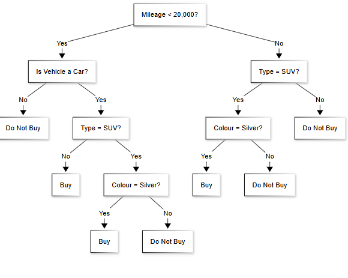
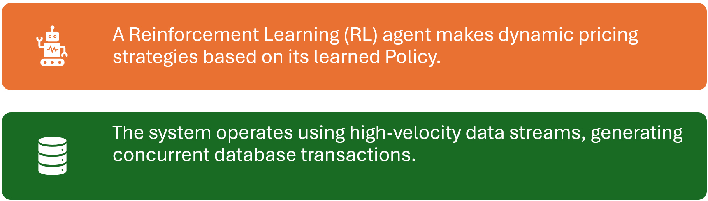
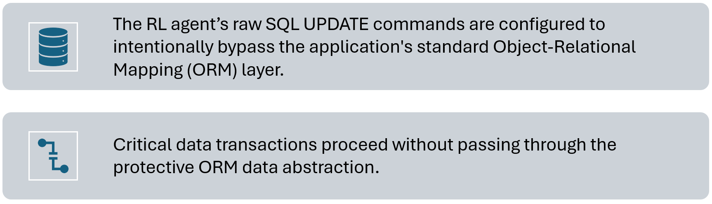
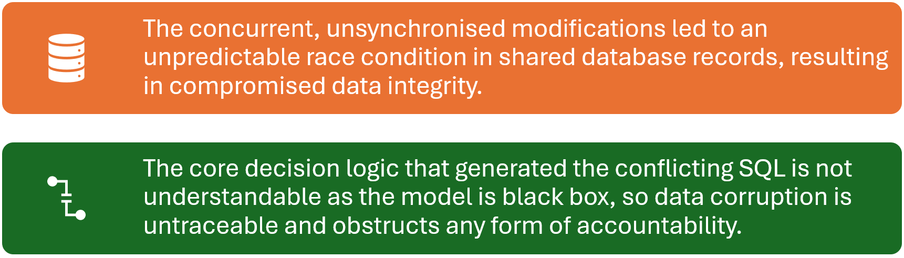

# NSW Software Engineering Paper

- Syllabus: Software Engineering · Publisher: –
- Status: private
- **Score: – / 80** · answered 0/30 parts · marked 0/30
- Review page: -

---

## 1. New Question 1, Machine Learning Model

#### Question 1 — –/1 marks  `MULTI_CHOICE`

A company is designing an algorithm to predict non-linear customer purchasing patterns based on complex interactions between demographics, browsing behavior, and prior purchases. Which machine learning model is best suited for this task?

- **A.** Decision trees, because they map customer information to clustered predictions.
- **B.** Neural networks, due to the multidimensional nature of the customer data.  ✅ *correct*
- **C.** K-nearest neighbours, because it predicts outcomes based on similarity accross customer attributes.
- **D.** Polynomial regression, due to the non-linear nature of the customer purchasing patterns.

**Your answer:** (none) · **Correct:** B

---

## 2. New Question 2, System Design Diagram

#### Question 2 — –/1 marks  `MULTI_CHOICE`

Which diagram is used during the system design phase to show the interaction between modules?

- **A.** Flowchart
- **B.** Context diagram
- **C.** Structure chart  ✅ *correct*
- **D.** Gantt chart

**Your answer:** (none) · **Correct:** C

---

## 3. New Question 3, Security Testing

#### Question 3 — –/1 marks  `MULTI_CHOICE`

In Object-Oriented Programming, what is the term for bundling data (attributes) and the methods that operate on the data into a single unit or class?

- **A.** Inheritance
- **B.** Polymorphism
- **C.** Abstraction
- **D.** Encapsulation  ✅ *correct*

**Your answer:** (none) · **Correct:** D

---

## 4. New Question 4, Security Testing

#### Question 4 — –/1 marks  `MULTI_CHOICE`

A development team is building a new financial application and wants to find security flaws by analyzing the application's source code for issues like SQL injection vulnerabilities before the program is compiled and run. Which of the following strategies is most appropriate for this task?

- **A.** Dynamic Application Security Testing (DAST)
- **B.** Penetration Testing
- **C.** Static Application Security Testing (SAST)  ✅ *correct*
- **D.** A/B Testing

**Your answer:** (none) · **Correct:** C

---

## 5. New Question 5, AI Bias

**Stimulus:**


#### Question 5 — –/1 marks  `MULTI_CHOICE`

An AI model designed to screen job applications is found to consistently rank candidates from a specific demographic group lower, even with equivalent qualifications. It is discovered the model was trained on historical hiring data from a time when discriminatory practices were common. This is a clear example of:

- **A.** Poor memory management
- **B.** The model successfully maintaining the company's workplace atmosphere.
- **C.** Human and dataset source bias  ✅ *correct*
- **D.** The AI developing its own "gut feeling," which is legally distinct from discrimination

**Your answer:** (none) · **Correct:** C

---

## 6. New Question 6, Web Page Load Times

#### Question 6 — –/1 marks  `MULTI_CHOICE`

Which of the following methods help to manage and reduce the load times of a web page?

- **A.** Enabling file compression  ✅ *correct*
- **B.** Using a Content Delivery Network (CDN)  ✅ *correct*
- **C.** Using the highest-resolution images possible
- **D.** Caching frequently accessed data  ✅ *correct*
- **E.** Minimizing the number of HTTP requests  ✅ *correct*

**Your answer:** (none) · **Correct:** A, B, D, E

---

## 7. New Question 7, CMS Example

#### Question 7 — –/1 marks  `MULTI_CHOICE`

Which of the following is an example of a web content management system (CMS)?

- **A.** React.js
- **B.** MySQL
- **C.** WordPress  ✅ *correct*
- **D.** Apache

**Your answer:** (none) · **Correct:** C

---

## 8. New Question 8, PWA Steps

#### Question 8 — –/2 marks  `SORTING_TABLE`

Arrange the following steps in the order they typically occur when a user first visits a Progressive Web App (PWA) for offline capabilities.

**Your answer:**

_(not answered)_

**Marking criteria:**
- [2] Steps in correct order
- [1] At least 3 steps in correct order

**Sample answer:**

1.  The browser downloads manifest.json to determine app name, icons, and theme
2.  The service worker is installed and waits for activation.
3.  The service worker is activated and takes control of pages.
4.  The service worker caches essential files for offline use.
5.  The user adds the PWA to their home screen.

---

## 9. New Question 9, SDLC Order

#### Question 9 — –/2 marks  `SORTING_TABLE`

Arrange these fundamental software development steps into the correct order.

**Your answer:**

_(not answered)_

**Marking criteria:**
- [2] Steps in correct order
- [1] At least 4 steps in correct order

**Sample answer:**

1.  Requirements definition
2.  Determining specifications
3.  Design
4.  Development
5.  Integration
6.  Testing and debugging
7.  Installation
8.  Maintenance

---

## 10. New Question 10, Web Protocols and Ports

#### Question 10 — –/2 marks  `OBJECTIVE_RESPONSE`

Match each protocol to its default port number by selecting the correct option in each row.

| Statement | Correct | Yours | |
|---|---|---|---|
| HTTP | 80 | – |  |
| HTTPS | 443 | – |  |
| FTP | 21 | – |  |
| DNS | 53 | – |  |

---

## 11. New Question 11, Modularisation

#### Question 11 — –/4 marks  `SHORT`

Describe the purpose of modularisation in software development and explain two advantages it provides for large-scale projects.

**Your answer:**

_(not answered)_

**Marking criteria:**
- [4] Clearly and accurately describes the purpose of modularisation using correct syllabus terminology (e.g. top-down design, system design phase, maintainability, reusability).Provides two well-explained advantages clearly related to large-scale software projects.Response is cohesive, detailed, and uses appropriate technical language.
- [3] Describes the purpose of modularisation and provides two advantages (one may lack depth or direct link to large-scale projects).Uses mostly correct terminology.Shows a sound understanding of software design principles.
- [2] Demonstrates a basic understanding of modularisation by describing its purpose and one advantage, or two advantages with limited explanation.May use some relevant terminology but lacks clarity or depth.
- [1] Provides a simple or partial statement about modularisation

**Sample answer:**

Modularisation is a software design strategy in which a complex system is decomposed into smaller, self-contained modules, each responsible for a specific function or process. This practice is essential in the system design phase of the software development cycle, as it enables programmers to apply top-down design principles and create programs that are easier to test, debug, and maintain. Each module can be developed and verified independently, then integrated to form the complete system.

  

For large-scale software projects, modularisation offers distinct benefits. It enhances maintainability, as faults can be isolated and corrected within a single module without affecting the overall system — improving reliability and reducing maintenance time. Additionally, it facilitates teamwork and reusability: separate development teams can work on different modules concurrently, promoting efficient project management, while well-defined modules can be reused in future systems, increasing productivity and software quality.

---

## 12. New Question 12, Password Check Pseudocode

**Stimulus:**

A programmer is designing a program to check the length of a password and to check if the password input is the same as the stored password.

The program requirements are:

-   input the password, ‘Password’
-   check if there are at least 8 characters in the password
-   check that the password is not the same as the stored password ‘OldPass’
-   output 'accepted' if both tests are completed successfully
-   otherwise, output 'rejected'.

#### Question 12 — –/3 marks  `PSEUDOCODE`

Create pseudocode for this using the variable names as given.

**Your answer:**

_(not answered)_

**Marking criteria:**
- [3] The pseudocode correctly checks both the password length and compares it to the stored password 'OldPass' using a logical AND.The program correctly outputs 'accepted' or 'rejected' based on the outcome of the conditional checks.
- [2] The pseudocode correctly checks one of the conditions (either length or comparison to 'OldPass'), but not both.The program correctly outputs 'accepted' or 'rejected' based on the single condition that is checked.
- [1] The pseudocode shows a basic understanding of input and output, but the logical conditions are incorrect or incomplete.The program attempts to check the password but does not implement the conditions correctly, leading to incorrect outputs.

**Sample answer:**

```
BEGIN
  INPUT Password
  IF LENGTH(Password) >= 8 AND Password <> “OldPass” THEN
    Display 'accepted'
  ELSE
    Display 'rejected'
  ENDIF
END
```

---

## 13. New Question 13, Vulnerability Assessment

#### Question 13 — –/2 marks  `SHORT`

Describe how vulnerability assessment helps manage the security of programming code.

**Your answer:**

_(not answered)_

**Marking criteria:**
- [2] Describes how vulnerability assessment helps manage the security of programming code
- [1] Outlines what vulnerability assessment is

**Sample answer:**

Vulnerability assessment involves identifying, quantifying, and prioritising vulnerabilities within a system, programmers can implement secure code solutions to nullify these vulnerabilities and maintain security.

---

## 14. New Question 14, W3C Influence

#### Question 14 — –/4 marks  `SHORT`

Explain how the World Wide Web Consortium (W3C) influences the development of web applications. Use examples in your response.

**Your answer:**

_(not answered)_

**Marking criteria:**
- [4] Explains how the World Wide Web Consortium influences the development of web applications with relevant examples ANDResponse should cover at least 4 of the following syllabus points: Web Accessibility Initiative (WAI), internationalisation, web security, privacy and machine-readable data
- [3] Describes how the World Wide Web Consortium influences the development of web applications ORExplains how the World Wide Web Consortium influences the development of web applications with relevant examples for 3 of the syllabus points
- [2] Outlines the World Wide Web Consortium
- [1] Provides some relevant information on the World Wide Web Consortium

**Sample answer:**

The W3C influences the development of web applications by establishing standards and guidelines developers should implement. The web accessibility initiative provides guidelines for developers managing web apps like the Web Content Accessibility Guidelines (WCAG) causing developers to implement features like high contrast colours in the UI frontend for disabled people. Developers are also recommended to implement internationalisation to address diversity of end users , such as defining css properties to handle different writing directions (left, right) Web security guidelines cause developers to follow secure coding standards such as the CPS (content Security Policy) which helps prevent cross-site scripting (XSS) attacks by allowing developers to specify which sources of content are trusted and can be safely loaded by the browser. W3C’s privacy standards aim to provide users with greater control over their personal information and ensure that web applications handle data responsibly, for example the privacy sandbox initiative leads to developers creating more privacy-friendly web environments in the context of advertising and tracking

---

## 15. New Question 15, Delivery Anomaly Detection

**Stimulus:**

Uber tracks the delivery time of their drivers and wants to understand why some deliveries take unusually long. They decide to flag any deliveries that take more than 1.5 times the overall average delivery time.

Uber’s delivery times:

```
deliveries = [
  {"driver": "Alice", "time": 30},
  {"driver": "Bob", "time": 45},
  {"driver": "Alice", "time": 40},
  {"driver": "Bob", "time": 100},
  {"driver": "Alice", "time": 90}
]
```

#### Question 15 (a) — –/3 marks  `CODING`

Create a Python function that takes the `deliveries` and returns a list of flagged deliveries.

**Your answer:**

_(not answered)_

**Marking criteria:**
- [3] Creates a correct function that returns the expected list
- [2] The function is mostly correct but contains one significant error
- [1] Correctly calculates the overall average delivery time

**Sample answer:**

```
def detectAnomaly(deliveries):
  times = [t["time"] for t in deliveries]
  averageTime = sum(times)/len(times)
  flagged = [f for f in deliveries if f["time"]>1.5*averageTime]
  return flagged
```

#### Question 15 (b) — –/2 marks  `SHORT`

Uber wants to automate the whole process and receive alerts automatically. Outline the role of RPA and BPA in fully automating Uber’s anomaly detection system.

**Your answer:**

_(not answered)_

**Marking criteria:**
- [2] Correctly outlines the role of RPA and BPA with an example of each
- [1] Identifies at least one correct example of either RPA or BPA

**Sample answer:**

RPA automates small repetitive tasks such as logging delivery times, while BPA automate the whole workflow by triggering the anomaly detection algorithm and then sending notifications to Uber.

---

## 16. New Question 16, Logistic Regression vs KNN

**Stimulus:**

A software company collects data of the vitals of patients with a certain disease.

The company aims to analyse this data and predict whether or not a new patient has the disease by looking at their vitals.

The developers are stuck between using logistic regression or KNN for this model.

#### Question 16 (a) — –/1 marks  `SHORT`

Outline why these two models were considered by the developers?

**Your answer:**

_(not answered)_

**Marking criteria:**
- [1] Explains the need to use classification models

**Sample answer:**

KNN and logistic regression are both classification models which are required to predict whether or not someone has a disease (Yes Or No).

#### Question 16 (b) — –/3 marks  `SHORT`

By first explaining how each model works, justify which model the company should use to get the most accurate results?

**Your answer:**

_(not answered)_

**Marking criteria:**
- [3] For explaining how each model works to classify data ANDJustifies why logistic regression is more suitable
- [2] For explaining how each model works to classify data
- [1] Justifies why logistic regression is more suitable

**Sample answer:**

KNN finds the 'k' nearest points and looks at the majority to classify while logistic regression uses a sigmoid function to get a probability between 0 and 1 to classify.

KNN is highly sensitive to noise as every feature (including unnecessary vitals) contribute equally to the Euclidean distance while Logistic regression adds weights for each factor so that irrelevant features don't contribute as much to the prediction. Hence, Logistic regression is more accurate and suitable.

**Answers Could Include:**

KNN works slow on large datasets as it needs to calculate a lot of Euclidean distances every time the model predicts, while Logistic Regression is much faster due to a set sigmoid function that instantly returns a value.

---

## 17. New Question 17, Encryption vs Hashing

**Stimulus:**

The robot stores data internally, such as internal logs, and also communicates with other robots and users across the web securely via a wireless network which is password protected. All data for these tasks is secured using either encryption or hashing.

Additionally, hashed values are appended to the files that the robot transfers.


#### Question 17 — –/4 marks  `SHORT`

Compare the purpose and function of the robot's use of encryption and hashing for storing and communicating data.

**Your answer:**

_(not answered)_

**Marking criteria:**
- [1-4] Provides the differences between hashing and encryption in terms of:Purpose, must mention the purpose of the hashes (tampering) etcHow they work (function), must mention keys, and properties of hashesProvides multiple references with the stimulus including for:Internal logsSecure wireless communication. Mentions TLS/SSL protocols.-1 mark for each not met

**Sample answer:**

Encryption and hashing are both cryptographic methods used to secure data, but they have different purposes:

  

Encryption ensures confidentiality (keeping data secret) by converting readable plaintext into unreadable ciphertext. There are two types of encryption:  
Symmetric Encryption (e.g., AES): Used for bulk encryption of stored data (data at rest), such as internal sensitive logs, ensuring that if storage is accessed, the data is unreadable without the key.  
Asymmetric Encryption (e.g., RSA): Used in securing communications (data in transit) with protocols such as SSL/TLS for the secure exchange of session keys, which then encrypt the data transmitted wirelessly.

Hashing ensures integrity (preventing/detecting unauthorized modification) and irreversibility with a hash function that produces a fixed-size, irreversible string (hash value) from the input.  
Passwords for the wireless network access must be hashed before storage to prevent retrieval in plaintext, leveraging the irreversibility property. Hashing is used to generate checksums or digital signatures, which are vital for verifying that data packets sent across the wireless network have not been tampered with or altered during transmission.

---

## 18. New Question 18, Web Communication

**Stimulus:**

Sam is using his web browser to search for an iPhone on Google.

#### Question 18 (a) — –/1 marks  `SHORT`


Explain how Sam's browser is able locate Google’s server.

**Your answer:**

_(not answered)_

**Marking criteria:**
- [1] Explains the role of DNS

**Sample answer:**

The browser queries the Domain-Name System (DNS) server which translates the domain 'Google.com' into an IP address for the browser to locate Google's server.

#### Question 18 (b) — –/2 marks  `SHORT`

Sam searches for an iphone, sending a HTTPS request to get data from the server.

How is the iphone data transmitted reliably from the server to the browser, ensuring that no information is missing?

**Your answer:**

_(not answered)_

**Marking criteria:**
- [2] Identifies the use of TCP/IP and data packets ANDJustifies why the transmission is reliable
- [1] Completes ONE above criterion

**Sample answer:**

TCP/IP establishes a connection that allows for reliable data transmission by breaking the information into numbered data packets which are reassembled on the receiver's end. Any packet that is missing is sent again, ensuring that the transmission is reliable.

#### Question 18 (c) — –/3 marks  `SHORT`

How is the security of Sam's connection to the server and their data transmissions maintained?

**Your answer:**

_(not answered)_

**Marking criteria:**
- [3] Identifies the use of TLS ANDDescribes 2 features of TLS in enhancing security
- [2] Describes 2 features of TLS in enhancing security
- [1] Identifies the use of TLS

**Sample answer:**

Sam sends a HTTPS requests which runs HTTP over TLS (Transport Layer Security). TLS authenticates the connection to the server by verifying digital certificates and exchanges encryption keys. It encrypts any data being transmitted and drops the connection if it detects tampering with the data, hence maintaining security.

---

## 19. New Question 19, Decision Tree Simplification

**Stimulus:**

A mystery mark student had a stroke and created this even more worse decision tree to the HSC Familiarisation question:



#### Question 19 — –/3 marks  `DRAWING_V2`

The decision tree can be simplified without compromising its logic. Redraw the decision tree to reduce the number of branches.

**Your answer:**

_(not answered)_

**Marking criteria:**
- [1-3] Groups VehicleGroups SUV TypeGroups Colour=Silver-1 mark for each not met

**Sample answer:**


---

## 20. New Question, Library System

**Stimulus:**

A small library needs a terminal based system. The system should allow you to:

-   Add a new book with title, author, and year.
-   Remove a book by title.
-   Display all books sorted by year.

Use a class called **Library** to store and manage the books. Each book should be a dictionary or a small class with attributes **title**, **author**, and **year**.

Methods should include **add\_book()**, **remove\_book()**, and **display\_books()**.

#### Question 20 (a) — –/3 marks  `DRAWING_V2`

Create a UML class diagram for this library system.

**Your answer:**

_(not answered)_

**Marking criteria:**
- [1-3] Correct library classCorrect book classCorrect ratio / relationship-1 mark for each not met

**Sample answer:**


#### Question 20 (b) — –/6 marks  `CODING`

Make the system in python based on the stimulus.

  

**Constraints:**

-   Use a list to store books.
-   Use loops and conditionals to navigate options.
-   Handle cases like removing a book that doesn’t exist.

**Example output:**

```
1. Add Book
2. Remove Book
3. Display Books
Choose an option: 1
Enter title: Python 101
Enter author: John Doe
Enter year: 2023
Book added successfully.

Choose an option: 3
Books in library:
1. Python 101 by John Doe (2023)
```

**Your answer:**

_(not answered)_

**Marking criteria:**
- [1-6] Complete, working codePrints available optionsHandle user inputsCorrectly displays booksCorrectly removes booksCorrectly adds books-1 mark for each not met

**Sample answer:**

```
class Library:
  def __init__(self):
    self.books = []

  def add_book(self, book):
    self.books.append(book)
    print('added')

  def remove_book(self, title):
    for i in self.books:
      if i.title == title:
        self.books.remove(i)
        print('removed')

  def display_books(self):
    print('Books in the library: ')
    def year(book):
      return book.year
    sortedb = sorted(self.books, key = year)
    for n, z in enumerate(sortedb, 1):
      print(f"{n}. {z.title} by {z.author} ({z.year})")

class Books:
  def __init__(self, title, author, year):
    self.title = title
    self.author = author
    self.year = year

# Option print
print('1. Add book')
print('2. Remove book')
print('3. Display books')

library = Library()

while True:
  option = int(input('Choose an option: '))
  if option == 1:
    title = str(input('Enter a title: '))
    author = str(input('Enter an author: '))
    year = int(input('Enter a year: '))
    book = Books(title, author, year)
    library.add_book(book)
  elif option == 2:
    title = str(input('Enter a title: '))
    library.remove_book(title)
  elif option == 3:
    library.display_books()
```

---

## 21. New Question 21, Authorisation vs Authentication

#### Question 21 — –/4 marks  `SHORT`

Compare and contrast authorisation and authentication measures when designing a login portal for a fast food restaurant.

**Your answer:**

_(not answered)_

**Marking criteria:**
- [4] Compares and contrasts authorisation and authentication in the context of designing a fast food login portal.
- [3] Compares authorisation and authentication without reference to the stimulus ORExplains authorisation and authentication with no comparison
- [2] Outlines authorisation and authentication ORExplains one of them with sufficient detail
- [1] Provides some relevant information

**Sample answer:**

Authentication is the ability of a system to verify a user's identity, using passwords, MFA, or security questions, in order to protect systems from inappropriate access by bad actors. In this restaurant's login portal, usernames and passwords should be required to log into the website to order food or perform employee-related activities, and hashing algorithms should be used to secure the passwords of employees and customers.

  

Authorisation also relates to securing a system, however, it is the managing of permissions for such systems through this authentication, specific users or roles should be given different levels of access throughout a system as per the principle of least privilege. For instance, role based access control can be implemented by ensuring base level employees have the required levels of clearance to perform their jobs, higher than the customers, but managers who require more features, such as monitoring information not available to employees, can access it.

  

Hence, authorisation and authentication work together to keep a website secure, but the results of authentication will often dictate the authorisation provided to an individual.

---

## 22. Question 22 sql

**Stimulus:**

You are a data analyst for an online retail company tasked with analyzing sales data to find the most consistently high-performing product categories. The goal is to identify categories that generate significant revenue through a high volume of sales.

You have access to the `Sales_Transactions` table:

**Table: Sales\_Transactions**

| Transaction\_ID | Product\_Name | Category | Unit\_Price | Quantity | Order\_Date | Region |
|---|---|---|---|---|---|---|
| 1001 | Wireless Mouse | Electronics | 75 | 2 | 2024-03-15 | North |
| 1002 | SQL for Pro | Books | 50 | 3 | 2024-04-22 | South |
| 1003 | Gaming Keyboard | Electronics | 150 | 1 | 2024-03-20 | North |
| 1004 | The Martian | Books | 25 | 2 | 2024-05-10 | North |
| 1005 | T-Shirt | Apparel | 30 | 5 | 2024-03-18 | West |
| 1006 | Smart Watch | Electronics | 450 | 1 | 2024-06-05 | North |

  
**Expected Output**

| Category | Number\_of\_Transactions | Total\_Items\_Sold | Average\_Items\_Per\_Transaction | Total\_Revenue | Highest\_Unit\_Price |
|---|---|---|---|---|---|
| Books | 2 | 5 | 2.5 | 200 | 50 |
| Electronics | 1 | 2 | 2 | 150 | 75 |
| Apparel | 1 | 5 | 5 | 150 | 30 |

#### Question 22 — –/5 marks  `SQL`

Write a single SQL query to identify the top-performing product categories from all sales in 2024.

Your query must:

-   Only include transactions where the **Quantity** of items sold was greater than 1.
-   For each category, calculate and display:
    -   The category name.
    -   Total number of transactions.
    -   Total number of items sold.
    -   Average items sold per transaction.
    -   Total revenue, as the sum of.
    -   The highest price of a single unit sold.
-   Sort the final results by **Total\_Revenue** in descending order.

Dataset:
```sql
CREATE TABLE Sales_Transactions (
    Transaction_ID INTEGER PRIMARY KEY,
    Product_Name TEXT,
    Category TEXT,
    Unit_Price REAL,
    Quantity INTEGER,
    Order_Date TEXT,
    Region TEXT
);

INSERT INTO Sales_Transactions (Transaction_ID, Product_Name, Category, Unit_Price, Quantity, Order_Date, Region) VALUES
(1001, 'Wireless Mouse', 'Electronics', 75, 2, '2024-03-15', 'North'),
(1002, 'SQL for Pro', 'Books', 50, 3, '2024-04-22', 'South'),
(1003, 'Gaming Keyboard', 'Electronics', 150, 1, '2024-03-20', 'North'),
(1004, 'The Martian', 'Books', 25, 2, '2024-05-10', 'North'),
(1005, 'T-Shirt', 'Apparel', 30, 5, '2024-03-18', 'West'),
(1006, 'Smart Watch', 'Electronics', 450, 1, '2024-06-05', 'North');
```

**Your answer:**

_(not answered)_

**Marking criteria:**
- [1-5] Correct Calculations: The SELECT clause includes all five required calculationsCorrect Aliases: All five calculated columns are correctly renamed using AS to match the names in the "Expected Output" tableCorrect Filtering: The WHERE clause correctly filters the data for both required conditions using AND: Quantity > 1 and accurately selects for the year 2024Correct Grouping: The query correctly groups the aggregated results by Category using the GROUP BY Category clause.Correct Sorting: The final result set is correctly sorted by Total_Revenue in descending order using the ORDER BY Total_Revenue DESC clause.-1 mark for each not met

**Sample answer:**

```
SELECT
    Category,
    COUNT(Transaction_ID) AS Number_of_Transactions,
    SUM(Quantity) AS Total_Items_Sold,
    AVG(Quantity) AS Average_Items_Per_Transaction,
    SUM(Unit_Price * Quantity) AS Total_Revenue,
    MAX(Unit_Price) AS Highest_Unit_Price
FROM
    Sales_Transactions
WHERE
    Quantity > 1
    AND Order_Date >= '2024-01-01'
    AND Order_Date <= '2024-12-31'
GROUP BY
    Category
ORDER BY
    Total_Revenue DESC;
```

---

## 23. New Question 23, RL Model Failure Analysis

**Stimulus:**

A mystery mark student (inventors) had an innovative idea to make a pricing strategy business model for a technology audience, and it was very successful and used by many consumers. However, one day the RL model decided to not do what it is supposed to do. Here is the slideshow of the incomplete investigation carried by the mystery mark student.







#### Question 23 (a) — –/8 marks  `SHORT`

Critically evaluate the failure of Security by Design (SbD) principles in this scenario and how these can be mitigated with appropriate exception and session management, and at TWO other techniques you have learnt in this course.

**Your answer:**

_(not answered)_

**Marking criteria:**
- [1-8] 2 - Explains failure of 2 SbD principles, description, cause and effect must be evident. Note: SbD includes CIA triad (Confidentiality, Integrity, Availability), Authentication, Authorisation, and Accountability (AAA) and Defensive Coding. Explicit correct description must be provided for at least TWO of them (as it says ‘principles’)3- Exception and Session management: Clearly describes what is checked, the response, and how it mitigates the issue(s).3- Explains how the two tools chosen could have been used to mitigate the impacts.-marks for each not met

**Sample answer:**

**SbD Failure 1: Defensive Coding**  
The system intentionally bypassed the Object-Relational Mapping (ORM) layer \[slide 1\]. The ORM is a critical security and abstraction layer, handling tasks like query parameterization, managing transaction scopes, and ensuring data consistency. Bypassing it removed a key defensive layer, leaving the database directly exposed to potentially flawed logic from the RL agent.

**SbD Failure 2: Accountability**  
RL agent was granted excessive privileges, allowing it to execute raw SQL UPDATE commands directly against the database. This violates the principle of least privilege, which dictates that a component should only have the bare minimum permissions necessary to perform its function. The agent was over-authorized, giving it the power to cause widespread damage.

**Exception Management:**  
To prevent a complete system crash, exception management must check for database errors indicating that a physical resource limit has been reached and when such an exception is caught, the response should immediately trigger an alert to the team. The application could enter a safe mode, gracefully rejecting new pricing update requests from the RL agent. This prevents a disorderly crash by handling the error gracefully, which protects the integrity of all data committed before the resource limit was hit.

**Session Management:**  
Database sessions should be managed to enforce transaction isolation levels. This ensures that concurrent transactions do not interfere with each other, preventing the race conditions described. The application should manage the lifecycle of a transaction within a controlled session, committing only upon successful completion of all required steps.

**Input sanitisation:**  
As RL agent's output must be treated as untrusted user input, as a black box system, sanitisation is essential. Sanitising the input variables passed to the raw UPDATE command, or escaping special characters, would prevent the execution of malicious or conflicting code (such as potential SQL injection if the agent's logic were compromised)

**DAST tools:**  
DAST could have provided a realistic assessment of the security strength of the live system. It would have been used to actively test the endpoints that the high-velocity RL agent was using and uncovered the weakness caused by the ORM bypass or exposed the race condition under high load, allowing these critical flaws to be fixed before the production crash.

  
**Answers may also include:**

**SbD Failure 1: Defensive Coding**  
Could also mention  
• The system treats the raw SQL generated by the black box RL agent as a trusted input. Defensive coding mandates that all inputs, especially from complex or external components, must be considered potentially hostile or malformed. By executing this SQL directly, the application created a potential vulnerability path.  
• A defensively coded system should anticipate and handle errors (like resource limits or transaction conflicts) gracefully, rather than allowing them to cause a complete system failure.

**SbD Failure 3: Integrity**  
The use of concurrent, unsynchronized modifications on shared database records led to an unpredictable race condition, resulting in compromised data integrity \[Slide 3\]. Integrity ensures that data remains accurate, consistent, and trustworthy throughout its lifecycle, preventing unauthorized modification. The core purpose was undermined when the outcomes of concurrent operations depended on the unpredictable order of execution of race conditions. Additionally the high-velocity data streams \[Slide 1\] introduces the challenge of handling massive datasets, which may be inputted.

**SbD Failure 4: Accountability**  
Accountability requires maintaining logging and auditing mechanisms so that every action and security event can be traced back to a responsible individual or entity. As the "data corruption is untraceable and obstructs any form of accountability"\[slide 3\] because the model's logic is a black box. Without a clear audit trail, it is impossible to determine why the faulty commands were generated or to hold the system's designers responsible.

**SbD Failure 5: Availability**  
Since the "database crashed with its storage resources exceeded." The uncontrolled updates caused transaction log bloating or data file growth beyond provisioned limits, resulting in a denial of service (DoS), and thus lack of availability or all consumers and the business itself.

**Exception Management**  
The exception handler can check for database constraint violations that the uncontrolled RL may make, such as attempting to insert a negative price or updating a ProductID that doesn't exist. The response is to catch the specific exception, log it as a critical failure of the agent's logic, and trigger a Rollback. It should also generate an alert, preventing the database from being polluted with nonsensical or invalid data, preserving data quality and integrity by strictly enforcing the business rules.

**Implementing API**  
Instead of allowing the RL agent to generate raw UPDATE commands, it should be restricted to calling a predefined stored procedure. This acts as a controlled API to the database. The stored procedure itself would contain the necessary logic for validation (e.g., ensuring the price is within a valid range), logging the change for accountability, and implementing concurrency controls like row-level locking to prevent race conditions. This abstracts the risky database operations away from the "black box" agent.

**Locks:**  
The section of code that performs the price update must only have one thread that can access and modify that database record at a time. This ensures that when the RL agent decides on a new price for a shared record, only one at a time. This guarantees that the final state of the price (the outcome) is predictable and maintains data integrity.

**Audit Trails:**  
The system must maintain detailed logs of user actions, access attempts, and security events. Specifically, every price update transaction initiated by the RL agent must be logged, including the input data used by the model, the resulting raw SQL, the timing of the transaction attempt, allowing traceability and ability investigate the logs and retrospectively determine the exact sequence of events that led to data corruption, ensuring accountability even if the model logic itself is opaque.

#### Question 23 (b) — –/3 marks  `SHORT`

With uncontrolled UPDATE commands, the database crashed with its storage resources exceeded.

Explain how version control features can serve as necessary disaster recovery mechanisms.

**Your answer:**

_(not answered)_

**Marking criteria:**
- [1-3] Identifies one feature and what it doesIdentifies two features and what it doesExplains both features in reaction to disaster recovery-1 mark for each not met

**Sample answer:**

**Logs:** A detailed version history of the database can provide a sequential record of every change made over time. In this scenario, every update command from the RL agent would be recorded in this log where the team can count the exact number of records affected and the rate at which the updates occurred. This helps in assessing the full scope of the data corruption and understanding how the system’s storage resources were overwhelmed, informing future planning and monitoring for recovery.

  

**Backups:** They can also serve as effective backup tools to rollback the database to the last stable version identified from the logs, which can prevent data loss of the company and ensure the availability of data to the customers in short durations of time, serving as an effective disaster recovery.

#### Question 23 (c) — –/3 marks  `SHORT`

The mystery mark student hired his band 6 classmate that he knew on NSW SENG. He quickly pentested and noticed that it is highly vulnerable to bot attacks and brute forcing, which could compromise their server and overwhelm their RL agent. Luckily no one had attempted this attack yet, but by SbD principles he suggested:

-   A time-based one-time password (TOTP) from an authenticator app.
-   A visual CAPTCHA to prevent bots.

However, the mystery mark student suggests that apps should be easy to use, especially for elderly or non-technical users.

Explain the ethical problem with implementing a purely visual CAPTCHA, specifically in the context of web accessibility, and propose the alternative secure solution.

**Your answer:**

_(not answered)_

**Marking criteria:**
- [1-3] Identifies the ethical problem (discrimination)Explains with an example of how it could be inaccessibleExplains a valid alternate secure solution-1 mark for each not met

**Sample answer:**

The primary ethical problem with a purely visual CAPTCHA is exclusion and discrimination based on ability. For instance, users who are blind or have low vision cannot perceive the distorted text or images, and users with dyslexia or other cognitive disabilities may struggle to interpret the characters. Rate Limiting addresses brute-force attempts by restricting the number of API requests allowed within a specific time window, preventing the server from being overwhelmed.

  

**Answers could include:**

A behaviour-based system like Google's reCAPTCHA v3 can work invisibly in the background, by monitoring user behaviour on the site to generate a risk score and present further tests only if the score is high.
