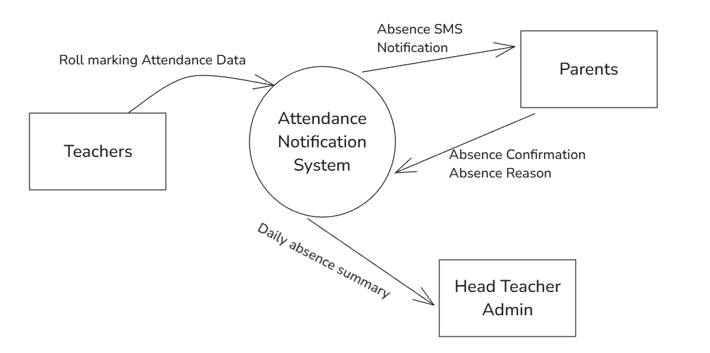
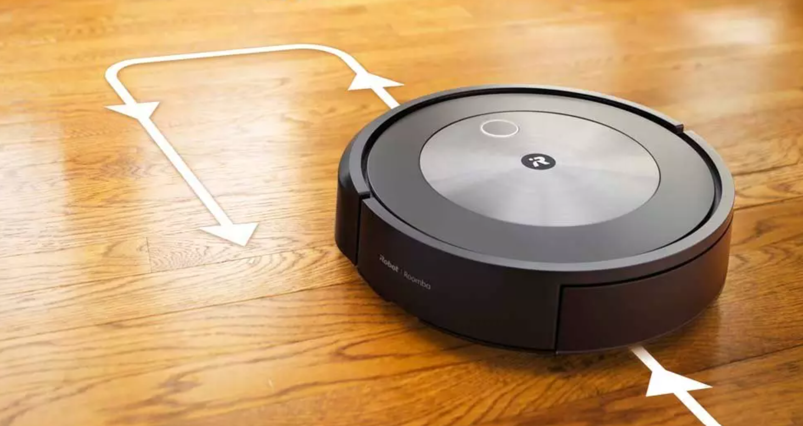
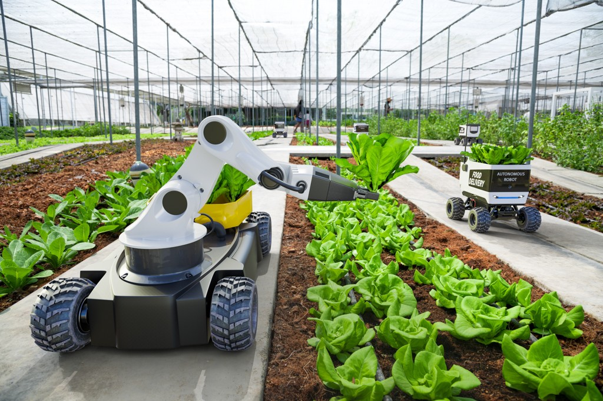
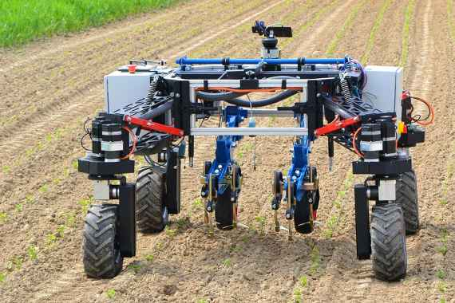

# Preliminary (Year 11) Paper

- Syllabus: Software Engineering · Publisher: –
- Status: private
- **Score: – / 60** · answered 0/25 parts · marked 0/25
- Review page: -

---

## 1. 1 - PF - Software Development (BHHS, Prelim Yearly, 2025)

**Stimulus:**

Place the steps of the software development cycle in the correct order.

#### Part A — –/2 marks  `SORTING_TABLE`

**Your answer:**

_(not answered)_

**Marking criteria:**
- [2] Correctly orders the step of the software development cycle
- [1] Partially correct order

---

## 2. 2 - OOP - Design (BHHS, Prelim Yearly, 2025)

#### Part A — –/1 marks  `MULTI_CHOICE`

Identify the code that properly accesses an engine\_sound() method in a Car class.

- **A.** porsche.engine_sound()  ✅ *correct*
- **B.** engine_sound(porsche):
- **C.** porsche = engine_sound()
- **D.** engine_sound.Car(porsche)

**Your answer:** (none) · **Correct:** A

---

## 3. 3 - PF - Modules - MC (BHHS, Prelim Yearly, 2025)

#### Part A — –/1 marks  `MULTI_CHOICE`

A key benefit of modular design is:

- **A.** More lines of code
- **B.** Fewer subroutines to run
- **C.** Enhanced real-time performance
- **D.** Easier testing, reuse, and maintenance  ✅ *correct*

**Your answer:** (none) · **Correct:** D

---

## 4. 4 - Mecha - Hardware - MC (BHHS, Prelim Yearly, 2025)

#### Part A — –/1 marks  `MULTI_CHOICE`

Which of the following is an actuator?

- **A.** Thermistor
- **B.** Rotary potentiometer
- **C.** Servo motor  ✅ *correct*
- **D.** Photodiode

**Your answer:** (none) · **Correct:** C

---

## 5. 5 - OOP - Inheritance (BHHS, Prelim Yearly, 2025)

#### Part A — –/1 marks  `MULTI_CHOICE`

What is "inheritance" in object-oriented programming?

- **A.** The process by which one class acquires the properties of another  ✅ *correct*
- **B.** Writing multiple functions in one program
- **C.** A method for sorting data
- **D.** A way to write pseudocode

**Your answer:** (none) · **Correct:** A

**Marking criteria:**
- [1] Selects the correct option

---

## 6. 6 - Mecha - Testing (BHHS, Prelim Yearly, 2025)

#### Part A — –/1 marks  `MULTI_CHOICE`

Which type of testing is used when developing mechatronic solutions.

- **A.** Black Box Testing  ✅ *correct*
- **B.** White Box Testing
- **C.** Grey Box Testing
- **D.** Peer Testing
- **E.** Proceedual Testing

**Your answer:** (none) · **Correct:** A

**Marking criteria:**
- [1] Selects the correct option

---

## 7. 7 - Mecha - Code structs (BHHS, Prelim Yearly, 2025)

#### Part A — –/2 marks  `RICH_TABLE`

Match each code snippet to its type.

| Snippet | Type |
|---|---|
| JMP | **you:** – (correct: Opcode) |
| 11001100 | **you:** – (correct: Machine Code) |
| print("Hello") | **you:** – (correct: High Level) |
| mov X0, #1 | **you:** – (correct: Assembly) |

**Marking criteria:**
- [2] Correctly matching of the code snippets to their types
- [1] Partially correct matching of the code snippets to their types

---

## 8. 8 - PF - DFD (BHHS, Prelim Yearly, 2025)

#### Part A — –/1 marks  `MULTI_CHOICE`

In a DFD, data must move into/out of a data store via:

- **A.** A process  ✅ *correct*
- **B.** Another data store
- **C.** Transmission lines
- **D.** External entities directly

**Your answer:** (none) · **Correct:** A

---

## 9. 9 - Mecha - Pico (BHHS, Prelim Yearly, 2025)

#### Part A — –/2 marks  `OBJECTIVE_RESPONSE`

Select the correct True / False options about the Raspeberry Pi Pico.

| Statement | Correct | Yours | |
|---|---|---|---|
| It has 26 GPIO pins | True | – |  |
| Runs Raspberry Pi OS | False | – |  |
| It has built-in DAC (true analog output) pins | False | – |  |
| GPIO operate at 3.3 V | True | – |  |
| Can only be programmed using MicroPython | False | – |  |

**Marking criteria:**
- [2] Correct selection of options
- [1] Patially correct selection of options

---

## 10. 10 - PF - Data Types (BHHS, Prelim Yearly, 2025)

**Stimulus:**

Select the most correct data type for the data provided.

#### Part A — –/2 marks  `RICH_TABLE`

| 2025-02-08 | **you:** – (correct: Date and Time) |
|---|---|
| TRUE | **you:** – (correct: Boolean) |
| A | **you:** – (correct: Character) |
| 1.234 | **you:** – (correct: Floating Point) |
| True | **you:** – (correct: String) |
| 7 | **you:** – (correct: Integer) |

**Marking criteria:**
- [2] Correctly selects ALL data types
- [1] Correctly selects SOME data types

---

## 11. 10bv2 - OOP - Sorting (BHHS, Prelim, 2025)

#### Part A — –/1 marks  `OBJECTIVE_RESPONSE`

Categorise the following algorithms to their Big O notation.

| Statement | Correct | Yours | |
|---|---|---|---|
| Linear Search | O(n) | – |  |
| Bubble Sort | O(n) | – |  |
| Merge Sort | O(n log n) | – |  |
| Selection Sort | O(n&sup2;) | – |  |

**Marking criteria:**
- [1] Categories the items correctly

---

## 12. 11 - PF - Pseudo (BHHS, Prelim Yearly, 2025)

**Stimulus:**

## Algorithm A

**BEGIN**  
  **READ N**  
  **READ FirstScore**  
  **MaxScore = FirstScore**  
  **FOR i = 2 TO N**  
    **READ Score**  
    **IF Score > MaxScore THEN**  
      **MaxScore = Score**  
    **ENDIF**  
  **NEXT i**  
  **DISPLAY MaxScore**  
**END**

## Algorithm B

**BEGIN**  
  **READ Score**  
  **IF Score < 0 THEN**  
    **DISPLAY "No data entered"**  
  **ELSE**  
    **MaxScore = Score**  
    **WHILE Score >= 0**  
      **READ Score**  
      **IF Score >= 0 AND Score > MaxScore THEN**  
        **MaxScore = Score**  
      **ENDIF**  
    **ENDWHILE**  
    **DISPLAY MaxScore**  
  **ENDIF**  
**END**

#### Part A — –/1 marks  `RICH_TABLE`

Which control structure is used in each algorithm?

| Algorithm A | Algorithm B |
|---|---|
| **you:** – (correct: Counted Loop) | **you:** – (correct: Pre-Test) |

**Marking criteria:**
- [1] Selects the correct options

#### Part B — –/1 marks  `MULTI_CHOICE`

Which initialisation choice prevents a logic error?

- **A.** Set MaxScore = 0 in both algorithms before any read.
- **B.** In A, set MaxScore to FirstScore; in B, set MaxScore to the first non-negative input.
- **C.** In A, read all data before setting MaxScore; in B, set MaxScore = 100.  ✅ *correct*
- **D.** Set MaxScore = -9999 in both algorithms.

**Your answer:** (none) · **Correct:** C

**Marking criteria:**
- [1] Selects the correct option

---

## 13. 12 - PF - Documentation (BHHS, Prelim Yearly, 2025)

#### Part A — –/3 marks  `OBJECTIVE_RESPONSE`

RinWar is a utility software which creates, views and unpacks archive files such as .zip.   
It gets an update 12 months after release that fixes bugs and adds features.

Which documentation actions should the team take?

| Statement | Correct | Yours | |
|---|---|---|---|
| Use vague phrases like &ldquo;various improvements&rdquo; instead of specifics. |  | – |  |
| Update the version number and release date  across documentation. |  | – |  |
| Document known issues and any workarounds for this release. |  | – |  |
| Update documentation if commands, flags, or outputs changed. |  | – |  |
| Update the user manual, help pages and screenshots to reflect the changes. |  | – |  |
| Hide security fixes so attackers won&rsquo;t notice. |  | – |  |
| Publish clear release notes with links to issues. |  | – |  |
| Announce only on social media, formal documentation is unnecessary. |  | – |  |
| Provide upgrade guidance for both users and enterprises. |  | – |  |
| Delete previous release notes to avoid confusing users. |  | – |  |

**Marking criteria:**
- [3] Selects ALL correct options
- [2] Selects most of the correct options
- [1] Selects some of the correct options

---

## 14. 13v2 - Mecha - PWM (BHHS, Prelim Yearly, 2025)

**Stimulus:**

You are programming a microcontroller to control an LED and a positional servo using Pulse Width Modulation (PWM).

Describe Pulse Width Modulation (PWM) and duty cycle.

#### Part A — –/2 marks  `SHORT`

**Your answer:**

_(not answered)_

**Marking criteria:**
- [2] Defines PWM and duty cycle
- [1] Shows some understanding

**Sample answer:**

PWM (Pulse Width Modulation) switches a digital pin on and off very quickly, this is to mimic analog. The duty cycle is the fraction of time the signal is ON during one period, usually written as a percentage.

---

## 15. 14 - PF - Lvl 0 DFD (BHHS, Prelim Yearly, 2025)

**Stimulus:**

Draw a Level 0 Data Flow Diagram for a School Absence Notification system where:

-   Teachers input attendance data during roll call
-   Parents submit absence notes via SMS
-   The system sends confirmations and daily absence summaries to Head Teacher Admin

#### Part A — –/3 marks  `DRAWING_V2`

**Your answer:**

_(not answered)_

**Marking criteria:**
- [3] Substantially correct Level 0 DFD
- [2] Partially correct Level 0 DFD
- [1] Attempts to represent the scenerio with a diagram

**Sample answer:**



---

## 16. 15 - PF - Require/Specs (BHHS, Prelim Yearly, 2025)

**Stimulus:**

Explain the difference between requirements definition and determining specifications in the software development process.

In your answer, refer to the perspectives of both the client and the developer.

#### Part A — –/4 marks  `SHORT`

**Your answer:**

_(not answered)_

**Marking criteria:**
- [4] Explains BOTH Requirements Definition and Determining Specifications, WITH BOTH perspectives referenced
- [3] Describes BOTH Requirements Definition and Determining Specifications, with a perspective referenced
- [2] Outlines BOTH Requirements Definition and Determining Specifications
- [1] Shows some understanding of the development cycle

**Sample answer:**

Requirements definition identifies the features and behaviours the client needs from the system, expressed in business terms. It focuses on what the system must achieve. For example, a requirement might be: The system must notify customers when their order is ready for pickup.

Determining specifications translates these requirements into precise technical details for developers. Specifications explain how the requirement will be met, through functional specifications (inputs, processes, outputs) and non-functional specifications (performance, usability, security). For example: The system shall use an API to send an SMS to the customer’s registered number within 5 seconds of the order status changing to ready.

In short, requirements are written for the client’s understanding, while specifications are written for developers to implement.

---

## 17. 16v2 - Mecha - pseudo (BHHS, Prelim Yearly, 2025)

**Stimulus:**

A robot vacuum cleaner utilises microswitches on it's bumpers to detect if it hits objects. 

The following functions are prebuilt into the robot's codebase.

-   MoveForward(): Moves the vacuum one step forward.
-   TurnLeft(): Turns the vacuum 30 degrees to the left.
-   TurnRight(): Turns the vacuum 30 degrees to the right.
-   CheckObstacle(): Returns TRUE if there is an obstacle (wall or furniture) in front of the robot, otherwise FALSE.

The robot will need to follow the below key instructions:

-   The robot should move forward if there is no obstacle in front of it.
-   If the robot encounters an obstacle, it will check for obstacles to it's left.
    -   If it is clear it will turn left and continue in that direction.
    -   If it is not clear, it will turn left again and check. It will do this a maximum of 4 times. After which it will turn 180 degrees, and try to move forward.



#### Part A — –/4 marks  `SHORT`

Write a pseudocode algorithm for the robot vacuum to navigate around a room. 

You are to utilise the premade functions and loops into your answer.

**Your answer:**

_(not answered)_

**Marking criteria:**
- [4] Substantially correct pseudocode algorithm which meets the scenario
- [3] Mostly correct pseudocode algorithm which meets the scenario
- [2] Partially correct pseudocode algorithm which meets the scenario
- [1] Demonstrates an attempt of an algorithm

**Sample answer:**

BEGIN ROBOVAC

\# Helper to turn left N times (N \* 30°)  
FUNCTION TurnLeftNTimes(N):  
    i := 0  
    WHILE i < N:  
        TurnLeft()  
        i := i + 1  
END FUNCTION

\# Main loop: run continuously  
WHILE TRUE:  
    IF NOT CheckObstacle():  
        MoveForward()  
    ELSE:  
        # Obstacle ahead — sweep left up to 4 times (max 120°) to find a clear path  
        turns := 0  
        path\_found := FALSE

        WHILE turns < 4 AND NOT path\_found:  
            TurnLeft()            # rotate 30° left  
            turns := turns + 1  
            IF NOT CheckObstacle():  
                MoveForward()  
                path\_found := TRUE

        IF NOT path\_found:  
            TurnLeftNTimes(6 - turns)  
END WHILE

END ROBOVAC

---

## 18. 17 - PF - E-Bike (BHHS, Prelim Yearly, 2025)

**Stimulus:**

Write a Python program that calculates the total cost of renting an e-bike. The rental shop charges $10 per hour. The program should:

-   Prompt the user to enter the number of hours they want to rent the bicycle. (Allow decimals like 1.5 hours)
-   Use a loop to ensure that the user enters a positive number of hours (i.e., greater than 0). If the user enters 0 or a negative number, prompt them to enter the number again.
-   Calculate the total cost by multiplying the number of hours by the hourly rate.
-   Display the total cost to the user.

#### Part A — –/4 marks  `CODING`

**Your answer:**

_(not answered)_

**Marking criteria:**
- [4] Substantially correct Python algorithm for the given scenario
- [3] Mostly correct Python algorithm for the given scenario
- [2] Provides a good attempt at solving the scenario
- [1] Demonstrates some understanding of Python algorithms

**Sample answer:**

hourly\_rate = 10.0  # dollars per hour 

\# Keep asking until the user enters a positive number  
while True:  
    try:  
        hours\_hired = float(input("Enter hours to hire the e-bike (e.g., 1.5): "))  
        if hours\_hired > 0:  
            break    
        else:  
            print("Please enter a number greater than 0.")  
    except ValueError:  
        print("Invalid input. Please enter a number (e.g., 2 or 1.5).")

\# Calculate and display the total cost  
total\_cost = hours\_hired \* hourly\_rate  
print(f"Total cost: ${total\_cost:.2f}")

---

## 19. 18 - Mecha - Requirements (BHHS, Prelim Yearly, 2025)

**Stimulus:**

A local ag-tech startup is building AgriCart, a battery-powered, line-following cart that moves trays of seedlings through greenhouse aisles, it utilises a mechanical arm to pick up the seedlings. 

Key components of AgriCart:

-   **Sensors**: two (2) reflective IR line sensors, one (1) front ultrasonic sensor, two (2) pressure sensor in mechanical gripper
-   **Actuators**: two DC motors for wheel movement, a micro-servo that engages a mechanical brake, and a mechanical arm with 4 Degrees of Freedom (4DOF)
-   **Proccesing**: Microcontroller to control the AgriCart, a separate Wi-Fi board for communication with the other AgriCarts and to recieve OTA updates.
-   **Constraints**: aisles are 0.8 m wide, target speed 0.6 m/s, must stop within 0.3 m of obstacles, and operate 3 hours per charge.

The AgriCart recieves OTA (over-the-air) updates on a weekly basis and will not  run without recieving it's weekly update. Farm workers share the same space as the AgriCarts.



#### Part A — –/3 marks  `SHORT`

Outline the functional and non-functional requirements for AgriCart.

**Your answer:**

_(not answered)_

**Marking criteria:**
- [3] Correctly outlines the functional and non-functional requriements of AgriCart
- [2] Identifies the functional and non-functional requriements of AgriCart
- [1] Shows some understanding of requirements

#### Part B — –/3 marks  `SHORT`

Explain the social and ethical issues related to the scenario.

**Your answer:**

_(not answered)_

**Marking criteria:**
- [3] Explanation of social and ethical issues related to the scenario
- [2] Description of social and ethical issues related to the scenario
- [1] Shows some understanding of social and ethical issues
- [null] null

**Sample answer:**

Worker safety & duty of care: Carts share the equivalent aisles with people, so a sensor or brake failure could injure workers or damage crops. Ethically, the design needs rich fail safes and procedures to stop the robot.

Security and vendor control (OTA): Requiring weekly updates to run creates dependency and the risk of downtime if an update fails or servers are unreachable. Ethically, updates must be firmly signed, tested, and changeable (rollback), with “grace periods” so operations and worker schedules aren’t disrupted.

Employment and Automation may reduce or change roles; workers should be consulted, retrained.

---

## 20. 19 - OOP - Features of OOP (BHHS, Prelim  Yearly, 2025)

**Stimulus:**

A game design studio is beginning to work on a new 2D action game. 

Explain how adopting the object-oriented paradigm (OOP) can streamline the development of the game and reduce maintenance.

In your response, include references to classes, encapsulation, and polymorphism, with examples related to a 2D game. 


#### Part A — –/5 marks  `SHORT`

**Your answer:**

_(not answered)_

**Marking criteria:**
- [5] Explanation of OOP with reference to classes, encapsulation, and polymorphism, with examples related to a 2D game.
- [4] Description of OOP with reference to classes, encapsulation, and polymorphism, with minor reference to a 2D game
- [3] Describes OOP with some reference to a 2D game OR classes/encapsulation/polymorphism
- [2] Outlines OOP features
- [1] Demonstrates some understanding of OOP

**Sample answer:**

Object-oriented programming (OOP) helps a 2D game feel organised and easier to change. We build classes for the things in the game: a base Entity class with position and sprite, then Player, Enemy, Projectile, and PowerUp that extend it.

Encapsulation means each class keeps its own data safe. For example, Player stores health and collision box privately and offers methods like takeDamage(type) or pickUp(item). Enemies hide their AI state and expose setTarget() instead of random public flags. This stops other code from breaking rules. 

Polymorphism lets the game loop treat different objects the same. We can keep a list of Entity and call update(dt) and render() on all of them easily. A Weapon can hit anything that implements IDamageable, so adding a Boss or ShieldedProjectile doesn’t change the loop.

Reusing components like Movement or Health reduces duplicate code, makes teamwork smoother, and keeps bugs contained when we add new features.

---

## 21. 20 - OOP - Classes (BHHS, Prelim Yearly, 2025)

**Stimulus:**

Design a Python class to help manage a small library.

### 1.

Create a Python class called **Book** with the following requirements:

-   It should have three attributes:
    -   title (string)
    -   author (string)
    -   is\_borrowed (boolean, default False)

### 2.

Write a method **\_\_str\_\_** that returns a string with the following format: 

**Title by Author - Borrowed/Available**

The word Borrowed should appear if the book’s is\_borrowed value is True, otherwise show Available.

### 3.

Print each book in the test data using the **\_\_str\_\_** method.

**Output example:**

**Moby-Dick by Herman Melville - Available**  
**Pride and Prejudice by Jane Austen - Borrowed**  
**The Odyssey by Homer - Available**  
**The War of the Worlds by H.G. Wells - Available**

#### Part A — –/4 marks  `CODING`

Starter code (PYTHON):
```
class Book:
    def __init__(self, title, author, is_borrowed=False):
        


# Test data
book1 = Book("Moby-Dick", "Herman Melville", False)
book2 = Book("Pride and Prejudice", "Jane Austen", True)
book3 = Book("The Odyssey", "Homer", False)
book4 = Book("The War of the Worlds", "H.G. Wells", False)
```

**Your answer:**

_(not answered)_

**Marking criteria:**
- [4] Substantially correct Python algorithm for the given scenario
- [3] Mostly correct Python algorithm for the given scenario
- [2] Provides a good attempt at solving the scenario
- [1] Demonstrates some understanding of Python algorithms

**Sample answer:**

class Book:  
    def \_\_init\_\_(self, title, author, is\_borrowed=False):  
        self.title = title  
        self.author = author  
        self.is\_borrowed = is\_borrowed

    def \_\_str\_\_(self):  
        status = "Borrowed" if self.is\_borrowed else "Available"  
        return f"{self.title} by {self.author} - {status}"

  
\# Test program  
book1 = Book("Moby-Dick", "Herman Melville", False)  
book2 = Book("Pride and Prejudice", "Jane Austen", True)  
book3 = Book("The Odyssey", "Homer", False)  
book4 = Book("The War of the Worlds", "H.G. Wells", False)

print(book1)  
print(book2)  
print(book3)  
print(book4)

---

## 22. 21 - PF - Linear Search (BHHS, Prelim Yearly, 2025)

**Stimulus:**

A school’s help desk keeps an unsorted list of open ticket IDs in a Python list:

**\[1042, 987, 1201, 773, 987, 660, 661, 501, 911, 724\]**

When a student reports their ticket number, the system needs to check whether it exists and, if so, report the index of the first match.

The team plans to implement this using a linear search.

#### Part A — –/4 marks  `SHORT`

Describe the key feautres of a linear search algorithm.

**Your answer:**

_(not answered)_

**Marking criteria:**
- [3] Good description of the features of a linear search
- [2] Outlines features of a linear search
- [1] Demonstrates some understanding of linear search

**Sample answer:**

**Answers can include:**

Sequential scan: checks each element from start to finish, one by one.

Works everywhere: simple to implement, easy to read, and applies to arrays, Python lists, or any iterable you can loop through.

No sorting required: works on any list/array in any order.

Early exit on success: stops as soon as the target is found.

Clear “not found” outcome: typically returns -1/None/False if the target isn’t present.

Duplicates handled: usually reports the first matching index it encounters.

Time complexity:

-   Best case: O(1) (target is at the first position)
-   Average/Worst case: O(n) (may check every element)

#### Part B — –/4 marks  `CODING`

Write a Python function which performs a linear search.

The function should:

1.  Loop
2.  Check if the target value exists
3.  Counts each time it checks a value
4.  Outputs if target value is / is not found
5.  Outputs the total number of checks it performs 
6.  Utilise the helper code tests given

Starter code (PYTHON):
```
def linear_search(nums, target):
  

nums = [1042, 987, 1201, 773, 987, 660, 661, 501, 911, 724]
linear_search(nums, 1201) #
linear_search(nums, 111)
linear_search(nums, 911)
```

**Your answer:**

_(not answered)_

**Marking criteria:**
- [4] Substanitally correct Python algorithm which meets all requirements.
- [3] Mostly correct Python algorithm which meets some requirements.
- [2] Produces a Python algorithm which meets some requirements.
- [1] Attempts a Python algorithm.

**Sample answer:**

def linear\_search(nums, target):  
  count = 0  
  for i, value in enumerate(nums):  
    count += 1  
    if value == target:  
      print(f"Found {target} at index {i} after {count} comparisons.")  
      return i, count  
  print(f"{target} not found after {count} comparisons.")  
  return -1, count

nums = \[1042, 987, 1201, 773, 987, 660, 661, 501, 911, 724\]  
linear\_search(nums, 1201)  
linear\_search(nums, 111)  
linear\_search(nums, 911)
